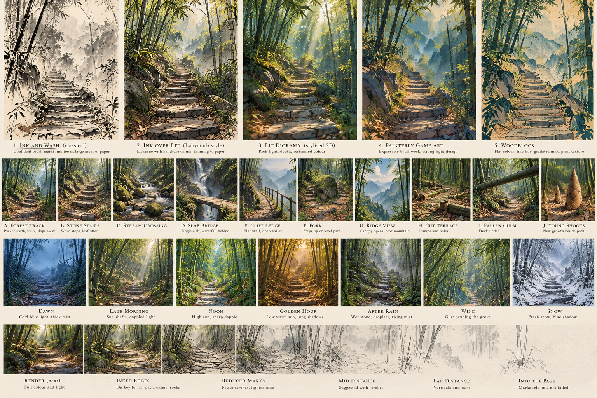
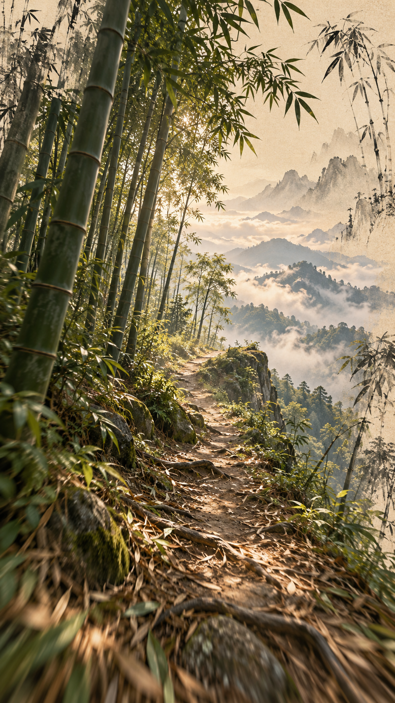
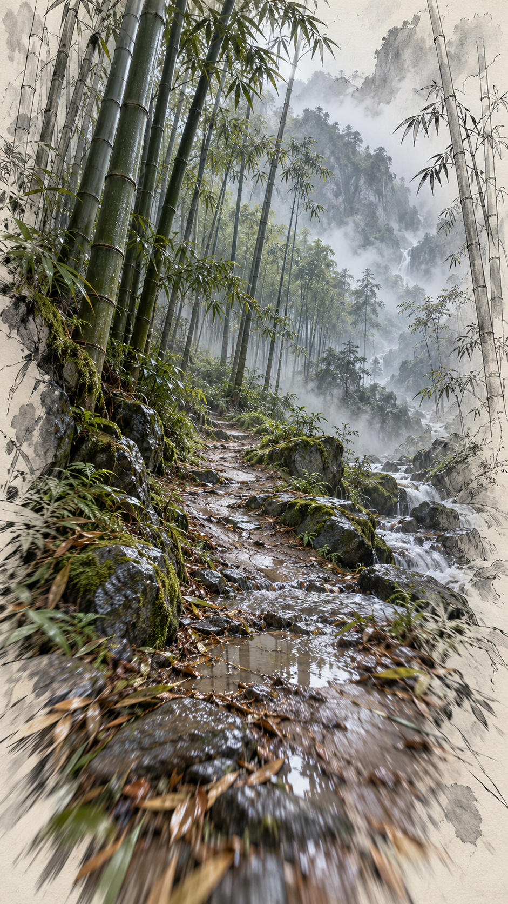
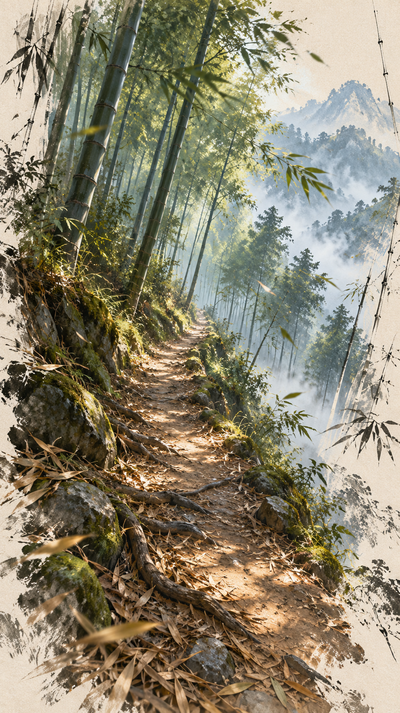
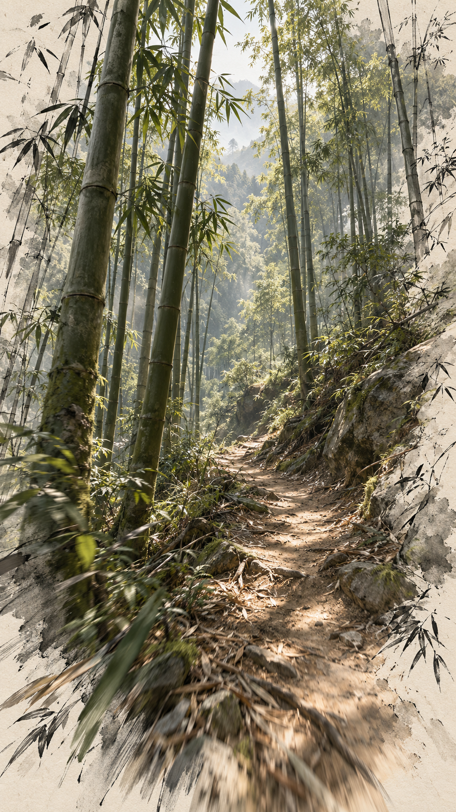

# Bamboo: paths deep through a wild mountain grove (exploration)

Not built yet. This is the idea, how it would be drawn, how it walks, and the prompts for exploring the look before we
commit to one.

## The place

A wild Chinese mountain bamboo forest (moso / 毛竹), not a garden grove. Steep slopes, mist in the hollows, the grove
growing right down to the path's edge and over it.

The ways are old and wild:
- stone stairs worn hollow and tilted, half buried in leaf litter;
- packed earth tracks with roots across them;
- a slab bridge over a stream;
- a ledge path cut along a cliff;
- a stretch of split-bamboo handrail;
- a fallen culm across the way.

Where the ways open out:
- a ridge where the canopy breaks and you see the next mountain in mist;
- a gully with a stream and mossy boulders;
- a small terrace where the bamboo has been cut, and stumps stand in rows.

There are no buildings yet. Taohua-like shrines and temples can come later, at the ends of ways.

## How it's drawn: Labyrinth's two layers

Labyrinth draws in two layers that agree with each other.

**1. A lit picture.** Scene-linear light (sun, sky, ground bounce, occlusion), one display transform, and a post pass. That
post pass draws the **outline ink** from a mask of what kind of thing each pixel is, and takes the picture back to the
page toward its edges (*drawn less, not faded*).

**2. Marks with a reason to be there** (`strokes.ts`). Ribbons laid in the world, each one called for by a feature:
- a cut's rim;
- hachures down a bank;
- bedding and fractures;
- a flight's treads and strings;
- a way's edges and joints;
- current, bank, fall and impact for water;
- branch lines for trees.

Each mark carries its **family**, its **weight**, and a seeded **pick**. Where the drawing thins (distance, its reach),
whole marks are left out, never faded. **Print** then exposes the five layers (page, under, colour, light, ink) as
sliders.

For bamboo, the same split works, and suits it better than almost anything.

### The picture (lit)

- **Culms** as GPU instances. Each is a tapered, segmented cylinder with a slight lean and curve; branches only high up.
  Thousands near, more as cards far off.
- **Wind** in the vertex shader. Each culm bends as a cantilever (offset grows with height²), driven by gusts that travel
  through the grove. You *see* a gust arrive.
- **The canopy** as a ceiling of leaf clusters. On the ground it shows mostly as moving dapple: a projected light
  pattern, not real shadows of every leaf.
- **Atmosphere** carries the depth: mist in hollows, green-grey air, shafts where the canopy breaks.
- **Ground:** the hillside, leaf litter, stone and water, from the land machinery Taohua and Labyrinth already have.

### The marks (ink)

Each is called for by a feature:

| family | from | what it draws |
|---|---|---|
| **node** | a culm's nodes | the ring at each node, a short calligraphic tick, heavier near the foot. This is what makes bamboo *bamboo* in ink |
| **culm line** | a near culm | its two contours, broken at the nodes (the classic 竹 stroke) |
| **leaf** | a branch's leaf clusters | 个 / 介 shaped strokes, the classic leaf groups, in clumps under the canopy edge and on fallen litter |
| **sheath** | a young shoot | the papery sheath's edge, sparse |
| **tread / string / edge / joint** | the ways | as Labyrinth and Taohua have them: worn nosings, stair strings, the way's edge where it's open |
| **rim / hachure** | a cut bank or ledge | the bank above the path and the drop below it |
| **current / bank / fall** | streams | as now |
| **litter** | the path's floor | a scatter of single leaf strokes, drifting thicker against steps and stones |

The picture thins with distance and with the edge of the frame: far culms go to a few grey strokes, then to the page and
the mist. That's how classical bamboo painting handles depth anyway: ink tone, darker near and paler far (浓淡).

## The walk: purposeful, not hasty, not lethargic

**Go.** Hold anywhere and you walk; let go and you slow to a stop. Steer by where you look. The camera rides the path, so
you can't walk off it. At a fork, the branch you're looking toward is the one you take.

**Pace.** About a brisk 1.4 m/s on the flat, and the path sets the rhythm:
- stairs are a stepped cadence, slower up and quicker down;
- a stream crossing makes you step stone to stone;
- a long straight in the grove eases into a stride.

No sprint. But a quick double tap at the foot of a long flight could "take it two at a time".

**Something every 10–20 seconds.** The path is composed:
- compress, then release;
- a bend that hides the next thing;
- a gust you see coming down the slope before it reaches you;
- a bird flushed off the path;
- light breaking through;
- a view out to mist and the next ridge;
- a stream heard before it's seen.

That's what keeps it from being lethargic. The walk is never empty for long, and the "go" is never slow.

**Body.** The camera stays at eye height with a slight lean into climbs. A gentle step bob in time with the footsteps,
which you hear too (stone, earth, dry leaves, a hollow board). Looking around is a drag. Upright, it looks down the path.

**Sound:**
- footsteps by surface;
- creak and knock of culms in gusts;
- leaf hiss rising with the wind;
- water louder near it;
- birds (a far cuckoo, near small birds).

**No goal, but a sense of where.** A tiny compass of the ways you've walked (Taohua's journey network). The deepest point
you've reached, and how far you are from the start, are told only by the light and the air: denser, mistier, older
stone.

## Exploring the look: image-generation prompts

How to use them:
- Run each in your generator of choice (Midjourney, Imagen, Flux, DALL·E). Make 4 or more of each.
- Pick what's right and say *why* (the light, the line, the density). We'll fold the reasons into the next round.
- Frame: phone portrait 9:16 for in-walk views, 3:2 or 16:9 for establishing views.
- The prompts are built from the base below. Swap one slot at a time so differences are attributable.

### Base

```
A narrow path climbing deep into a wild Chinese mountain bamboo forest (moso bamboo), seen at eye height from the path.
Tall straight culms crowd both sides and rise out of frame, ringed nodes clearly visible, the canopy far overhead.
[PATH]. [LIGHT]. [ATMOSPHERE]. [STYLE]. [FRAMING].
```

Avoid (append as a negative or "no …"): people, text, signage, lanterns, buildings, fences, Japanese garden, Arashiyama,
pandas, modern objects, symmetrical corridor, oversaturated green, fisheye.

### Round 1: the style axis (the most important decision)

Path, light and framing are held the same across all five. Only the style changes.

> PATH: worn stone stairs half buried in dry bamboo leaves, turning left out of sight · LIGHT: late-morning sun breaking
> through in shafts, dappled light on the steps · ATMOSPHERE: light mist further up the slope · FRAMING: vertical 9:16,
> eye height, the path leading the eye up and left

1. **Ink and wash, classical.** "Chinese ink-and-wash painting (shuimo), bamboo drawn in confident calligraphic strokes,
   nodes as short dark ticks, leaves as clustered 个-shaped brush marks, ink tones from dense black near to pale grey far,
   large areas of untouched rice paper, light colour wash on the stones only"
2. **Ink over lit** (Labyrinth's own register). "Painted 3D illustration in the style of a hand-inked architectural study:
   soft realistic light and shadow, restrained muted colour, crisp hand-drawn ink outlines on near culms and stair edges,
   ink hatching on the bank, the drawing thinning to bare paper at the edges of the frame"
3. **Lit diorama.** "Stylised 3D render, tilt-shift miniature diorama, rich soft global illumination, glossy jade-green
   culms with pale node rings, warm sunlit dapple, gentle depth of field"
4. **Painterly game art.** "Concept art for a contemplative exploration game, painterly brushwork, strong light design,
   simplified shapes, limited palette of jade, ochre and mist blue"
5. **Woodblock.** "Japanese-Chinese woodblock print, flat layered colour, fine line, gradated mist bands (bokashi), wood
   grain texture"

### Round 2: light and time (on the winning style)

Swap [LIGHT] and [ATMOSPHERE]:
- **dawn**: "cold blue light before sunrise, the first sun catching the top of the canopy only, thick mist in the
  hollows";
- **noon**: "high sun, sharp dapple on the path, bright gaps in the canopy, saturated deep greens in the shade";
- **golden hour**: "low warm sun raking across the slope between the culms, long striped shadows across the path";
- **after rain**: "overcast, wet glossy culms and dark stone, droplets falling, mist rising off the ground";
- **wind**: "a gust bending the whole grove one way, leaves streaming, motion in the canopy";
- **snow**: "fresh snow weighing the culms down into an arch over the path, blue shadow, white everywhere".

### Round 3: the ways and the moments (what the walk is made of)

Swap [PATH], keeping the winning style and light:
- "a packed earth track along the contour, roots across it, the slope falling away to the right into mist";
- "stepping stones across a shallow clear stream, mossy boulders, the bamboo leaning in over the water";
- "a single long stone slab bridge over a gully, a small waterfall behind";
- "a ledge path cut along a cliff face, split-bamboo handrail, the valley open below";
- "a fork where the path splits around a huge mossy boulder, one way up steps, one way along level ground";
- "a ridge where the canopy opens and the next mountain shows in layered mist beyond the culms";
- "a small terrace of cut bamboo stumps in rows, a pile of cut poles, the grove dense around it";
- "a fallen culm lying across the path at head height, you'd duck under it";
- "young shoots in brown papery sheaths pushing up through the litter beside the steps".

### Round 4: composition and the ink

On the winning style, test what the marks should do:
- "the nearest two culms fully inked with nodes and contours, mid-distance culms suggested by a few strokes, far culms
  only as grey verticals dissolving into paper";
- "ink only on edges that matter: stair nosings, the path's edge, node rings near the eye; everything else painted";
- "view looking straight up from the path: culms converging into a ring of leaves against bright sky".

### What to judge

- **Line:** do the culms read as bamboo at a glance? Look at the nodes, the taper and the leaf clusters.
- **Depth:** does the grove read deep without becoming a wall? Look at how tone falls off and at what's left out.
- **Path:** is it the clear figure, inviting forward?
- **Wildness:** does it read as a mountain, not a garden?
- **Drawability:** could we make it with instanced culms, wind, dapple, marks and a post pass?

## Round 1: what came back



The generator answered with **one composed sheet**, not separate images. That flattened everything toward one house
style: 2, 3 and 4 are nearly the same picture, and the moments row and the light row repeat it. So the sheet shows us
less than it looks like it does. Next round, make **one image per prompt**.

**What's worth keeping:**
- **The bottom strip** (render → inked edges → reduced marks → mid → far → into the page). It is our drawing model as a
  picture, and the most useful thing on the sheet. Its third and fourth panels, colour giving way to marks, are closest to
  a golden target.
- **1, ink and wash:** the page, the ink tone falling off with depth, the mist as empty paper. Right for the far field.
- **5, woodblock:** the only style with its own palette (teal, ochre, cream). Worth one more look as a colour key.
- **Moments:** E (cliff ledge with rail), G (ridge view), I (fallen culm), J (young shoots), Dawn, After rain, Snow.

**What's wrong across all of it:**
- **Not moso.** The culms are thin, few and grassy, with leafy undergrowth at eye level, so it reads as a generic leafy
  forest. A moso grove is thick, smooth, pale culms (powder-white just below each node), close and countless, branching
  only high up, with a fairly *open* floor of litter between them. The verticals should be the subject.
- **One composition.** Centred stairs vanishing up the middle, symmetric walls, in every panel. We asked for a turn out of
  sight and never got it.
- **No visible ink** in "ink over lit" (2). It's a painting; nothing is drawn. The target needs lines you can see: node
  rings, culm contours, stair nosings, the path's edge.
- **Wind** doesn't read (static). **Golden hour** is an orange filter. **D's** waterfall is a cliché, and its bridge is
  planks, not a slab.

## Round 2: aim at the strip, fix the grove

One image per prompt, 9:16 portrait unless noted, four or more variations each. The style line in all of them is the
strip's middle panels:

```
STYLE: hand-inked illustration over soft realistic light: crisp dark ink lines on the near bamboo (both contours, broken
at every node, a short dark tick at each node ring) and on the stair nosings and the path's edge; restrained colour
(jade, pale celadon, ochre litter, grey stone) held near the path; further away the colour drains, the bamboo becomes a
few grey ink verticals, then bare cream rice paper and mist at the edges of the frame
GROVE: a dense wild moso bamboo forest on a steep mountain slope: thick smooth pale-green culms 10 to 15 cm across,
a band of white powder just below each node, hundreds of them close together and receding, no branches below 6 m,
an open floor of dry fallen bamboo leaves between them, almost no undergrowth
AVOID: thin bamboo, leafy shrubs at eye level, ferns, centred symmetric corridor, path vanishing up the middle, people,
buildings, lanterns, fences, text, Japanese garden
```

**2A, the golden-target attempt.** "[GROVE]. Eye height on worn stone stairs that climb steeply and turn right behind a
mossy boulder, the top of the flight out of sight; the culms on the left lean slightly over the path. Late-morning sun in
narrow shafts, dapple on the steps. [STYLE]."

**2B, asymmetric contour track.** "[GROVE]. A packed earth path running across the slope along the contour, the hillside
rising steeply on the left, falling away on the right into mist between the culms, roots crossing the path. [STYLE]."

**2C, density test (three images).** 2A with the grove at three densities: "culms 1 m apart, a fence of verticals you see
far between" / "culms 40 cm apart, a wall" / "a clear gap of 3 m either side of the path, then dense".

**2D, the ink's reach (landscape 3:2).** "[GROVE], [STYLE]. The colour and the full ink only within a few metres of the
path in the centre of the image, the drawing becoming fewer marks toward the left and right edges and ending in bare
paper; whole bamboo left out at the edges, not faded."

**2E, looking up.** "[GROVE], [STYLE]. Straight up from the path: culms converging, nodes inked, a ring of feathery leaf
clusters (个-shaped brush strokes) against a bright pale sky."

**2F, the gust.** "[GROVE], [STYLE]. A gust coming down the slope: the culms on the upper left bent hard over, those near
still upright, leaves streaming in brush strokes, a wave of motion travelling through the grove toward the viewer."

**2G, colour key (woodblock palette).** 2A with "palette of deep teal, jade, ochre and cream, flat layered colour with
gradated mist bands" in place of restrained colour.

**2H, after rain.** 2A with "overcast after rain, culms wet and darker, stone glossy, mist rising off the ground, no
sun".

What we're looking for:
- a single picture where bamboo reads as moso at a glance;
- ink you can see on the near things;
- the path turning off-centre;
- the frame ending in page.

That picture becomes the target we judge the renders against, like the coast's boards.

## Round 2: what came back

| a. ledge, sun over a sea of cloud | b. after rain, stream | c. ledge, mist valley | d. the grove |
|---|---|---|---|
|  |  |  |  |

A big step. All four are off-centre, wild, mountain, and end in paper. **c is the provisional target**, with **d as the
reference for the grove itself**.

- **c:** the best balance.
  - The path runs along the contour with the bank rising on the left and the valley falling away to mist on the right:
    the walk's own shape, compress and release in one frame.
  - The dapple and litter are right, and the page comes in at the frame's edge with dry brush.
  - The culms are still on the thin side.
- **d:** the closest to moso.
  - Thick culms, node rings you can read at a glance, a rock bank, an open-ish floor, real height.
  - But it's enclosed: no view, nothing to walk toward except more grove. That's the "deep in" stretch between releases.
- **a:** the light and the reward.
  - Low sun through the culms and a sea of cloud with karst peaks.
  - It's the moment a ridge path opens out, not the everyday frame.
  - The paper fills the sky, but nothing is inked.
- **b:** the weather and the water.
  - The wet stone, the puddle reflecting, and the stream beside the path are all good.
  - It's the busiest; too much detail everywhere for us to draw well.

**The gap all four share:**
- **The ink is a border, not marks.** The paper and brush come in as a vignette round a photograph. Inside the picture
  nothing is drawn: no node ticks, no culm contours, no edge to the path. The only inking is a few decorative bamboo
  sprays painted on the paper margin.
  - Our drawing does both. The frame's edge going to page (cheap, and right) is one half.
  - Marks that belong to things, getting fewer with distance, are the other half.
- **The motion-blur smear** at the bottom of b, c and d is the generator imitating a brush. Not something to copy: our
  near ground should be the sharpest, most drawn thing in the frame.
- **The culms are still too thin** except in d.

## Round 3: put the ink inside c

Same image each time, c's composition, with the ink stated as marks. 9:16, one per prompt:

```
BASE: eye height on a narrow earth path along the contour of a steep mountain slope in a wild moso bamboo forest; the
bank rising on the left with thick pale-green culms (12 cm across, white powder band below each node) crowding up it
and leaning slightly over the path; on the right the slope falls away between sparser culms to a valley filled with
mist, distant forested ridges; dry bamboo leaves and roots across the path; late-morning sun in dapple
INK: drawn as a hand-inked illustration over soft light: every near culm outlined in fine dark ink, its contour broken
at each node with a short dark brush tick at the node ring; the path's edges and the roots drawn in ink; mid-distance
culms only as a few ink lines; far ridges as pale ink wash; the image ends in bare cream paper with dry-brush edges at
the frame; the nearest ground is the sharpest, most detailed part
AVOID: motion blur, smeared foreground, thin bamboo, leafy shrubs, people, buildings, text, decorative bamboo painted in
the margins
```

- **3A** = BASE + INK.
- **3B** = 3A, with "the ink heavier: like a pen-and-wash architectural sketch, colour only on the path and the near
  culms".
- **3C** = 3A, with "the ink lighter: only node ticks and the path's edge are drawn, everything else painted".
- **3D** = 3A at dusk: "low warm sun from behind the bank, the mist below lit gold, long shadows of culms across the
  path".
- **3E** = d's grove in the same INK, as the "deep in" frame: "BASE without the valley: the slope rising on both
  sides, the path climbing into dense culms, a single shaft of light ahead".

**Pick:** the one whose ink you'd want to see *move* (the lines staying on the culms as you walk past them). That's the
test for marks laid in the world.

## Round 3: the target board


The ink came inside the picture. Three of the eight are targets, and three more are references for one thing each.

- **Target A, the near frame** (`r3-8-lit-stairs.png`). Real light, with ink drawn on it:
  - culm contours, a dark tick at each node;
  - stone steps and the boulder outlined;
  - litter as warm strokes;
  - paper coming in at the top corners.

  This is Labyrinth's register exactly, a lit picture plus marks, and the frame most of the walk should look like.
- **Target B, how it thins** (`r3-5-ink-path.png`). The near culms are fully drawn: dry-brush body, black at the nodes,
  broken contours. The colour is held to the path's litter. The far side goes to a few verticals, then pale ridges, then
  the page. That's our *reach*, and the thinning has to look like this, not like fog.
- **Target C, the walk** (`r3-6-contour-valley.png`). The contour path, dense moso climbing the bank on one side, and the
  valley opening between sparser culms on the other. This density and this rhythm of verticals is the grove we build. The
  ink is lighter here: the node rings are white bands rather than ticks.
- **Ref, the culm** (`r3-4-looking-up.png`). How one culm is drawn up close: the dry-brush streak down its body, darkest
  just under a node, a crisp curved ring, ink pooling at the foot.
- **Ref, the gust** (`r3-3-gust.png`). The upper grove bent over, leaves streaming across the light, the near culms still.
- **Ref, an alternative palette** (`r3-2-teal-stairs.png`). Teal, ochre and cream, flat-layered. Kept for a weather or
  time preset, not the default.

Left aside:
- `r3-1-rain-stairs.png`: busy, and the carved calligraphy is the generator's invention. Carved characters on old culms
  are real, though; a later detail.
- `r3-7-ledge-roots.png`: round 2's photograph with a brushed border again.

### The drawing, read off the board

| thing | picture (lit) | marks (ink) |
|---|---|---|
| **culm** | pale celadon to olive, lighter where lit, with long dry-brush streaks down it; a pale powder band just under each node; darker and greener low down | its two contours, broken just under each node; a short dark tick (curved, following the ring) at every node, heaviest near the eye; ink pooled at the foot where it meets litter |
| **canopy** | a high ceiling of leaf mass, lit yellow-green against the light; dapple on everything below | 个/介 leaf clusters in dark ink where sprays hang into view, only near |
| **litter** | warm ochre and tan, the brightest colour in the frame, deepest along the path | single tapered leaf strokes scattered over it, thicker against steps, roots and stones |
| **path** | packed earth, paler in its worn middle; stone steps grey-green with moss in the joints | the path's edge where it's open; step nosings; roots across it |
| **stone** | grey with olive moss, a cool shadow side | contour, heavier on the shadow side; a crack or two |
| **far** | colour drains to grey-green, then the mist is the paper itself | fewer and fewer verticals, each still dark at its nodes; whole culms left out, never faded |
| **page** | cream (about #EFE6D2), slightly toothy | where the reach ends: the top of the frame (the sky is page), and the open side of the slope |

The page comes in where nothing's there (sky, mist, the open side), not as a brushed border all round. That's the one
thing to take from B and A rather than from the round-2 vignettes.

## Open questions after the image rounds

- How much colour against how much page.
- Whether culms are inked by contour (post pass) or by marks (node ticks and broken lines), or both.
- How dense the grove is near the path: a wall, or a fence of verticals you see between?
- The first slice: one path of a few hundred metres up a slope, with one stream crossing, one fork, one view out and one
  gust event, plus fixed `?ref=` views to judge it by.
