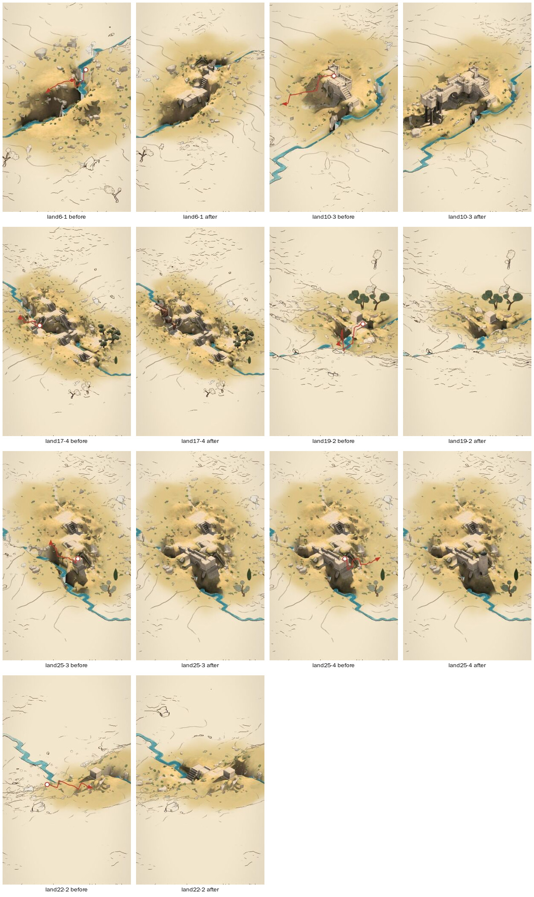

# Labyrinth: blind intent rounds on the continuous hillside (land-001)

Three rounds and 25 gestures, on seven land seeds no earlier review had seen (set 3: lands 6, 10, 14, 17, 19, 22, 25). All were captured with the browser harness against the stage-23 build. Each land is a run of three or four gestures, so later gestures are made on what the earlier ones built. Seven of the gestures were made in Mass mode; the other 18 used the default mode.

## Method

**Reviewers.** Each round was judged by a fresh reviewer told only that this is "a touch-driven toy that builds stone on a landscape". It was told not to read the source, docs, or `sealed/`. For each gesture it worked in this order:
1. Wrote hypotheses and observable success criteria from the before image and before.json alone, then locked them (`expect`).
2. Revealed the result.
3. Judged from the after image first. Only after that did it look at the result's user-visible fields: the hint after release, the alternatives offered, and any declines.

**Critique fields.** The critique gained a `scene` block of axes for comparing gestures and rounds: location honoured, endpoints honoured, coherence (0–3), surprise, the hand's likely next move, and the disconnect as a phrase in the reviewer's own words.

**Pooling.** The pooled dataset is `land-001-dataset.json`. It joins each locked expectation and critique with the sealed diagnostics: the operations and their readings, liberties taken, `reached`, the hint during the stroke and the alternatives. The full review directories are in `land-001.tar.gz`.

**Analysis.** Causes below are marked **verified** only where I reproduced them against the source after the reviews were locked. Everything else is a hypothesis.

## Headline

| | n | fulfilled | acceptable alt. | partial | misread |
|---|---|---|---|---|---|
| all | 25 | 9 | 5 | 8 | 3 |
| taps (on ground or a top) | 6 | 5 | 0 | 1 | 0 |
| sweeps | 7 | 3 | 2 | 1 | 1 |
| strokes from a built top | 7 | **0** | 2 | 3 | 2 |
| pause strokes | 3 | 1 | 0 | 2 | 0 |
| meanders | 2 | 0 | 1 | 1 | 0 |

- **Location:** honoured in 16 cases and partly in 9; it was never wholly wrong.
- **Endpoints:** fully honoured in only 7 of the 19 strokes.
- **Coherence:** mostly 2 (18 cases), with 4 at 3 and 3 at 1.
- **The hand's next move:** build on it 9, keep it 8, look for an alternative 4, undo and retry 4.
- **Surprise:** unwelcome 7, welcome 4.

**Taps are reliable.** Every tap acted where the finger touched.

**Construction lands in roughly the right place.** Location was never wholly wrong.

**What the stroke means is the weak part:** its shape, its heights, its far end, and above all strokes that begin on something already built.

## Disconnects, by frequency and severity

### 1. The hint while drawing contradicts what release builds (10 of 19 strokes)

**What reviewers saw.** In 10 of the 19 strokes the hint said "nothing to lay along that · hold to a row of olives", or "a walkway would add nothing that isn't there", for the whole stroke. Release then built a way, a wall or a walkway in all 10. Reviewers in all three rounds raised this independently. One said a player would "learn to ignore the hint, or let go expecting nothing".

**Cases:** land6-2, 6-3, 10-3, 14-3, 17-2, 17-3, 17-4, 19-4, 22-2, 25-2.

**Possible cause (hypothesis).** The reading computed during the stroke isn't the one made on release; it seems to be judged against a different context. This matches the still-open task "intent round 2: fix context loss".

**Why it matters.** It's the cheapest kind of trust to lose: the toy tells the hand one thing and does another, every time.

### 2. Strokes that begin on a built top: 0 of 7 fulfilled

This is where every misread but one sits, along with most undo-and-retry responses. The stroke's reading gets swapped for another:

- **wall-instead (2).**
  - land6-3: reaching out from a platform became an arcaded rampart.
  - land17-4: reaching out from a terrace became "a gated wall", a tall block.
- **tower-instead (1).** land25-4: a long eastward walkway became a stair tower at the start, and the far end was dropped.
- **Walkway kept at the start's height when the stroke descends.** land10-3: a stepped stroke down to low ground became a level walkway on stilts ending in a parapet mid-air. Diagnostics report `reached: true`, because the walkway is over the target column even though it is three levels above it.
- **Stops short.** land19-3: the walkway ran about half the stroke (`reached: false`).
- **Destructive: lowered instead of built.** land19-2, Mass mode: the stroke ran from a top across the stream, and the toy "lowered 2 courses, all that's selected (5 across)", knocking down blocks built a gesture earlier.
  - **Verified cause.** In Mass mode, a stroke from a top that runs mostly up or down the screen is read as raising or lowering. The tops it brushed over become its scope (`main.ts` around line 572). This stroke ran across the land, but at this camera angle (turn 3) it ran down the screen. Whether a gesture builds or demolishes therefore depends on how the view is turned.

### 3. Water: crossings don't read as crossings, and the stream disappears (7 cases)

**What reviewers saw.** No stroke over water gave a light bridge. They got:
- steps down into the stream (land6-1);
- a landing stage (land6-2, land14-3);
- a heavy brick causeway (land22-4);
- a dam-like walled causeway that hid the gorge (land25-3).

A bridge existed only as a held alternative (land25-3: "… a bridge of 1"). Streams and pools near construction partly vanished, even after a single tap (land6-1, 6-2, 14-1, 14-3).

**Verified cause of the vanishing: a regression from stage 21's terrain.** A stream cell is never a bench, but `groundAt` blends it toward any benched neighbour. Toward a higher bench the blend is the gentle, wide fill, so the channel is filled up to the bench's level.
- land6-1: one way buried 99 of the 232 points along the stream's course; the stream was clear before.
- land14-1: a single block buried 20.

This isn't an intent error, but it corrupted the intent reading: reviewers reasonably read "steps into the stream and the water vanished" as the toy's answer to a crossing.

### 4. The stroke's shape and its far end aren't kept (12 of 19 strokes with endpoints honoured only partly or not)

**What reviewers saw:**
- **Straightened:** meanders and right-angled routes came out straight (land6-2, 17-2).
- **Moved:** routes shifted 30–40 px up the slope or to firmer ground (land22-2), or went "round what's in the way" (`routed-round` twice).
- **Overran:** carried past the finger's end to a nearby building. Reviewers judged this welcome (land25-2).
- **Underran:** stopped halfway (land19-3).

"As drawn" was offered as an alternative in only 3 cases. So a hand that meant its line mostly has no one-touch way back to it.

### 5. What was made is hard to see (most rounds)

- **The view moves.** It reframes after release, and the coloured region follows the latest build. Ground that was coloured goes to drawing, so reviewers couldn't tell new from old (land6-1, 6-2, 14-1, 17-*, 25-2).
- **Paving is faint.** "A way: 3 paved" read as a pale smudge (land17-1; its `reached` cells list is empty).
- **Labels promise more than the picture shows.** "A gated wall" twice with no gate visible (land17-4, land19-1).
- **The hint is often gone.** After release it had often faded or reverted to the generic text by the time the after picture settled. A player who looks a moment late doesn't see what was read, or that alternatives exist.

### 6. Scale and side effects

- **Elaboration far beyond the gesture.** One stroke down from a block grew a hilltop fort with keep, terrace, arch and grand stair (land10-2). Coherence 3, judged welcome, but hard to predict.
- **Stilts.** A tap on steep ground gives a block on a tall stilt (land25-1).
- **Taps reshape their neighbours.** A tap buried the top of an adjacent outcrop (land10-1). The drained pool (land14-1) is cause 3.

## What works

- **Taps:** 5 of 6 fulfilled, and every tap acted where the finger touched.
- **A sweep from a place down to water or to a landmark** reads as convincing stonework: steps, landings and paving at the right heights (land22-2, 25-2, 17-3, coherence 3).

## Patterns across the axes

- **Every misread is a stroke**, and 2 of the 3 begin on a built top. Taps never misread.
- **Mass mode** produced 2 of the 3 misreads in 7 gestures. One of them is the destructive lower.
- **Every undo-and-retry** is either a destructive or wrong-kind substitution (land17-4, land19-2), a dropped descent (land10-3), or a result too faint to see (land17-1).

## Limitations

- **Sample.** 25 gestures from a random generator, so these counts are indicative, not rates.
- **Input.** Synthetic input at DPR 1, not an iPhone: strokes are dispatched in the page and taps by mouse.
- **Speed.** Construction is instant and cats are off.
- **Zoom.** At 0.62 the land is small on the screen, and reviewers often hedged on detail.
- **Reviewers.** Model reviewers, one per round, so judgments within a round aren't independent. They are implementation-naive, not naive users.
- **Process slips, disclosed in their critiques.**
  - r1 land6-3: the user-visible text was seen a moment before the after image.
  - r2 and r3: in places they used the event-log hint during the stroke or `op.alts`. Each such use is labelled as diagnostic.
- **The hint in the after picture** is affected by screenshot timing, so finding 5's last point is partly a harness artefact.

## Next experiments (no fixes made in this pass)

1. **Re-run this battery** after any change to items 1–3. The same seeds and gestures replay exactly, and the replay data is in `sealed/`.
2. **A targeted set of strokes from built tops**: up, down, level, across water, and screen-vertical at each of the four camera turns. Finding 2 is the weakest class, and its destructive case depends on the view.
3. **Crossings set:** short, long and diagonal strokes over a stream, scored on whether a crossing is visible and the water is kept.
4. **Capture the hint during the stroke and at release** into the before/after packet as visible UI, so feedback agreement (finding 1) is scored from the scene, not the event log.
