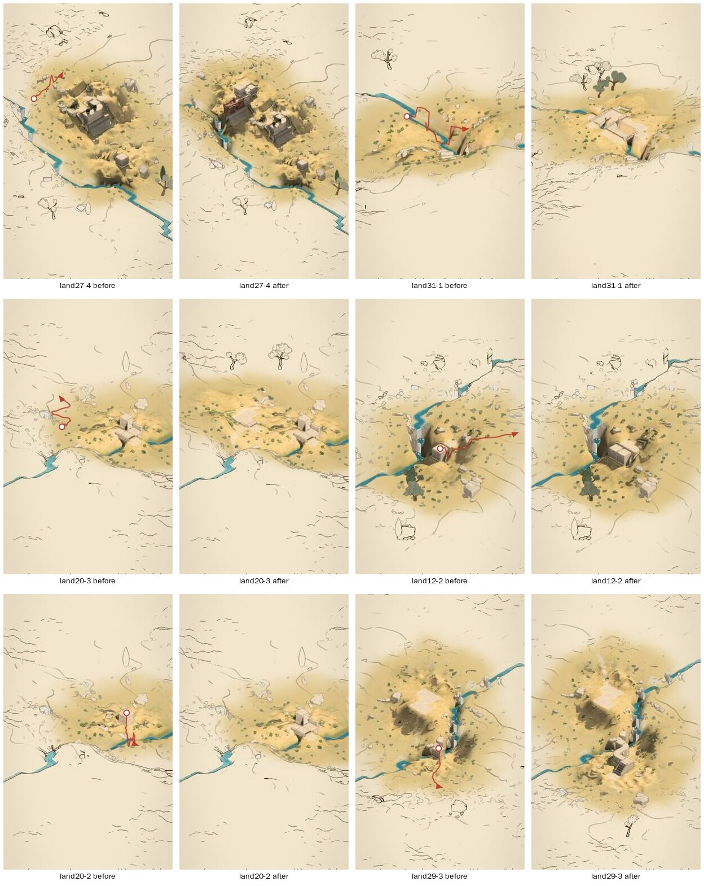

# Labyrinth: blind intent rounds 4–6, after the first fixes (land-002)

Three more rounds and 25 more gestures, on seven more unseen lands (set 4: lands 7, 12, 20, 23, 27, 29, 31). They were captured after the two fixes that land-001 verified:
- the stream is kept open beside a bench;
- a stroke lowers only while the finger is still on the stone.

The method is unchanged (see [land-001](land-001.md)): a fresh implementation-naive reviewer for each round, expectations locked before the reveal, and the after image judged before any diagnostics. One addition: reviewers were told that `during.hint`, the hint text under the finger just before release, is visible UI. Before, they had to infer it.

**Files:**
- `land-002-dataset.json`: the pooled data.
- `land-002/`: one archive per round and land. Images are recompressed. The review folders' image copies and the reviewers' own zoomed crops are left out.

## Did the fixes hold?

Yes, and narrowly:
- **Lowering.** No lowering was read in any of the 25 gestures.
- **The stream.** It is never buried in any after-world: 0 points along its course in all 25.
- **Replay of set 3.** Replaying all 25 of set 3's gestures against the fixed build changes only land19-2, from the destructive lower to a walkway. The replay tool is `labyrinth-intent-replay.mjs`.

## Set 3 against set 4

| | set 3 (before fixes) | set 4 (after) |
|---|---|---|
| all | 9 F · 5 A · 8 P · 3 M (n 25) | 14 F · 5 A · 5 P · 1 M (n 25) |
| taps | 5 F · 1 P (n 6) | 10 F · 1 A (n 11) |
| strokes | 4 F · 5 A · 7 P · 3 M (n 19) | 4 F · 4 A · 5 P · 1 M (n 14) |
| strokes from a built top | 0 F · 2 A · 3 P · 2 M (n 7) | 1 F · 1 A · 2 P (n 4) |
| stroke endpoints yes/partly/no | 7 / 11 / 1 | 4 / 7 / 3 |
| mean coherence (strokes / taps) | 2.00 / 2.17 | 1.79 / 2.09 |
| undo-and-retry | 4 | 5 |

F = fulfilled, A = acceptable alternative, P = partial, M = misread.

**The headline improved mostly because the generator drew more taps this time** (11 against 6). Stroke results are about where they were: 4 fulfilled out of 14, against 4 out of 19. Misreads fell from 3 to 1, and one of the two removed misreads was the defect fixed. Read the rest as patterns, not rates.

## Findings across both sets (50 gestures)

### 1. The hint under the finger contradicts the result (18 of 33 strokes)

**What reviewers saw.** In 18 of 33 strokes the hint said "nothing to lay along that · hold to a row of olives", or "… would add nothing that isn't there", while the finger was down. Release then built something in all 18. Reviewers in every round raised it independently.

**Verified in the source** (`main.ts` around line 615). While drawing, a reading only reaches the hint line if it's a refusal: `if (refused && refused !== g.said) say(...)`.
- The first moves of any stroke are too short to lay anything, so they are refused, and that text goes up.
- When the stroke grows into a valid way or wall, nothing replaces the text.
- It stays for `say`'s 2.6 s timeout, which covers the whole of a typical stroke.

So this is a stale refusal, not a misreading, and the earlier guess of context loss was wrong.

**Related.** After a tap on a top the hint line went blank (land23-4, land29-4). After plain taps it showed the generic instructions; no tap was ever named.

### 2. A stroke from a built top becomes a level walkway, whatever its end's height (5 of 11 strokes from tops)

| Case | Stroke | What it became |
|---|---|---|
| land10-3 | down from height 4 to 1 | level walkway ending mid-air |
| land20-2 | down to the water | level walkway over it; the stair down only an alternative |
| land12-2 | up from 2 to 3 | stopped after 1 cell |
| land27-2 | up from 3 to 4 | stopped after 3 cells |
| land19-3 | level | stopped halfway |

- **Diagnostics:** the three stopped walkways report `reached: false`.
- **What the toy said:** only "a walkway". The "it joins the stone it meets on the way" message is never shown, because it is gated on `connect.to`.
- **The other substitutions from tops:** in set 3, wall-instead twice and tower-instead once.
- **The one stroke from a top that went down as drawn:** land29-3, "going down 1 level". It was judged fulfilled with coherence 3.

### 3. Strokes come out heavier and straighter than the line

- **Heavy:** footpaths became raised causeways or blocky paved patches (land23-1, 29-1, 31-1), and a short climbing line became an arcaded wall cluster (land27-4, Mass mode).
- **Straightened or shortened:** zigzags and switchbacks were straightened (land7-1, 31-1) or collapsed to a 2-cell patch at the start (land20-3, reported as `reached` with 1 cell).
- **Crossings:** strokes over water still give heavy decks or causeways. A light bridge appeared once (land7-3, "a bridge of 1") and was judged acceptable.
- **"As drawn":** offered as an alternative only 3 times in 33 strokes.

### 4. The labels promise what the picture doesn't show

- "A gated wall" with no visible gate (land17-4, land19-1).
- "A walk all the way round" that read as a solid forecourt (land23-3).
- "A walkway" that barely leaves its block (land12-2, land27-2).
- A pause acknowledged as "a gate here, or a landing", then neither built (land31-2).
- A tap moved beside a stair's way: the explanation was in the diagnostics but not on screen when the reviewer looked (land31-4, `moved-beside`). This is the liberty the external review flagged.

### 5. The scene changes around the build

- **The camera** reframes or zooms after most builds, so the new stone isn't under the finger. All six rounds reported it.
- **The coloured region** follows the latest build, so ground that was coloured fades to drawing and the land "grows".
- **Natural features vanish:** boulders inside an enclosure, outcrops beside a new block, crest rocks (land12-3, 20-1, 31-3).
  - **Likely cause (from the source, not run):** the stage 22–23 scatter clears rocks and scrub round anything built, and places outcrops by local steepness. Both change when a bench is let in.

## What works

- **Taps:** 15 of 17 fulfilled across both sets, and every one acted at the finger. One rose about 25 px off, beside a stair's way, and was judged an acceptable alternative.
- **Building on what's there:** a stair down off a block, a gate raised on a walkway, a way from a place to the water. These were the most coherent results (coherence 3).

## Limitations

- **The random generator** drew different mixes in the two sets, so compare classes, not totals.
- **Input:** synthetic input at DPR 1, construction instant, cats off.
- **Reviewers:** model reviewers, one per round. Two minor process slips are disclosed in their critiques: text fields glimpsed before the after image in land23-4 and land31-3; both fields were uninformative.
- **Hint in the after picture:** screenshot timing still affects whether it's visible. Finding 1 rests on `during.hint`, not the after picture.

## Next (no fixes in this pass)

The candidates the data supports, most direct first:
1. **The stale hint** (finding 1): a defect, verified in the source.
2. **Strokes from a top that end at another height** (finding 2): read as a way down or up rather than a level walkway, or at least say when the walkway stops short.
3. **Name every tap and every liberty on screen:** the blank hints, and `moved-beside`.
4. **The view:** hold it still after a build, or make its move legible.

Findings 3 and 4 are about the interpretation vocabulary (weight, shape, labels). They need design decisions, not defect fixes.
