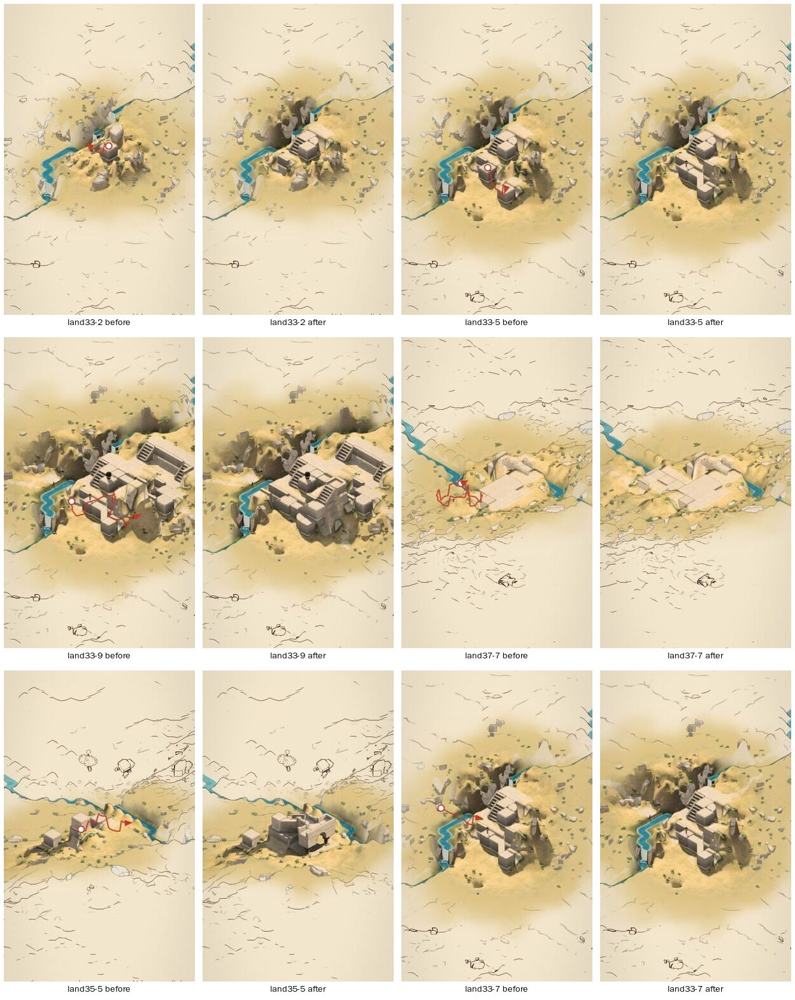

# Labyrinth: intent-first rounds, after acting on critique-001 (land-003)

## What changed before these rounds

Acted on [critique-001](critique-001.md) and deployed:

**Confounds removed:**
- The hint under the finger says what the stroke reads as now, not only refusals.
- Any way that stops short says so.
- Every tap is named.
- The hill is held within a quarter level of each column's level over its middle. It had been up to 1.1 levels off.
- `?held` keeps the camera still for captures.

**Design calls:**
- A stroke from a top that ends over ground at another height goes to that height, up or down, in either intent.
- One planting among the alternatives, not two.
- "As drawn, every turn kept" is offered when a reading smooths a stroke's jogs away.

**Method:** capture set 5 is intent-first.
- **Authored gestures.** On each land, nine gestures are drawn from the land's own features for intents written down beforehand and sealed: raise a block; a way down from it to the water; two blocks and a walkway joining their tops; a path up the slope; a way across the stream; a walled yard; a winding path that keeps its zigzags.
- **Blind first.** A fresh, implementation-naive reviewer reads each gesture blind and critiques the result against their own reading, as before.
- **Then the written intent.** With the critique locked, the reviewer is shown the written intent and answers two separate questions:
  - **Legibility:** did my reading recover it?
  - **Interpretation:** what did the toy make of *it*?

**Scale:** 32 gestures on four unseen lands (33, 35, 37, 39). Three recipes found no place and were skipped. Land 33 had a second, independent reviewer.

**Files:**
- `land-003-dataset.json`: the pooled data.
- `land-003/`: per-land archives. Land 33 is split in two to fit the cell, with the second review separate.

## Reliability

On land 33, two reviewers judged the toy against the **written** intent the same way **9 times out of 9**. That's against 14/17 when each judged against their own imputed intent (critique-001). They agreed 6/9 on whether the gesture had said it.

The written intent is the steadier yardstick, as the critique predicted. Interpretation results below are against it.

## Legibility: purposeful gestures mostly say what they mean

The reviewer's own preferred reading recovered the written intent in **19 of 32** gestures, partly in 10, and missed it in 3.

The misses and most partials trace to the gesture, not the reader:

| Case | Cause |
|---|---|
| land35-2 | My recipe chose a bank one cell from the block, so the "way down to the water" was a rub. |
| land37-6 | The stream crossing was hidden behind earlier construction. |
| land39-5 | The stream had been buried visually by an earlier fortress. |
| pair-b taps | The "to be joined" purpose of a tap is invisible until the joining stroke. That's expected. |

## Interpretation: what the toy made of the written intent

| Recipe | Against the written intent |
|---|---|
| raise a block (tap) | 4/4 fulfilled |
| pair of blocks (taps) | 7/8 fulfilled. land37-4 rose to a cliff top, not the first block's level. |
| walkway joining two tops | 1/1 fulfilled |
| way down to the water | 1/3: one fulfilled, one no-effect (the recipe flaw), one destructive lower (below) |
| way across the stream | 1/4: one fulfilled; two stop at the water ("trimmed", a landing); one misread |
| path up the slope | **0/4**: always partial; flattened, routed round, or a rampart from a top |
| walled yard (loop) | **0/4** good, one acceptable alternative: a raised walk-round, a deck on a tower, a quay, a walkway ring |
| winding path keeping its zigzags | **0/4**: three misread, one partial; smoothed every time |

**Taps:** 11 of 12 good. **Strokes:** **4 of 20**. The strokes are the gap.

### What the strokes show

**Shape is discarded by default.**
- **Smoothing:** every winding path and most climbs carry the `smoothed` liberty: their zigzags are run straight.
- **Recovery:** "as drawn" is now offered in 9 of these strokes; it was offered 3 times in all 33 strokes before. So the recovery exists, but the default throws the shape away, even where the zigzag is 1.3 cells wide and plainly meant.
- **What reviewers said:** "the thing I actually drew is buried in the hold-at-the-end alternatives."

**A closed loop isn't read as enclosing.**
- **The default:** "a walk all the way round", a raised ring way. "A court, walled round" is held back as an alternative.
- **On a roof:** a loop that passes over a roof becomes a deck (land35-7, also a recipe flaw: the ring wasn't kept off built cells).

**Climbing isn't seen as climbing.**
- **What gets built:** the ways do reach higher ground, but come out as level-looking plazas or ramparts with a flight tucked in, routed round what's built.
- **What reviewers said:** "Height changes come out as flat terraces."

**Water stops a way.** Two of four crossings were trimmed at the bank or became a landing stage. A crossing with a span happened once (land35-6), and it was "a grand fortified causeway".

**Weight.**
- **What reviewers said, every round:** "everything turns into crenellated fortress".
- **Why it compounds:** an early stroke over the pair of blocks became a castle that hid the stream for the next gesture (land39-4, land39-5).

### The destructive case, found and fixed

**land37-2, the "way down to the water":**
- **The gesture:** a 24 px drag straight down the screen from a block's top to the cell diagonally in front, which on screen is directly below it.
- **What the toy did:** read it as **lowering** the block, and removed it.
- **The feedback defect:** while drawing, the hint said "going down 1 level", because the lift path never named its reading.

**Fixed after these rounds:**
- the lift path names its reading as it's drawn;
- letting go never turns a stroke into a lift it wasn't already;
- a lowering offers "going down 1 level" as its first alternative. Verified by replaying land37 with `--alts`.

The gesture itself, a short drag down a block's face, *is* the lower gesture. Which one wins there is a vocabulary question. Lowering stays primary, but it now says so before you let go, and the way is one hold away.

## Replaying the earlier 50 gestures against this build

8 of 50 changed. The design call on strokes from tops shows directly:
- **land12-2:** a walkway that stopped after one cell is now "climbing 2 levels".
- **land31-1:** a zigzag over the stream now includes "a bridge of 1".
- **land17-4:** a gated wall became a way.
- **land19-2:** a walkway, as before.
- **land31-4:** a tap that had been moved beside a stair's way now raises where tapped, probably because the hill under it changed. To check.

## Method lessons

**Recipes need checking against the gesture they draw.**
- **Too-short strokes:** a "way down" whose target lies directly below on screen is the lower gesture (land37-2), and one a cell away is a rub (land35-2).
- **Loops:** must keep their whole ring off built cells.
- **Next battery:** reject recipe strokes shorter than about 40 px or mostly screen-vertical from a top. Check every ring cell.

**Cumulative runs compound.**
- **The problem:** by the seventh gesture the scene is a fortress, and the crossing and winding-path intents are made over and around it, so they test the toy in clutter.
- **For the interpretation question:** give each intent a fresh copy of the land, or at most the one prerequisite it needs: two blocks for a link, one block for a way down. Keep cumulative runs only for the "does it compose" question.

**The written intent is the better yardstick.** Use it for rates. Keep each reviewer's own reading for legibility.

## What it means

**The confound fixes worked:**
- the hint matches the result;
- taps are named;
- no stream is buried;
- the hill matches the levels.

**Taps are solved.**

**Strokes are where the work is,** and the authored rounds name the defaults that fail. Each needs a design call; none is a defect:

| Default | Proposal |
|---|---|
| A zigzag is straightened | Keep a stroke's turns when they're wider than about a cell (deliberate), not only offer them |
| A loop on the ground becomes a raised walk-round | Make the walled court the default for a closed loop on open ground; the walk-round the alternative |
| A crossing stops at the water | When a way's stroke runs from bank to bank, span the water (it already can: "a bridge of 1") rather than trimming |
| A climb comes out flat and routed round | Let a climb follow the line drawn, the flights on it, before routing round what's built |
| Everything comes out heavy | Bring the weight down: a footpath on open ground before a raised causeway |
