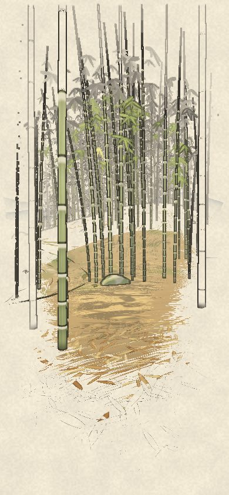
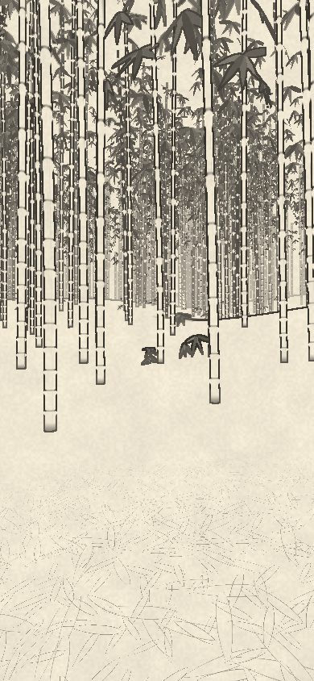
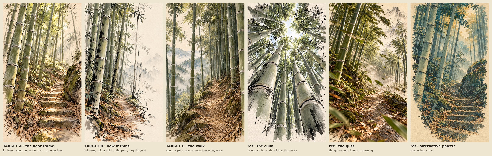

# Bamboo · 竹径

A run through a wild moso bamboo grove on an endless mountainside, drawn as a lit picture with ink on it: held close to the eye, giving out to the page.

## Running

- **Hold anywhere and you run**: a fast lope of about 7 m/s, gathering speed in a second or so. Let go and you ease to a stop.
- **Drag left and right to turn**, up and down to look. Arrow keys work too.
- **You give the direction; the run gives the footwork.** A few times a second it takes the clearest way near where you're heading: no culm in its path for nine metres (a stand seen coming and gone round, not met), no rock face to climb, no drop too far to take. It weaves you between the stands. The grove has its own runs, winding lanes where it's thinner (the ways a deer would take), and the run finds them. It would rather go over a stone than round it.
- **It sees what's coming and commits to a move**, a second or two ahead, takeoff to landing (`runner.ts`):
  - **a root or a small stone** is skipped. The steps before it shorten to meet it, and you keep your pace.
  - **a broad low stone**: you gather and hop up onto its crown.
  - **from a crown**, you leap to the next stone if one's in reach. Its takeoff is already in mind as you land, so it's a quick plant and away.
  - **off an edge**, you step down or leap. That depends on your speed and where you'd come down: the clearest, flattest landing.
  - Turn well off the move's way before its takeoff and it's given up. Your direction wins.
- **What's underfoot and what's in the way are what's drawn** (`footing.ts`). You stand on a stone's own top, the same lump the renderer draws, turned and scaled as it is. The culms are taken as they really go: leaning, or now and then a young one **bowed right over** by snow, its arc reaching across a trail. You **duck** under one passing at head height. You step over one at your shins. You go round, or squeeze past, one at your hips. Through a gap narrower than your shoulders you **turn them** and lean through. A culm close by brushes you aside with a rustle.
- **Landings are felt by how hard you come down**: your speed into the surface across its slope, how fast you're going, and what's ahead.
  - **An ordinary landing** gives at the knees and comes back.
  - **A heavy one** sinks, pitches you forward and costs speed, then a few short steps.
  - **Onto a stone, or into a tight place**, you brace and stagger.
  - **Hard and fast onto a clear run down**, you go down into a low roll, the horizon held, and come up running.
- **In the air** the stride's bob lets go and the view settles, drifting a little toward where you'll come down.
- **The ground sets the pace**: uphill slows you, downhill quickens you.
- **It feels its speed**: the head rises and falls with each stride and sways a little; you lean into a turn; the view widens the faster you go.
- **The sound comes with your first touch**: your footfalls (litter and earth; stone on a stair or a boulder; a knock on a root), a landing's thud (heavier the harder) with its footing's sound over it, a rustle as you brush a culm, the air past your ears rising with your speed, and the wind in the leaves when a gust comes through.

## The chase

`chase=fox`, `chase=runner` or `chase=stir`: something crosses your way, a little ahead. Stay with it as long as you can. Catching it isn't promised.

- **A fox** (`presence.ts`): one trunk, fuller at the shoulder, with the deep chest under its front and a white bib at the throat. A narrow snout and tall dark-backed ears. Long legs, dark below (the fore with the elbow behind; the hind with the thigh's mass, the stifle forward, the hock behind). A thick brush nearly as long as its body, white at the tip, that swings after it. Its coat is painted as a brush lays it (`render.ts`): strokes along each part the way its fur lies, a darker one down the back, a pale one catching the light, and at its edge the strokes break off dry, so its outline is fur rather than a shell. It walks, trots (diagonal pairs) and gallops (the hind pair, then the fore) by its speed. Each foot is set down on the ground under it (the slope, a stone's top, a root), drawn back while it bears weight, then lifted and swung forward. Over what it can't step (a rise, a stone, a culm bowed low across its way, an edge) it **bounds**, in the sheet's phases (`targets/07-fox.jpg`): it **gathers** (the hind feet coming right under, the hips sinking), springs from there into a flight it's committed to (forelegs tucked, hind legs streaming back, the body tilted with its rise), reaches its forefeet down for the **contact** (nose down, rear high), and **absorbs** it through the shoulders, a landing you can hear. When it stops to **listen**, it looks back over its shoulder, and turns its body if you're further round than its neck goes; its ears prick and its brush hangs. On the ground it never rises or falls more steeply than it steps; where there's no way it can take, it stops and turns, never slipping through.
  - **It's wary of you by what it can tell of you.** It sees you coming (the more the faster you come, the nearer, the less there is between you) and hears you (your running, your landings). It goes from a trot to a run to flight. Once it has got away (or climbed a stone, calm enough to look) it stops to listen and looks back. Quiet a long while somewhere open, it lies up, and if you come slowly it lets you come close; run at it and it's gone. So staying with it is restraint as much as speed: near enough to read it, far enough not to drive it off.
- **A runner**: someone with their own way to go, along the trails, at about your pace, legs and arms as a runner's go. They don't wait for you. Now and then they pause to check the way, and a kilometre or so on they reach where they were going and stop there.
- **A stir**: nothing to see. The grove moves where it passes high in the canopy: the stems bend away and the leaves hiss.

Where it has passed, the grove keeps moving a moment: the culms it brushed, the canopy it went through, still swaying and settling. You can follow it by that even with the sound off. Its footfalls are louder on stone, and its landings thud.

Contact has some give (`chase.ts`), and it's what you can actually perceive:
- **seen**: some of its body in view and readable. It's not behind the land, a stone or the culms between you; it's big enough on the screen to make out; and the drawing still describes it there (its colour or its ink reaches that far, as the renderer judges it);
- **traced**: hidden, but you can follow its route. You heard it (only with the sound on, and less through a gust or over your own running), or you saw the grove move where it passed, in view and not behind anything. You believe it's where the last of these came from, carried on the way you've seen it going, never the way it's really going unseen;
- **searching**: the cues have stopped, and the last of them is fading. There's still time to find it again;
- **lost**: you no longer have a credible direction. While it's still near, see it or hear it again and the chase is on again.

The end comes once it's well away (or long gone), or when it has let you come up to it. You slow, the grove settles, and a quiet line says so ("the fox has gone", "the fox let you come close"); no score. A while later, something else crosses your way.

With `auto`, the run chases it by itself, steering only by what it has perceived. `pose=walk|trot|gallop|gather|bound|contact|absorb|listen|lie` with `still` holds the body just ahead, side on (`posed=` metres away), to see how it's made. `node cells/lab/devtools/bamboo-fox.mjs` puts the sheet's six (trot, gather, bound, contact, absorb, listen) above the same six held in the grove, in `devtools/bamboo/gates/fox.jpg`. `node cells/lab/devtools/bamboo-chase.mjs [seeds]` runs situations on land laid by hand:
- a fox behind a boulder isn't seen, and stepping out it is;
- heard behind you, it's traced, while with the sound off it goes to searching and then lost;
- coming fast in the open alarms it, coming slowly or behind a rock keeps it calmer, and stopping calms it;
- lying up, it lets you walk up to it but not run;
- across a row of stones it bounds and lands, with no pops in height.

It then runs chases on the mountain against a pursuer that knows only what it has perceived, checking every presence's movement is honest over every second and every step.

## What you meet

Mostly the grove. But now and then:

- **a trail**: a sparse network of them crosses the mountain, each worn the way feet would rather go: routed over the land so it keeps to the contour and bends where the hill does, taking a slope on only where it must. Roots cross it here and there, from the bank side, half in the earth. Giants stand right at its edge; below it, where the hill falls away, the grove thins, so the way looks out over the valley, its far ranges blue in the mist. Its cut bank is bare red-brown earth, roots run across it and stones stand in it, ferns along its top. The trails run on from one stretch of the mountain into the next and meet here and there. A trail near draws you onto it; run along one and it carries you, turning with it, a little quicker, until you turn off it. Each is cut into the slope as a bench, the bank rising on its uphill side.
- **a flight of steps**: where a trail climbs steeply (a cliff band, mostly), it's a flight of stones laid by hand, each its own width and a little off line and askew, boulders left standing beside it here and there as it was cut through them; where a flight turns, it turns round a great boulder on the inside of its bend. Your stride shortens to the treads.
- **a cliff band**: here and there the rock breaks through and the land steps up five to nine metres along a winding rim. A rock face you can't climb (the run turns you along it, unless a trail's stair takes you up). Off its top, a drop of up to three metres you step or leap down, and land as hard as it was. A bigger one stops you at the rim, with the valley beyond.
- **a gust**: every so often one comes through the grove, and you see the tops bend over before it reaches you.

In three minutes of running the run covers about a kilometre at a mean of 4.8 to 6 m/s (the mountain's steep), on a trail for a few per cent of it (`node cells/lab/devtools/bamboo-run.mjs [seconds] [seed]` checks that it never runs through a culm, never stalls for long, and keeps up its pace, and counts its moves and landings). It runs in fixed steps of 1/120 s, so the pace and the landings are the same however fast the frames come. `node cells/lab/devtools/bamboo-course.mjs` runs it straight at things laid by hand: a root and a stone, a broad boulder, a chain of stones, three drops (a moderate one, a big one onto open ground, a big one into culms), a bowed culm and a narrow gap. It checks that each one changes the body, as the list above says, and that your way is still yours at the end.

## The mountain

Long steep-sided ridges and the valleys between (half the hillside steeper than one in three), endless (where a rim or a rock face bars the way ahead, the run looks wider and turns you along it): built where you are and a little way round, 32 m at a time, as you run, and let go behind you. The same seed is the same mountain wherever you go.

## The rock

Where the rock breaks through, it's built as rock (`rock.ts`), not drawn onto a slope. A formation has one way it's made: a bedding plane (its dip and roll) and its joints (one yaw, the fractures across it). Its blocks are cut along those, so a ledge belongs to the face behind it and a fallen slab is the shape of what's missing above.
- **An escarpment**, where a cliff band breaks through. The ground's smooth rise is taken out down to the foot (`world.ts`), so the blocks are the cliff and the gaps between them are clefts going back to the foot. It's built as columns along the rim:
  - most are one tall slab, or two or three tiers, each column's joints its own (so they don't run on as courses);
  - the lower tiers stand out as ledges, and now and then a middle one is set back under the lip of the one above;
  - columns lean a little out or back, and their crests are broken, stepping down toward the face or to a side, a broad top sometimes split along a joint;
  - narrow columns leave clefts, and a slab now and then lies fallen at the foot.
  
  A trail's stair still cuts through it, between the columns.
- **A rooted outcrop** out on the slope: a big slab tipped back into the hill, its neighbours along the same joints, a wedge broken off below, fragments.
- **Running crowns**: low flat tops stepping along the contour, a little apart, a way a fox could take.

A block is a box with chamfered edges and corners. Its corners are nudged and its top drawn in, then broken down toward a face. Its faces are flat, each with its own normal: a fracture is an edge, not a swell. Fresh fractures have crisp edges and old ones are rounded. Nothing grows under rock.

The run and the fox stand on the blocks' own upward faces (`footing.ts`), and sight stops at them. On the rock, the run leaps a cleft to the top across it. It won't drop onto a ledge it couldn't leave. Held at a rim, it looks for a way from where it stands, turning right round at a dead end, and if held a while it lowers itself down a face. `?clay&grove=0` shows the forms alone. The rock's own material and ink (a face's planes, its joints, its crest in the drawing) come next. Until then it wears the boulders'.

## The grove

- **Culms:** moso, thick and pale, in **stands**, as a grove grows from its runners: clumps of a few to a dozen or more, with open floor between them, each stand of an age (young and pale, or old and dull), stoutest toward its middle. Now and then one old giant stands beside a trail, the one the eye goes to. Each culm has its own girth and height (the stoutest are the tallest) and its own lean, downhill toward the light and out over a way beside it. Its internodes lengthen up the culm. Young culms are pale celadon with fresh white powder under each node; old ones are duller and olive, patched with lichen. Below a way, on the side where the slope falls away, the grove is sparser, so the walk looks out between them.
- **Sprays:** the leaves come in sprays of three to five blades (个 and 介) along the upper part of every culm, so the ceiling is high. Small sprays at shin and knee height are scattered through the grove, thicker along a trail's edges.
- **Litter:** a carpet of fallen leaves everywhere, drawn leaf by leaf near the eye, thinner in the worn middle of a trail, lying on a stair's treads.
- **Stones:** boulders fallen under the cliffs and at the foot of a trail's bank, mossy on top.
- **Rock:** a cliff's face is grey stone streaked down its fall, inked with broken strokes down it.
- **Wind:** every culm sways a little on its own. Every so often a gust comes down the slope: you see the tops bend over upslope before it reaches you, then the sprays stream.

## How it's drawn

Three passes, after Labyrinth's, and the land's own strokes laid in the world:

- **The shadows**: the culms, their leaves, the boulders and the steps near you, seen from the sun (or the moon), so their shadows stripe and fleck the litter, the steps and each other. The canopy's shade is the leaves' own. The sun is low and warm, so the shadows run long, and shafts of light come through when you run toward it.
- **The picture**: each surface lit in its own colour.
  - **Culms**: olive-celadon, dry-brushed down their length, darker just under each node, a band of white powder there.
  - **Sprays**: dark ink-green in shade, glowing gold-green with the sun behind them.
  - **Litter**: a carpet of fallen leaves.
  - **Stone**: worn, warm.

  Beside the colour, each surface hands on its own **marks**, the ink it calls for:
  - a culm's node ticks, darkest at its edges as the eye sees them, dry-brush strokes down its shaded side, and ink pooled at its foot;
  - a spray's blade edges, its blades filled in ink where the colour's given out;
  - each near fallen leaf's edge;
  - a trail's edges;
  - the strokes down a rock face;
  - a crack across a step.
- **The land's strokes** (`strokes.ts`): marks the mountain's features call for, laid as ribbons on it, so each stays where it is as you run and the mountain still reads when its colour's gone: a trail's **edges**, broken, firmer where the bank's cut deep; a **rim** along the top of a bank's cut and **hachures** down it in small groups; a flight's **strings** along its sides and a stone's front edge now and then; a cliff's **rim** and **strokes down its face**; a few **contours** along the hillside and short **strokes down the fall** where it's steep enough to show; where a **stone** meets the ground. Each is turned to the eye, held to a least width on the screen by its kind (a rim most), lighter with distance, and left out whole by its pick where the drawing thins, never faded. A rim holds over the colour; a contour's only for the paper.
- **The page**: the outlines, found where the depth jumps or one thing meets another, inked on the side that's in front; a culm's breaks just under each node, as a brush lifts there. They lighten with distance, so a far culm is a fine grey line.

### The grove

Moso is a running bamboo: its culms come up one by one along rhizomes under the floor, so a stand is a few crooked lines of them, a culm every half metre to two, now and then two close together, the parent stoutest and its offspring along the run less so, with open floor between the runs. Young shoots of the last year or two stand thin and short among the rest (with the papery sheaths they grew in still on their low nodes); a culm's height goes with its girth; now and then a giant stands beside a trail. Most stand near straight, some lean, a few lean hard, mostly down the hill or out into a gap, and a stand leans a little together; every culm's top bows over under its leaves, the leaners most. Its branches come off the nodes of its crown side to side, rising and arching out, the lower ones longer and flatter, and its leaves hang in bunches along their outer half and at their ends, with a tuft at the tip. Each blade is its own: its angle off the twig, its length, curl and droop, and its turn along its length, so one shows its face to the light and the next its edge. Only some blades get an ink edge, and only on one side. Close to, a node is two rings (the sheath's scar, the branch ridge above it) with the pale powder band under it, a dark scar where a branch was below the crown, fine lines down the culm, moss and soil at its foot.

### The light

The sun's light is real where it can be: the culms', stones' and steps' shadows from a shadow map near you; the land's own shadows (a cliff, a ridge, a bank shading the slope under it) and how much of the sky each point of the ground sees (its hollows, the foot of a bank) baked with each piece of the land as it's laid, by marching toward the sun and round the horizon over its heights, and darker again where it meets a stone, a step or a culm's foot. The shade under the canopy is real too. The leaves cast it: each spray's blades go into the same shadow map as the culms, the steps and the boulders, so near you the light on the floor is the true shadow of what hangs overhead, moving as the leaves move. Beyond the map's reach, each piece of land knows how much leaf is over each metre of its ground (from where its sprays really hang). There, the light is broken into flecks only as much as that cover closes, and the sky's light under a closed stand is dimmer than in a clearing. Each material has its own relief, drawn in the shader as a height in its own lie (its normal tipped by how the height changes across the screen, so it needs no maps or tangents) with the dark of its creases: the litter's leaves as thin blades lying one on another with the soil dark in the gaps; a bank's clods with cracks between and grooves down it where the rain runs; rock's bedding, ledge over ledge, each undercut dark, and its fractures; a stone's pitting and a crack or two; a step's tooling; a culm's node ridge, the groove above it and the fine grooves down it; a leaf's midrib. Every rise is spread over a few pixels wherever it's seen from, and the finest fade first, so nothing flickers. The bare floor is never flat either: a broad swell, lumps of earth, pebbles proud of it and, down a trail, the ruts feet have worn; and a boulder has broad weathered facets and chips as well as its pits. Its height darkens its own hollows and lifts its crowns, in the sun and in the shade alike, so it reads under the canopy too. Each describes one surface. The litter's colour, relief and creases share one measure of how much it covers, so a trail's worn middle is bare earth to the light as well as to the eye. A boulder's crack is a single field in the stone's own body: the ink draws it, the light finds it as a crease, and its dark gathers there. Each feature fades by the footprint of its own coordinates, so a steep face loses its detail as soon as the level does. `relief` (with the light, 0–8, 3 by default) sets how strong it all is.

### The layers

How it's drawn is a stack of layers laid from the paper up, after Labyrinth's print, each with its own dials, and none moving another (`client/bamboo/layers.ts`):

- **page**: where every layer is measured from. Each thing asks one measure, how far **out** it is: from the **focus** (where you're going and looking: the ground the eye's line meets past the culms crossing it, kept between 7 and 30 m, moved to slowly) across the frame, 1 at **every edge** (top and bottom as much as the sides: it's measured near-square), and in depth (`depth`: sooner for things far beyond the focus, a little for things much nearer); or in the world, 1 at `distance` metres; whichever is further. The land is asked as a column: a point of the ground (or a stone, a step, a stroke on it) is as far out as the least of it and the air 3 and 8 m above it, where what stands on it is seen. So the ground is never gone from under a culm that's still drawn. `held` (0–1) holds the bottom of the frame: at 0 the page comes in from every edge alike; higher, the ground at your feet stays, and the page comes in from the sides and the top, as a painting keeps its foreground. `toward` pulls every layer in toward the paper at once, by the same factor (each reach times 1 − `toward`), so it never lets one layer outrun another. For ink that runs on past the colour, leave `toward` at 0 and set the reaches apart: colour short, light a little further, ink out to the frame.
- **air**: the time of day and the weather (`client/bamboo/sky.ts`).
  - `hour` (0–24) sets where the sun is: up at six, highest at noon (57°), down at eighteen, crossing from the east of the slope to the west. At eight it lights the grove exactly as the house always has. The sun goes white at noon, warm in the morning, and gold and low near the horizon; the sky goes rose at dusk and indigo at night.
  - By night the full moon, opposite the sun, takes over, cool and dim. The eye adjusts, so a night is dim but not black. The sheet takes a dark wash, heavier toward its top, with its torn edge left bare. The moon is left as bare paper with a soft ring of light, seen between the culms.
  - The land's own shadows are baked again whenever the light moves, the nearest pieces first.
  - `mist` (0–1, 0.5 by default) sets how thick the far haze and the valley's mist are. Both take the hour's colour: warm paper by day, peach at dusk, blue-grey at night.
- **under**: how much of the drawing (marks, outlines, the land's strokes) lies beneath the colour; on bare paper it's always all of it.
- **colour**: each kind its own strength (`culms`, `leaves`, `terrain`), and its `colourreach`. Past it, a thing gives way to the paper.
- **light**: factored out of what the sun and sky give, so each part can be laid again at its own strength: `shade` (a surface's turn from the sun), `cast` (the culms' shadows and the canopy's dapple), `hollow` (the sky shut out), `landlight` (how much of them the land keeps), and `lightreach`. Past the colour, the light lies on the paper itself, in sepia.
- **ink**: `lines` (things' own marks: node ticks, a spray's blades, a leaf's edge), `strokes` (the land's: trail edges, rims, hachures, contours), `edges` (the outlines found from depth and kind), `inkreach`, and `inkfade`: how it ends, thinning (fewer things inked, each by its own pick) or fading (all of them paler). And its hand: `open` (how open its contours are: a stone's weight at its underside and contact, a step's at its front, the counter-side of a culm and the land's own silhouettes left to the paper), `swell` (the firm lines heavier, the slight ones hairlines) and `grain` (lines broken granular, tone as stippled clusters).
- **focus**: one measure of how far out of focus a thing is, as a lens has it: nearer than the focus it goes out fast, beyond it toward 1 far off. `aperture` sets how strong it is. `near blur` sets how much the nearer side takes of it: at 1 a lens's, at 0 sharp from you to the focus with only the far softening, so a culm beside you can stay the boldest thing in the frame. Each layer reads it its own way: `soften` blurs the colour and light (never the ink), `near wet` turns a close culm or spray into a dark wash, and `far dry` leaves the far ink paler and broken.

A reach is a multiple of that measure, on a log scale from ×0.25 to ×4: under 1 leaves every edge of the frame to the paper; over 1 lets that layer run out to the frame. No mark ever comes or goes at once: each thing has its own amount of ink, never switched on or off. It's laid as a brush lays it, **its length first, then its weight**: a culm drawn up from its foot, a land stroke out from its middle (a broken line as one line with breaks in it, all its runs sharing one pick), a blade out from its stem, a stone from its middle to its sides. As the ink thins, things go out over their own short stretches of the reach, so there are fewer of them; as it fades, all of them go paler too. An outline where two kinds meet takes the stronger side's weight, so it never breaks into dots. The paper isn't a mask feathered over the picture: a culm, a spray, a stone, a stroke is left out **whole**, by its own pick, only where none of its layers reach it, and what's gone hides nothing behind it. Along a culm, an internode at a time, its colour gives way, then its light, then its ink; the ground goes leaf by fallen leaf, its edge dragged dry across the slope as a brush leaves it, and is never left out: past its layers it's the paper.

The house setting draws with the brush's hand (`open` and `swell` up) over the land's light as a pale wash. The path has its own marks (strokes.ts): broken tread lines where feet have gone, and what lies on it, twigs and fallen leaves as small curved commas, thicker toward its edges. Beside the route now and then stands a giant culm, stouter than the rest, the drawing's anchor: never a secondary stroke, its shaded side firm.

The 墨 button (bottom right) opens the palette: a slot for each layer, the one touched open with its sliders (a mark where the house setting has it; double-tap a name to put it back), and under **page**, the starts: `house` (the default), `picture` (every layer whole, out to the frame), `drawing` (no colour; the light on the paper; the ink), `ink` (the ink alone, out to the frame), `page` (all of it taken to the paper). Four more draw the same ink with different hands, at a reach that carries the grove: `contour`, `brush`, `litho` and `wash` (the brush's lines over pale washes of the land's light). The address keeps every dial that differs from the house, so a setting can be passed on.

## Judged against the board

The look was found by image generation first (`devtools/bamboo/explore.md`: three rounds of prompts and what each taught). The reference frames are found on the mountain by what they need (`?ref=a`, the foot of a stair; `?ref=b`, a trail with a fall beside it; `?ref=c`, in the grove off the trails; `?ref=cliff`, a rim; `?ref=run`, mid-stride), and `node cells/lab/devtools/bamboo-fidelity.mjs` draws a, b and c and puts each beside its target. The views are made with `node cells/lab/views.mjs bamboo`.

## The gates

The look is now hill-climbed against five target studies (`devtools/bamboo/targets/`, and `gates.md` there for what each is judged by: the contour run, culm scale, ink reach, the stair, a gust), in gates: **0**, geometry and composition in plain colour with no marks; **1**, the drawing alone, which must still carry the route and the bank; **2**, the board as it's shown; **3**, motion and finish. `node cells/lab/devtools/bamboo-gates.mjs [gate…]` draws each target beside its pinned scene (`?cam=`, never found afresh) three ways: picture, ink only, board.

## Addresses

- `seed=<n>`: the mountain.
- `ref=a|b|c|cliff|run|up|gust`: a frame found on the mountain by what it needs; `cam=x,z,heading,pitch[,speed]`: one pinned exactly.
- `at=x,z,heading,pitch` and `t`: start just there, at that time, and run on. The address keeps it up to date: when you come to rest, finish looking round, change a dial or leave the page (never while you run), it's rewritten with where you stand and what's set, so a link opens on just what you saw.
- `look=house|picture|drawing|ink|page|dusk|night`, and any dial by its own name (`colourreach=0.3`, `cast=1.6`, `inkfade=1`…): the layers (above).
- `shadows=0`: no culm shadows (cheaper).
- `auto`: run on by itself, wandering.
- `t=<seconds>` and `still`: time held.
- `fov=<degrees>`.
- `clean`: without the shafts and the paper's grain.
- `marks=0`: the picture without its ink.
- `strokes=all`: every stroke the land has, at full weight, none left out (to see what's laid).
- `clay`: every surface one clay, its light kept (the sun on it, the culms' cast shadows, the sky), no paper, no ink: the forms alone.
- `grove=0`: the land alone, no bamboo (the gates' hard test: does the mountain and its path still read?).
- `mute`: no sound.
