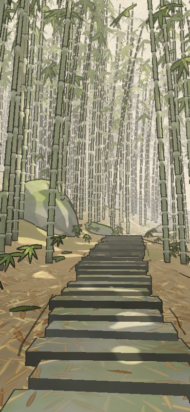

# Bamboo · 竹径

A walk up through a wild moso bamboo grove on a mountainside, drawn as a lit picture with ink on it: held close to the eye, giving out to the page.

## Walking

- **Hold anywhere and you walk.** Let go and you slow to a stop. There's nothing to steer: you're on the way, and it takes you along.
- **Drag to look round** while you walk or while you stand. Leave it be and after a moment the eye comes back to the way ahead, and up the stair or down it.
- **The way sets the pace.** It's a brisk walk along the contour, a little slower uphill, slower again up a stone stair (step by step: the eye rises tread by tread) and a little quicker down one. There's no running.
- **Where a way forks, you take the branch you're looking along.** As you come near the fork, its name comes up at the foot of the screen (the stair straight up, the track round the gully); look the other way and it changes.
- **The sound comes with your first touch.** The wind in the leaves rises as a gust passes. Footsteps are soft on earth and litter, harder on the stone treads.

Arrow keys work too: up to walk, left and right to look.

## The mountain

A slope rising east at about one in two and a half, rumpled; to the west it breaks over an edge and falls steeply into the valley. The ways make a loop:

- **the lower track** along the contour, the grove up the bank on one side and falling away on the other; along one stretch the edge comes in close and the grove opens to the valley's mist;
- **the stair up**, stone steps climbing the slope to a fork, a big mossy boulder at its top;
- from the fork, **the stair straight up**, or **the track round the gully**, dipping through it; the two meet again above;
- **the upper track**, deep in the grove along a higher contour;
- **the long stair down** to where you started.

Each way is cut into the slope as a bench: the bed a little sunk, the bank rising on its uphill side and the ground falling away below. Each stair is a flight of stones laid by hand, each a little off line and not quite level with the next.

## The grove

- **Culms:** moso, thick and pale, close but not a wall. Each has its own girth and height (the stoutest are the tallest) and its own lean, downhill toward the light and out over a way beside it. Its internodes lengthen up the culm. Young culms are pale celadon with fresh white powder under each node; old ones are duller and olive, patched with lichen. Below a way, on the side where the slope falls away, the grove is sparser, so the walk looks out between them.
- **Sprays:** the leaves come in sprays of three to five blades (个 and 介) along the upper part of every culm, so the ceiling is high. Small sprays line the edges of the ways at shin and knee height.
- **Litter:** fallen leaves, thick along the foot of the banks and on the stair's treads, thinner in the worn middle of a way.
- **Stones:** boulders at the foot of the uphill bank, mossy on top.
- **Wind:** every culm sways a little on its own. Every so often a gust comes down the slope: you see the tops bend over upslope before it reaches you, then the sprays stream.

## How it's drawn

Two layers that agree, after Labyrinth's:

- **The picture:**
  - The sun comes through the canopy as a dapple, and the same patches of light lie across the path, the litter and a culm alike; there are sky and bounce light too.
  - Each culm is drawn with the dry brush down its length: streaks, darker just under each node, a band of powder there, the node's own ring.
  - Each spray is lit dark ink-green in shade, yellow-green in sun, and glows where the sun is behind it.
  - The air between: far things are paler and cooler, toward the paper.
- **The ink:**
  - A tick at each node, curving with the ring and darkest at the culm's edges as the eye sees them.
  - Ink pooled at a culm's foot.
  - Each blade's edge on a near spray; each fallen leaf's edge.
  - The way's edges, broken.
  - The outlines, found where the depth jumps or one thing meets another, are inked on the side that's in front. A culm's outline breaks just under each node, as a brush lifts there.
- **The page:**
  - The colour is laid on as far as it reaches (about 10 to 40 m), and the ink reaches further (to about 75 m). Beyond that, the sky, the mist and the far side of the valley are the paper itself, with the far ranges laid in as washes darkest at their crests.
  - Far off, a culm isn't faded: it's in or out whole, by its pick against how far drawn it would be, so the grove thins to a few verticals and then to the page.
  - Shafts of light come through where the canopy opens toward the sun.

## Judged against the board

The look was found by image generation first (`devtools/bamboo/explore.md`: three rounds of prompts and what each taught). The three reference frames are laid out like the board's targets, and `node cells/lab/devtools/bamboo-fidelity.mjs` draws them and puts each beside its target:

- `?ref=a`: the near frame (up the stair);
- `?ref=b`: how it thins (along the lower track, the valley's mist on one side);
- `?ref=c`: the walk (along the contour, the bank on one side, the valley opening on the other).

The views are made with `node cells/lab/views.mjs bamboo`.

## Addresses

- `seed=<n>`: the mountain and grove.
- `ref=a|b|c|up|gust`: a fixed frame.
- `at=<way>:<metres>`: where to start (ways 0–5, in the order above); add `back` to face the other way.
- `auto`: walk on by itself, taking each fork in turn.
- `t=<seconds>` and `still`: time held.
- `fov=<degrees>`.
- `clean`: without the shafts and the paper's grain.
- `marks=0`: the picture without its ink.
- `mute`: no sound.
