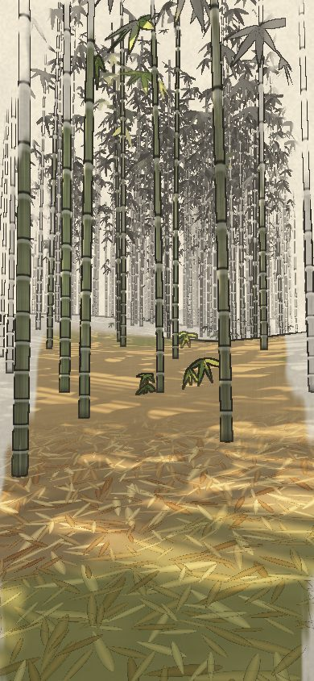
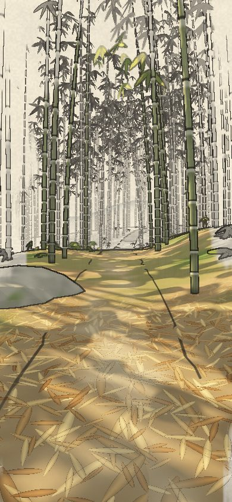
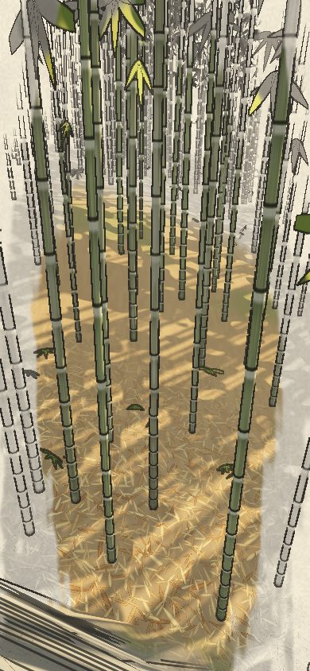
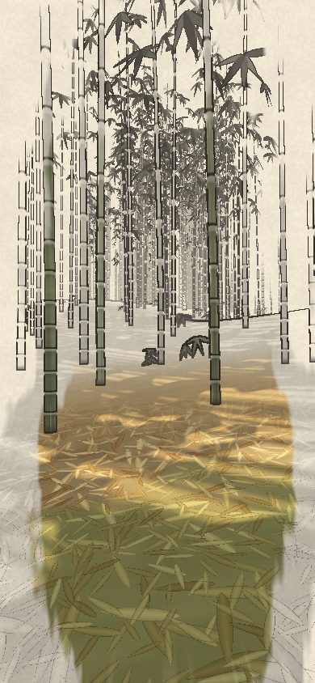
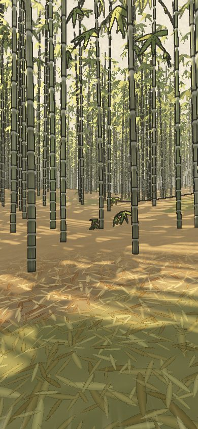
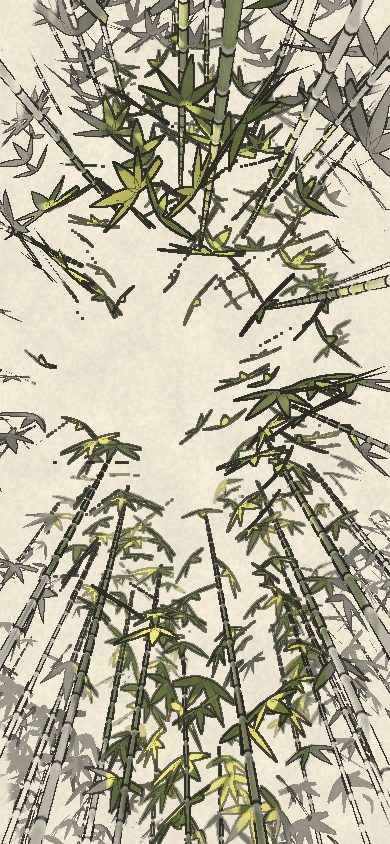
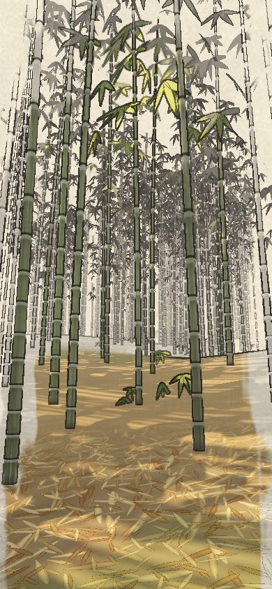
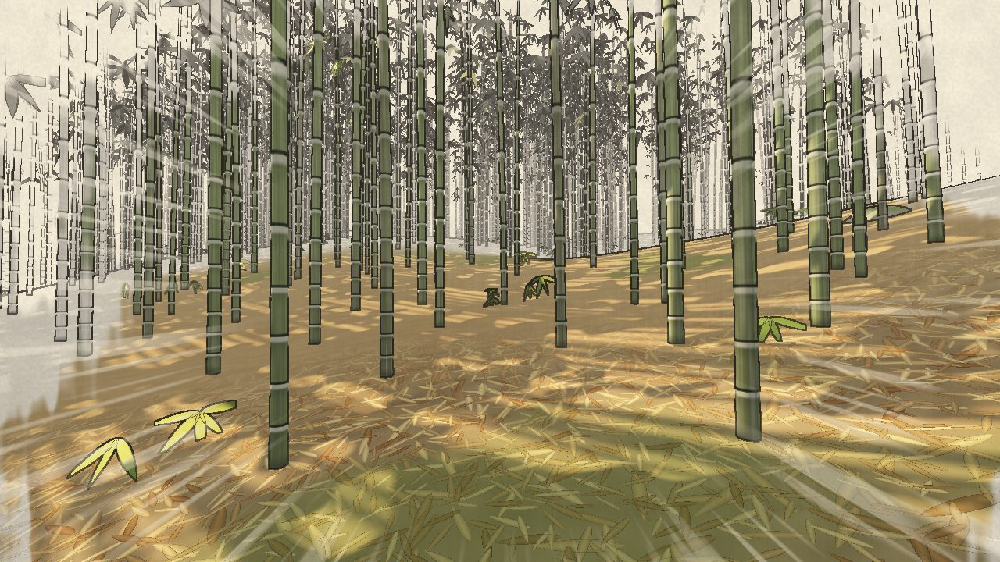

# bamboo: every view

Made by `node cells/lab/views.mjs bamboo` from `client/bamboo/views.mjs`. The README is `../bamboo.md`.

## The run

## Things you meet

## How far it’s drawn

## Looks

