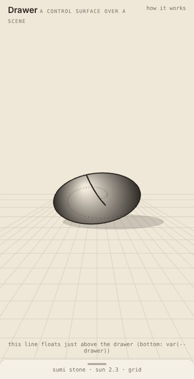
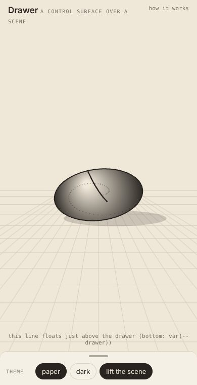
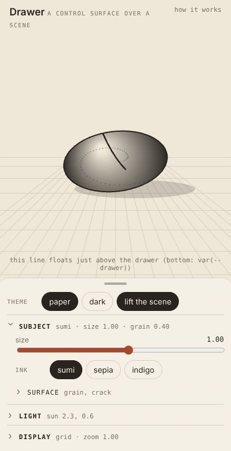
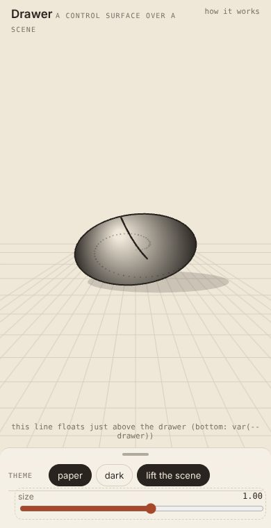
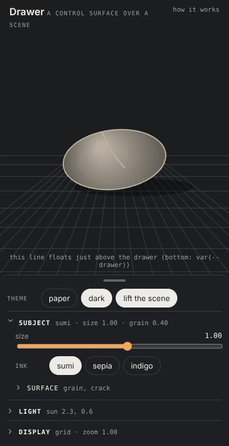

# Drawer

A control surface over a scene, made once for every experiment in the lab. Tagged **hci**: the experiment is the
interface itself.

## Why

Each experiment had grown its own panel, and some covered the scene they were for. The Splats panel did, until it
was capped. Looking across the lab and the home cell, each had solved part of the problem well:
- **FAB's bench:** a drawer with three heights measured from its content; dragged, flicked or tapped; publishing its
  height so the camera lifts the subject clear.
- **Labyrinth's layers palette:** tabs and one tray of sliders, already a function. Bamboo copied it almost line for
  line.
- **The home cell's palette and tuner:**
  - arrow keys on the grip, Escape that unwinds one layer at a time;
  - a focus mode that narrows the tuner to the one slider you're dialling.
- **Taohua's surfaces:** a complete modal sheet: a backdrop, focus moved to it, Escape.
- **Splats' panel:** sections that open one at a time and summarise themselves shut.

None had all of it. This experiment is where they're put together: its own page to develop and judge them on (a
stand-in scene, a stone on a ground), and modules any experiment imports (`../drawer/drawer`, `../drawer/sections`).

## The drawer (`drawer.ts`)

`drawer(el, { persist, start, cap, onHeight, onState })` → `{ state, height, set, step, measure }`.

**Three heights, measured, not configured.** Each height is the one before with more below it, so the drawer is only
ever clipped to a height:
- **closed:** to the foot of its grip, which shows a line saying what's chosen;
- **focus:** to where its first `data-tier="2"` child starts. Tier 1 is what you use most; tier 2 is the rest;
- **full:** all of it, capped at 82% of the window, and only then scrolling.

They're measured again whenever the window or the content changes.

**The hand.** The grip drags the height as a preview. It follows the finger and gives a little past either end. Let go
and it settles where it was heading: past a quarter of the way to the next height it goes there, and a flick goes one
further. A tap steps closed → focus → full → focus.

**The keyboard.**
- **On the grip:** ↑ opens a step, ↓ closes one, and Enter or Space step as a tap does. FAB's grip had no keyboard at
  all.
- **Escape:** anywhere in the drawer, it closes the drawer a step, once whatever is inside has had its turn. Focus
  mode, for one, leaves first.

**The scene.** The drawer lies over the scene and never resizes it.
- Its height is published as the CSS variable `--drawer`, for what floats just above it (the line above the drawer
  on this page).
- It's given to `onHeight`, and `lift(h, canvasHeight)` turns it into the share of the screen to lift the subject by:
  the drawer's height, held to at most 60% of the canvas. A camera shifts its projection's centre by it and eases
  toward it each frame (FAB's trick, now in Splats too).

It remembers its height under `persist`, if given.

## Sections (`sections.ts`)

`sections(root, { persist, summaries })` → `{ refresh, open, focused }`.
- **One open at a time.** `details.dw-sec[data-key]` sections open one at a time, and the open one is remembered.
  Each `summary` holds its name (`.t`) and, while it's shut, a line saying what it's set to (`.s`, from
  `summaries()`).
- **Nesting.** `details.dw-sub` nests inside a section, for what's used less.
- **Hidden sections.** A section that doesn't apply to what's showing is `hidden`. If the open one is hidden, the
  first shown opens.

**Focus mode**, from the home cell's tuner. Give a control's container `data-focus` and tapping its name (its label)
narrows the drawer to that control alone, so the scene clears while you dial it. Tap the name again, or press Escape,
and the rest comes back.

## Its look

Its stylesheet is injected once, on first use, never on import (the lab is one bundle, and an import shouldn't touch
a page that doesn't use it). It goes ahead of the page's own styles, and every colour is a token the pages already
have: `--card`, `--ink`, `--muted`, `--edge`, `--accent`. A page keeps its look; a page that switches themes (Splats'
paper) switches the drawer with it.

## Who uses it

- **Splats:** its panel is now a drawer.
  - Closed, it says the scene and its stats.
  - Focus shows the scene chips and status.
  - Full shows the sections: drawing, stroke, light, display.
  - The camera lifts the subject clear as it opens.

Next: Labyrinth's and Bamboo's layer palettes onto one shared `palette`, Taohua's modal shell as `surface`, then FAB
itself.

## Checks

`node cells/lab/devtools/drawer-check.mjs` checks, at a phone's size: the three heights by tap and by keyboard,
Escape, focus mode, the lift, and both themes. `node cells/lab/views.mjs drawer` makes the pictures.
