# Fab

A dressmaking workbench for children. A little wooden figure stands on a turned stand, and beside it lies a garment's
paper pattern: a skirt, a top, a dress, trousers or a jumpsuit. Nothing is chosen from a list. A child decides what a dressmaker decides, the pattern that follows is
drafted to the figure, and the cut cloth is sewn up round it and falls as that cloth falls.

The aim is for a child to find out that clothes are made, and can be reasoned about, constructed and transformed.

This page sets out what Fab claims, how it's built, and the evidence for and against it. The evidence comes from the
**evidence bench** (`?bench=evidence`), which runs the same tests in the page as it does headless.

## One garment family, deep, then five

The first Fab tried to dress the figure in a skirt, a top and a cape, each with the same six dials. The skirt worked.
The top's sleeves never sat properly. Its pieces weren't real pattern pieces:

- the bodice had no armhole cut into it;
- each sleeve head was about 30% bigger than its armhole;

so no simulation could have made a garment of them. And dials like *silhouette* and *drape* claimed to set what should
only ever be found.

So Fab went deep into one family first: **the skirt**. It's the simplest thing that's truly *made*: flat pieces cut,
joined round a body and hung from one line, the waist. Nearly every move a dressmaker has shows in it:

- **extend** (length);
- **flare** (cut a panel as a sector);
- **split** (more panels);
- **gather**, **pleat**;
- **dart**, and **shape a seam** (to take in the waist);
- **cut on the grain or the bias**;
- **join** (side seams, waistband).

With the skirt sound, the same grammar now makes four more families. It follows GarmentCode (Korosteleva &
Sorkine-Hornung 2023): a garment is components drafted to the body's measurements and sewn edge to edge by length. The
first Fab's failures are now checks every pattern has to pass:

- **Tops**: a bodice whose armholes are cut, five necklines, sleeves whose heads are solved to their armholes, and three
  collars.
- **Dresses**: a bodice sewn to any skirt at the waist.
- **Trousers**: four panels with a crotch curve solved to the figure.
- **Jumpsuits**: a bodice sewn to trousers.
- **Tiers** on any skirt or dress.

The skirt's made by hand, on its paper, at the cutting table. The others are decided at the figure, in its drawer,
with choices and dials. Moves on their paper are next (see *Known limitations*).

## The cutting table: a grammar of moves

A skirt is a **waistband** and **n panels** round it, each sewn to the next, every panel cut the same. A panel isn't
chosen from a family of shapes. It's the dressmaker's **straight skirt block**, drafted to the figure, plus the
**moves** made on its paper, in order (`cut.ts`).

### The block

Straight down from the hips. Its side seams curve in toward the waist as far as a seam can (2 cm). Darts take in the
rest, as many as it needs, none deeper than 3 cm. Fewer panels means fewer seams, so more darts: a straight skirt in
one piece needs darts all round.

### The moves

| move | what a cutter does | gesture on the paper |
|---|---|---|
| **spread** | slash from the hem up to the waist, leaving a hinge, and open the hem | **slash**: touch the hem, drag sideways |
| **pleat** | slash down from the waist, spread it parallel, fold the new cloth into a knife pleat, stitched 5 cm down | **fold**: touch the waist, drag sideways |
| **gather** | slash and spread parallel, and ease the new width into the band where it was added | **gather**: touch the waist, drag sideways |
| **close a dart** | pivot the cloth beside it about its point until its legs meet: the waist's taken in the same, the hem below opens | **hand**: tap the dart |
| **release a dart** | don't sew it; gather its width into the band instead | **hand**: tap it again (a third tap sews it again) |

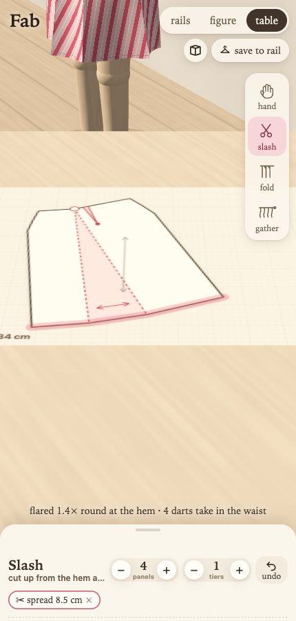
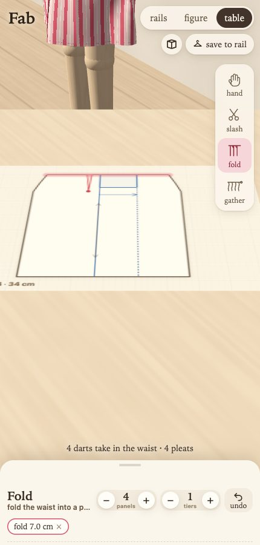
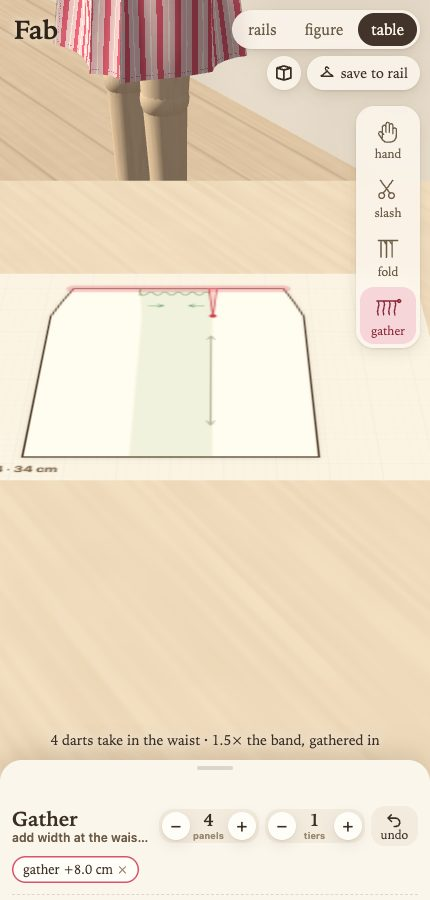
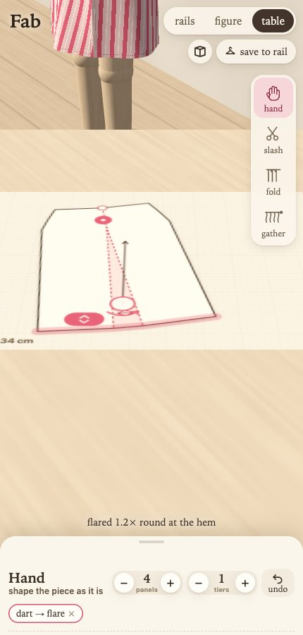

The rest are parameters on the same paper:

- **length**: drag the hem;
- **grain**: turn the grain arrow's handle;
- **panels**: the − / + beside the tools;
- **cloth** and **print**: the swatches.

**Every move is a chip in the history under the paper.** Tap one to take it back: the rest are made again, in order,
and a move that now does nothing is struck through and says so. **undo** takes back the last.

**The moves don't commute, and that's the point.** A pleat folded and then slashed through opens toward the hem with the
flare. Slashed first and then pleated, it hangs straight. Closing a dart first and then spreading isn't the same as the
other way round. Positions are on the paper *as it is when the move is made*. Even the shortcuts below have to account
for that: placing three pleats "a third of the way along each" bunched them up, because each one lengthens the waist the
next is measured on.

### How a panel is represented

A panel is a row of **ribs**: lines from waist to hem, bent once, at the hips at its sides or at a dart's point. Between
the ribs are **strips**: cloth, a wedge someone spread, a pleat, a dart, or eased width. Moves insert ribs, and turn or
slide everything to one side of them, so a strip is always exactly the paper it was. Each strip records the move that
made it, so the history is the pattern's **provenance**.

What's sewn, and how the waist meets the band, follow from the strips:

- side seams;
- darts, tapering to their points;
- pleats' stitching, let out where the hips need the room;
- the waist: cloth sewn flat to the band; folds and darts closed to a point; eased width gathered in, the ease declared
  on that seam;
- a waist cut longer than its band with nothing to take it in is eased all round, and the check says so ("gather it,
  pleat it or dart it?").

Paper that's one piece (cloth, and what's been slashed and spread or a dart closed into it: a cutter tapes these back
into one) is meshed as a single region, with rulings evenly spaced along the waist and the hem. Folds and darts still
sewn keep their own columns, so their edges can be sewn.

### What we took from GarmentCode, and what we didn't

GarmentCode (Korosteleva & Sorkine-Hornung 2023) programs parametric sewing patterns as panels of edges joined by
stitches between named **interfaces**.

Taken:

- **Seams as contracts between named edges**, not point pairs: a panel's sides, its waist.
- **Ease declared on the seam** (GarmentCode's "ruffle" coefficient) rather than built into the cloth's shape.
- **Every operation reports how old edges became new ones**: a rib is copied before it's cut.

Not taken: its sampling of designs for datasets, its 3D placement, and its edges shared by reference between edits. That
last is fragile under sequences of edits, as its own code comments note.

Where Fab goes beyond it, because the gestures need it:

- **An operation history as the source of truth.** GarmentCode regenerates a garment from its parameters and keeps no
  history.
- **Pleats as folds with stitching.** GarmentCode lists pleats and folds as future work.

### The dials, kept as shortcuts (and as the comparison)

The first Fab's controls are still there (`?ui=dials`): length, fullness, flared/gathered/pleated, panels, grain. They
no longer draw anything themselves; they **write moves**:

- **flared**: close the darts into the hem, then slash and spread the rest, evenly, as far as the paper lies flat;
- **gathered**: release the darts and add width at three places;
- **pleated**: fold pleats evenly along the waist.

The workshop's rail and the evidence bench go through the same shortcuts, so they exercise the same cutting. The dials
stay as the other half of the comparison the next step needs: do children who make a skirt on the paper understand it
better than children who turn dials?

### What's never set (outcomes)

Silhouette, how many folds and how deep, whether the hem is level, how far it swings out in a twirl. These are what
the simulated cloth does with the cut.

## The other families

Every family is drafted from the figure itself, measured from its own shapes in `body.ts`, and every one passes the
same checks: seams meet, pieces lie flat, pieces fit on the cloth. Each also has checks of its own.

### Tops (`bodice.ts`)

A **front** and a **back**, each half the chest's round and its ease. The ease runs from snug (4 cm) to roomy (16 cm).

| control | what it is |
|---|---|
| **length** | cm below the waist; less than 0 is cropped above it |
| **room** | wearing ease round the chest |
| **sleeves** | cm down the arm, 0 for sleeveless; **plain**, **puff** or **bell** |
| **neck** | **round**, **V**, **square**, **boat** or **scoop**, and how much lower or higher than usual |
| **swing** | how much wider the hem is than the chest |
| **collar** | none, **Peter Pan**, **band** or **frill** |

What follows from those choices:

- **The front is as long as the figure's surface.** It runs as far as the figure's front does from the waist to the
  neck. The shoulder seam falls as the figure's shoulder does across its top, about 17°. The back's shoulder seam is
  cut to the front's length.
- **The armhole** runs from the shoulder's point straight down and meets the side seam under the arm.
- **A sleeve is as wide as the arm plus its ease.** Its head's height is *solved* so the head is 3% longer than its
  armhole (eased in), or 45% longer for a puff (gathered in).
  - Each half of the head fits its own armhole, back and front. GarmentCode solves its sleeve caps the same way.
  - An armhole too short for the sleeve is cut deeper, and the notes say by how much.
  - A long sleeve must pass the hand.
  - A puff is gathered into a cuff as round as the arm there.
  - A bell flares, but no faster than its seams can lean.
- **It has to go over the head.** If the neckline won't, it opens down the back with buttons. A knit (jersey) stretches
  half again, and often needs no opening.
- **A top that comes below the hips** is cut wide enough to clear them.
- **Collars:**
  - A **Peter Pan collar** is two flat ring sectors whose inner edge is the neckline. It's a small circle skirt, rounded
    at the front.
  - A **band collar** is a strip as long as the neckline.
  - A **frill** is 1.8 times as long, gathered on.

### Dresses

A bodice cut to the waist, with a skirt sewn round its hem. The skirt is cut at the table like any skirt, but to the
bodice's hem instead of a waistband: its recipe carries that round (`band`), so its paper, its dials and the dress all
cut the same skirt. Its darts, pleats or gathers close into the hem: each point of the skirt's waist is sewn to its own place
round it.

### Trousers (`trousers.ts`)

Four panels, after GarmentCode's PantPanel: a front and a back for each leg.

| control | what it is |
|---|---|
| **legs** | cm of leg below the crotch: shorts (5) to full length (33) |
| **width** | room in the leg, slim to wide (culottes, palazzos) |
| **flare** | the hem over the knee: tapered, straight, flared |

What follows from those choices:

- **Each panel** is a quarter of the hips' round and its ease, straight up to the waist.
- **The crotch curve's reach is solved.** Each crotch seam must be as long as the figure's own surface from the waist,
  down under it, to between its legs, plus 2 cm.
- **The waist** is as wide as the hips and gathers into an elastic band, so it goes over them.
- **A full-length leg** must pass the foot.

### Jumpsuits

A bodice to the waist, with trousers gathered onto its hem.

### Tiers

Any skirt or dress can have two or three **tiers**. Each is a ring of straight panels 1.5 times the round of the hem
above, gathered onto it, as GarmentCode's SkirtLevels are. The first tier still comes past the hips.

### How it's represented

GarmentCode's edges are lines, circle arcs and Béziers whose control points are *relative to their chord* (`edges.ts`),
so a curve keeps its shape whatever its ends do.

A piece is four runs of edges round it, with its cloth's grid laid over them as a **Coons patch**. Every corner between
two edges falls on a grid point. So a bodice with its armholes and neckline, a sleeve with its head and a trouser leg
with its crotch curve are all grids, as a skirt's panel is. (A skirt's panel is meshed as ruled regions from its paper's strips: see *How a
panel is represented*. A piece cut from curves is a Coons patch.) The cloth needed only one new thing.

**A seam sews two runs by length**, as GarmentCode's stitches do. Every point of each run is sewn to the place the same
fraction along the other: between two of its points, by a new interpolated XPBD stitch constraint in `cloth.ts`. Two
runs of different lengths gather the longer onto the shorter. Gathered waists, puffed sleeve heads, tiers and frills are
all that one rule.

The grid runs down each piece, so no edge along a piece's top or side may run in the grid's own direction. That would
crush the cells. So:

- the armhole meets the side seam steeply, not level;
- a round neckline meets the shoulder at 45°, not straight up;
- a square neck's sides lean, as GarmentCode's trapezoid neck allows;
- the crotch curve meets the inseam at 45°.

Under an arm or a leg the difference is a few millimetres. The **pieces lie flat** check catches any grid that crushes.

**The figure is posed for what it wears.** Its arms stay up in a dancer's curve for skirts and trousers. For anything
with a bodice they come down to 45° below its shoulders, as GarmentCode's bodies stand.

Pieces start laid out as GarmentCodeData lays its panels:

- flat and unstretched, on a gentle curve in front of the figure and behind it;
- sleeves as tubes on the arms;
- trouser panels round the legs.

The sewing and the shoulders' holds then draw them round. Tops hang from the tops of their shoulders. Pieces that
aren't held, like sleeves, a dress's skirt and collars, are tethered to what they're sewn to.

## The physical representation

Each piece is a grid over its flat shape, at about 2 cm, coarser for big skirts so the cloth stays near 1,800 points.
The cloth is simulated with **XPBD** (extended position-based dynamics), in its "small steps" form: 8 substeps a frame.
All units are centimetres, grams and seconds.

- **Mass**: each point gets a third of each triangle's flat area, times the fabric's weight.
- **Stretch and shear**: a spring along every mesh edge. Its stiffness is the cloth's *orthotropic* tensile stiffness in
  that edge's direction on the cloth:

  1/E(φ) = cos⁴φ/E₁ + sin⁴φ/E₂ + (1/G − 2ν/E₁)·cos²φ·sin²φ

  So a woven cloth is stiff along its threads and soft on the bias, a knit is soft across its courses, and felt is the
  same every way. Turning the grain dial changes physics, not a texture. This is a spring network, not a finite-element
  membrane: that is the stated compromise.
- **Bending**: the quadratic isometric bending energy of Bergou et al. (2006). At each interior point it takes the
  cotangent Laplacian of the positions, which is zero on the flat pattern. It's weighted by the flexural rigidity,
  computed from the swatch's measured Peirce bending length and weight, over the point's area. It's solved as an XPBD
  constraint with its multipliers carried across three passes a substep, so extra passes converge on the true
  stiffness instead of adding to it.
- **Long-range attachments** (Kim, Chentanez & Müller 2012): each point is tied to its nearest held point, no further
  than the cloth between them plus what that much cloth would stretch hanging, *in that direction*. Without them a
  one-pass solver let woven cloth creep about 7% under its own weight.
- **Seams** are zero-length constraints, drawn closed over the first 0.8 s: the sewing. **Darts** are sewn and folded
  flat. The **waistband** is held, turning with the figure.
- **Air** drags on each point's speed through the cloth by area over mass, so chiffon floats and felt falls.
- **The figure**: an analytic distance field (lathed torso, capsules, balls) with Coulomb friction against its moving
  surface.
- **The cloth against itself**: a spatial hash, with each point's radius under half its nearest neighbour's distance.
  Points near seams and folds are exempt, since there they're meant to meet.

**Assembly is shown, not hidden.** The pieces are first laid on a surface of revolution where nothing is stretched:
its round at each depth is the panels' width there. Then the seams are sewn and the waist is drawn into the band. Press
**sew** to watch it again.

### Why XPBD, and what else was considered

| approach | fits Fab because | against |
|---|---|---|
| **XPBD, small steps** (chosen) | stiffness in real units (compliance), unconditionally stable, cheap, deterministic, easy collisions and seams | stiff materials under-converge at few substeps: measured below |
| plain PBD (the first Fab) | simplest | stiffness depends on iteration count, so it can't be calibrated to a swatch |
| implicit mass-spring / Baraff–Witkin (the CLO and Browzwear lineage) | large stable steps, mature for garments | a sparse linear solve each step; heavy for a phone in JS |
| projective dynamics | fast, stable, prefactored system | refactor on every re-cut; collisions awkward |
| FEM shells (StVK / discrete shells, ARCSim) | the most faithful anisotropy and bending | far too slow for real time on a phone |
| GPU XPBD (WebGPU) | 10–100× the points: finer folds | not yet on every phone; the next step if folds need it |

GarmentCode (Korosteleva & Sorkine-Hornung 2023) programs parametric sewing patterns as components with interfaces.
It's the closest relative of the grammar here. Fab takes its "pattern first, simulate second" stance at a scale a child
can turn by hand.

## Evidence

Each test states a narrow claim and, as plainly, **what it doesn't establish**. A verdict covers only its claim. None of
the tests yet compares with real cloth, real sewn skirts or children. Run them at `?bench=evidence` (`&converged`
re-measures the slow converged drape references). The numbers below are from a headless run on the cutting engine.

| test | claim | result | doesn't establish |
|---|---|---|---|
| **1** pattern | 1,120 designs (every corner of the space, plus 400 at random), 6,824 checks: seams match, the waist fits its band, hips cleared with 4 cm of ease, pieces fit across the cloth, darts sewable, paper doesn't overlap itself, every move made | **holds**: all pass | makeability: no seam allowances, notches, opening or fastening, or order of construction; not cut and sewn by a dressmaker |
| **2a** cantilever | the cloth reproduces each swatch's bending length | **holds**: converged within 10%, at the figure's settings within 18% | that the swatches' figures describe real silk or felt (they're representative); bending is one stiffness every way |
| **2b** Cusick | the model drapes in the order, and over the range, drape testers find | **holds**: converged 0.29–0.94, ordered by stiffness; folds 12 → 5 | agreement with the same specimens measured |
| **2b′** real time | the cloth on the figure drapes as its converged self, within 0.10 | **fails**: gap up to 0.27 (lawn 0.35 vs 0.57) | how much that gap matters to a child's predictions |
| **2c** bias | woven cloth stretches more on the bias than on the grain | **holds**: 2–3.5× more; felt the same either way | the size of real bias growth (creep isn't modelled) |
| **3a/3b** expressiveness | one cut in four cloths, and one cloth in five cuts, are measurably distinct, and sound | **holds**: nearest pairs ≥ 1.02 apart; all sound | that a child sees them as different, or that they match real skirts |
| **4** speed | the cloth step under 12 ms, the same every time | **fails here**: 11–13 ms on this container's CPU; deterministic | the whole frame on a phone: use `?perf` on the phone |

"Sound" now means more than not exploding:

- finite;
- 99% of springs within 12% stretch, and within 35% squash;
- under 1% of triangles collapsed (not counting ones held flat on purpose: a fold held to the band, or a dart's legs
  sewn together);
- no point inside the figure;
- every seam closed to 5 mm.

On the cutting engine the worst sound skirt (pleated) has 11% stretch at the 99th percentile and a 4.6 mm seam gap.

One construction (flared, 4 panels, 2.2× full) in contrasting cloths:

| cloth | hem out | fold depth | folds | hem level (sd) | swing |
|---|---|---|---|---|---|
| chiffon | 14.2 cm | 2.2 | 16 | 0.75 | +12.2 |
| cotton lawn | 15.1 | 2.4 | 13 | 0.85 | +11.8 |
| linen | 16.4 | 4.1 | 7 | 1.50 | +12.2 |
| felt | 14.3 | 5.1 | 4 | 1.31 | +14.3 |

One cloth (cotton lawn) in contrasting constructions:

| construction | hem out | fold depth | folds | swing |
|---|---|---|---|---|
| straight (the block, darted) | 12.2 | 1.3 | 3 | +0.5 |
| flared (darts closed, slashed and spread) | 15.1 | 2.4 | 13 | +11.8 |
| gathered (darts released, width added) | 17.5 | 2.2 | 13 | +10.9 |
| pleated | 15.9 | 2.8 | 11 | +12.8 |
| one piece, bias | 16.0 | 3.5 | 9 | +11.0 |

Building the cutting engine, the bench caught:

- slashes whose hinges added waist length;
- a waist-ease rule wrong for dirndls;
- a block whose hips came up 1.4 cm short of their ease;
- pleats bunched by order-dependent placement (7 mm of cloth between two folds, stretched 90%);
- a spring between two collapsed triangles with infinite compliance (NaN);
- a minimum mass that silently made fine test meshes 30% too floppy.

### Children: paper or dials?

Not yet tested; it can't be tested here. The protocol is unchanged (predict, then try; explain; intention; observe),
now as a **comparison**. Half the children use the paper (the default), half `?ui=dials`, with the same skirts and
questions.

The hypothesis to test: children who slash, fold and close darts on the paper predict and explain better (naming a
construction, not a look) than children who turn dials to the same skirts.

### Every garment

| test | claim | result | doesn't establish |
|---|---|---|---|
| **5** garments | 752 garments (every neckline × sleeve length × sleeve × collar of a top, a dress and a jumpsuit at both ends of their room and length; trousers' corners; tiered skirts and dresses; 300 at random), 4,308 checks: seams meet as they're meant to (eased, or gathered by as much as meant), pieces cut from curves lie flat, fit across the cloth, clear the body, go on (over the head, past the hand, past the foot) | **holds**: all pass | makeability, as test 1; that a sleeve set in this way hangs as a dressmaker's would |
| **6** sewn | every garment on the workshop's rails sews up on the figure: seams to within 2.5 cm (0.25 on average), finite, nothing inside it | **holds**: all 27 | that it's sound (6′) |
| **6′** sound | the same garments, by the skirt's bar for "sound" (above) | **fails**: 12 of 27 (every plain skirt; 4 of 5 trousers) | how much the stretch under a bodice matters to how it looks or to a child |

Under a bodice, under tiers and where gathers crowd the cloth it stretches more: 13–33% at the 99th percentile, seams
within 1.1 cm rather than 5 mm. Building the families, the checks caught:

- sleeve heads split 24/8 cm between their halves (a bisection the wrong way round);
- grid cells crushed to 0° wherever an armhole, neckline or crotch curve ran level or upright;
- a shoulder seam at 45° when it should be 17°, from measuring the shoulder's point up the figure's side;
- tiers gathered 1.45× when they should be 1.5×, from loops that dropped each panel's last step;
- merging with the cutting table: a dress whose paper was cut to a waistband while it wore a skirt cut to its bodice
  (now the recipe carries the round), and a seam-gap measure that read a gathered seam as open.

## Known limitations

- **The real-time cloth is limper than its own converged self** in drape: coefficients up to 0.27 lower, from too few
  substeps for stiff bending. The next step is more substeps on capable devices, or WebGPU.
- **Up to 11% stretch at the 99th percentile** of springs near the waist in pleated skirts (4–8% elsewhere), where
  folds and darts crowd the cloth. Real woven cloth would buckle more and stretch less.
- **The grain's laid along the panel's middle as it is after the moves.** After one slash on one side, the block's own
  part ends up slightly off-grain. A cutter might keep the grain on the block's centre instead. The arrow can be
  turned either way.
- **The swatch figures are representative, not measured.** Measuring real swatches (a cantilever, a drapemeter, a strip
  tensile test) and putting the numbers into `fabric.ts` would make test 2 a comparison with reality rather than with
  the literature's ranges.
- **Only a skirt is made by hand on its paper.** A top's, a dress's bodice, trousers are decided by choices and dials in
  the figure's drawer: the gap the cutting table was built to close. The next step is moves on every piece, as the
  pattern books make them: slash and spread a sleeve into a puff or a bell, turn a bodice's dart, fold a trouser leg's
  waist. The garments' blocks (bodice.ts, trousers.ts) are where that paper starts.
- **Tiers are a stepper, not a move** on the paper.
- **Only knife pleats, a single layer.** Box pleats, petticoats and linings are natural next operations in the same
  grammar.
- **Under a bodice the cloth stretches more** at its 99th percentile (18–34%, against 6–7% in a skirt). Gathered heads
  and the shoulders' holds crowd it. More substeps, or a finer grid at seams, would let it buckle instead.
- **The grid can't follow every curve.** Armholes, necklines and crotch curves meet their neighbours at an angle rather
  than level (see *How it's represented*). GarmentCode meshes its panels freely; a grid can't.
- **No fitted darts in bodices yet**, and no princess seams. A child's figure barely needs them; a grown one would.
- **A dress on its hanger** settles a little crumpled where its gathered skirt meets the bodice.
- **The Peter Pan collar is hard to see in the same cloth.** A contrast collar would show it.
- **Seams are hinges.** A real seam allowance stiffens the cloth along it.
- **See-through cloth** (chiffon) shows a faint ladder where folds meet at a seam behind it.

## The rails

Fab opens on the workshop's wall: a row of clothes rails, each hung with garments on hangers.

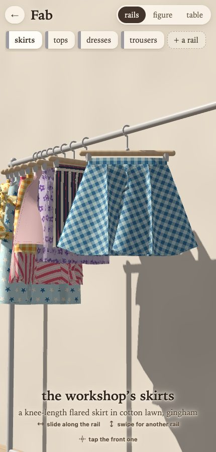

- **The workshop's rails** are chromed: one each for skirts, tops, dresses, and trousers and jumpsuits, with one of each
  way of making them in contrasting cloths, to start from.
- **Each person has their own rail**, powder-coated in their own colour, with what they've made. Tap **+ a rail** and
  give it a name.

Using the rails:

- Drag the garments along a rail and they slide like real hangers (a skirt or trousers on clips, anything with a bodice
  on a coat hanger). They run on, slow down, and settle with one in front.
  They bunch up toward the bar's ends, and each swings on its hook as it's pushed.
- Swipe up or down, or tap a name tag, to move to another rail.
- Tap the one in front to put it on the figure. (On a bare hanger, **A New Creation** starts a new skirt from the block.)
  It comes off its hanger, the camera crosses the room to the bench, and it's laid out flat and sewn onto the figure.
- A person's rail starts with a bare hanger, for something new.

Saving:

- **save to rail** at the bench hangs it back on its owner's rail, its design and its paper's recipe both. One that came
  from the workshop's rails goes
  on the rail in use instead, and if nobody has a rail yet, Fab asks whose it is.
- Going back to the **rails** hangs it up too, if it's changed.
- Long-press one of your own to take it off the rail.
- Tap your own rail's name tag to rename it. Clear the name to take the rail away.

Every skirt on a rail is the real thing. Its pattern is drafted from its design, a little coarser than at the bench
(about 650 points). It's sewn and let fall from the hanger's two clips, which hold its waistband flat, by the same
cloth simulation. Each one settles once, a few at a time, nearest first. After that it hangs still, and only its swing
moves it.

The rails live in this browser (localStorage), so a rail is a person on this device: a family's tablet, or a
classroom's. Nothing leaves the device. Sharing rails between devices would need storage behind the cell, which this
static lab cell doesn't have.

## Three places in one room

The workshop is one room, and the camera walks between three places in it. They're the three buttons along the top
(**rails · figure · table**), and the one you're at is dark. What can be done there sits in a row under them.

| place | where | its drawer | along the top |
|---|---|---|---|
| **the rails** | along the wall, to the left | the rails' name tags; put a skirt on the figure | |
| **the figure** | on its stand, in the middle | what it is (**make**: skirt, top, dress, trousers, jumpsuit; tiers), the **bodice** (neckline, sleeves, collar; length, room, swing) and the **legs**, when it has them; fabric, print and colour | **twirl** and **sew** (icons), **save to rail** |
| **the cutting table** | to one side, facing the figure | the tool in hand: what it does, the gestures it answers to, what it's set to; panels, tiers, undo, the history (the tools themselves are a palette down the right). A top's or trousers' whole pattern lies there to be looked at, without tools | **cloth** (an icon), **save to rail** |

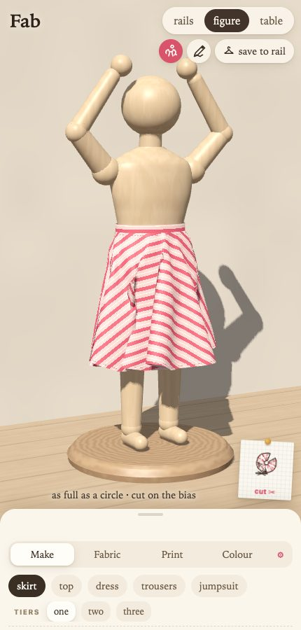

**The drawer has three states, each the one before with more below it:**

- **closed**: its handle, and what's chosen in a line ("cotton lawn · stripes · strawberry");
- **focused**: at the figure, a section's tabs (**Make · Bodice · Legs · Fabric · Print · Colour**) and its choices; at the table, the tool in
  hand, panels, undo and the history;
- **expanded**: at the figure, the section in focus made your own (below); at the table, the tool's gestures and what
  it's set to.

**Its handle is tactile.** The drawer follows a finger on its handle, so what's below comes into view before it's let
go, and it gives a little past either end. When it's let go it settles, sliding there: dragged a quarter of the way to
the next state it goes there (and on, past each further quarter); flicked, it goes one further the way it was flicked;
short of a quarter, it springs back. A tap steps it: closed → focused → expanded → focused. (⚙ by the tabs expands the
section in focus, and closes it again.)

**The room never moves with it.** The drawer lies over the room rather than taking space from it, and each place keeps
the bottom of the screen for its drawer whatever state it's in, the scene drawn centred above that by moving the lens.
Opening, closing or dragging the drawer doesn't move or resize the scene.

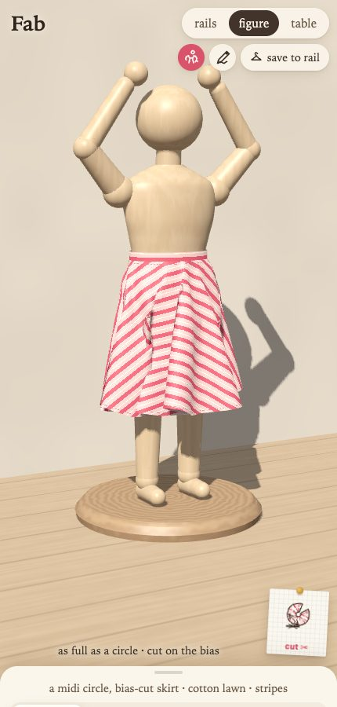
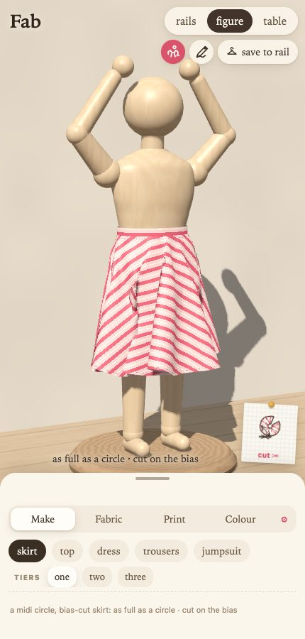
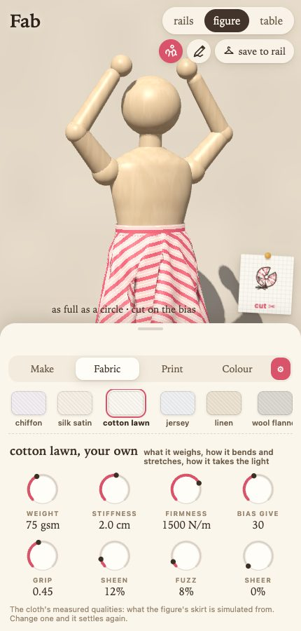

**Expanded, a section is made your own.** What's changed is kept with the skirt (on its recipe, so it's on the rail
with it, and in the link):

- **cloth**: its measured qualities, dial by dial, starting from the swatch's: weight (gsm), stiffness (Peirce bending
  length), firmness (tensile stiffness, warp and weft together), bias give (shear stiffness), grip (friction), and how
  it takes the light (sheen, fuzz, sheer). The first five are what the skirt is simulated from: change one and it
  settles again;
- **print**: how big it's printed;
- **colour**: the palette's three inks (ground, ink, accent), each picked.

**as it was** puts the section back as its swatch has it, and choosing another swatch starts afresh from that one.

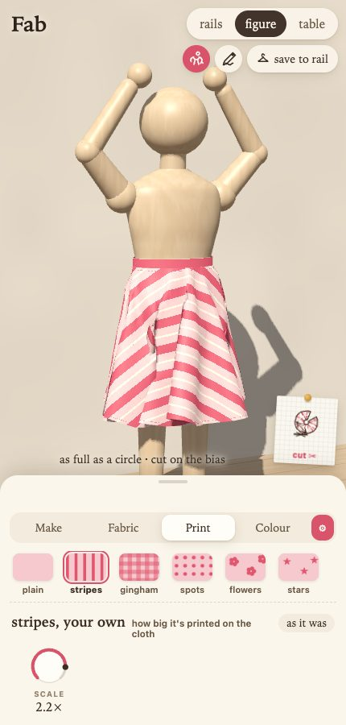
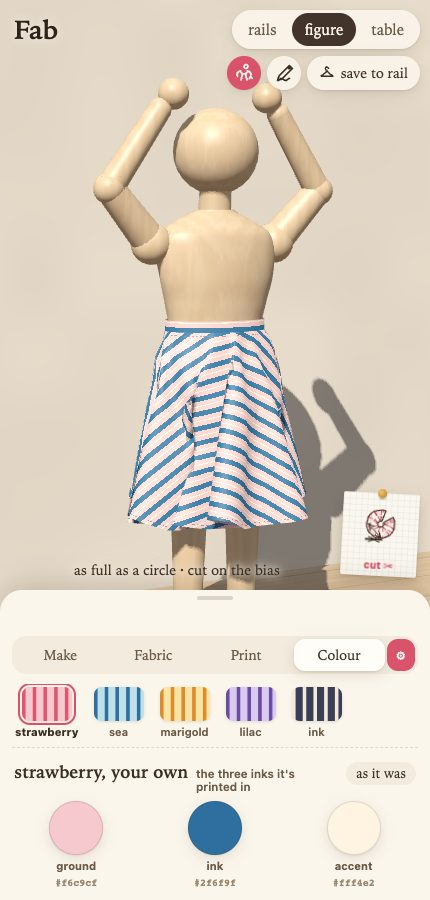
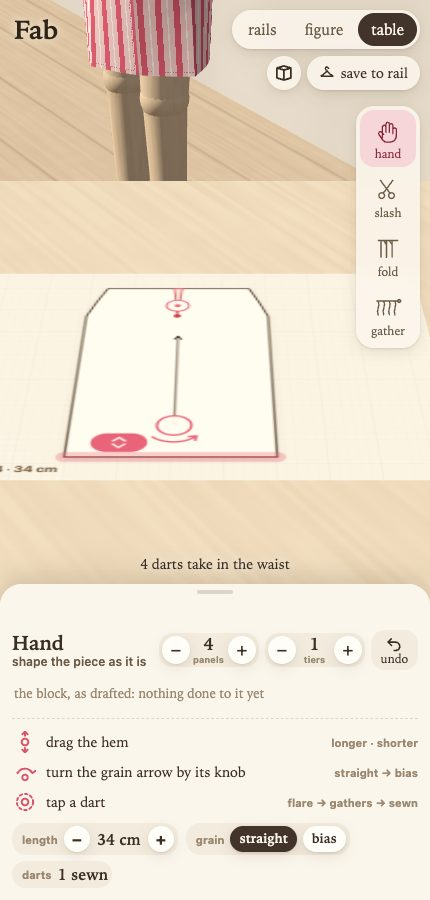

**At the figure, a drag on it spins it; a drag off it goes round it.** Spinning is the same as from the table: its
front follows the finger, and a flick runs down on its own. A pinch, or scrolling, comes close or goes well back.

**Every place can be reached by tapping it.** From any of the three, tap another where it stands in the room (a
rail, the figure, the cutting table) and the camera walks there. It's one list in the code (`PLACES` in `main.ts`):
each place says how a touch finds it (a box round each rail and what hangs on it; the figure out to its arms and the
reach of its skirt; the tabletop), and the nearest one along the touch wins, so whatever's in front hides what's behind
it. A tap the place you're at uses itself (a garment on the rails, the paper's piece at the table) is never passed on.
A new place in the room is one more entry.

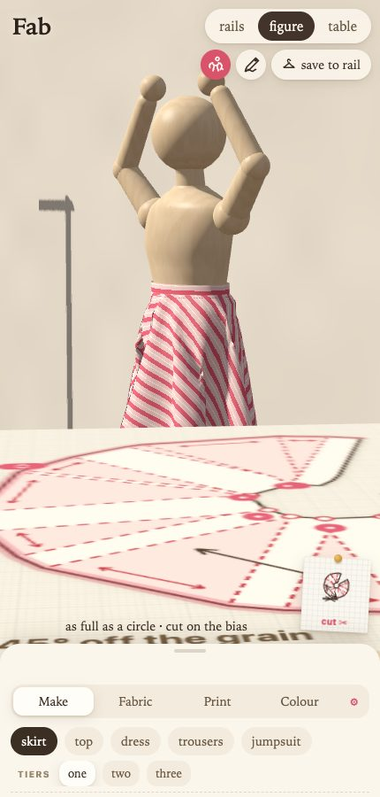
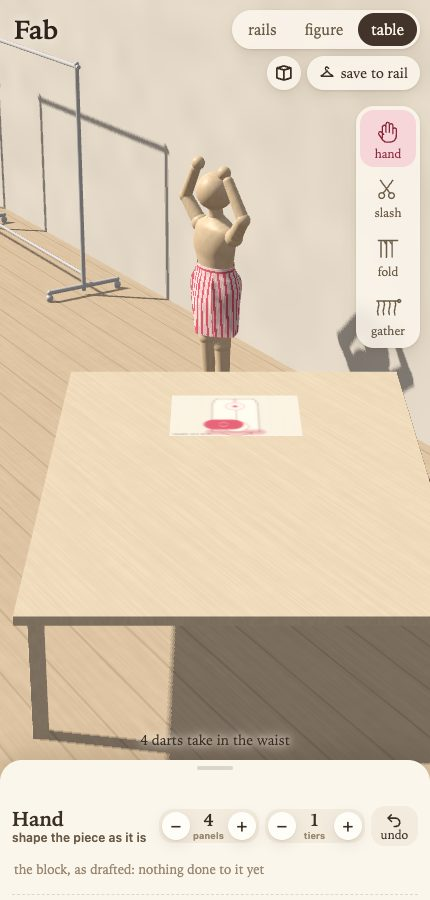

**The pattern is pinned up beside the figure,** bottom right. It's a little note with the pieces drawn on it, what the skirt is, how
long, and how far round its hem is. Tap it, or tap the cutting table itself where it stands in the room, to go to the table. It's redrawn with every
change, and stays by the figure.

**At the table, the figure's still across the room.** Tap it to go over to it. Drag across it to spin it on its stand: its
front follows your finger, and a flick runs down on its own.

**The paper is plain by default.** A piece is drawn as pattern tissue, so its marks (slashes, folds, darts, gathers)
stand out. The **cloth** icon lays the chosen cloth and print on it, running with the grain, as it'll be cut. The note by the
figure follows the same choice. (`?cloth` starts with it on.)

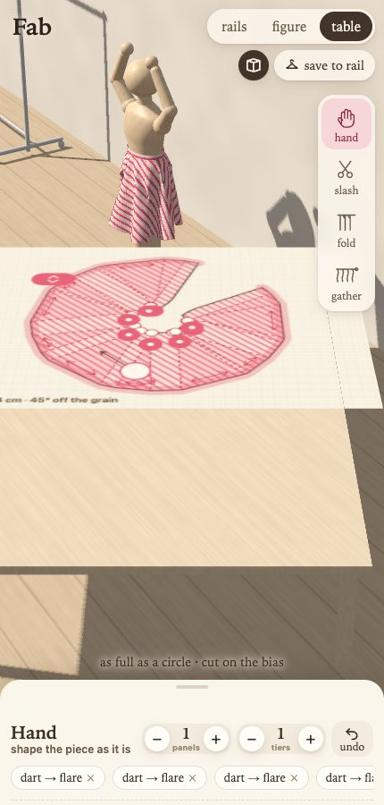

**At the table, the pattern lies on it at true size.** A centimetre of the paper is a centimetre on the figure, so a piece
that's spread grows on the table. The figure stands across the room behind it, wearing each move as it's made.

A touch on the screen is cast down onto the tabletop and lands on the paper. Every gesture works on the paper there, and
a fingertip is a fingertip's size wherever the paper is seen from.

**The paper shows what the tool in hand can do.** The edge it works lights up: the hem for the hand and the scissors,
the waist for fold and gather. The hand also gets a tab on the hem to drag, a ring at the foot of the grain arrow to
turn it, and a badge on each dart to tap (white while it's sewn, rose once it's flared or gathered). The moment a cut or
fold is touched, a dashed ghost shows where it'll go. While a finger's on the paper, a label beside it says how much
("+4.5 cm", "37 cm (+3)", "22°"), and the drawer keeps up with it.

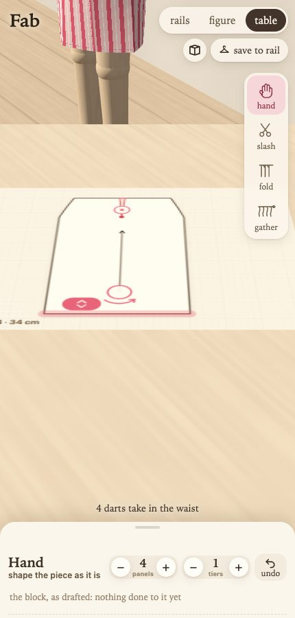
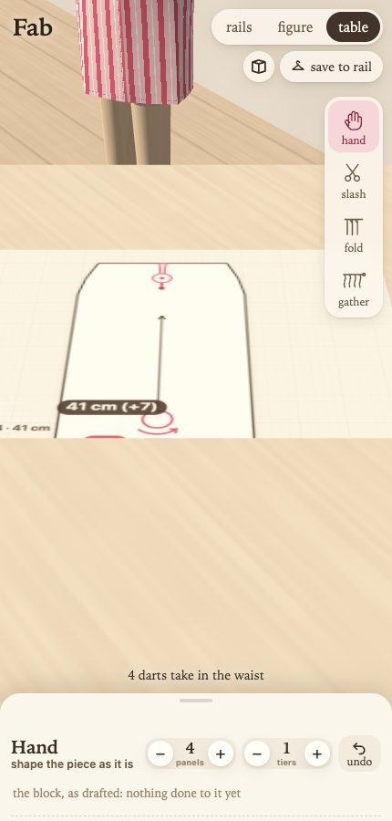
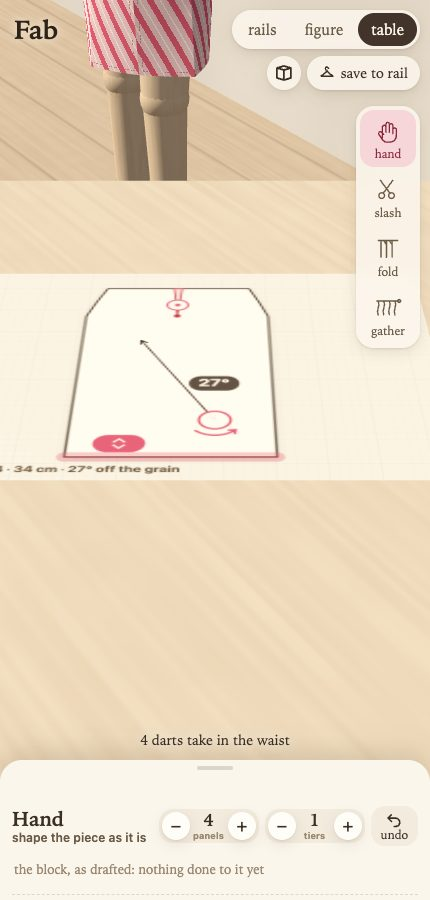
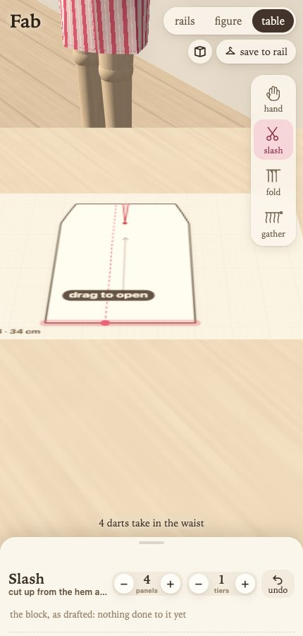

**Each move is marked as a dressmaker marks it:**

- a slash: its two edges dashed and the opening shaded, the point it swung open about ringed, an arrow across the opening;
- a pleat: the fold line solid and where it's laid dashed, an arrow from one to the other (the way it's folded), and
  its stitching down from the waist boxed off at a bar;
- gathers: a notch either side on the waist, a wavy running stitch between them, and arrows drawing it in;
- a dart: its two legs to a dot at its point.

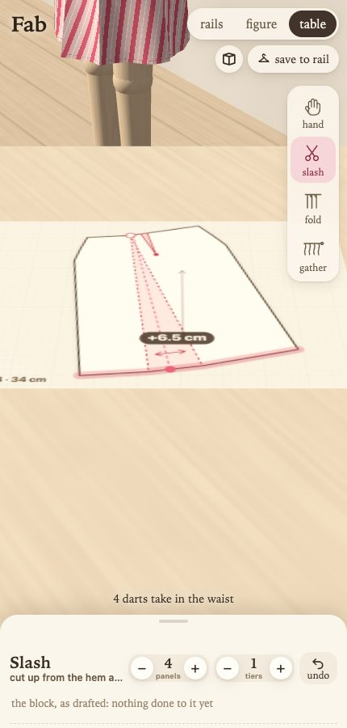
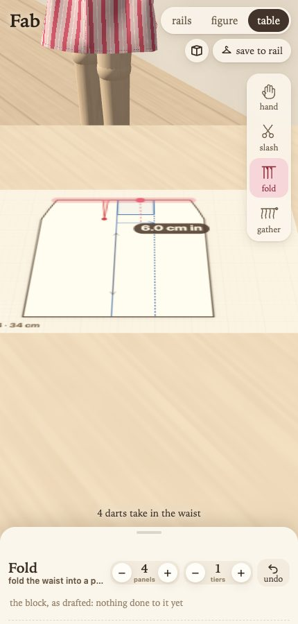
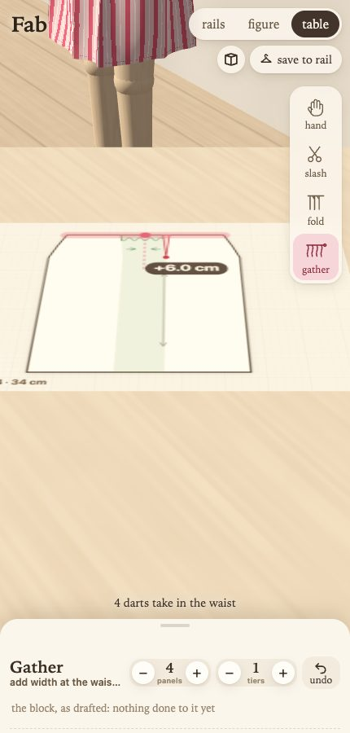

**Only the piece takes the tools.** A touch on the pattern (or within a fingertip of its edge) cuts, folds, gathers or
pulls. A touch anywhere else (empty paper, the tabletop, the room) moves the eye:

- **drag up**, **pinch together** or **scroll** to look up from the paper, across the room, to the figure;
- **drag down**, **pinch apart** or **scroll back** to come back down to the paper;
- **drag sideways** to look a little round;
- **two fingers moved together** slide the view across the table, for working close in on one part of the piece.

It goes further than over the piece both ways: down close to the paper (to a third of the distance), and back past
the figure to see the room round it.

**The room's wall is one-sided.** Seen from behind it isn't there, so wherever the view goes round to, nothing stands
between it and the room.

Looking past halfway, the paper is just part of the view, and a touch on it moves the eye too. Come back down to cut.

The paper stays where it was laid. The piece is only moved, and the sheet re-cut, when it no longer fits on its sheet
or has shrunk into a corner of it. That never happens while a finger is on it. The camera follows the piece smoothly,
so nothing jumps between one gesture and the next.

## Using it

- **The paper** (on the cutting table: tap the pattern note, or **table** along the top) is one panel of the pattern. Pick a tool and work it (see the moves above); the figure
  wears every move as it's made, and follows while your finger is still on the paper.
- **Spin the figure**: drag across it. **Go round it**: drag off it. **Come close or go back**: pinch, or scroll.
- **Tap the title three times** (or `?perf`) for a frame readout: fps, frame, cloth and drawing time, and whether the
  cloth is keeping up with the clock. The cloth runs in fixed 1/60 s steps, at most two a frame: on a slow device it
  slows down, rather than falling further and further behind.
- **twirl**: spins the figure on its stand.
- **sew**: lays the pieces out flat and sews them up again.
- `?sheet` opens the whole pattern: the pieces with their grain lines, darts and pleats, how
  many to cut, the notes the cut made, and the pattern's checks. (It's no longer a button: the pinned note and the
  table are the pattern now.)
- `?drawer=closed|focus|full` and `&sec=fabric|print|colour` open the drawer as a link left it; `&own=` carries what's
  been made your own (`{"c": {cloth qualities}, "i": [three inks], "s": print scale}`), and the page writes it as it
  changes.

## How it's built

**The pictures are made, not taken.** Every one in this page is made by driving the page as a child would, and the
whole set is made again with one command: `node cells/lab/views.mjs fab` (name some, or a group, to make only those;
`--list` for what's registered). Each view is registered in `client/fab/views.mjs`: a name, a group, a title and
caption, the page's query, and the steps that drive it (pick up a tool, touch the hem, drag), the shot taken at the
right moment, often with the finger still down. They're `static/fab/v-<name>.jpg`, committed and deployed with the
page. The whole set is under **pictures** at the top of this page, apart from the prose (and `static/fab/views.md`
on GitHub); here, a view goes where it's talked about.

All of it is in `client/fab/`:

| file | what it does |
|---|---|
| `garment.ts` | every garment from one design: its family, its components, how they're sewn together, the shared checks |
| `edges.ts` | the geometry: lines, arcs, Béziers (chord-relative), Coons-patch pieces, sewing runs by length |
| `shared.ts` | what every garment's cut shares: the figure measured, waistbands, holds, hangers, the shared checks |
| `bodice.ts` | tops: bodice, necklines, sleeves, collars |
| `trousers.ts` | trousers |
| `cut.ts` | the cutting table: the block, and the moves made on it |
| `pattern.ts` | from a recipe (block + moves) to what's sewn and held, and the pattern's checks; the dials' shortcuts |
| `paper.ts` | the paper on the cutting table: its sheet, tools and gestures |
| `fabric.ts` | the swatches |
| `cloth.ts` | the XPBD cloth |
| `body.ts` | the figure and its distance field |
| `render.ts` | WebGL2, shadow-mapped, the print laid on the flat pieces along the grain |
| `sheet.ts` | the pattern, drawn as a dressmaker would |
| `rails.ts` | the rails: the carousel, the swing, hanging skirts settled on their hangers |
| `store.ts` | the rails kept in this browser, and the workshop's own skirts |
| `evidence.ts` | the evidence bench |

### URL parameters

| parameter | values |
|---|---|
| `fam` | `skirt`, `top`, `dress`, `trousers` or `jumpsuit` |
| `len` | a skirt's length, cm |
| `m` | the moves, e.g. `c0_s500.150_p250.15` (close dart 0; spread at 0.5 of the hem by 15.0 cm; pleat at 0.25 of the waist, 1.5 cm deep) |
| `full`, `cut` | an older link's fullness and `flare`, `gather` or `pleat`: written as moves |
| `ui` | `dials`: the dials instead of the paper |
| `at` | `table`: start at the cutting table |
| `perf` | the frame readout |
| `panels` | number of panels |
| `grain` | degrees |
| `tiers` | 1–3 |
| `blen`, `ease`, `swing` | a top's length below the waist, its room round the chest (cm), its swing |
| `neck`, `ndepth` | `round`, `v`, `square`, `boat` or `scoop`; cm lower (or higher, below 0) |
| `slen`, `sleeve` | sleeve length (cm; 0 sleeveless); `plain`, `puff` or `bell` |
| `collar` | `none`, `peterpan`, `band` or `frill` |
| `llen`, `lwidth`, `flare` | trousers' leg below the crotch (cm), room (1–2), hem over knee (0.8–1.8) |
| `fabric` | `chiffon`, `satin`, `lawn`, `jersey`, `linen`, `flannel`, `organza` or `felt` |
| `print` | 0–5 |
| `colour` | 0–4 |
| `settle` | frames run before the first draw |
| `twirl` | spin the figure on load |
| `sheet` | open the pattern on load |
| `preview` | no controls |
| `rails` | start at the rails (a design in the query starts at the bench) |
| `warm` | settle the rails' skirts before the first frame |
| `bench` | `evidence` opens the evidence bench |

## Sources

- Korosteleva & Sorkine-Hornung, *GarmentCode: Programming Parametric Sewing Patterns*, ACM TOG 42(6), 2023:
  [arXiv:2306.03642](https://arxiv.org/abs/2306.03642).
- Macklin, Müller & Chentanez, *XPBD: Position-Based Simulation of Compliant Constrained Dynamics*, MIG 2016.
  Macklin et al., *Small Steps in Physics Simulation*, SCA 2019.
- Bergou, Wardetzky, Harmon, Zorin & Grinspun, *A Quadratic Bending Model for Inextensible Surfaces*, SGP 2006.
- Kim, Chentanez & Müller, *Long Range Attachments: A Method to Simulate Inextensible Clothing in Computer Games*,
  SCA 2012.
- Peirce, *The "handle" of cloth as a measurable quantity*, J. Textile Inst. 1930. ASTM D1388 (the cantilever test).
  On the formula's known overestimate of stiffness:
  [MetaTOC summary](https://www.metatoc.com/papers/40121-improved-accuracy-in-the-determination-of-flexural-rigidity-of-textile-fabrics-by-the-peirce-cantilever-test-astm-d1388).
- Cusick, *The dependence of fabric drape on bending and shear stiffness*, J. Textile Inst. 1965. BS 5058 / ISO 9073-9.
  The 30–98% range of drape coefficients is from the
  [Materials Science (Medžiagotyra) drape study](https://matsc.ktu.lt/index.php/MatSc/article/view/26688/13757).
  That stiffness dominates drapeability is from the [JTATM study](https://jtatm.textiles.ncsu.edu/index.php/JTATM/article/view/11259/5989).
