# fab: every view

Made by `node cells/lab/views.mjs fab` from `client/fab/views.mjs`. The README is `../fab.md`.

## The room

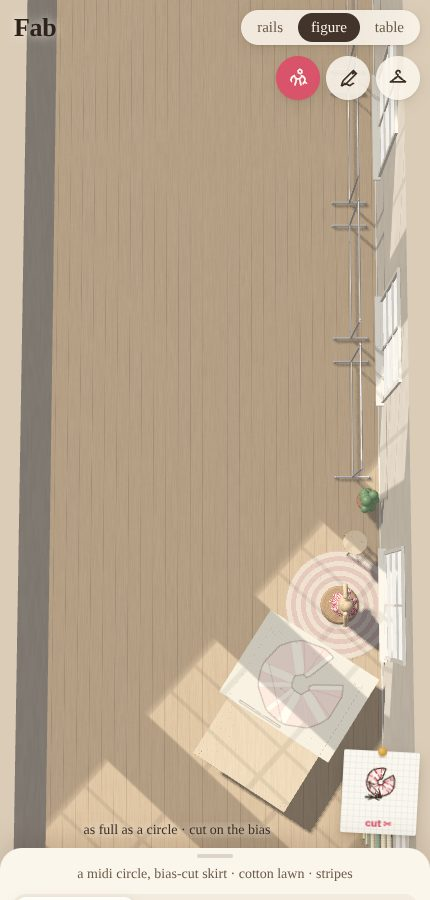
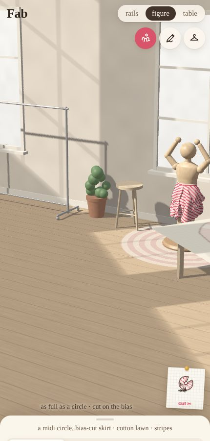
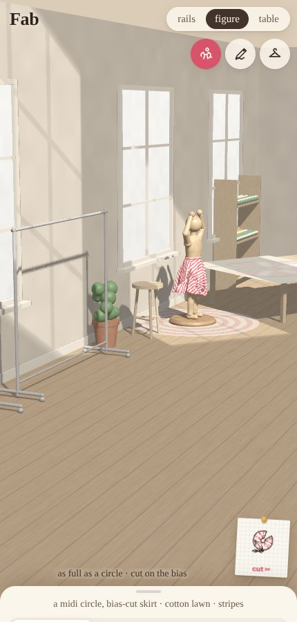

## The drawer

## What can be made

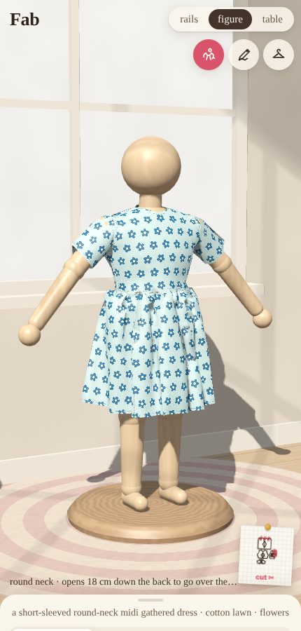
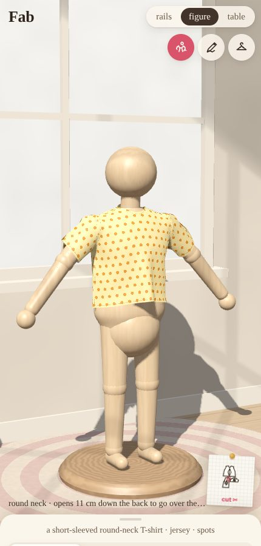
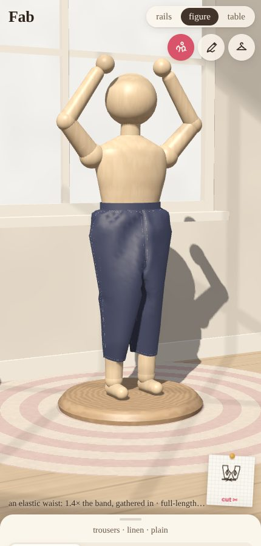
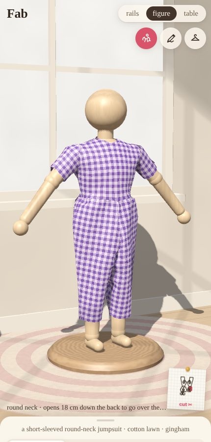
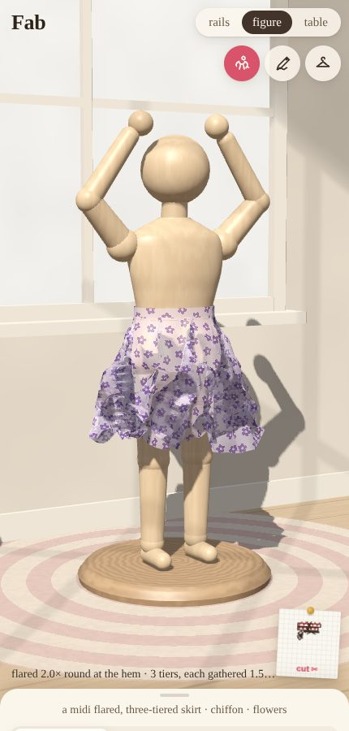
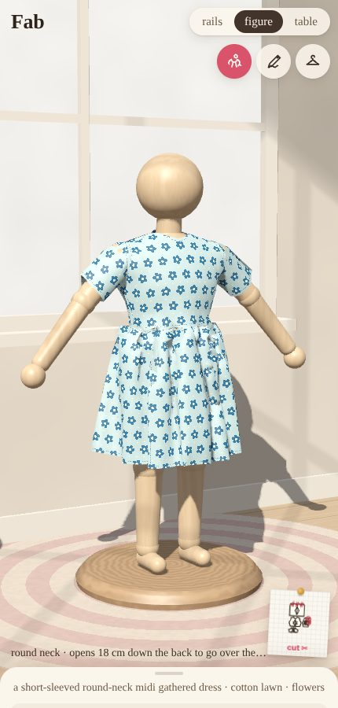
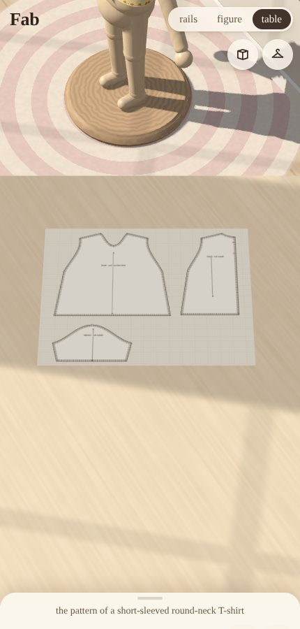
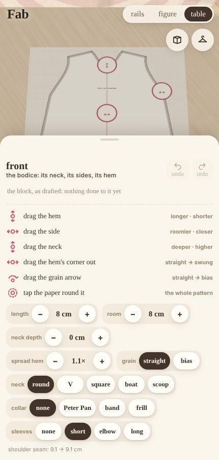
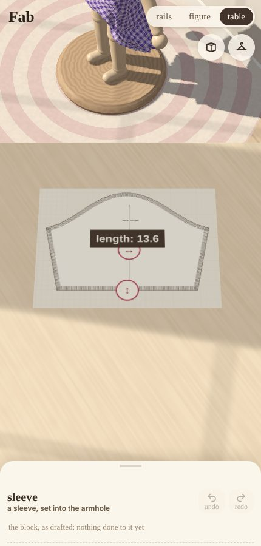
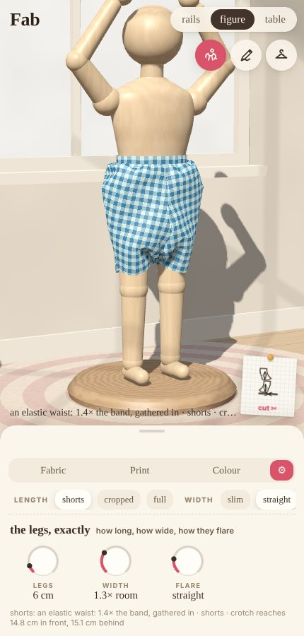

## The hand

## Slash

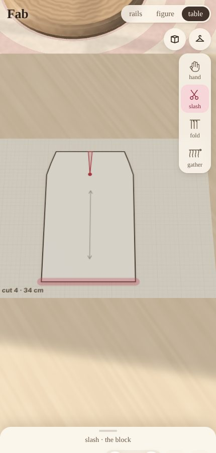

## Fold

## Gather

## Cloth

