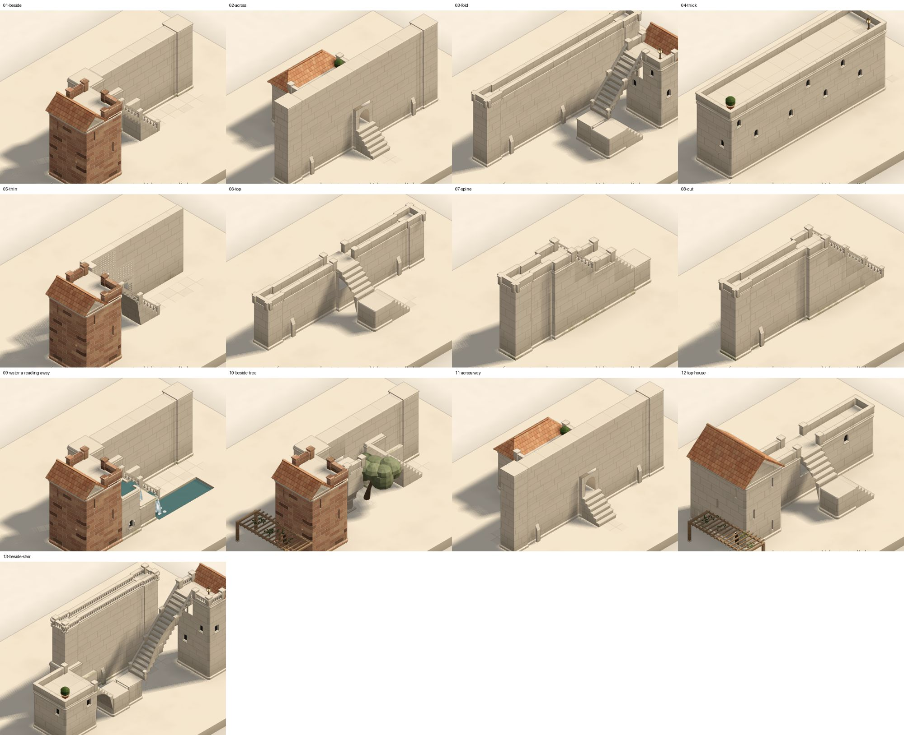
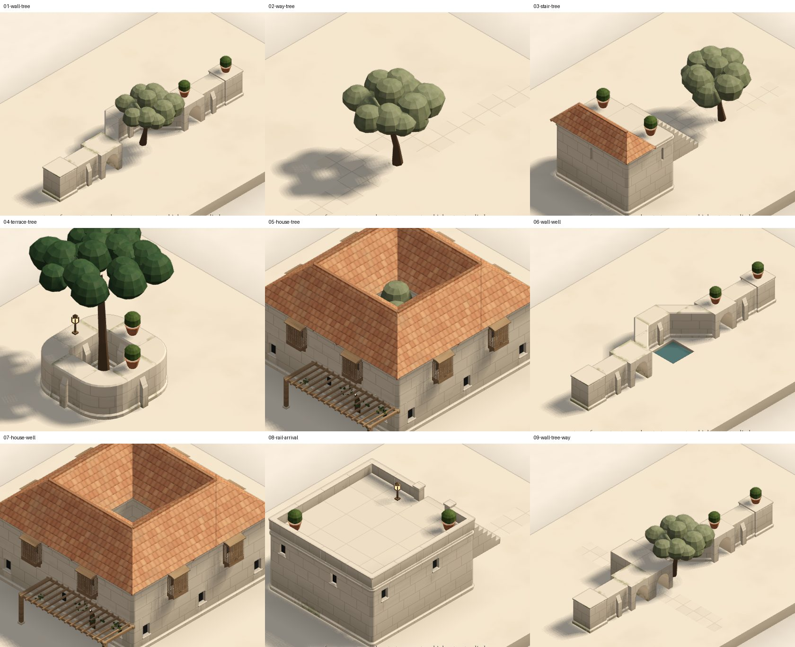
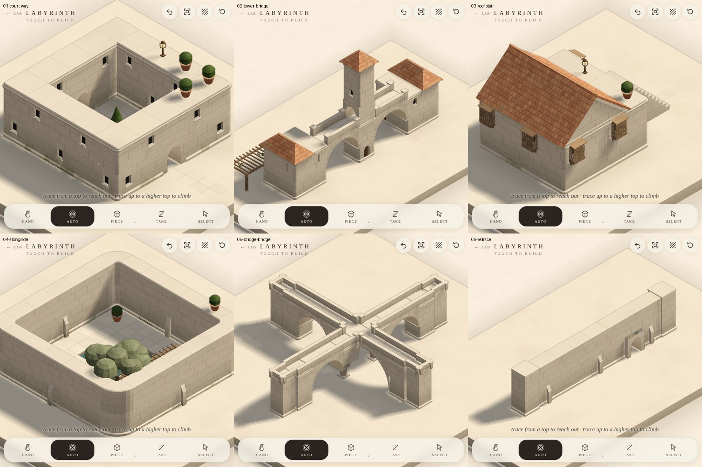
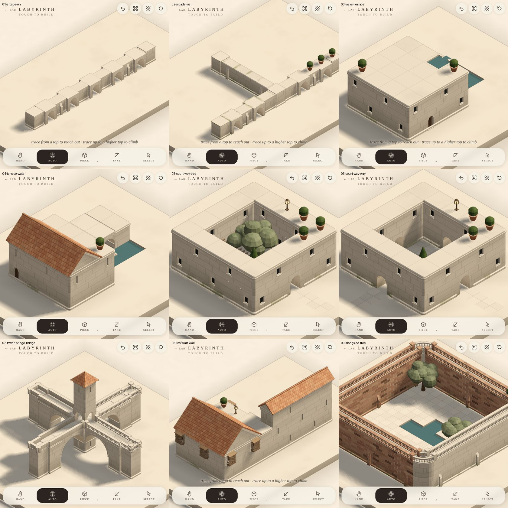
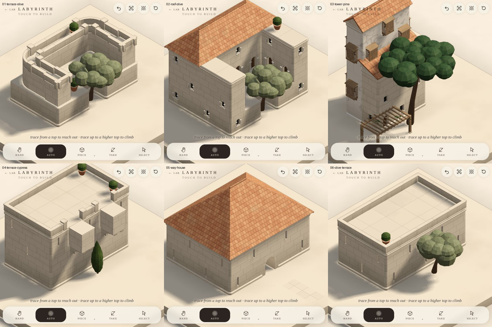

# Labyrinth: an atlas of encounters

Astra's note, in short: the ambition depends on what the material can become. Beneath finished pieces (a stair, a tower, a bridge) are more fertile ingredients: **thickness, surface, edge, void, span, fold, opening, rhythm**. What matters is what forms do when they meet (**penetrate, divide, wrap, thicken, exchange roles, interlock, dissolve, reconcile**), and how the hand's movement steers that (pass alongside, cross through, circle around, double back, broaden, pull upward, retrace). Pairs show whether forms meet; three-way combinations show whether a form can *adapt* or only *attach*.

The method proposed: map the encounters broadly; find the geometric capabilities recurring in the best results; build those as reusable operations; add forms that use them differently; test combinations of combinations.

This page is the first map: **wall × stair**, made the way a hand makes it.

## How it's made

`devtools/labyrinth-atlas.mjs`. Each case lays a setting (a wall, a terrace, pools, a tree), then draws one stroke through the production reading (`gesture.ts` `stroke()`: no intent in hand, as the app reads a stroke). What came of it is recorded and classed:

- **adapts**: one changed for the other (the wall opened, was cut, was walked, carried the stair);
- **attaches**: something was laid beside the other, neither changed;
- **refused**: nothing was laid.

That's generous, so each case also names what it would be **at its best** and checks for it (`BEST` in the harness): the measure that matters.

## Wall × stair, as it stands

| Case | At its best | What it is now | Best? |
|---|---|---|---|
| **beside**: up beside a wall to a terrace past its end | cantilevered steps hung from the wall | a flight hung from the wall | ✓ |
| **across**: up across a wall taller than the terrace beyond | the stair through the wall | climbs to a gate in the wall, the way on through it | ✓ |
| **fold**: a climb drawn folding back against a wall | two flights, a shared landing | a switchback: two flights, a landing at the turn | ✓ |
| **thick**: up a mass two cells thick (a house) | the stair inside it | in at a door at its foot, up its stair inside, out on its top (a terrace now) | ✓ |
| **thin**: beside a thin wall | a screen beside an exposed stair | the flight stands free (a thin wall carries no steps), the wall a jali beside it | ✓ |
| **top**: up to a long wall's top | the wall a promenade | walked along its top, railed both sides | ✓ |
| **spine**: along a wall that steps up | a stepped spine, its top a stair | walked up its top, a step at each rise | ✓ |
| **cut**: from the ground along a wall's length to its top | steps cut into the wall | steps cut into the wall, out on its top | ✓ |
| **water**: beside a wall, pools at its foot | a dry stair and a cascade | apart, as laid; **a reading away**, a cascade of basins beside the stair falling to the pool | ○ |
| **beside + tree** | the stair yields round the tree | passes it, hung from the wall | ✓ |
| **across + way** (a way along the far side) | through the wall, landing on the way | through the gate on to it | ✓ |
| **top + house** | the promenade arriving at a door in the house | walked, railed, an arched door in the house's face there (the wall itself read as an inhabited step of the house, windows in it) | ✓ |
| **beside + stair** (a second from the first's terrace, back the other way) | the two interlock, one landing shared | the terrace their landing, a switchback against the wall | ✓ |

**12 of 13 at their best as laid, the last a reading away** (2 of 12 at the start).

## The capabilities, built

| Capability (Astra's terms) | What it is in the model | Cases |
|---|---|---|
| **Penetrate / thickness** | a way's step can be carved into the hand's stone where the stroke's drawn over or through it, headroom cut, the stone over it kept as an arch or opened to the sky where it can't span (`World.carved`); a level way through stone a cell to three thick opens a gate, preferred to climbing over | across, across + way, cut |
| **Edge becomes surface** (exchange roles) | walking the hand's existing tops lays nothing, so costs almost nothing; a top a way arrives on is a **promenade** (`Buildings.promenade`): walked on along it at that height, railed both sides where it's a cell across and two up; a house face met at that height gets a door | top, top + house, spine |
| **Fold / interlock** | a climb drawn folding back on itself, that followed as drawn would climb in one flight, is read as a switchback; a terrace a flight arrives on is the next one's landing | fold, beside + stair |
| **Inside implied** | a stroke drawn over a house to its top: in at a door where the stroke meets it, up its stair inside, out on its top (`RULE.within`, kept at its foot) | thick |
| **Dissolve** | a thin wall carries no cantilevered steps; beside a flight it becomes a screen (the rules' dressing) | thin |
| **Water with levels** | an encounter, a flight beside water (`flight-beside-water`): apart, or a cascade of basins at each step falling to the pool, or that with a lantern at its head | water |

## Yield: what gives way to what

The second set (`--set=yield`): a tree, a well (a pool), a railed edge, met by a wall, a way, a stair, a terrace, a house. At their best one gives way round the other, which is kept.

| Case | At its best | What it is now | Best? |
|---|---|---|---|
| **wall × tree**: a wall drawn straight through an olive | bowed round it | bowed round it a cell out and back, the tree kept | ✓ |
| **way × tree**: a way drawn straight through one | round it | round it at its foot (it went up and over it before: the crown wasn't claimed) | ✓ |
| **stair × tree**: a stair up to a terrace, an olive on its line | the flight yields | the flight beside it, the tree kept | ✓ |
| **terrace × tree**: tapped up round an olive | notched round the trunk | a pit, the tree up through it (the last tap, on the tree, grows it) | ✓ |
| **house × tree**: raised round an olive, two deep | the house wraps it, a court open to the sky | a courtyard house: its roof in wings sloping in to the opening over the tree | ✓ |
| **wall × well**: drawn straight across a pool | bowed round it, or over it on an arch | bowed round it; carried over the water on an arch, the other reading | ✓ |
| **house × well**: raised round a pool | the house wraps the well | a courtyard house round the well | ✓ |
| **rail × arrival**: a way up on to a railed terrace's edge | the rail opens where it arrives | open there, railed round the rest | ✓ |
| **wall × tree × way** | bowed round the tree, a gate for the way beside it | both | ✓ |

What made the difference, all general:

- **A tree claims its crown** (`World.crown`): nothing a way lays goes through or over a tree's trunk and the crown above it, so a way meeting one goes round, near the stroke.
- **A wall bows** (gesture.ts `wall`): drawn through a tree or across water, it goes round it a cell out and back (the same routing a way round something uses, a cell from the stroke), and over water the other reading carries it across on an arch (`wallOver`).
- What was there already did the rest: stone laid where a tree grows leaves it a pit; a plan with a hole in it is roofed in wings, which slope in to it.

Together: **21 of 22 at their best as laid, the last a reading away.**

## Reactions: the gestures put to work

The third set (`--set=reactions`): pairings that ask a form to react to a gesture (cross through, pass alongside, retrace) rather than only to sit beside another.

| Case | At its best | What it is now | Best? |
|---|---|---|---|
| **court × way**: a way drawn in across a walled court and out the far side | a gate in, across the court, a gate out: thresholds | the wall arched where it goes in and where it comes out, the way paved across | ✓ |
| **tower × bridge**: a bridge between two blocks, straight through a taller tower | the walkway passes through the tower, the tower over it | through it, an arched passage at that height (round it, the other reading) | ✓ |
| **roof × stair**: a stair up to a roofed house | the roof gives way where it arrives: a terrace there | up to a terrace in the roof, the roof kept over the rest | ✓ |
| **alongside**: a way drawn inside a court, along its wall | a gallery along the wall, the middle kept open | a pergola along it, the middle open | ✓ |
| **bridge × bridge**: a second bridge across the first | one deck where they meet | they share the crossing | ✓ |
| **retrace**: a wall drawn again | it develops | a course higher (again: higher still, or arcaded) | ✓ |

What was added, all general:

- **A walkway passes through the hand's stone** (`realise`): a level way at height meeting a mass up to three cells thick, with stone over it, goes through it as an arched passage instead of stopping or climbing over. A gesture bridge whose line meets such a mass now prefers that, going round offered (and a short tower whose top it would merely take off isn't pierced: it goes round).
- **A gallery accompanies a wall** (the rules' dressing): a way laid along the inside of a court's wall for three cells or more gets a pergola over it.

## Combinations: arcades met, water with levels, three at once

The fourth set (`--set=combinations`): an arcade drawn on from and drawn up to, water and a terrace, and the reactions above with a third thing.

| Case | At its best | What it is now | Best? |
|---|---|---|---|
| **arcade on**: a wall drawn on from the end of an arcade | the arcade goes on, its beat kept across the join | an arcaded wall going on as the one it meets; the old end pier, an end no longer, opened again in the beat | ✓ |
| **arcade × wall**: a wall drawn up to the middle of an arcade | it lands on a pier, the arches either side kept | the arch it met filled solid (its way would have come out into the wall's end), the rest kept | ✓ |
| **water × terrace**: a basin let into a terrace's edge, a pool below | it spills into the pool | a spout over the edge into the pool | ✓ |
| **terrace × water**: the terrace pushed out over a pool | it stands over the water on arches, the pool kept | carried on an arch, the pool under it | ✓ |
| **court × way × tree**: a way across a walled court, an olive in its middle | gates in and out, the way bowing round the tree | so (it climbed over the court's walls before: nothing let it go round the tree) | ✓ |
| **court × way × way**: a second way across the court, crossing the first | four gates, crossing in the middle | so | ✓ |
| **tower × bridge × bridge**: two walkways through one tower | both through it, crossing under a cross vault | so (the second went round before) | ✓ |
| **roof × stair × wall**: a stair beside a wall up to a roofed house | hung from the wall, on to a terrace in the roof | so | ✓ |
| **alongside × tree**: a way along a court's wall, an olive on its line | a gallery along the wall, giving way round the tree | a pergola each side of the tree, the way bowed round it | ✓ |

What was added, all general:

- **A wall reconciles with the wall it goes on from** (`runOf`, gesture.ts `wall`): drawn on from the end of a wall, in line with it, it takes that wall's kind (thin, arcaded, gated, plain) and its beat: an arcade's arches every other cell counted from its last, a gated wall's gates six apart. An arcade's end pier, an end no longer, is opened again so the arches run on through.
- **A wall lands on a pier**: drawn up to a gate or an arch square to it, where the arch's way would come out into the wall's end, that bay's filled solid. A gate a way was drawn through is never filled.
- **A way bows round a tree before it's followed**: drawn through a tree, it goes a cell out and back round it there, so it yields to the tree wherever it is, in a court or out, and opens gates in walls as drawn.
- **A walkway crosses another inside stone**: a bridge through a tower that already has a walkway through it passes through too, and the two make a crossing under a cross vault (`World.crossings`).

Together: **36 of 37 at their best as laid, the last a reading away** (42 of 43 with reshape below).

## Reshape: an outline changed in place

Astra's critique of the encounters: the verbs (yield, wrap, frame) were tags on candidates, not capabilities. "Yield" laid nothing; "notched" laid nothing; "wrap" was a ring of paving; "frame", a lantern. The engine couldn't take an outline and make it give way.

So the first capability, **reshape a boundary locally** (`client/labyrinth/outline.ts`), is three operations on the hand's own stone, laid like any other, so everything worked out after them (supports, roofs and their wings, rails, the walk, buildings and doors) reads the new outline as it reads one the hand drew:

- **cut back** (`cutBack`): columns taken out from a level up to the sky, the courses under kept;
- **carried round** (`carryRound`): stone added beside the outline, out in the air, the rules carrying it on corbels;
- **set back** (`setBack`): a face opened at its foot under an arch that runs in and stops: a porch, the door at its back.

Three encounter rules use them, and the setting says which answer each starts at. They aren't rungs of more and more:

- **stone in a crown** (`stone-in-crown`): the hand's stone where an olive's or a pine's crown spreads. Either the crown is pruned to the stone, or the stone is cut back round the crown. **What came first decides:** stone laid after the tree gives way to it; a tree planted after the stone is pruned to it.
- **a cypress at a raised edge** (`edge-round-cypress`): the edge reaches round it on both sides, a bay for it, or it stands against the edge as it is.
- **a way at a face** (`way-at-face`): a door in the face, or set back under an arch. Set back where the mass is three deep there, in the face where it's less.

| Case | What it is now | Best? |
|---|---|---|
| **terrace × olive**: a terrace laid up to an olive at its edge | notched round the crown, open to the sky, the lower course kept as a ledge at its foot, the rail following the notch | ✓ |
| **roof × olive**: a house raised against an olive | the plan notched; the roof over what's two cells wide or more, the thin arms beside the notch flat (a plan with parts too thin to roof is now roofed where it can be, the rest a terrace, instead of losing its roof) | ✓ |
| **tower × pine**: a tower beside a stone pine | stepped back three courses up where the pine spreads, full below | ✓ |
| **terrace × cypress**: a cypress planted at a terrace's foot | the edge reaching round it on corbels, a bay for it | ✓ |
| **way × house**: a way drawn up to a house's face | a porch: the door set back a cell under an arch | ✓ |
| **olive × terrace**: an olive planted at a terrace already there | the terrace kept, the crown pruned to it (the other answer, by order) | ✓ |

Also fixed on the way: stone is never laid in a tree's crown over its trunk (it was laid two courses over an olive); the tree meeting's first answer and the terrace-beside-a-flight's are now labelled as what they are (apart, as they are), not "yield" and "notched". Every new rule runs through the connector checks in eight orientations (1680 checks).

## Next

What the atlas hasn't mapped yet: a stair meeting an arcade (through a bay, or up beside its piers), water and a court (a channel along a way, a fountain at a crossing), and combinations of combinations: one of these settings met by two strokes in different orders, to see whether the result depends on which came first.
