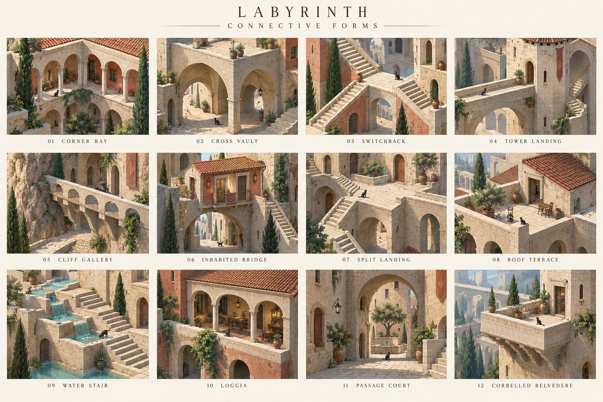
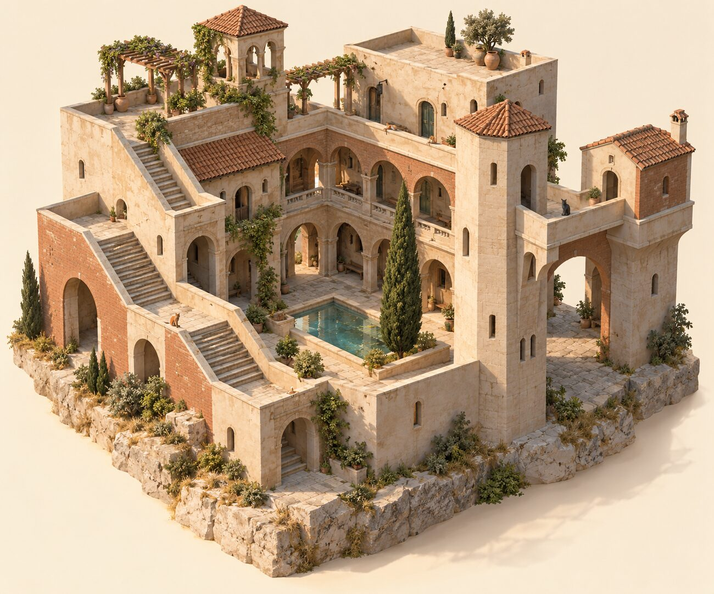
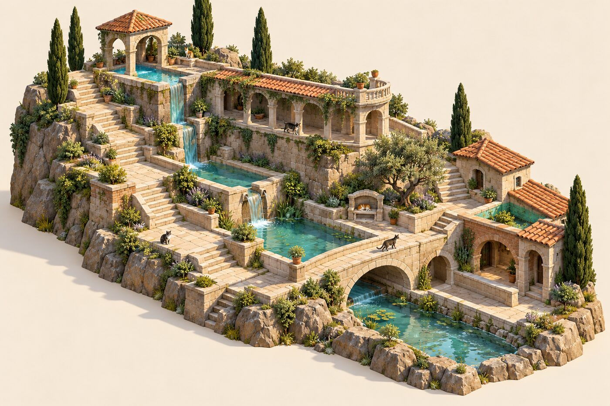

# Labyrinth: an expanded grammar of connective geometry

Design audit and proposed extension, 20 October 2026 (from a design critique by a peer agent, Astra, kept here as the reference the work builds against). What's been built from it is listed at the end, under **Progress**.

Status: a source-grounded design specification and concept studies. The concept images show aspirations, not output, and not exact geometry: some of their stair connections need correcting (the "switchback" panel reads as a branching stair, not two opposing flights with a half-landing).

The primary commitment: **the visible form may change dramatically, while the authored mass, passage or connection stays recognisable in what it becomes.** Describe what must remain open as carefully as what becomes solid, so new mass can turn a bridge into a house and keep its passage, or a wall into a gallery without blocking its stairs.

## 1. What the foundations already contain

| Layer | Present in source | Boundary exposed |
|---|---|---|
| Authored pieces (`palette.ts`) | block, thin wall, arch, stair, bridge, cypress, pool; traced runs; closed strokes fill; raised basins | seven tools hide a much larger generated vocabulary; more buttons won't address the limit |
| Structural resolution (`model.ts`, `mesh.ts`) | spans, arcades, piers, lintels, colonnades, corbels; stair cells; courts; basins, spills, catch bowls | spans and stairs are directional and per-cell; intersecting volumes, shared landings and inhabited spans need richer collective representations |
| Local form (`form.ts`) | thin runs and full mass; rounded corners; quarter-circle bends; diagonal runs; posts, buttresses, octagonal stair turrets | strong local continuity; needed across larger assemblies and heights |
| Buildings (`buildings.ts`) | doors at useful arrivals; windows; inferred internal stairs; hipped, gabled, shed, domed roofs | a building is grounded solid columns at one height; roofs need rectangular plans; an inhabited bridge or a hollow upper room isn't one |
| Assemblies (`motifs.ts`) | arcade, bridge, flight, wall, tower, terrace, court | no junctions, thresholds, covered routes, shared landings, stacked crossings |
| Context (`context.ts`) | retaining walls at used banks, excluding water and stairs | no general transition grammar between terrain, water, passage and building |
| Character (`character.ts`, `mesh.ts`) | materials, parapets, balustrades, jali, pergolas, mashrabiya, colonnettes, pots, lanterns, planting | variety is already available as dressing; more ornament won't make more expressive space |

Corbels, curved walls, colonnade proportions, spills into bowls and stair towers' interior connections already exist: generalise them, don't reinvent them.

## 2. What a "piece" should mean

A piece is a small architectural relationship with several possible resolutions, part of a cell or many; its mesh is one result of its relationships, not its identity. Four levels:

1. **Primitives**: solid, void, floor surface, opening, edge, support, water surface.
2. **Connectors**: threshold, landing, corner bay, crossing, abutment, roof junction, spill lip.
3. **Assemblies**: arcade, loggia, switchback, gatehouse, inhabited bridge, terrace garden.
4. **Compositions**: courtyard neighbourhood, cliff settlement, water garden, stacked passages.

Most new expressive capacity comes from levels 2 and 3; primitives and the toolbar stay modest.

## 3. Eight families

| Family | Forms | Context that selects | Connective behaviour required |
|---|---|---|---|
| Span and support | segmental, semicircular, pointed arches; lintels; coupled bays; deep transfer arch; corbelled balcony; stepped abutment | headroom, span/rise, width carried, route beneath, neighbouring bay rhythm | consistent spring lines, shared supports; keep clearance; never a pier in a passage to satisfy support |
| Junctions | corner bay; T landing; four-way crossing; widened meeting terrace; offset threshold; chamfered corner | two or more route ends, their widths, heights, directions, turning room | one continuous walkable surface, guards right, shared piers, no overlapping caps |
| Vertical movement | straight flight with landing; quarter-turn; switchback; split stair; stair street; wall stair; tower wrap; internal stair | rise/run, room, arrival direction, wall or tower beside | endpoints connected, clearance; pauses become flat useful space; never arriving at a railing or blank wall |
| Covered space | barrel-vaulted passage; groin-vaulted crossing; loggia; porch; portico; covered stair; two-storey arcade | a route under mass, crossing voids, a court-facing edge, load or shelter over | usable volume under the roof; what's above respects the opening below |
| Inhabited thickness | gatehouse; room over a bridge; projecting bay; inhabited retaining wall; niche; passage through a house | mass over a route, a thick boundary, a terrain cut, a room beside | buildings recognised above air and round voids; doors connect real reachable surfaces |
| Roof and terrace | partial roof beside a terrace; joined pitched wings; lean-to at a taller wall; roof return; roofed gallery; pavilion; lantern | footprint, neighbouring height, circulation, exposed edge, local family | ridges, valleys, eaves, thresholds resolved together; never every roof lost because one small area is walked |
| Terrain and water | terraced retaining wall; stair cut through a bank; cliff gallery; quay; culvert; rill crossing; stepped cascade; aqueduct | gradient, wet edge, route crossing, water level | foundations meet terrain; water at continuous levels or explicit drops; a dry crossing kept where the player made one |
| Edges and inhabitation | continuous parapet with corners and ends; bench niche; seat; shaded perch; cat ledge; planter edge | exposed drop, arrival, quiet recess, shade, unused edge | out of the route; guards end at openings; cats use reachable surfaces |

Variation should have causes (a flatter arch where headroom is scarce; repeated bays share an order; brackets where the path below must stay open). Family and proportion choose among valid variants; seeded variation picks details after. A few coherent local families (plain monolithic stone, refined arcade, brick-and-stone domestic) rather than random traditions per arch.

## 4. Twelve connectors

| Connector | Eligible when | Resolution | Failure to prevent |
|---|---|---|---|
| Corner bay | two perpendicular galleries, one height, room for the intersection | shared landing and pier; the arch springing returns round the corner | two arches in one corner; a parapet cutting the turn |
| Cross vault | two crossing clear corridors under a supported surface | a groin vault with four usable portals | a decorative vault whose navigation treats the centre as solid |
| Switchback | two opposing parallel flights, room for the turn | a flat half-landing joins them; void and support under it resolved together | zigzag steps, or flights crossing with no landing |
| Tower landing | a route arriving at a tower wall at a known height | threshold, landing, opening; continuing inside or out | reaching the tower and meeting a closed face |
| Cliff gallery | a route along a retaining face over a lower lane or drop | a deck on brackets or piers off the wall; an outward guard | filling the lane below, or floating beside the bank with a seam |
| Inhabited bridge | a span carrying a room with a reachable entrance | bridge support plus a room, roof and useful openings | the room rejected for not being grounded; a room with no way in |
| Split landing | three approaches, maybe unequal heights | one meeting surface, short connecting flights | three stair solvers competing for one cell |
| Roof terrace seam | a walked roof region beside an unwalked one | a local terrace and guard; the pitched roof kept; a clean eave/threshold joint | the whole roof lost to a local access |
| Water stair | basins stepping down beside a dry route | connected rills, explicit spill lips into receiving basins | water across a dry landing, or flowing uphill |
| Loggia | a covered outward band of useful floor beside a room or court | open bays, a shared roof or deck, accessible entrances | a facade with no depth to stand in |
| Passage court | a thick inhabited edge between outside and an enclosed open space | a gate passage, widened threshold, perhaps a room over | court recognition sealing the gate it needs |
| Corbelled belvedere | a small floor projecting from substantial mass | brackets, a continuous parapet, the space beneath left open | unbounded cantilever growth; railings across its entrance |

## 5. A common contract for pieces

Each resolved assembly exposes:
- **Ports**: position, orientation, width, floor height, role (walk, doorway, support, roof, water).
- **Occupied geometry**: where material stands.
- **Reserved void**: headroom of a passage, turning room, threshold space, apertures that must stay open.
- **Support relationships**: what carries what (stylised rules, not physics).
- **Boundary profile**: top, soffit, edge, eave, parapet, spring line, so neighbouring meshes agree.
- **Authorship**: which parts express a gesture, which were selected, which are inferred.
- **Stable identity**: an assembly keeps its character when an unrelated neighbour changes (never re-rolled because its minimum cell key changed).
- **Occupancy and navigation**: the same surfaces and voids drive drawing, picking, routes and inhabitants.

Two floor ports match only if height, width and clearance can be resolved continuously; otherwise a transition connector goes between. Water ports need compatible levels or an explicit fall. A roof edge isn't a walking port by default.

Resolution order: authored mass and routes → usable floors and reserved voids → junctions and thresholds → supports → building and room envelopes → roofs and guards → surface detail and inhabitation. A bounded local re-solve with deterministic priorities; report failure rather than relocate the authored route.

## 6. How additions transform a composition

**Courtyard neighbourhood.** An L-shaped wall and one stair: a small enclosure. An elevated route along it: the wall becomes an arcade, the corner a shared landing. A crossing: the lower passage is kept and the upper surface becomes a bridge. Mass on the bridge: its support deepens into an inhabited span. The tower beside extended: its arrival becomes a door and a stair. Each step reinterprets a shared structure; none attaches another finished prefab.

**Hillside water garden.** A platform against a bank becomes a retaining terrace. A route down the slope, a stair street with flat resting places. Water on the upper terrace forms a basin; lower basins a cascade beside the dry stair. A lateral route becomes a cliff gallery on brackets; mass over part of it, a loggia or an inhabited retaining wall.

**Stacked passage quarter.** Two crossing ground routes. Build over one: a barrel-vaulted passage. Over their crossing: a cross vault. A raised route: the supported roof becomes a terrace. More mass: only its part is roofed, keeping the terrace's access.

Composition preferences (soft, never grounds for moving the player's construction): keep at least one dominant void; cluster heights rather than checkerboard them; a repeated bay rhythm within an assembly; one connector can carry several roles; quiet surfaces beside detailed junctions; distinctive roofs and towers as occasional accents.

## 7. Sequence with the greatest return

1. Landings, thresholds and edge continuity.
2. Reserved voids and support alternatives: keep passages through upper growth; crossing vaults; predictable choices among valid supports.
3. Buildings above air and round voids: gatehouses, loggias, inhabited bridges.
4. Partial and joined roofs: roof regions, terrace seams, joined wings.
5. Terrain and water transitions: quays, culverts, cascades, dry crossings.
6. Richer families and inhabitation, once shared geometry and navigation are reliable.

Most forms should emerge from the existing mass, way and pool actions; direct controls adjust scope, height or family where inference isn't enough.

## 8. Evaluation

For each connector: rotations, reflection, uneven ground, unequal approach widths, partial deletion, extension into an already occupied scene, and both edit orders (bridge then room, room then passage; wall then stair, stair then wall). Differences can be intended where authorship differs; an unexplained loss of access can't. Check endpoints and clearance, not only the world's overall connectivity (a remote route can make a global check pass when the requested crossing is unusable). Each review records the hand's local obligation, the transformations allowed, and the authored relationships that must survive; geometric validity is measured apart from coherence. Small input perturbations keep the kind and place of the action; varied surroundings give richer valid resolutions.

## Progress

What's been built from this, and where:

- **Reserved voids (§5, §7.2)**: authored passages (ways laid, paving) are void the model keeps open. Mass added into one becomes an archway with the passage through it; piers never stand in one; a way drawn through a wall one cell thick opens a gate in it. (`model.ts`: `World.passage`.)
- **Stable identity (§5)**: a building's character is anchored to the operation that first laid it, so an unrelated neighbour doesn't re-roll it. (`buildings.ts`.)
- **Roof terrace seam (§4)**: arriving on part of a roof makes that part a terrace; the rest keeps its roof. (`buildings.ts`.)
- **Connector scenarios (§8)**: `devtools/labyrinth-connectors.mjs`, each connector's failure-to-prevent as its check, both edit orders, the four rotations.
