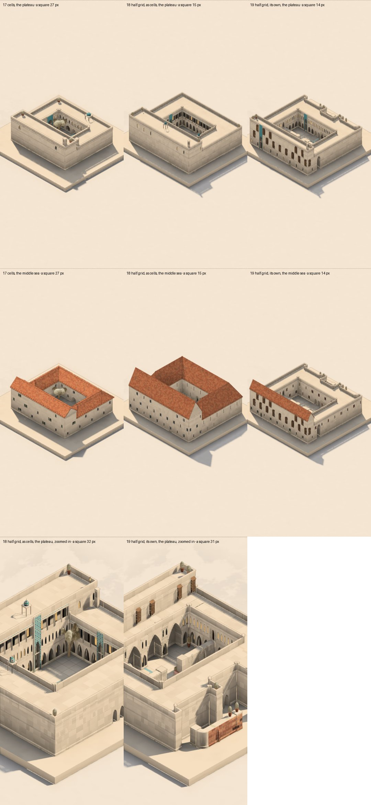

# A finer grid? The courtyard house three ways

*Since adopted: new worlds are built on the half grid. What changed is in the half grid section of [labyrinth.md](labyrinth.md).*

The question: should a placed cell be four of today's in plan, its storeys as tall? Then thin walls and narrow paths come by default, and today's masses are built up out of them, so there is room for the in-between: piers, setbacks, recesses, pilasters. This spike builds one fixture three ways and compares them. Measurements come from `devtools/labyrinth-grid-spike.mjs`.

- **Cells** (story 17): the courtyard house as it is.
- **Half grid, as cells** (story 18): the same house on the half grid, each cell made four. This measures what the house costs there.
- **Half grid, its own** (story 19): the house as the half grid would build it:
  - wings a cell and a half deep;
  - a gallery of piers half a cell thick along the north wing's court side;
  - its top storey set back half a cell;
  - the gate recessed half a cell into the south front, between pilasters;
  - the court split by a thin wall with a gate in it;
  - a forecourt walled thin, with a path half a cell wide.
- **Edge walls**: walls on the lines between cells, rooms filled between them. This is reckoned by hand below, because the model has nothing to build them with yet.

`?plan=0.5` draws a half-grid world in its own proportions: squeezed in plan, its storeys as tall as before. It is for looking only. A touch strikes where it would have struck unsqueezed.

## What it costs to draw

These are medians of five, in node, on the bare slab. "Replay" is building the world from its ops; "mesh" is everything drawn (buildings, fronts, roofs).

| | cells | replay | mesh, middle sea | vertices | mesh, plateau | vertices |
|---|---|---|---|---|---|---|
| 17 cells | 122 | 44 ms | 150 ms | 92k | 76 ms | 51k |
| 18 half grid, as cells | 488 | 60 ms | 248 ms | 157k | 156 ms | 67k |
| 19 half grid, its own | 431 | 19 ms | 194 ms | 95k | 226 ms | 102k |

- **Mesh time:** the same house on the half grid costs 1.6–2× as long to mesh. The half grid's own house costs 1.3–3×. On the plateau, its extra arches and bays make it dearer.
- **Vertices:** these stay within 2×.
- **Grid size:** the cost not shown here is that the grid itself would go from 48 to 96 across to keep the same land. That means four times the cells the land, the ways and the cats read, and every distance in the rules doubled. Examples are arcade spacing, how far a court looks, and the bay lengths of the fronts.

## What it takes a hand to build

These numbers come from a model of the gestures:

- each storey is laid in straight strokes (the fewest runs);
- "travel" is how far the finger goes, with a cell as one unit;
- an arch cut is one stroke.

| | strokes | travel | taps, cell by cell | strokes with a brush 2 wide | travel |
|---|---|---|---|---|---|
| 17 cells | 27 | 122 | 122 | — | — |
| 18 half grid, as cells | 54 | 244 | 488 | 28 | 122 |
| 19 half grid, its own | 70 | 216 | 431 | 66 | 120 |

- **Same house, half grid:** built with a brush one half cell wide, it takes twice the strokes and twice the travel. Raising it cell by cell takes four times the taps.
- **A brush two half cells wide** (the default it would want) brings the same house back to today's effort. What thickness the brush has decides most of the cost, not the grid.
- **The half grid's own house:** its extra strokes are mostly its extra detail:
  - about a dozen piers and pilasters, each one tap;
  - thin walls, each one stroke;
  - the set-back storey.
- **The conclusion on effort:** detail costs gestures in proportion to how much of it there is, and plain mass costs what it does today.

## What you can place yourself

**Cells.** A wall or a way is a whole cell or nothing. Today, the in-between comes only from the rules:

- piers and corbels the resolver makes;
- the wall piece's thin walls;
- what the fronts compose: galleries, portals, jetties.

The hand can't set a wall half back, put a pilaster on a front, or make a path narrower than a cell.

**The half grid's own house** (19) shows all of these placed by hand:

- piers half a cell thick, with arches a cell wide between them (the resolver arcades them as it would any run);
- a storey set back half a cell;
- a gate recessed into its front;
- pilasters;
- a thin wall through the court;
- a path half a cell wide.

Each reads at the zoom you'd place it at (the bottom row of the sheet).

**What broke in the first round:** the rules still measured in cells.

- **Windows:** each face was given one window per half cell, so 19's fronts had twice as many, narrow and close-set.
- **Roofs:** in the middle sea, roofs formed only over the north wing, not over the wings a cell and a half deep.

### The second round: the rules read bays

A world on the half grid now says so (`w.bay = 2`). These rules now read in bays of two half cells:

- **Openings and a front's parts** (buildings.ts `pairOf`, facades.ts `inPairs`, mesh.ts):
  - two plain faces side by side along a front make a bay;
  - the one at the even square leads, and draws the bay's window, door, gallery arch, portal, paired windows or loggia across both faces, at a cell's size and depth;
  - its partner leaves it the room;
  - doors move to their bay's leading face;
  - a face with no partner (an odd one at a front's end) stays plain;
  - rhythms that went every other face (windows, balconies, high windows) now go every other bay.
- **Buildings:**
  - a mass is a building when it has two cells by two somewhere in it (four half cells by four);
  - a tower is up to two cells;
  - a plan's wings are at least a cell and a half wide, up to eight of them.
- **Roofs** (roof.ts): pitch and overhang are worked out as a cell's.
- **Galleries:** the top of a gallery carried along a building's own front, under its storey, is the building's own top. A way onto it doesn't make the roof walked. Without this, 19's ring was read as a terrace and left flat.

Nothing changes on the cell grid: the drawing of stories 1–16 hashes the same in all four traditions.

**Story 19 after:**

- **In the middle sea:**
  - the whole house is roofed: five hipped wings round the court, the set-back storey gabled over them;
  - its windows are a cell apart, shuttered, at a cell's size;
  - the 1.5-cell wings carry the same roof a 2-cell wing does, a little lower.
- **On the plateau:**
  - a gallery of arches a cell wide runs round the court, with paired windows over it;
  - the outer walls are blank, as a court house's are.
- **The set-back top storey reads as a building of its own:**
  - it doesn't face the court, so its portal is at its outer door and its windows go all round;
  - that's the same rule on cells, not the half grid.

**Story 18** (the same house made four) now draws much as 17 does. Its fronts lost their doubled windows: 144k vertices against 157k.

**What it costs:** meshing story 19 in the middle sea now takes about 450 ms for 194k vertices, against 130 ms and 92k for story 17. Most of that is the roof tiles: they are laid per unit of the unsqueezed drawing, so the half grid draws twice the courses. A real move to the half grid would build its geometry in true cell units, and that cost would go.

## Legible on a phone?

At a phone's size (390 × 844, as the app opens):

- a cell comes to **27 px**;
- on the half grid, a half cell comes to **15 px**.

A finger is about 40–45 px. Placing a single half cell needs the view zoomed in about twice (**31 px**, the bottom row). Pinching in is already the gesture for this; the default framing stays as it is.

The overview stays legible, and slightly richer: 19's setbacks, pilasters and recess read at the default zoom; 18 reads as 17 does.

## Edge walls, reckoned by hand

**Building the courtyard house with edge walls takes:**

- 2 closed traces, the outline and the court;
- 4 short traces between the wings;
- 1 fill a storey per wing (9 fills).

That is about 15 gestures, fewer than today's 27. Walls are thin by definition.

**But the model has no rooms.**

- Air enclosed under stone becomes an arch, a span or a passage. The resolver, the ways and the cats all read solid cells.
- Edge walls would need a new primitive: a room, which is enclosed air under a roof.
- They would also need a second way of drawing, with walls on lines rather than in cells.

**What edge walls show from outside:**

- At the façade, a thin wall on an edge and a half-cell wall look much the same.
- Where they differ is inside, and the camera looks at roofs, courts and fronts, not interiors.
- Thick things (piers, buttresses, a deep gate) would still need cells.

So edge walls cost the most to build into the model, and pay off mostly where the view doesn't look.

## Where it leaves us

**The half grid works**, in look, in cost and in effort, provided two things hold:

- **The brush:** the default is two half cells wide, so mass is as quick to build as today and thin is a choice.
- **The rules read bays.** The second round shows that this is contained:
  - a pairing of faces;
  - three thresholds in buildings.ts;
  - two in roof.ts;
  - one change to the gallery rule.

  It needed no change to how anything is drawn.

**What a real move would still take:**

- **The grid:** from 48 to 96 across.
- **Distances:** every distance in the rules doubled (arcade spacing, how far a court looks, a front's runs).
- **Geometry:** built in true cell units, not squeezed after.
- **Touch:** half-cell picking, and the two-wide brush.
- **The other traditions:**
  - the north's jetties still draw their windows a face at a time;
  - the courts' gardens are laid per square.

**Edge walls aren't worth a new primitive for this camera.**
