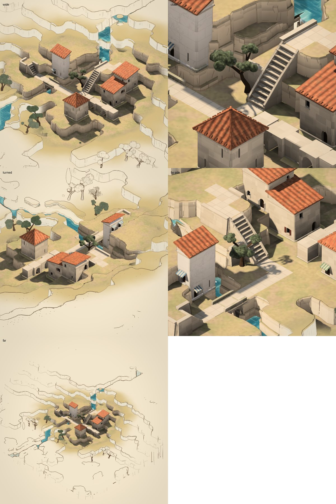
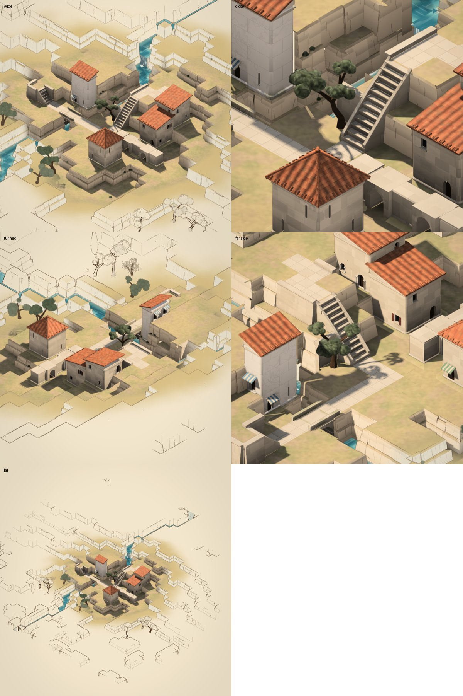
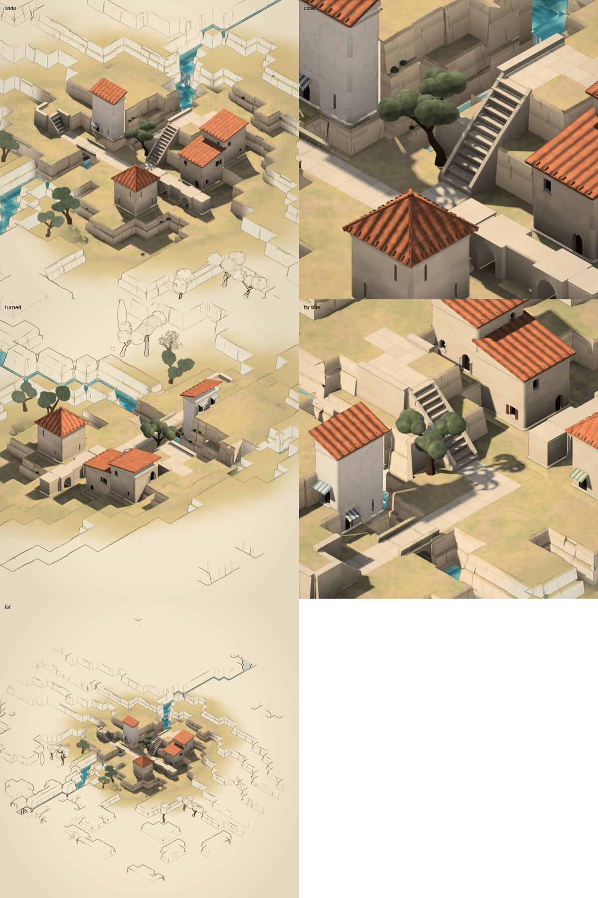
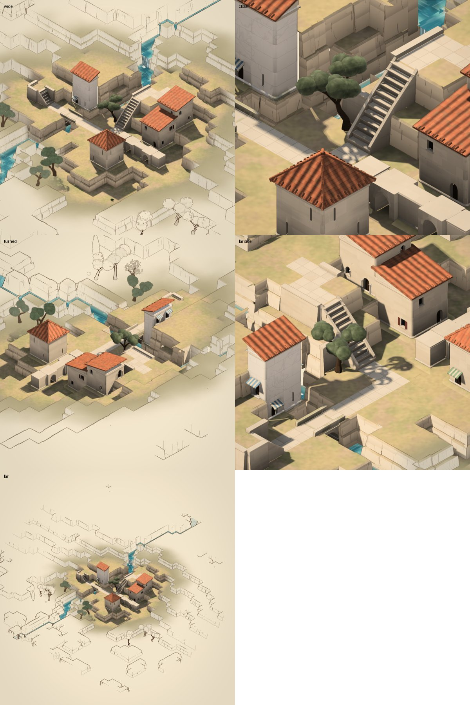
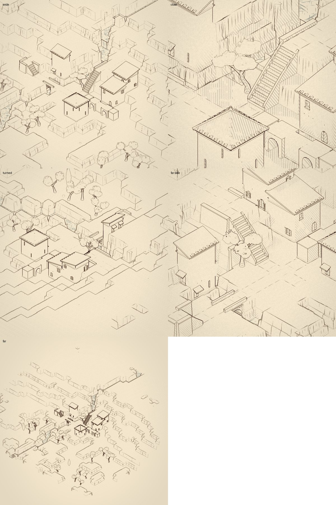
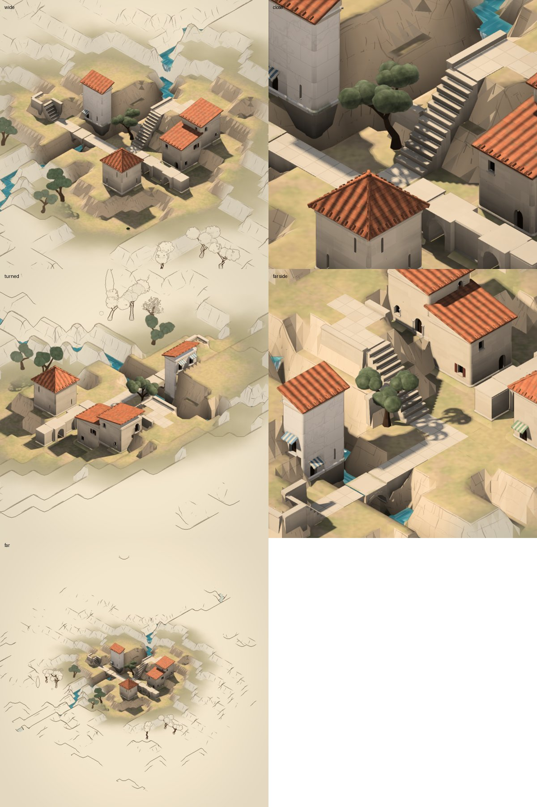
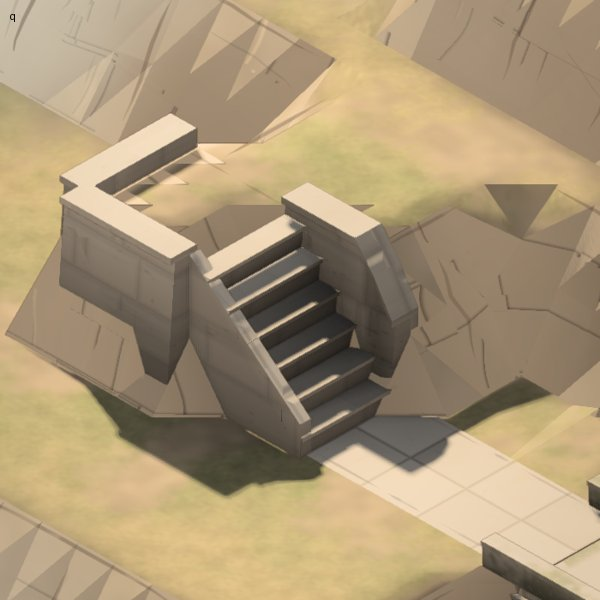
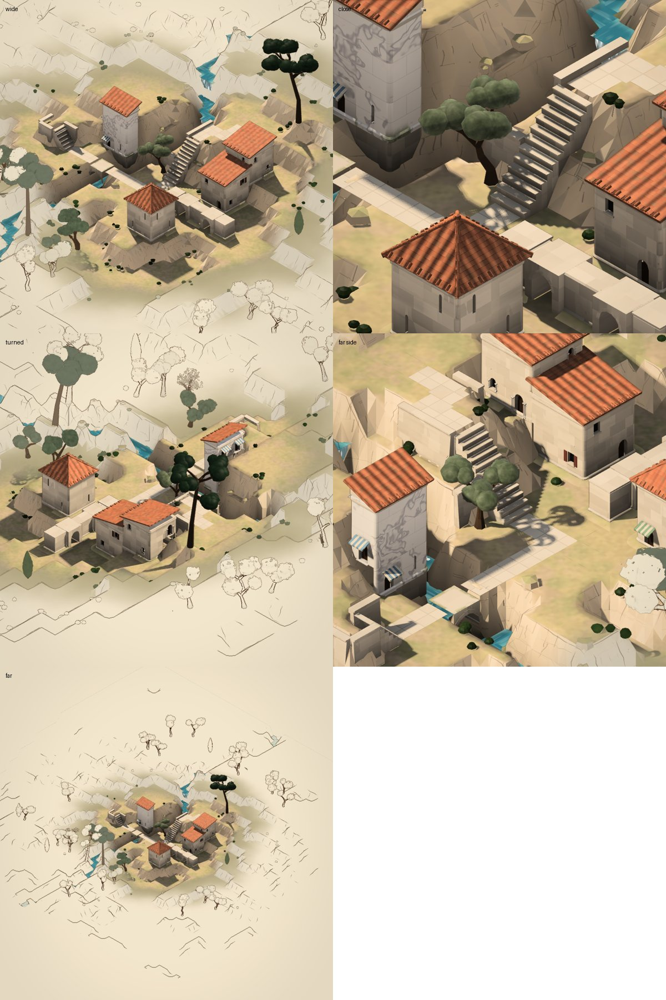
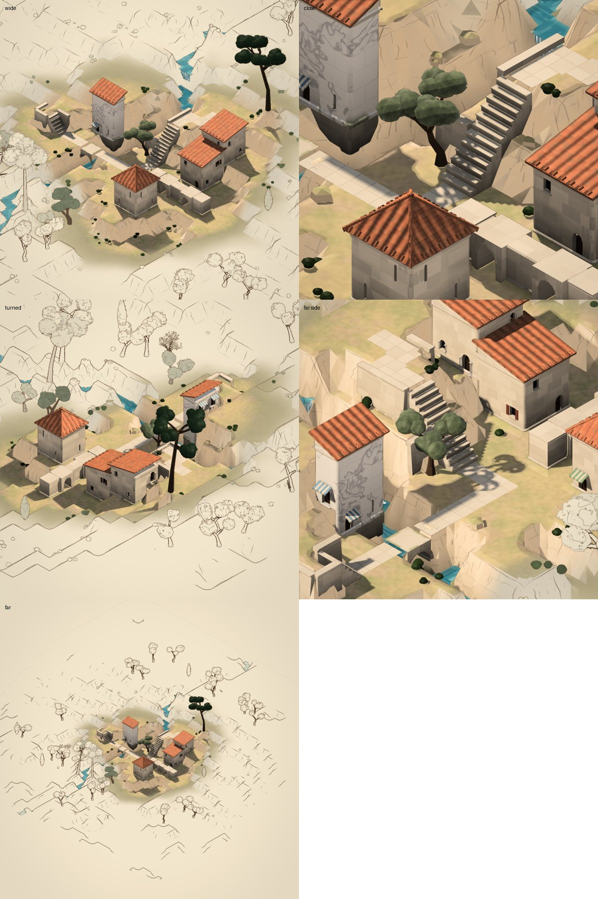
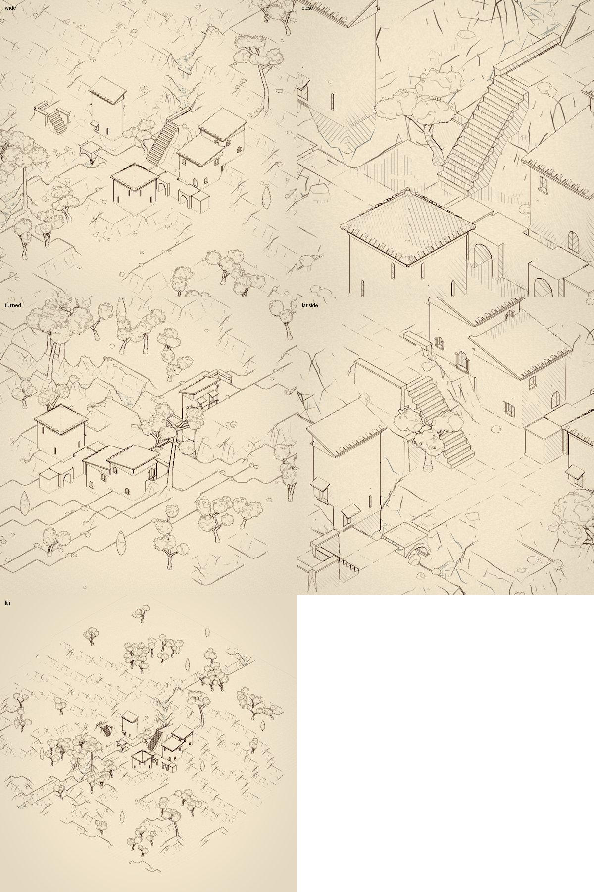

# Labyrinth: the look

The target: the concept studies (warm stone on a cliff over a turquoise stream, terracotta roofs, olives and cypresses, drawn as a miniature on paper). The style comes from convincing small-scale physical construction, shown with the restraint of an architectural illustration. Astra's read of the renderer: *surfaces have colour detail, but too little physical relief.* Stone joints and pores were drawn as colour; roof tiles were alternating colour on flat slabs; and the light still saw the underlying flat faces.

## How it's judged

One fixed place, the **study** (`?story=16`, demo.ts): three houses, a tower set into the cliff, an arcade, a stair, olives, the stream and its fall. It is drawn in the same four views every time (`node devtools/labyrinth-look.mjs --tag=NAME` → `static/labyrinth/look-NAME.jpg`). Every change to the renderer is looked at in these, before and after.

## Stage 1: light, kept apart

- **Linear light, one display transform.** Material colours are authored as they're seen and converted back to light. They're lit in linear space, then go through the display transform once at the end:
  - exposure;
  - a filmic curve on luminance, so terracotta keeps its hue as it brightens;
  - the brightest values a little paler;
  - sRGB.
  
  Paper, ink and water marks stay in display space, after the transform.
- **The sun, the sky and what's thrown back, separately.**
  - The sun is warm and strong, and only its shadow shuts it out.
  - The sky is cooler and quieter, from above.
  - A warm bounce comes from below and the sides (sunlit ground and stone).
  
  The ambient occlusion now shades only the sky and the bounce, never the sun.
- **What the sky sees, baked** (mesh.ts `skyVis`). The vertex AO used to be a fixed gradient up each face. Now each vertex of stone, roof, timber and land casts 16 cosine-weighted rays a few cells through what's built and the land. So an arch's mouth is lit and its depth dim, a court is shut in, and a terrace is open. The old unconditional warm light in every arch is gone. Measured at about +46 ms per mesh build of the study, on this machine.
- **A sheen by roughness:** polished marble and glass most, then lead; travertine a little, brick and clay hardly.

## Stage 2: relief

- **Ashlar.** One block layout (courses three a level, each block its own length, staggered) drives:
  - each block's colour;
  - the recessed, paler mortar;
  - the rounded arris that catches the light;
  - each face a little out of true.
  
  The relief turns the normal the light sees; the ink still sees the face's own, so joints don't become ink lines. Tops get flags a cell each. Detail fades where it's smaller than a pixel.
- **Roof tiles in the slope's own frame**, so they're one size whatever the pitch:
  - round tiles in columns, caps and pans by turns;
  - courses up the slope, each tile's lip proud of the one below and throwing a little shadow on it;
  - each tile a shade of its own, now and then one weathered.
- **Real geometry where it changes the silhouette.**
  - At the eaves: the tile ends, a cap's round end over each crown and a pan's hollow end between, so the eave line is scalloped and throws its little shadows.
  - At ridges and hips: round cap tiles, each overlapping the next, with a boss where they meet.

## Stage 3: shadows and contact

- **The sun's map fitted to what's in the picture.** It covers what the camera sees on the ground, not the whole settlement, so close views get sharp shadows (the olives' leaves on the roofs). Its frame steps a whole texel at a time so edges don't crawl. Its bias and its softness are in world units, so they hold however close it's fitted.
- **Contact** (post pass): where something stands close in front of a surface (a wall's foot, the eaves, a riser under its tread), a little shade in the crease. It is oriented by the surface's normal, so convex edges don't darken, and it reaches only a third of a cell, so broad pale walls get no halo. Not on the paper land or the sky.

## Stage 4: the land, lit near what's built

Near what's built, the land is lit like everything else. Further out it breaks up raggedly into the drawing's marks, as a wash dries at its edge, then the paper. The three zones Astra described, by the drawing's reach:

- **Open ground:** warm earth and dry grass, greener where it's low and damp.
- **Steep ground:** limestone in its beds, with bedding lines across it, fractures down it, each bed's face a little out of true, and weathering at its foot.
- **The mesh:** steep ground is stepped into ledges a third of a level thick, so a cliff is broken by shelves, not a smooth sheet. Level ground, where things are built, is exactly as it was.

## Stage 5: water

The stream knows which way it runs (the next cell down, carried on its vertices) and how deep it is at each point (shallow at a dry bank).

- It's clear and turquoise as it deepens, over a pale bed that shows through in the shallows.
- Ripples are carried down its run, with streaks of froth in fast water and a pale wet line along the banks.
- The sky shows in it more at a glance, with the sun's glints.
- Pools and basins are still water, barely stirred.

## Stage 6: trees

- **Crowns cut through.** An olive's or a pine's crown is cut through where its leaf pattern thins, more at its rim, so its outline breaks into tufts. The same cut applies in the sun's view, so its shade on the ground is dappled.
- **Tufts shaded,** with darker hollows.
- **Light and sheen:** a little of the sun comes through leaves turned from it, and an olive's leaves are silver at a glance.
- **Limbs** run from the fork toward the furthest clumps, showing through the gaps.

**Where a frame's time goes** (`perf.ts`). Every frame is kept (the last 900, about fifteen seconds):
- its interval (from its start to the next frame's) and its time on the CPU;
- what it spent, by phase: `input` (a pointer's handlers, between frames, put on the frame they held up), `mesh` (build and upload), `cats`, `draw`, `overlay`, `resize`;
- what it spent by part, inside those: `gesture.trace`, `world.rebuild`, `mesh.build.ground`, `.stone`, `.plants`, `.water`, `.dressing`, `.strokes`, `.sky` (the sky's visibility rays), `cats.perches`;
- what it counted: worlds made (`world.new`, a gesture's readings), rebuilt, sky rays cast;
- what was going on (`gesture:trace`, `remesh`, `following`, `two fingers`, `profiling`);
- the GPU's time for it, per pass (shadow, main, post), where the browser can time it, matched to the frame that issued it;
- in Chrome, the long animation frame that covered it, and its scripts.

A frame much slower than those round it (more than 1.8 times the median of the last two seconds, and over 34 ms), or with more than 24 ms on the CPU, is a **heavy frame**, kept with its cause:
- the phase that spent most, with its largest parts;
- or the GPU's passes;
- or the browser's scripts;
- or, if none of those accounts for it, "unaccounted", with what was going on.

**What the first captures showed, and what changed.** On an iPhone (804×1428 drawn) a frame took 107 ms with 4× multisampling and 23 ms without; on an M4 Pro at 2300×1306, 67 and 17. Multisampling is now off unless asked for (`?msaa`), and the post pass smooths edges instead (FXAA). A stroke's every step rebuilt the whole mesh, the ground and its strokes the most of it (on the phone 1.7 to 1.9 s a step: the strokes about one second, the ground about 700 ms); now, while a finger draws and just after, the ground and its strokes are kept as they were and only what's built is worked out again (at most every 140 ms), and the ground catches up 300 ms after the finger lifts.

`?perf` shows a meter: frames per second, p95 interval, each phase's mean over the last two seconds, and the last heavy frame's cause. `__labyrinth.perf()` returns the whole report, and it's in the telemetry a double tap copies. `node devtools/labyrinth-perf.mjs` runs the page through being left alone, turned, drawn on, tapped, zoomed and a cat followed, and reports each interaction's breakdown and heavy frames (headless Chromium draws in software: read where the time goes, not how much).

Also: **telemetry.** A double tap on the title copies what drawing costs on the device as JSON:
- frame intervals and CPU time per frame (mean, p50, p95, p99, max);
- GPU time per pass, where the browser lets it be timed;
- mesh vertex counts and build times;
- GL renderer, extensions, screen and DPR.

Optimisation waits on these numbers from the phone.

## Stage 7: the land, the crowns and signs of life

- **Open ground:** grey-brown earth rather than sand, under drifts of dry grass running from straw to olive, with a fine grain to the blades while they're big enough to see.
- **Wet banks:** each point of the land knows how near it is to the stream, both across and in height (baked on the mesh), so a bank is greener and darker where it's wet. A cliff the stream runs along the top or foot of stays dry.
- **Rock beds:** level, each a little thicker or thinner than the next. They step a little at their fractures, as settled blocks do, instead of waving.
- **Crowns as one mass:** each clump's normals lean toward the whole crown's, so a crown is lit as one mass with clumps swelling on it, darker underneath and toward its middle. Leaves are cut through only toward the outline, so the paper never shows through a crown's middle. The sun's view still cuts throughout, so the shade stays dappled.
- **Tops:** laid as flags in staggered half-cell rows, not one slab a cell square.
- **Signs of life:**
  - most windows have shutters in the house's paint (sage, blue-grey or oxblood): louvred, worn through to grey wood here and there, mostly folded back against the wall, a few closed;
  - now and then a door at the foot of a house has an awning of striped canvas with its valance.
- **On the phone:** shadows are now hardware-filtered (13 fetches instead of 34). A long press on the title runs a profile sweep that times the drawing with each costly part turned off in turn: sun map, multisampling, contact shade, leaf cutting, three-quarter and half resolution. The result is included in the telemetry copied by a double tap.

## Stage 8: from the picture to the page

The render no longer switches to the paper over a narrow ragged band. It goes over a broad one, by the drawing's reach:

1. **Rendered:** near what's built.
2. **Washed:** the render laid as a watercolour wash, lighter and less coloured. Its edge is crisp, granulated and pools a little darker, as a wash dries. The ink marks lie over it.
3. **Hatched:** in the wash's shade, the pen's hatching, crossed where it's darker. It's laid in the world so it stays on what it shades, and left out where the lines would crowd.
4. **Marks:** the marks alone on the paper.

- **Things on the land** (rocks, shrubs, trees) and anything built out toward its edge are washed the same way. Each takes the ramp at its foot, so a crown is never torn in two.
- **Ink lines:** how far along the ramp each pixel is gets handed to the post pass, which brings the lines up as the drawing takes over. They get heavier and are drawn at creases as well as folds, and on the land's ledges and banks too, broken.

**Gathered round what's built.** The drawing's reach is no longer the box round everything built. It's a distance field over the land: each point knows how far it is from the nearest built column, recomputed whenever what's built changes. Two reaches come from it:

- **The picture's reach:** short, so full fidelity gathers round the buildings themselves.
- **The line's reach:** much longer, so the pen work (hachures, the cliffs' washes and drags, rocks, shrubs and trees drawn in outline) goes on across the land and thins out toward its edge.

Between them the render fades steadily, less coloured and paler, with the ink coming up over it. By the wash's edge it's barely a tint, so the edge is quiet and the picture and the page aren't at odds. The marks themselves are a little softer than straight ink. The wash is ragged only where the picture reaches, so there are no islands of it out on the paper. Leaves aren't hatched.

## Stage 9: after the transition studies

These follow the two study sheets, [one](labyrinth/ref-transition-1.jpg) and [two](labyrinth/ref-transition-2.jpg) (continuous world, spatial legibility, construction grows, selective detail, persistent marks).

- **Paper and ink:** warm parchment, and sepia ink for every mark and line. The page behind matches.
- **Each feature at its own rate.** Where a point sits on the way from the picture to the page is worked out once, at the top of the shader, by the picture's reach at it (a thing on the land is judged at its foot), with an offset for each kind of thing:
  - what's built holds on longest;
  - water nearly as long;
  - then the ground;
  - trees soonest, going to drawn canopy while what they stand by is still whole.
- **Reduced texture first:** a material's fine detail goes before its colour and form do. Joints, tiles, pores, bed lines and grain all fade through the same switch that already drops what's too small to see.
- **Wash toward the paper's warmth:** colour drains toward the page's own hue, not toward grey, so the wash never reads paler than the page.
- **Drawn terrain in contours:** a line each third of a level, every third one heavier, where the ground is gentle enough for them to stand apart. Cliffs keep their hatching instead. The contours break here and there and thin out further away.
- **Drawn canopy:** a crown being drawn is cut through more, so its limbs show, and its tufts' edges get the pen's small scalloped marks.
- **Water continuous:** past the painted stream, a pale wash of its colour with its flow lines, as far as the lines reach.
- **Persistent marks:** the land's ink lines are no longer broken by a pattern fixed to the screen. Every mark is anchored in the world.

**Print is the page, not another renderer.** Printing used to turn the whole picture into a lithograph's screen of hatching. Now it's the far end of the same ramp, everywhere:
- every feature is drawn on the paper, with no paint, no tint and no water colour;
- the pen's lines, contours, hachures, drawn canopy and the shade's hatching all reach the whole of it;
- the post pass treats it exactly as it treats the page where the picture doesn't reach.

## Stage 11: no wash between

On the phone, a band showed between the rendered core and the strokes: a pale wash with a crisp, granulated edge, plus grey dry-brush smears where the shade and the cliffs had been laid as tones. That's gone. The transition is now one continuous move from high definition to linework:
- the picture loses its colour toward the paper's warmth and lightens all the way to the paper itself, with no tint left behind an edge;
- the ink comes up over it at the same rate (the drawing's marks, the post pass's lines, the contours), and nothing is laid as a tone of its own, so nothing has a border to show;
- the stream's paint fades the same way, without a broken edge.

Past the picture's reach, it's strokes on the paper only.

**Wider (after the phone).** The way from full paint to full linework is now about seven cells long, not three:
- **Even falloff:** the picture's reach falls evenly with the distance from what's built, instead of along a curve that did most of its change in a narrow middle band.
- **Room to finish:** bleeding into the page, the land is drawn seven cells past what's shown of it (`drawnBox`), as drawing only. The fade has room to complete, and the strokes carry on past it, instead of the land's edge cutting it short. What's built and struck is still the extent's.

**Further, and what counts as built.**
- **Further land:** bleeding into the page, the land is drawn fourteen cells past what's shown of it. The lines' reach falls off over about twenty cells from what's built, so the drawing carries on to the edges of the view.
- **Things out there are drawn:** the land's own things (rocks, scrub, olives, pines) thin out the further they are past what's shown, and are made more simply: a tree's crown in a few broad masses. Their marks thin the same way, so what the drawing would leave out isn't made. With the land drawn that far, the study's mesh goes from 129k vertices to about 317k, plus 134k for the marks. Without the thinning it was 1.35M.
- **Water counts as built:** a pool or basin the hand laid, and the paving of its ways, are built as much as stone is. The picture gathers round them, and the view frames them.
- **Contours off the levels:** contours now sit half a step off the levels. A terrace's floor is at a whole level, and a contour there spread along its flat into a soft grey band. That band, and the shade's hatching crowding into a tone on steep faces, were what still read as wash far out.

## Stage 20: the land off the grid (after the phone: "more blocky and voxel than before")

Stage 17's cliffs followed every cell's edge, so each run of the land was a staircase of right angles: a voxel landscape, more so than the soft banks before it. The target's terraces and limestone are as flat and as blocky, but their outlines wander, round off and run across the grid.

**The levels as fields** (cliffs.ts):
- **Each level a field:** for each level the land steps up to, a field over the ground. It's each cell's own (whether its ground is that high), blended with its neighbours' through a smooth kernel, moved a little by noise. The terrace is where the field is over a half; its edge is the contour there. So a staircase of cells reads as a diagonal, a corner is rounded, a lone rise is a knoll, and every edge wanders.
- **Where things stand stays true:** the middle of every cell keeps its own level, so nothing that stands at a cell floats or sinks. Where anything's built, the cell is kept square and exact: on it or against its ground, a wall or what's built holding its bank, a way, paving, a court, a pool, a flight, a fall of the stream. The land meets what's built as it did.
- **Near the stream:** the levels over its bed are held back from it, the higher the further. Its banks open upward in steps and its water is seen. The water lies on the bed's own terraces, so it follows the banks' winding, not the cells.

**The ground, the rock and the drawing from the same contours:**
- **Terraces:** each square of samples (four to a cell) is cut along the contours that cross it, each part flat at its level. Uniform squares run on along their row.
- **Cliffs:** each contour is chained into a run, its line simplified to what its shape needs. Where two levels' contours lie apart, the cliff is in two steps with a ledge between. Where they lie together, as at an exact edge, it's one cliff the whole height.
- **Blocks:** set forward or back, leaning back, with bevelled tops. Now and then a block is sunk, and a tall face is in two courses.
- **Ink:** the rim along the rock's top, its ledges and foot, plane changes where blocks meet and where the line turns sharply, and the stream's bank at the water's edge.
- **Ground height:** read from the same fields (`groundAt`, through context.ts `groundY`), so the cats, the picks and what's placed on the land agree with what's drawn.

**Cost:** the study with the land bleeding into the page now builds in about 1.1 s in node, against 0.7 s for stage 17 and 5.4 s before it. Ground vertices went from 158k to 236k (the contours are finer than cell edges), and the marks from 101k to 81k.

## Stage 19: what's built and what grows, rebalanced

From the review: the roofs were the most assertive material, their dark channels striping them, while the masonry was so quiet that the houses read as smooth boxes; the olives were rings of equal round puffs.
- **Masonry at the distance a house is seen from:** each block's shade now varies by about ±6%, up from ±2.5%. It holds while a block is still a good few pixels across, so a wall reads as a wall of blocks in the wide views. Close up, the joints are as quiet as before.
- **Roofs as tiles, not stripes:** the pans are only a little darker than the caps (16%, from 30%) and the caps turn less. Each course's lip and shadow carry the roof, and the tiles vary a little more in colour.
- **Olives with a shape:**
  - each crown's clusters are unequal: the one toward the light is its main mass, the others smaller;
  - each cluster is more, smaller clumps, lower toward its edge;
  - the limbs reach further, so there's sky between the clusters and the primary branches show.
- **Foliage in sprays:** each tuft of leaves is turned its own way to the light, lit on its top and dark in the gaps between, so a crown is dappled and not a smooth ball. The edge is broken in tufts the size of a spray, not of a clump. This goes as soon as a tuft is too small to see.

## Stage 18: the pigment outlasts the light

Between the picture and the page, the terraces passed through a muddy olive-grey (their simplified colour, (.72, .67, .52)) as they paled. That grey, over a broad band, read as smoke round the settlement. The target sheets keep a warm ochre wash on the terraces that pales into the page: the pigment outlasts the light.
- **Ochre, not grey:** the land's colour as the drawing takes it is now a warm ochre for the terraces and a pale limestone for the rock.
- **Held a little longer:** the land's wash goes to the page over a slightly later part of the ramp (.3–.97 of `drawn`, from .2–.95). The light still goes first, so the wash is flat colour with no shade in it.

The order is now: relief, then light, then the colour's detail, then the colour itself, with the structural ink (each cliff's rim, ledges, foot and corners) up before the light has gone. The review's fuller split into independent channels, varied by each rock face's and terrace's own identity, is still to do.

## Stage 17: limestone (after the in-situ target sheets)

The in-situ target sheets (the same settlement, the same five views, overpainted) and the review with them put geology first. The terrain was a sampled height surface: banks were a smoothed band about a cell wide between level plateaus, roughened with noise, with shelves and block offsets laid over it. However the normals and colours were tuned, it read as crumpled, triangular folds. The target has broad limestone masses: a few decisive planes, ledges, fractures that belong to the blocks, and flat terraces.

**One description of the cliffs, for the rock and its drawing** (cliffs.ts):
- **Runs:** every edge where the land steps down from one cell to the next is chained along the drop, with the high ground on the left. A cliff is followed round its corners as one thing: a loop round a rise, or a run that ends where a retaining wall, a flight or something built takes over the bank.
- **Segments:** straight stretches at one height, from corner to corner.
- **Tiers:** the drop in one to four courses, the same down the whole run (its strata). Each course stands a little further out than the one above, with a ledge between.
- **Blocks:** each segment is cut into blocks 0.4–1.2 cells long. Each is set a little forward or back of the next and leans back a little. Each course's top edge is rounded off by a bevel.

Offsets are measured out from the edge into the low cell. At a corner of the high ground the faces run on to meet; in a corner of it they stop at the next.

**The land is terraces** (land.ts `surfaceY`, mesh.ts `landMesh`, `rock`):
- **Terraces:** each cell is flat at its level. The cell is laid finely where its shade can change (by a drop, near what's shown) and in one quad where it can't.
- **Rock:** the cliffs are built from the runs, course by course: face, rounded edge, top or ledge, the returns where one block stands forward of the next, and the ends where a run stops or changes height.
- **Shading:** each face is lit as the plane it is, its shade the sky its corners see. Each block has a slightly different tone. The limestone is paler: weathered a little darker toward each course's foot, fractures down the faces, and only a faint bedding line now and then (the courses carry the strata now).
- **Backing:** behind each cliff, the terrace's own side runs down to the next, dark. Where three heights meet and the faces don't quite close, the gap reads as a crevice, not a hole.

**Down to the stream, cut back.** A one-cell channel between vertical banks hides its water from this camera. Where the low side is water, the cliff's rim is set back 0.3–0.42 into the bank, its foot at the water's edge. The terrace stops at the rim, and a corner square is cut where two such rims meet. The channel opens upward and the water's seen. Banks aren't cut back where something built leans on that ground (on it, or beside it along the edge). The tower is an example: its faces against the bank aren't drawn, so cut back, there'd be a hole through it.

**The drawing is the rock's own edges** (strokes.ts):
- **Structure, one pick per run:** the rim along the rock's rounded top edge, in and out at its blocks and round its corners. Also the ledges between courses, the foot, and the plane changes down the face: at a corner of the high ground, and where one block stands forward of the next. A cliff stays or goes whole where the drawing thins, so the land far out is still a continuous set of terraces in outline.
- **Spent first:** hachures down faces turned from the sun, a few per course, and a crack now and then. These are thinned past what's shown.

**Colour off** (`--print`): the terraces, the runs of cliff, the stream's course and every tree still read.

**Cost:** building the study's mesh with the land bleeding into the page went from about 5.4 s to 0.9 s in node, since the land no longer samples ledges and blocks at every grid point. The ground went from 167k vertices to 158k, and the marks from 123k to 101k.

**Less regular, and lived on.**
- **Blocks:** longer, 0.45–1.5 cells, and the courses lean further.
- **Sunk blocks:** now and then a block between a segment's ends has its top 0.06–0.22 under the terrace. The terrace's edge stands over it as a riser of rock, and where neighbouring tops differ, the higher one's side shows over the lower. The rim steps up and down, and the drawing's rim follows each block's own top.
- **Rubble and scrub from the runs:** fallen rubble at a face's foot; scrub there, on ledges, and along the rim on the terrace over it. It's placed from the cliff's own blocks, so it's never inside the rock (the old cliff-foot boulders could be), and never on what's used or in the water.
- **The scrub's colour:** the garrigue's grey-green, a brighter green now and then. It used to draw in the darkest leaf kind and read as black specks in shade. It's no longer culled as small on the screen; stones still are.

**Still to come** (from the review's order):
- broken corners at the high ground's corners;
- transition channels (relief, lighting, pigment, structural ink, detail ink) in place of the one ramp;
- roof and masonry rebalanced, and trees as unequal masses round their primary branches;
- immediate feedback separated from rebuilding, and regional rebuilds.

## Stage 16: the land meets what's built; quieter close up (after the phone)

From the phone, close in on a stair-and-terrace complex set into a cliff:
- wedges and spikes of rock showed against walls and beside stairs;
- the rims were sawtoothed;
- the masonry was too heavy close up.

The fixes:
- **No wedges against walls:** where what's built stands (on a cell's ground or just under it, a stair, or a wall holding its bank), the land's own ledges and block offsets give way within half a cell. The ground meets the wall or the stair as the land is, without wedges against it. (The ground cache's signature already covers what's built on each cell, so this is kept and rebuilt correctly.)
- **Less sawtooth:**
  - risers are a little less sharp, since a sharper riser sampled a third of a cell apart aliases into a sawtooth along the rim;
  - the blocks' push forward and back is halved;
  - neighbouring blocks' planes differ less, so a triangle across a joint doesn't stand out as a tooth.
- **Quieter close up:**
  - masonry: each block barely its own shade or angle, the joints fine and only a little darker, the cavity lighter;
  - travertine's pores and pits fainter;
  - moss lighter;
  - marble's veins faint and few.

**And where stone fills a bank.** Where what's built fills a bank's face from the lower ground up to the higher (stone built up from below, or a bridge from the stream's bed), the land on both sides now stays flat to it, as it does at a retaining wall (context.ts `sharp`). The ground meets the stone, without a slope running into it or a gully beside it. Wild things (boulders, scrub on the banks and on the open ground) are kept off a cell and its eight neighbours wherever anything is built, paved, a way or a flight's foot, so no shrubs on a stair's head or a boulder against a wall.

**Ways on a bed.** A way laid on the ground was a sheet of flags at its level, floating wherever the land fell away under it (a bank, the stream's edge), and inset from its edges so the land showed between it and a bridge. Now its flags are laid on a bed of masonry:
- **Flush where it carries on:** it runs right up to what continues at its level: more paving, a court, a bridge's deck or other stone whose top is at its level, a flight's foot.
- **A kerb elsewhere:** it stops a little short, and its bed shows as a kerb, going down into the land as deep as the land falls away under that edge.

A way across a bank or out to the stream is a built causeway standing on the ground. The terrain's left as it is: the built part answers it.

**Bridges.** A way's span over the stream (or any gap where it lands on the ground at either end) was an arch springing straight off the sloping land. Now:
- **Abutments:** at each end where it lands, an abutment of masonry is set a third of a cell into the bank and down into the bed, a little proud of the span's faces.
- **String course:** one runs along the bridge's sides, over the abutments.
- **Parapet:** where it carries a way, a low parapet with a coping runs along each side, over the abutments.
- **The way's bed:** it runs flush onto the span with no kerb there (any stone whose top is at its level counts).
- **The banks:** the land holds flat to the span as it does to any stone filling a bank.

**Flights and the banks beside them.** A flight on the ground was a stack of boxes, each step's end its own block. The walls holding the banks beside it and at its head stood full height to square ends, a storey above the flight's foot, with the bank they held sloping away beside them. Now:
- **A cheek on each open side:** a low wall raking with the flight, its top a little over the line of the nosings. It starts low at the foot, where the paving runs up to the first step, and ends a little proud of the ground at the head.
- **Walls finish against the bank:** where a retaining wall ends and the bank it holds runs on unheld, its top rakes down over the last half cell to the bank's height just beyond, and never below the ground just behind it. So a wall beside a flight comes down with the bank at the flight's foot. It keeps its height to the end at a corner, where the next side is held too, and where a flight's head is against its end.

(The look harness takes `--q=QUERY` for one view of its own. `?at=i.j` now holds its cell in view: the first frame's check that everything is in frame had been re-framing the whole world.)

## Stage 15: gradual again, the cliffs' shade back (after the phone)

Two regressions, reported from the phone:
- **Cliffs went flat.** Taking the land out of the baked sky visibility (to rid it of a facet pattern) took away all its shade in recesses, under shelves and at cliffs' feet. The flat-tone banding and a brightened rock shade flattened what was left.
- **The transition went sharp.** The terrace-by-terrace patches of stage 15's first try made a halo'd, sharp edge to the paper.

The fixes:
- **Shade back, softened:** the land has its sky visibility again, worked out at each point of its grid and softened across its neighbours (two passes), so it lies in broad darkenings, not triangle by triangle.
- **Rock shade restored:** its shade is back to nearly as it was, and the banding is mostly gone (a light step only).
- **No patches:** the fade is one smooth ramp again, now over about ten cells from what's built.
- **Kept from the first try:** combs gone (hachures thin hard at small sizes) and drawn trees lighter.

## Stage 14: after the mobile studies

The mobile studies (continuous terrain, line hierarchy, material to paper, olive, geology, occupation) are flatter and more graphic than the first set: broad planes in a few tones, crisp edges where planes meet, sparse drawing, water that stays water.

- **Rock in planes:**
  - **Block planes:** each block of a cliff's face is lit as its one plane: turned toward the fall, a little to one side and back, its own for the block. Ledges included: at this grid's resolution each tread and riser was a triangle of its own, and they read as a scatter of facets.
  - **No per-vertex sky term on the land:** the baked sky visibility varied triangle by triangle over its stepped geometry, laying a facet pattern over everything.
  - **Quieter rock pattern:** the shader's own rock colour and normal no longer vary by a grid of their own; the mesh's blocks carry it.
  - **Warm and light:** the rock is warm cream, its shade warm and lighter, not the sky's grey.
- **A few flat tones:** the land and the leaves are lit in a few steps with soft edges between them, not a smooth gradient over every facet. A tree's tufts are subtler, so its clusters read in two tones.
- **Edges:** where the land is painted, its planes are edged lightly where they meet at a sharp turn.
- **Water stays water:** out into the drawing, the stream keeps its colour: flat turquoise in a few faceted patches, its lines over it. Only print gives it to the paper.
- **Sparse drawn terrain:** hachures only in shade and recesses, about a third as many; bedding seldom; the vertical joints (fractures) a little more often.

## Stage 13: silhouettes, within the budget

After the second set of studies (geology, form before texture; the olive, render to drawing), and Astra's note on spending detail where it changes recognition, depth or silhouette on a phone. First step: rebuild the cliff and tree silhouettes within the existing triangle budget. The study's mesh went from 317k to 322k vertices.

- **Cliffs: deliberate planes, not rounded geometry.** In the same height grid:
  - each bed is a shelf with a sharp lip and a steep riser under it (broad treads, not rounded steps);
  - along the face, the rock is in blocks of unequal width (0.4 to 0.9 of a cell), each set a little forward or back of the next, so the face is a few angular planes with joints between;
  - steep triangles are lit as the planes they are (their own normal), gentle ground smooth across them.
- **The material quieter:** the shader no longer lays a bedding course on every bed and a joint on every block (they read as masonry over the new planes). A bedding line now shows here and there, broken, with a few fractures, and the per-bed normal turn is reduced, since the geometry carries the planes.
- **Trees: a skeleton and a few clusters** (plants.ts `clusters`). Limbs go out from the fork, each bending up and out to its own end, with a side branch now and then; the leaves are gathered at each end in a cluster of four or five clumps, wider than tall, with sky between the clusters.
  - **Olive:** a short trunk that twists as it rises, forking low into two or three limbs; now and then a second stem with a cluster of its own.
  - **Pine:** a tall, slightly crooked trunk with four or five limbs spreading to flat pads, now and then a lower tier on a long limb.
  - Each cluster is lit as one mass round its own middle, and each clump's envelope is lumpy, not a ball. About the same number of clumps as before.
- **Branch lines:** each tree's skeleton (trunk, stems, limbs) is laid as strokes. The ribbon carries its tangent, and the stroke shader turns it across to face the eye. These lines go with their tree (left out by the tree's own chance) and show through the crown's gaps. In the drawing, a tree is its branching first and its crown's outline second.

Next, in Astra's order:
1. a small, coherent stone, roof and foliage material set;
2. lighting and contact from cached information;
3. sparse structural drawing over coarse opaque surfaces;
4. simplification by projected size for geometry, materials and strokes.

## Stage 12: pass 1, the drawing on its own

After Astra's review of the phone screenshots: the transition read as a rendered island dissolving into paper, with outlined objects round it. The terrain went before the trees did, so the trees became symbols floating on the page. The milestone is spatial continuity: the drawing on its own must hold a readable three-dimensional place, close and far. Print (everything at the paper's end) is the acceptance view, and the study gained a way out across the stream into the drawn land. The look harness gained a far view, matching the zoomed-out screenshot.

- **Marks hold at any distance:**
  - Each mark is widened, in the vertex shader, to a least width on the screen by its family, and keeps its taper. A rim holds firmest; a foot, a fracture, a contact, a way's edge and a flight's string next; detail least.
  - The detail families (hachures, bedding, current, rings, treads, joints) thin out as they get small on the screen, whole marks left out. A far view simplifies and keeps its structure.
- **Terrain first:**
  - A rim is now connected, broken only here and there.
  - Each drop has a **foot**, a lighter line where the face meets the ground below.
  - Hachures gather on faces turned from the sun and in the recesses at a run's ends, sparse and shorter across a lit face, and begin a little below the rim, so they no longer hang off it as a fringe.
  - The land's own occlusions are drawn (where a bank passes in front of another): lines from depth jumps only, never from creases.
- **Vegetation demoted:** a tree's leaves have their own range in the mask, so the post pass draws a crown's outline as a hint, not a ring round each clump, and its leaf marks are lighter. Small stones and scrub are mostly left out once they're small on the screen.
- **The stream can be followed:** every bank gets a line along the water's edge, laid on the ground where the land comes down to it, firmer where it's steep.
- **No clouds.** Each channel goes at its own pace instead of all on one ramp:
  1. **Light first:** the picture flattened to its own colours by a quarter of the way.
  2. **Colours simplified:** the land's drifts and patches settle to one colour for each surface (grass, rock), so they don't lie on it as clouds as they pale.
  3. **Then straight to the page,** never through a colour darker than both the colour and the paper.

  What the light said goes on as the shade's hatching, and in what's built a narrow wash holds in recesses. The ramp's own unevenness is slight: over a broad fade, patches of more and less picture had read as fog.

Next: pass 2 (material restoration: construction and local terrain colour back without weakening the drawing round them), then pass 3 (the source forms: trees with branching trunks, irregular crowns and gaps; cliffs with broader angular faces, interrupted shelves and fractured masses).

## Stage 10: marks with reasons (after Taohua)

The first step of the architecture Astra's comparison with Taohua proposed: the illustration as an interpretation of the world, not a treatment of an image of it. The drawing's marks on the land no longer come from the shader reading a surface's height, slope or depth jump. They're geometry (`strokes.ts`), laid by the features of the world that call for them, after Taohua's `marks.ts` and `pathmarks.ts`. Each is a tapered ribbon in the world, so it stays put as the eye moves, and each is seeded from its own feature's cells, so it stays put as what's built changes elsewhere.

| Feature | Found from | Its evidence (family) |
| --- | --- | --- |
| escarpment | a run of cell edges where the land drops a level or more, the same way (not held by a wall, not built against) | a broken **rim** along the top, firmer the higher it is; **hachures** down the face, long and short by turns, interrupted at each bed; **bedding** along the face at the ledges the mesh steps it into, a little higher or lower across each fracture; a **fracture** down it now and then |
| retention | a column built on the land, its open faces | its **contact**, a broken line at its foot, on the land banked up to it |
| passage | each flight (`World.flights`), and each cell a hand-laid way walks through (`World.passages`), its level and its direction | a flight's worn **tread** nosings, now and then, most at its foot and head; its **string**s, its pitch along each open side (not between two flights laid side by side as one); a way's **edge**s along its open sides and its flags' **joint**s across it, heavier at its ends, crossings and where it meets a flight |
| water | the stream's cells, their order, their neighbours | **current** along the way it runs (crowding the outer side at a bend); a steep **bank**'s line; a **fall**'s streaks where the bed steps; the **impact**'s rings below |

- **Each family has its own presence over the full render:** a rim holds some, a hachure none, since the render already says what a hachure would. Where the drawing takes over, all of a mark is laid. Where it thins out, whole marks are left out by their pick, never faded.
- **Retired:** the shader's hachures, the cliff drags, the rim line it found from a depth fold, and the post pass's lines on the land's own folds.
- **Kept, for now:** the shader's contours and its tonal washes.
- **`?marks`** (and `--marks` in the look harness) fades the picture nearly to the paper and colours each mark by its family: rim red, hachure brown, bedding green, fracture purple, contact orange, current blue, bank teal, fall violet, impact pink, tread black, string olive, edge dark teal, joint tan.
- **Passages barely show near what's built,** where a way is rendered (its marks hold a little at most). Where a way runs out into the drawing, they're how it carries on: edges, joints, treads. That's the sheets' "surface → edges → implied route". Print (`--print`) shows them everywhere.

Next, in the order the comparison proposed:
1. **The shade's hatching made feature-driven.** It's still the shader's, laid uniformly over every shadow, and it's what most dominates print. Recesses, undersides and occlusion behind a feature should be hatched; open shade should be left to the wash.
2. **The land conditioned by construction:** the geology kept as it was made, and a second surface derived from it that what's built has cut and filled (excavation, embankment, retained earth), with the marks read from that. To be tried first on a single stair and crossing.
3. **Each channel's persistence by its feature,** in place of one ramp position for nearly everything.
4. **An outline policy by material.**
5. **`?ink`, a composition-only view.**

**Foundations meet the land.** Where stone stands on the land, a skirt of the land's own ground is banked a little up its foot outside the plinth and settles onto the ground beside it, with its corners mitred. So earth and grass run to the stone instead of stopping at a line, damp and greener at the wall's foot where the rain off it gathers. Where the ground falls away, there's no skirt and the foundation's cut face shows.

## Next

1. **Terrain, further:**
   - near the city, coherent rock masses (ledges, fracture planes, rubble at the foot, soil on shelves);
   - foundations that meet the land (a skirt, a retaining course, a cut face);
   - the paper treatment kept for the outer margin.
2. **Vegetation:**
   - branches showing through the crowns;
   - clusters with gaps;
   - species-specific leaf orientation;
   - backlight;
   - restrained movement.
3. **Water as its own stage:**
   - depth and absorption;
   - flow-aligned motion;
   - foam at drops and obstructions;
   - wet contact at banks and piers.
4. **Composition and performance**, timed on the phone (the numbers here are software rendering, and mean nothing for the phone):
   - detail by projected size;
   - instancing;
   - render resolution;
   - HDR targets where the device supports them.
