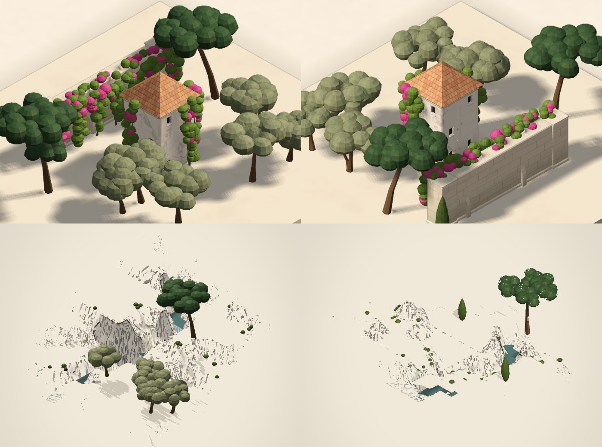
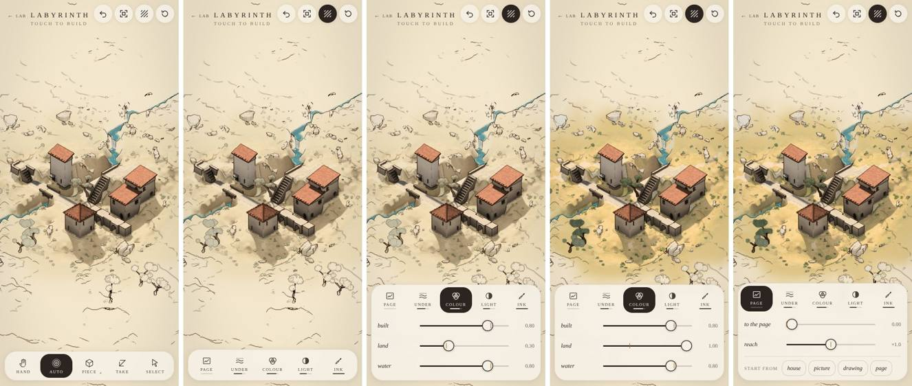

# Labyrinth

Architecture that follows the hand. A piece of land on a table in the sun (or, with `?flat`, the travertine slab), and five brushes along the bottom. It opens in the **hand**: drag to turn, tap to take something up. **auto** reads gestures: the hand decides the shape, and the stone works out what it takes to stand. That means arches, arcades and piers under anything with nothing beneath it, arched ways where stone is cut out from under stone, steps and landings where a trace climbs, and courtyards where walls close round the ground. The other brushes are for when auto isn't what you meant: one piece exactly, dressing, taking away, and **select**, which takes up what was built and reads it another way.

> Townscaper interprets where you place blocks. Labyrinth should interpret what you're trying to construct.

## The land

The labyrinth is built on a piece of land (`land.ts`): small, composed, seeded, and fixed once made (nothing built changes it). It's made to give the architecture reasons:
- it **rises toward a back corner in shelves**, so there are levels to connect;
- **a ravine runs down it with a stream in its bed**, so there's something to cross;
- **a rocky outcrop** stands in the way of the obvious line;
- **a shelf is kept flat**, five cells by five, room for a court.

**It's drawn as Taohua draws its hill**, bleeding into the page: the open ground is the paper itself, only its features drawn, in marks. A bank is hatched in short tapered strokes down its fall; a cliff is washed grey as a dry brush lays it, streaked down its face, with strokes dragged down it and a broken ink line along its top; the shade cast on the ground is laid on in dry strokes. Away from what's built, and toward the land's edge, there are fewer and fewer marks, each as dark as ever: the dry brush reaches less far, the strokes are fewer, the stream breaks into strokes and then a line or two, and what lies on the land (a rock, a shrub, a cypress) is drawn whole or left out, more of them left out the further they are. It isn't faded out; it's drawn less, until there's only the page. No plinth under it. `?plinth` puts it back on its plinth; the flat slab is always a slab on its table.

**It goes on past its first square.** Build within two cells of its edge and four more cells of it appear that way, the same land from the same seed: the rise going on rising, the ravine and its stream running on (never lower upstream, never higher downstream, banked either side), the low ground in front going on low. It goes as far as the grid does. Its first square is exactly as it's composed; undo what asked for more of it, and it's gone again.

**Start again** clears what's built, back to the land it was on; pressed again on bare land, it makes a new piece of land. `?land=<seed>` opens a particular one, and `?flat` keeps to the flat slab.

**It's held two ways that never disagree.**
- **By column**, the level the ground is at in each cell. That's what stands, walks and is struck: earth fills each column under it, and its top is a floor. Everything that resolves what's built takes it in: what stands on it, what an arch springs from (a bridge from bank to bank), what a corbel is held from (a cliff), where a court can be, where a figure can walk.
- **As a surface**, the ground as it's drawn: each cell flat at its own level through its middle, meeting its neighbours across a band at its edge. That's a bank where they differ by a level and a cliff where they differ by more, roughened where it slopes. Its flat middles are exactly the columns' levels, so what's built sits on the ground as drawn. Picking strikes the same surface it's drawn from.

**It's barely drawn, after Taohua.**
- Its open ground is the paper's own warm pale, held back from the light, with the shade still on it.
- A few dashes run down the fall of a bank; rock (a grey wash, mottled, cracked) appears only where it's steep: its cliffs, its edges.
- Ground meeting ground is never inked: the land's folds are its own.
- The stream sits a little under its banks, falling where its bed steps.
- What lies on the land is sparing: rocks at the foot of its cliffs, on the outcrop and along the stream; low shrubs on its banks; a cypress or two. Nothing grows where anything is built, or where a way goes.

**What's built on it meets the slope.** Each block, wall, stair and pier at its column's ground goes down into the land as a foundation, and the plinth runs along the ground's line. A court's paving and a way's paving are laid on the land's flat middles.

### Mass, or a way

Nothing is said ahead about what a stroke is for: each is read from where it's drawn (`meant()`, `stroke()` in `gesture.ts`), and the other kind of thing is offered with it (hold at the end of the stroke to read it otherwise). Going somewhere is a way: up or down to a top at another height, along paving, or from or to a place one goes from (a door, a flight's foot, the end of a way, a ladder's foot). A stroke from a top, along it or out from it, is mass. On open ground with neither, the land asks for a way and the slab for a wall. A tap raises, with a way up on to it, or a place to stand, offered with it. The land decides how a stroke is built, never what it's for. (There was a switch over the brushes, mass or way; `?intent=mass|way` still holds one fixed, for the harnesses.)
- **Mass**: raise, extend and enclose. A tap raises, a stroke on the ground is a wall (each cell on its own column's ground), and a stroke drawn round walls in a court. From a top, as ever, it reaches out or climbs.
- **Way**: a stroke connects where it starts to where it ends, a top or the ground, and the land says how. It follows the stroke as drawn (only round something in its way, or a house it would walk over, and then the way as drawn is offered), and is worked out by the cheapest heights along it:
  - walking on the ground costs nothing, and it's paved there;
  - raised over the ground costs by how high, with stone laid under it, carried on arches over anything low: a bridge;
  - a step up or down costs more, and goes only where the way runs straight. A flight turns about only after a landing, so it can always be walked.

  A way never goes into the land or into what's built, never stands in water (stone over the stream is carried on an arch, the water under it), and never lays stone in another stair's way. It passes through a gate along its way. Where it can't reach as drawn, it goes as far as it can and stops on the level there; a stair tower is offered first, and a walkway at the height it started. What it comes to ("a way: 3 paved, a flight of 2, a bridge of 1") is said before it's let go.

  Read as a way, a tap on the ground is somewhere to stand (paved, or the way brought on to it from paving within three cells); a tap on a top is a way up on to it, a flight straight in from whichever side one will stand; a house's roof isn't somewhere to go, and says so. A way drawn from a top that nothing from up there would reach begins at the foot of it, on the ground it comes down to; drawn from a top out over the water, it's a walkway out at that height. A walk drawn round goes round any house in its path, not over it. What the hand insists on and what it leaves open are told apart: **where** a gesture acts (the cells it touched, raising or lowering, a connection to a top it ended on, a pause) is the hand's; **how** it's resolved (supports, openings, roofs, flights or a tower, the form) is the world's, and can do much more than was drawn. So a way round what's in its way keeps within a cell of the stroke; further off is another place, offered, not built, unless the stroke ended on a top: then the connection is what the hand insisted on, and how it gets there the world's.

  **Doing it again develops it**, where the hand drew. A way drawn again over itself widens (paved alongside where the ground's as level), and again after that is covered (a pergola over it); a wall, a court's ring or any stone drawn along again rises a course. A way's tap on a house's roof goes up on to it, and the house becomes a tower with a terrace on top. And no reading is ever shown that would lay nothing: if it would add nothing and isn't a repetition to develop, it's said, not built, and its other readings that would lay something are offered with it (hold to choose one), never taken in its place.

  **What's authored stays usable.** A way laid by hand keeps the void it walks through: stone added there later is an archway with the passage through it (a block tapped on to a path, a gate over it; a wall drawn across a path, a gate where it crosses), no pier the rules raise ever stands in it, and a way drawn through a wall one cell thick opens a gate in it. Where a way runs square up to a building's foot there's a door; a building arrived on along one edge makes that edge a terrace and keeps its roof over the rest. The grammar this is growing toward, and what's been built from it, is in [labyrinth-connective.md](labyrinth-connective.md). Where two of the hand's raised ways end corner to corner or a cell apart, they're joined (a corner slab; drawn again, a small terrace where they meet; again, a corner bay on its own pier with a lantern), the other readings offered when held, or by selecting the joint; two ways side by side a level apart are left as they are, unless drawn again, when a step joins them: how such meetings are found and resolved is in [labyrinth-encounters.md](labyrinth-encounters.md).

  **Pulling stone up or down** (touched and drawn straight up or down the screen) lifts the part under the finger: the column touched, so it's what visibly rises with the hand, or everything selected, if the touched stone is part of the selection. The whole piece it's part of (a run of wall, a terrace at one height) is the other reading, offered. **A brush, then a lift**: drawn across a top first, the stroke takes in what it passes over at the height it began, and then, turned straight up or down the screen, lifts (or lowers) all of that together, from where it turned. What's round it keeps its sense: a way the hand made across what's raised goes on under it, through arches (the way's reserved void); lowered round a way, the way's left on a causeway; either way it's still walked end to end, and the note says so.

  Where a reading does take a liberty with the stroke (round something in its way, begun at the foot of a top, on to the same top a cell along, a tower for a flight), the operation records which (`Op.took`), so how often a hand gets other than it drew is counted, not guessed: `devtools/labyrinth-explore.mjs` reports it as authorship (built as drawn, with liberties, another kind of thing). A flight round what's in the way is taken only when it's no more than two cells longer than the stroke and within a cell of it; otherwise a tower is nearer what was drawn, and the route is offered (taken only for a stroke that ended on a top, when nothing nearer will do). The explorer also measures where gestures act: of what was laid, how much is within a cell of the stroke; of the stroke, how much has something laid by it. `devtools/labyrinth-stability.mjs` remakes each of many gestures on the stories a little differently, one thing at a time (its end a cell over, a cell shorter or longer, begun a cell along, a pause), and counts how often that makes another kind of thing although what was touched is the same: an unsteady reading.

`?story=12` is four gestures making a place on land 6:
1. a court walled round on the shelf (a stroke drawn round it, mass);
2. a way up to its gate from the low ground in front (flights where the land rises, through the gate);
3. a house raised two courses across the ravine;
4. a way from in front of the court over the stream to the house (an arch over the water, a flight up to the house's level).

You can walk from the low ground into the court, and over the stream to the house.

Next for the land:
- terraces and retaining walls, where a way or a court is cut into a slope or built out from it;
- a walk through what's built, following a way from the inside;
- spatial composition: sheltered courts, framed views, ways crossing over and under;
- keeping open: a passage, view or court protected from what auto builds later;
- the land shaped by hand.

## Forms chosen by their surroundings

What's built and the land it's on ask things of each other (`context.ts`, `buildings.ts`), worked out afresh each time:

- **Retaining walls.** Where the land steps down a bank (one to three levels) and either side of it is used (a way, paving, a court, something built at the ground, a pool, a bowl), the bank is held by a wall of dressed stone instead of falling away: the ground flat to it either side, its face battered (thicker at its foot), coped along its top, a low upstand where the ground above is open, an end where it doesn't run on. Not where a stair climbs the bank (its steps hold it), nor along the stream. The walk, the picking and the cats all take the ground as held.
- **Buildings stepping with the slope.** A mass built across ground at different levels, so many storeys each side, is read as steps: each its own building at its own height (the whole deep enough to be lived in, even where a step is a single cell deep), the lower leaning on the higher under a lean-to. Its downhill side stands on the wall that holds the bank under it.
- **Set into a hill.** A house whose ground behind it comes up to its eaves leans on the hill: its roof falls away from it (leaning on more than one side, away from the highest), and it's come into from the hill above, a door at the hill's level, as well as from below. No window or door looks into the earth; none opens onto another building's roof.
- **Water** asks for its own: a bowl where it falls, a lip at its spout, no roof over it (below).

## Water

**The pool brush lets water into whatever it touches**: the ground (a pool), or a top, up off the ground (a basin, let into the stone, a rim round it). Traced, it runs a channel along the stroke, along the ground or along a top. **A stroke drawn round, back to where it began, fills what it closes round**: a pond on the ground, a basin across a terrace. (With the block brush the same: a platform, filled.)

**A basin spills.** Cells of water side by side at one level are one basin, and it spills from one spout: at the edge over water if there's water below any edge (water finds water), else over the deepest drop; never where stone stands beside it at its level, or a floor runs out level from it. A basin walled in all round holds its water. At the spout the rim is cut and a lip runs out over the edge; the water falls from it in a sheet, curving out as it falls, white streaks running down it, foam where it lands. It lands in water (a pool, the stream, a lower basin, which spills in turn: a cascade), or, on the ground or a top, **in a bowl the rules put there to catch it**, a round moulded stone bowl. Onto a stair or a way it just lands. No roof is put over water, nor a pot or a lantern in it; it's neither stood on nor walked through. The land's stream falls where its bed steps, with foam at the foot of each.

## What grows

No mode of its own: planting is read from the same gestures, as another reading, and from where it's made (`green.ts`, `plants.ts`). Plants come in sizes, each standing in its cell (nothing's built or walked there), each a size up from the last, so a plant touched again grows: a **shrub** (waist high), a **hedge** (clipped, joined to the hedge beside it), a **cypress** (slender, two levels), an **olive** (a gnarled trunk, a round silver-green crown over head height; now and then on two stems), a **stone pine** (a tall leaning trunk, an umbrella crown two cells out, high over walls; now and then a lower tier out on a limb), and a **climber** (stems up the face of what it's planted against, as high as that stands, leaves in clumps along them, flowering a deep magenta, spilling over the top where the top's open, not over a roof's eaves). Each tree grows to its own size: some young and small, some old and spreading.

- **A plant touched grows**, whatever's in hand: shrub to olive, olive to stone pine (its other readings, the other kinds; the gesture's own reading among them).
- **Anywhere something could grow, planting it is another reading**, held at the end of a gesture: a tap, what suits the place (against a house, a climber; against a wall, a cypress, a climber offered; on a top, an olive in a planter, and that top's a roof garden, never roofed over; in the open, an olive); a stroke on the ground, a row along it (along a wall or a way an avenue of cypresses, else olives; climbers along a wall; a hedge); a ring, a grove of olives in what it encloses. Where stone along it would add nothing (a stroke beside a wall already there), the planting's what it is. Never in a way the hand made, a stair's way, or water.
- **The tree piece** plants by the same reading, tap or stroke, with nothing else in hand.
- **How they meet what's built**, with no rule for each: a crown leans away from tall stone beside it, toward the open side, and a clump of it that would be in stone isn't (a crown pruned round a wall, a terrace built up under it); stone laid round a trunk leaves it a pit; a big court grows an olive in a corner, a smaller one a cypress. A way drawn past a shade tree is a meeting (`way-meets-tree`, `labyrinth-encounters.md`): it passes by, or, insisted on or chosen, opens into a ring of paving round it, and then a low stone seat round its trunk. Checked in `devtools/labyrinth-plants.mjs` (nine scenes, eight orientations).
- **The land grows its own**, where nothing's built: scrub on the banks; olives in groves on the shelves, where the land's grove field runs high; stone pines on the rises and by the outcrop; a cypress now and then; cleared round anything built. Where the land's drawing fades into the page, a tree is kept or left out whole, by its foot, never cut through its crown.

## The cats

What's built has residents (`cats.ts`). They show how a place can be lived in: a warm ledge becomes a bed, a coping a way to balance along, a court somewhere to play.

**Who they are.** Each is a little individual that stays: a name, a coat (ginger tabby, grey, cream, brown tabby, black, ginger and white, silver tabby, black and white), how it's inclined (to the sun, to height, to shelter, to play; how curious, how bold, how sleepy), and its favourite places, which it comes to by resting in them (kept on the device for each piece of land). Who the nth to come is follows from the land's seed, so it's the same cat every visit.

**How many.** As many as what's built is home for: worked out from its habitable places (raised terraces, ledges, copings, sheltered corners, courts), not from how much stone there is, so a solid tower is home to fewer than the same stone in terraces. Bare land, or the bare stone, is home to none. When there's room for another, one arrives, walking in from the edge of the land; when there's less, the newest leaves.

**Where they can be** (`perches.ts`, a second reading of what's built beside the walk, checked against the stone as it's drawn): every place a figure could stand, and more a cat finds: the top of a thin wall (a coping, one cat at a time, walked only the way its wall runs), the edge of a top over a drop (a ledge, looking out), the top of a parapet. Between them, the walk's own ways (up stairs along their noses, through arches, through a building from door to door, unseen, taking the time it would), up and down the land's banks, and a cat's own: a hop up a level or onto a parapet, down as much as two, a leap across a gap a cell wide (a slot, the stream), each only where the air it would pass through is clear. Each place is known for whether it's in the sun (a ray toward it through the stone), sheltered, high, looking out, by water, in a court.

**How they live.** Mostly resting or quietly watching. Now and then one wanders off somewhere it doesn't know, or out over a drop; one washes; sometimes two play: a crouch, a short chase, a pounce, then both sit and wash. They rest where they're inclined to: sun, height, shelter, a view, a favourite. One to a resting place, one to a coping or a ledge, so none overlap. A jump is approached, weighed (the head lowered toward where it'll land), gathered for (the haunches dropped), reached across, and landed forepaws first.

**What building does to them.** Stone going up nearby, they look; close by, they get up and move aside; then, when it's settled, the curious go to see, sniff it, and may claim it as a new place to rest. Build a bridge in front of them and one will find the new way. Stone rising under a cat lifts it; stone taken from under one, it jumps clear. They never fall, and never stand in the hand's way: a tap with a building brush builds, cat or no cat.

**Meeting one.** With the hand brush, a tap on a cat says who it is and what it's doing; **Follow ›** keeps the eye on the cat, wherever it goes, until **‹ Return to building**; how close you are stays yours to pinch.

**Showing it somewhere.** While one's followed, nothing's built: a drag turns the view, and a tap on a place shows the cat where to go (a ring marks it until it's there). It answers as it is. Awake, it looks where it's shown and goes, the bold at once, the incurious in their own time (a wash first), far off at a trot. Asleep, an ear turns, and only a second tap soon after wakes it (a stretch, then it goes). Where it can't get, it goes as near as it can (the ring dashed); where another cat's resting, it goes to be beside it. Somewhere to rest, it may settle there, and a place it's been shown becomes a little more its own, kept with its favourites between visits, so a cat can be taught where it likes to be. A tap on the cat itself: a slow blink, and a purr (asleep, it purrs in its sleep). A tap on another cat follows that one instead.

**How they move.** Not from middle to middle: a walk over open places goes wherever in each it happens to pass, a little to one side or the other, its corners cut in easy curves; its pace drifts, quickening and slowing, easing in and to a stop; now and then it stops on the way to look round, or sits a moment; its head leads, the body following. A narrow place is taken slowly. Idle, a head drifts, looking about; before it lies down a cat turns round once or so on the spot; a playful one sometimes dashes off for no reason anyone can see, then washes as if it never happened.

**How they're drawn** (`catbody.ts`): to a cat's scale against a storey, a little larger than life, so it reads. Soft, rounded, a few facets left, hardly a face; a coat's markings kept on the body as it moves (a tabby's bands round body, legs and tail; paler underneath). Twelve poses (stand, walk, sit, loaf, curl, groom, stretch, gather, reach, land, assess, sniff), blended from one to the next; the legs found from where the feet are (a cat's knees and elbows); walking, the feet in a cat's order, each planted while the body passes over it. They breathe, a tail's tip twitches, an ear flicks. Drawn with the stone: its shadows, an inked contour.

`?story=13` is a place for cats (a court with a gate, a terrace, a stair up to a higher one, a thin wall, and a bridge built last); `?hold=1` keeps the last thing back, for building in front of them. `?catsat=60` runs their lives on a minute before showing them; `?cats=study` is the motion sheet; `?cats=0`, none.

## The brushes

| Brush | Tap | Trace |
|---|---|---|
| **hand** (where it opens) | takes up what's touched; again, the whole it's part of; on nothing, puts it down. Where there's nothing to take up (the bare land), says what it is | turns the view |
| **auto** | raises | builds a wall, reaches out, climbs (below) |
| **piece** (hold it, or touch it again, for the sheet; it's always called piece, and its picture is what it holds) | puts one piece, or dresses a stone | a run of pieces, or dresses every stone passed over |
| **take** | takes anything away, the outermost first (a pergola, a basin, a lantern or pot, a roof, a ladder, then the stone, paving or stair under them); what the rules made is taken by changing what made it, so it stays taken: a pier is asked not to stand (what it carried is held another way, or taken with it if nothing else will), a meeting's stone is read at a rung that doesn't lay it. Only the land itself stays | carves through: what's over the cut is carried on an arch |
| **select** | takes up a piece; again, the whole it's part of | turns the view |

**What's taken up stays taken up** while you're in the hand or select. The card shows only what it is; its chevron (or a tap on its name) opens the details: how much of it, its readings, its dressing, take it away. Shut or open, the selection holds; × puts it down, and so does a tap on nothing in the hand.

Two fingers, from any brush, turn the view (across), tilt it (up and down), and pinch closer to where they are.

### What the hand is asking for, while it's asking

While a stroke is under the finger:
- **where it started** is marked with a dot on the surface it started from;
- **the route** it's asking for is drawn along the heights it will be walked, apart from the stone the rules put under it to hold it up;
- **the top it's going to** is outlined, dashed while it's only being considered and solid once it's taken;
- **a label by the finger** says what it is: *a gated wall*, *a bridge, on one great arch*, *climbing 2 levels*, *a flight of 3 steps*, *carving through 2*;
- **where it can't go on** is marked with a cross, and the label says why (too steep, or joining the stone it meets).

What kind of wall a stroke makes is chosen once, where it starts, and kept as it grows. Its openings count from its start, so drawing it on never moves them.

The balance between them: **auto is for painting, select is for correcting, the piece brush is the fallback.** You paint with auto, and where it read you wrong, select what came out and switch it to another reading. The piece brush is for when you already know exactly what you want. Everything it makes is something auto understands, so the two mix freely, and every brush is an operation on the same stone, undone and resolved the same way.

### auto: the gestures

| Gesture | On… | Builds |
|---|---|---|
| **tap** | bare stone | a plinth |
| | a top | another course |
| | a side | the stone pushed out that way (on an arch or a pier, if there's nothing under it) |
| **trace** | from the stone, across the stone | a wall along the stroke |
| | from a top, out over anything | a walkway at that height, on stone laid under it. Where it meets stone at that height it stops and joins it: it never cuts what you built |
| | from a top to another top at the same height | a walkway joining them: a bridge where it crosses the air |
| | from the stone or a top to a top at another height | steps and landings, climbing evenly along the straight parts of the stroke. Too steep for the stroke, and nothing is built: it says why (draw it longer, or straighter) |

### piece: one thing, exactly

| Piece | Where it's touched | Puts down |
|---|---|---|
| **block** | the stone, a top, a side | stone in the free cell on that side. Against a side, out over nothing too, as a tap does (the rules carry it) |
| **wall** | the same | a **thin wall**: a wall's thickness, full height, running away from what it's put against (or across the view), and on to the stone beside it. Tapped on its top, it goes up as a thin wall; on its side, out along its way |
| **arch** | the same | stone with a way through it, running where it's open either side; on an arch, the same way, making one tall arch |
| **stair** | a floor, or beside stone | a flight up a level, climbing toward the stone it was put against (or onto a neighbour's top) |
| **bridge** | a gap at a level, from beside stone | stone laid across the whole span at once (up to seven cells), marked as a bridge so the rules carry it on one arch |
| **tree** | a floor with room above it | a cypress |
| **pool** | the stone | water let into the stone |

Traced, a piece makes a run along the stroke, at the height the stroke started from:
- **blocks**: a wall;
- **walls**: a thin wall along the stroke, turning its corners;
- **arches**: an arcaded wall, each way through running across the stroke;
- **stairs**: a flight, a step up for every cell where the stroke runs straight, carried as a whole as its setting has it: hung from a wall beside it, on a rampant arch from its foot to what it climbs to (open under, a lane can go on beneath), solid as a short stoop, or on piers with nothing to lean on; stepped on to from beside its foot, left sideways at its head, and never laid across another way's walk. Selecting a step offers the carriages its setting allows.

The rest (bridge, tree, pool) are put once, where the stroke began. An arch put by hand carries what's on it like any stone, and a pool by hand sits in a court beside the court's own water.

### Dressing

Dressing changes how stone looks, never what stands. Tap a stone, or stroke over several:

| Dressing | |
|---|---|
| **travertine**, **brick**, **marble** | what the stone is. Brick is laid in narrow courses, each brick its own shade, with pavers on top; marble is white and veined, in large blocks |
| **moss** | where it has a reason: on faces turned from the sun, at the damp foot of a course, in the joints and along the edges of a top (not across it), soft patches with a few brighter flecks |
| **ivy** | real leaves: a few trailing strands hanging from the top of each open side, every leaf its own size, tilt and shade; some lean out over the top edge, so the ivy breaks the stone's outline |
| **parapet** | a low wall round the open edges of a top, a wall's thickness all along, with a coping a little proud of it, and a capped post where it ends |
| **balustrade** | the same edges railed with turned balusters, close set, on a plinth under a rail, a pedestal at each end and corner. On a stair, it climbs with the flight, a baluster on each tread, a newel at its foot and head |
| **jali** | a screen of pierced stone: round a top, up a stair, or (on a thin wall) the wall itself pierced through |
| **lantern**, **pot** | on a top with room over it: a lantern on a post, lit; a terracotta pot with a clipped shrub |
| **pergola** | over a place (the ground, or a top, touched): posts, beams, rafters, a vine |
| **mashrabiya** | a building's upper windows, each in a box of turned lattice out from the wall |
| **colonnettes** | a building's doors and arched windows framed with slim shafts (and its windows made arched) |

A stroke that starts on a stone that already has the dressing takes it off everything it passes over. Take, tapped on a lantern or a pot, takes that first. The rules dress a little of their own accord: a bridge, or an arch two levels up or more, gets a parapet along its open sides.

### select: taking something up, and reading it another way

Tap a piece and it's taken up: its own surfaces faintly warmed and its outline drawn round it, in the picture itself (not a box round its cells). A card says what it is, with:
- **its scope**: *piece*, then each whole it's part of (the arcade an arch is in, the flight, the wall, the tower, the court), then the whole *structure* joined to it. Tap one, or tap the thing again for the next one out;
- **every reading at once**, each with a little drawing, the current one marked. Touch one to read it that way. Switching replaces the last switch rather than piling up, and touching the first again takes the switch away altogether;
- **dressing**, all of it, to dress what's taken up in one touch;
- **take it away**.

| Taken up | Its readings |
|---|---|
| an arch the rules made | an arch · a lintel (flat, on its piers) · a colonnade (a raised row of three or more) · two bays (a pier forced under its middle, if it's three or more long) · solid (stone under it, down to what's below) |
| an arcade, or a bridge | the same, for all its arches at once. Solid fills over its piers too |
| a pier | a pier (a column, under a colonnade) · solid |
| a block (yours, or laid by a connection) | a block · a thin wall · an arch either way · a stair |
| an arch you put | an arch · turned · a block · a stair |
| a stair | each of the four ways it could climb · a block |
| a wall | a wall · a thin wall · an arcaded wall (a way through each cell of its foot) |
| a building (a tower, a terrace) | its roof as the rules choose · no roof · hipped · gable · shed · dome |

A switched reading is an operation like any other: undone, written down, replayed. From then on it's the hand's. The rules don't decide it again.

### The stone grows

There's no cap on how high it goes: tap a column up as far as you like, and the view stands back to keep it all in. The slab starts as an 8 × 8 square. After that it is only as big as what's built, plus two cells all round. Build on its edge cell and it grows two cells further; undo, and it goes back. There's always room to go on, and the view follows, framing the whole slab. The grid underneath is 48 × 48 cells.

### Moving round it

- Two fingers, the hand brush, or one finger starting on the background, turn the view. Let go near a corner and it settles on it; anywhere else, it stays where you left it.
- Two fingers moving up and down tilt it.
- Pinch, or scroll, to come closer to where the fingers (or the pointer) are.
- **Undo**, **frame it all**, **print** and **clear** are at the top right. **Print** hands the palette over to the drawing's layers (below).

**Print: the layers in hand.** In print, the five brushes give way to the drawing's five layers, in the order they're laid from the paper up:

| Layer | Its sliders |
|---|---|
| **page** | how far everything's taken to the page; where to start from (house, picture, drawing, study, page) |
| **under** | how much of the drawing lies under the picture |
| **colour** | what's built, the land, the water; its reach |
| **light** | shade, cast, hollows; how much of them the land keeps; its reach |
| **ink** | marks, outlines; their reach; thin ↔ fade (how they give out) |

Each layer's reach is how far out from what's built it goes, so the colour can be held close while the light carries on past it (in sepia on the paper) and the lines further still.

- **Using it:** touch a layer and its sliders open under it. The picture follows as you drag, and a small mark on each slider shows the house value; a double tap on a slider's name puts it back. Each layer's slot shows its first value as a line under its name.
- **The stone:** while print is open, the stone is only turned and asked about (the hand brush). The brush you had comes back when you leave print.
- **The address:** it keeps `?print` and the values that differ from the house setting, so a print can be passed on as it is. The values are the URL dials in labyrinth-look.md.
