# Labyrinth

Architecture that follows the hand. A piece of land on a table in the sun (or, with `?flat`, the travertine slab), and five brushes along the bottom. **auto** (where it starts) reads gestures: the hand decides the shape, and the stone works out what it takes to stand. That means arches, arcades and piers under anything with nothing beneath it, arched ways where stone is cut out from under stone, steps and landings where a trace climbs, and courtyards where walls close round the ground. The other brushes are for when auto isn't what you meant: one piece exactly, dressing, taking away, and **select**, which takes up what was built and reads it another way.

> Townscaper interprets where you place blocks. Labyrinth should interpret what you're trying to construct.

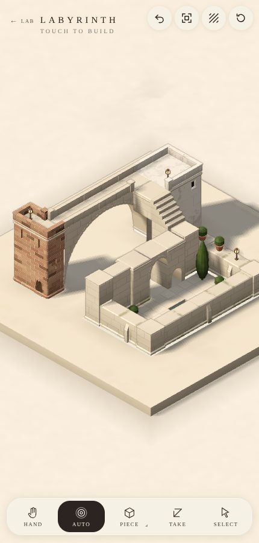

## The land

The labyrinth is built on a piece of land (`land.ts`): small, composed, seeded, and fixed once made (nothing built changes it). It's made to give the architecture reasons:
- it **rises toward a back corner in shelves**, so there are levels to connect;
- **a ravine runs down it with a stream in its bed**, so there's something to cross;
- **a rocky outcrop** stands in the way of the obvious line;
- **a shelf is kept flat**, five cells by five, room for a court.

**It's drawn as Taohua draws its hill**, bleeding into the page: the open ground is the paper itself, only its features drawn, in marks. A bank is hatched in short tapered strokes down its fall; a cliff is washed grey as a dry brush lays it, streaked down its face, with strokes dragged down it and a broken ink line along its top; the shade cast on the ground is laid on in dry strokes. Away from what's built, and toward the land's edge, there are fewer and fewer marks, each as dark as ever: the dry brush reaches less far, the strokes are fewer, the stream breaks into strokes and then a line or two, and what lies on the land (a rock, a shrub, a cypress) is drawn whole or left out, more of them left out the further they are. It isn't faded out; it's drawn less, until there's only the page. No plinth under it. `?plinth` puts it back on its plinth; the flat slab is always a slab on its table.

**It goes on past its first square.** Build within two cells of its edge and four more cells of it appear that way, the same land from the same seed: the rise going on rising, the ravine and its stream running on (never lower upstream, never higher downstream, banked either side), the low ground in front going on low. It goes as far as the grid does. Its first square is exactly as it's composed; undo what asked for more of it, and it's gone again.

**Start again** clears what's built, back to the land it was on; pressed again on bare land, it makes a new piece of land. `?land=<seed>` opens a particular one, and `?flat` keeps to the flat slab.

**It's held two ways that never disagree.**
- **By column**, the level the ground is at in each cell. That's what stands, walks and is struck: earth fills each column under it, and its top is a floor. Everything that resolves what's built takes it in: what stands on it, what an arch springs from (a bridge from bank to bank), what a corbel is held from (a cliff), where a court can be, where a figure can walk.
- **As a surface**, the ground as it's drawn: each cell flat at its own level through its middle, meeting its neighbours across a band at its edge. That's a bank where they differ by a level and a cliff where they differ by more, roughened where it slopes. Its flat middles are exactly the columns' levels, so what's built sits on the ground as drawn. Picking strikes the same surface it's drawn from.

**It's barely drawn, after Taohua.**
- Its open ground is the paper's own warm pale, held back from the light, with the shade still on it.
- A few dashes run down the fall of a bank; rock (a grey wash, mottled, cracked) appears only where it's steep: its cliffs, its edges.
- Ground meeting ground is never inked: the land's folds are its own.
- The stream sits a little under its banks, falling where its bed steps.
- What lies on the land is sparing: rocks at the foot of its cliffs, on the outcrop and along the stream; low shrubs on its banks; a cypress or two. Nothing grows where anything is built, or where a way goes.

**What's built on it meets the slope.** Each block, wall, stair and pier at its column's ground goes down into the land as a foundation, and the plinth runs along the ground's line. A court's paving and a way's paving are laid on the land's flat middles.

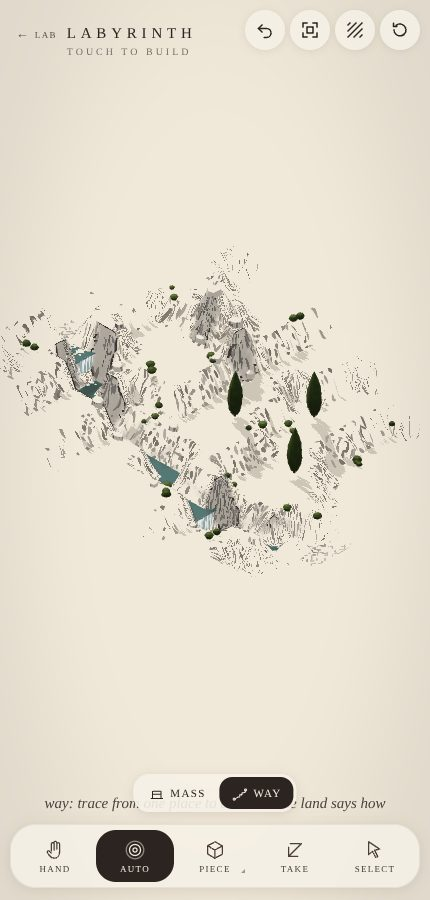

### Mass, or a way

Over the brushes, while auto is held, two choices say what a stroke is for. The land decides how a stroke is built, never what it's for.
- **Mass**: raise, extend and enclose. A tap raises, a stroke on the ground is a wall (each cell on its own column's ground), and a stroke drawn round walls in a court. From a top, as ever, it reaches out or climbs.
- **Way**: a stroke connects where it starts to where it ends, a top or the ground, and the land says how. It follows the stroke as drawn (only round something in its way, or a house it would walk over, and then the way as drawn is offered), and is worked out by the cheapest heights along it:
  - walking on the ground costs nothing, and it's paved there;
  - raised over the ground costs by how high, with stone laid under it, carried on arches over anything low: a bridge;
  - a step up or down costs more, and goes only where the way runs straight. A flight turns about only after a landing, so it can always be walked.

  A way never goes into the land or into what's built, never stands in water (stone over the stream is carried on an arch, the water under it), and never lays stone in another stair's way. It passes through a gate along its way. Where it can't reach as drawn, it goes as far as it can and stops on the level there; a stair tower is offered first, and a walkway at the height it started. What it comes to ("a way: 3 paved, a flight of 2, a bridge of 1") is said before it's let go. On the land a way is the choice the first time, and on the slab, mass; it's kept between visits after that.

  With a way in hand, a tap on the ground is somewhere to stand (paved, or the way brought on to it from paving within three cells); a tap on a top is a way up on to it, a flight straight in from whichever side one will stand; a house's roof isn't somewhere to go, and says so. A way drawn from a top that nothing from up there would reach begins at the foot of it, on the ground it comes down to; drawn from a top out over the water, it's a walkway out at that height. A walk drawn round goes round any house in its path, not over it. What the hand insists on and what it leaves open are told apart: **where** a gesture acts (the cells it touched, raising or lowering, a connection to a top it ended on, a pause) is the hand's; **how** it's resolved (supports, openings, roofs, flights or a tower, the form) is the world's, and can do much more than was drawn. So a way round what's in its way keeps within a cell of the stroke; further off is another place, offered, not built, unless the stroke ended on a top: then the connection is what the hand insisted on, and how it gets there the world's.

  **Doing it again develops it**, where the hand drew. A way drawn again over itself widens (paved alongside where the ground's as level), and again after that is covered (a pergola over it); a wall, a court's ring or any stone drawn along again rises a course. A way's tap on a house's roof goes up on to it, and the house becomes a tower with a terrace on top. And no reading is ever shown that would lay nothing: if it would add nothing and isn't a repetition to develop, it's said, not built, and its other readings that would lay something are offered with it (hold to choose one), never taken in its place.

  **What's authored stays usable.** A way laid by hand keeps the void it walks through: stone added there later is an archway with the passage through it (a block tapped on to a path, a gate over it; a wall drawn across a path, a gate where it crosses), no pier the rules raise ever stands in it, and a way drawn through a wall one cell thick opens a gate in it. Where a way runs square up to a building's foot there's a door; a building arrived on along one edge makes that edge a terrace and keeps its roof over the rest. The grammar this is growing toward, and what's been built from it, is in [labyrinth-connective.md](labyrinth-connective.md). Where two of the hand's raised ways end corner to corner or a cell apart, they're joined (a corner slab; drawn again, a small terrace where they meet; again, a corner bay on its own pier with a lantern), the other readings offered when held, or by selecting the joint; two ways side by side a level apart are left as they are, unless drawn again, when a step joins them: how such meetings are found and resolved is in [labyrinth-encounters.md](labyrinth-encounters.md).

  **Pulling stone up or down** (touched and drawn straight up or down the screen) lifts the part under the finger: the column touched, so it's what visibly rises with the hand, or everything selected, if the touched stone is part of the selection. The whole piece it's part of (a run of wall, a terrace at one height) is the other reading, offered. **A brush, then a lift**: drawn across a top first, the stroke takes in what it passes over at the height it began, and then, turned straight up or down the screen, lifts (or lowers) all of that together, from where it turned. What's round it keeps its sense: a way the hand made across what's raised goes on under it, through arches (the way's reserved void); lowered round a way, the way's left on a causeway; either way it's still walked end to end, and the note says so.

  Where a reading does take a liberty with the stroke (round something in its way, begun at the foot of a top, on to the same top a cell along, a tower for a flight), the operation records which (`Op.took`), so how often a hand gets other than it drew is counted, not guessed: `devtools/labyrinth-explore.mjs` reports it as authorship (built as drawn, with liberties, another kind of thing). A flight round what's in the way is taken only when it's no more than two cells longer than the stroke and within a cell of it; otherwise a tower is nearer what was drawn, and the route is offered (taken only for a stroke that ended on a top, when nothing nearer will do). The explorer also measures where gestures act: of what was laid, how much is within a cell of the stroke; of the stroke, how much has something laid by it. `devtools/labyrinth-stability.mjs` remakes each of many gestures on the stories a little differently, one thing at a time (its end a cell over, a cell shorter or longer, begun a cell along, a pause), and counts how often that makes another kind of thing although what was touched is the same: an unsteady reading.

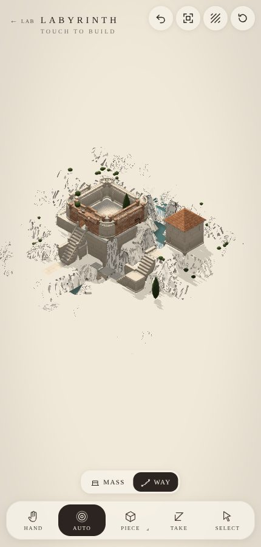
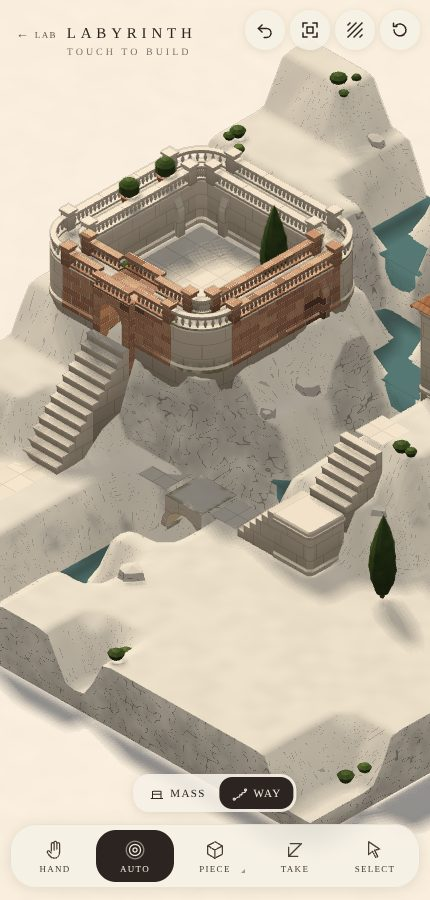

`?story=12` is four gestures making a place on land 6:
1. a court walled round on the shelf (a stroke drawn round it, mass);
2. a way up to its gate from the low ground in front (flights where the land rises, through the gate);
3. a house raised two courses across the ravine;
4. a way from in front of the court over the stream to the house (an arch over the water, a flight up to the house's level).

You can walk from the low ground into the court, and over the stream to the house.

Next for the land:
- terraces and retaining walls, where a way or a court is cut into a slope or built out from it;
- a walk through what's built, following a way from the inside;
- spatial composition: sheltered courts, framed views, ways crossing over and under;
- keeping open: a passage, view or court protected from what auto builds later;
- the land shaped by hand.

## Forms chosen by their surroundings

What's built and the land it's on ask things of each other (`context.ts`, `buildings.ts`), worked out afresh each time:

- **Retaining walls.** Where the land steps down a bank (one to three levels) and either side of it is used (a way, paving, a court, something built at the ground, a pool, a bowl), the bank is held by a wall of dressed stone instead of falling away: the ground flat to it either side, its face battered (thicker at its foot), coped along its top, a low upstand where the ground above is open, an end where it doesn't run on. Not where a stair climbs the bank (its steps hold it), nor along the stream. The walk, the picking and the cats all take the ground as held.
- **Buildings stepping with the slope.** A mass built across ground at different levels, so many storeys each side, is read as steps: each its own building at its own height (the whole deep enough to be lived in, even where a step is a single cell deep), the lower leaning on the higher under a lean-to. Its downhill side stands on the wall that holds the bank under it.
- **Set into a hill.** A house whose ground behind it comes up to its eaves leans on the hill: its roof falls away from it (leaning on more than one side, away from the highest), and it's come into from the hill above, a door at the hill's level, as well as from below. No window or door looks into the earth; none opens onto another building's roof.
- **Water** asks for its own: a bowl where it falls, a lip at its spout, no roof over it (below).

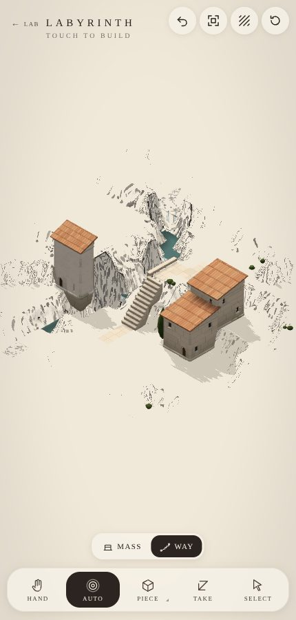
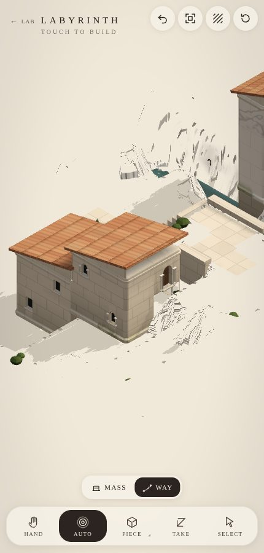

## Water

**The pool brush lets water into whatever it touches**: the ground (a pool), or a top, up off the ground (a basin, let into the stone, a rim round it). Traced, it runs a channel along the stroke, along the ground or along a top. **A stroke drawn round, back to where it began, fills what it closes round**: a pond on the ground, a basin across a terrace. (With the block brush the same: a platform, filled.)

**A basin spills.** Cells of water side by side at one level are one basin, and it spills from one spout: at the edge over water if there's water below any edge (water finds water), else over the deepest drop; never where stone stands beside it at its level, or a floor runs out level from it. A basin walled in all round holds its water. At the spout the rim is cut and a lip runs out over the edge; the water falls from it in a sheet, curving out as it falls, white streaks running down it, foam where it lands. It lands in water (a pool, the stream, a lower basin, which spills in turn: a cascade), or, on the ground or a top, **in a bowl the rules put there to catch it**, a round moulded stone bowl. Onto a stair or a way it just lands. No roof is put over water, nor a pot or a lantern in it; it's neither stood on nor walked through. The land's stream falls where its bed steps, with foam at the foot of each.

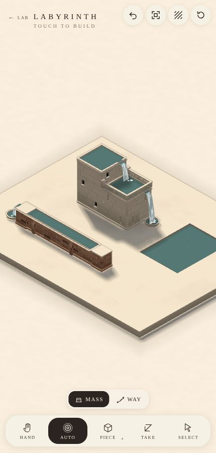
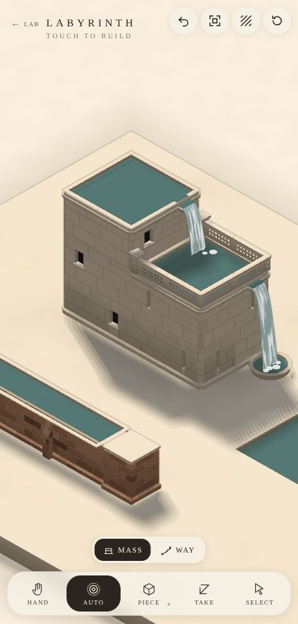

## What grows

No mode of its own: planting is read from the same gestures, as another reading, and from where it's made (`green.ts`, `plants.ts`). Plants come in sizes, each standing in its cell (nothing's built or walked there), each a size up from the last, so a plant touched again grows: a **shrub** (waist high), a **hedge** (clipped, joined to the hedge beside it), a **cypress** (slender, two levels), an **olive** (a gnarled trunk, a round silver-green crown over head height), a **stone pine** (a tall leaning trunk, an umbrella crown two cells out, high over walls).

- **A plant touched grows**, whatever's in hand: shrub to olive, olive to stone pine (its other readings, the other kinds; the gesture's own reading among them).
- **Anywhere something could grow, planting it is another reading**, held at the end of a gesture: a tap, what suits the place (against a wall, a cypress; on a top, an olive in a planter, and that top's a roof garden, never roofed over; in the open, an olive); a stroke on the ground, a row along it (along a wall or a way an avenue of cypresses, else olives; a hedge); a ring, a grove of olives in what it encloses. Where stone along it would add nothing (a stroke beside a wall already there), the planting's what it is. Never in a way the hand made, a stair's way, or water.
- **The tree piece** plants by the same reading, tap or stroke, with nothing else in hand.
- **How they meet what's built**, with no rule for each: a crown leans away from tall stone beside it, toward the open side, and a clump of it that would be in stone isn't (a crown pruned round a wall, a terrace built up under it); stone laid round a trunk leaves it a pit; a big court grows an olive in a corner, a smaller one a cypress. Checked in `devtools/labyrinth-plants.mjs` (seven scenes, eight orientations).

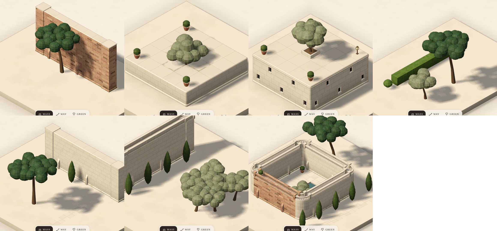

## The cats

What's built has residents (`cats.ts`). They show how a place can be lived in: a warm ledge becomes a bed, a coping a way to balance along, a court somewhere to play.

**Who they are.** Each is a little individual that stays: a name, a coat (ginger tabby, grey, cream, brown tabby, black, ginger and white, silver tabby, black and white), how it's inclined (to the sun, to height, to shelter, to play; how curious, how bold, how sleepy), and its favourite places, which it comes to by resting in them (kept on the device for each piece of land). Who the nth to come is follows from the land's seed, so it's the same cat every visit.

**How many.** As many as what's built is home for: worked out from its habitable places (raised terraces, ledges, copings, sheltered corners, courts), not from how much stone there is, so a solid tower is home to fewer than the same stone in terraces. Bare land, or the bare stone, is home to none. When there's room for another, one arrives, walking in from the edge of the land; when there's less, the newest leaves.

**Where they can be** (`perches.ts`, a second reading of what's built beside the walk, checked against the stone as it's drawn): every place a figure could stand, and more a cat finds: the top of a thin wall (a coping, one cat at a time, walked only the way its wall runs), the edge of a top over a drop (a ledge, looking out), the top of a parapet. Between them, the walk's own ways (up stairs along their noses, through arches, through a building from door to door, unseen, taking the time it would), up and down the land's banks, and a cat's own: a hop up a level or onto a parapet, down as much as two, a leap across a gap a cell wide (a slot, the stream), each only where the air it would pass through is clear. Each place is known for whether it's in the sun (a ray toward it through the stone), sheltered, high, looking out, by water, in a court.

**How they live.** Mostly resting or quietly watching. Now and then one wanders off somewhere it doesn't know, or out over a drop; one washes; sometimes two play: a crouch, a short chase, a pounce, then both sit and wash. They rest where they're inclined to: sun, height, shelter, a view, a favourite. One to a resting place, one to a coping or a ledge, so none overlap. A jump is approached, weighed (the head lowered toward where it'll land), gathered for (the haunches dropped), reached across, and landed forepaws first.

**What building does to them.** Stone going up nearby, they look; close by, they get up and move aside; then, when it's settled, the curious go to see, sniff it, and may claim it as a new place to rest. Build a bridge in front of them and one will find the new way. Stone rising under a cat lifts it; stone taken from under one, it jumps clear. They never fall, and never stand in the hand's way: a tap with a building brush builds, cat or no cat.

**Meeting one.** With the hand brush, a tap on a cat says who it is and what it's doing; **Follow ›** brings the eye close and keeps it with the cat until **‹ Return to building**.

**How they move.** Not from middle to middle: a walk over open places goes wherever in each it happens to pass, a little to one side or the other, its corners cut in easy curves; its pace drifts, quickening and slowing, easing in and to a stop; now and then it stops on the way to look round, or sits a moment; its head leads, the body following. A narrow place is taken slowly. Idle, a head drifts, looking about; before it lies down a cat turns round once or so on the spot; a playful one sometimes dashes off for no reason anyone can see, then washes as if it never happened.

**How they're drawn** (`catbody.ts`): to a cat's scale against a storey, a little larger than life, so it reads. Soft, rounded, a few facets left, hardly a face; a coat's markings kept on the body as it moves (a tabby's bands round body, legs and tail; paler underneath). Twelve poses (stand, walk, sit, loaf, curl, groom, stretch, gather, reach, land, assess, sniff), blended from one to the next; the legs found from where the feet are (a cat's knees and elbows); walking, the feet in a cat's order, each planted while the body passes over it. They breathe, a tail's tip twitches, an ear flicks. Drawn with the stone: its shadows, an inked contour.

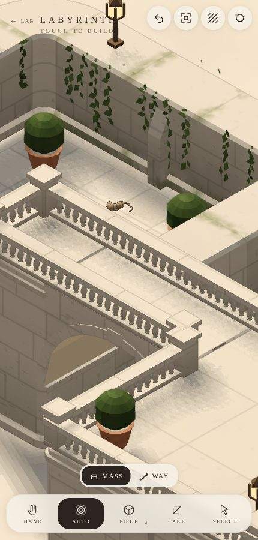
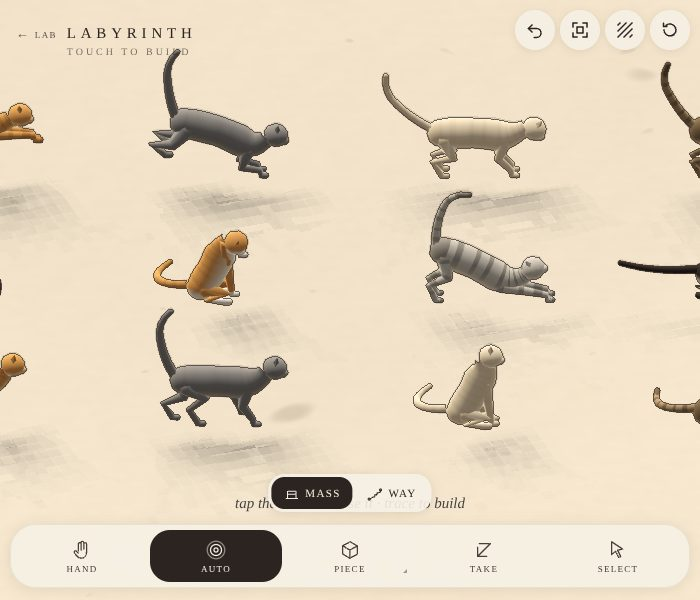

`?story=13` is a place for cats (a court with a gate, a terrace, a stair up to a higher one, a thin wall, and a bridge built last); `?hold=1` keeps the last thing back, for building in front of them. `?catsat=60` runs their lives on a minute before showing them; `?cats=study` is the motion sheet; `?cats=0`, none.

## The brushes

| Brush | Tap | Trace |
|---|---|---|
| **hand** | says what it is, and what it's part of | turns the view |
| **auto** | raises | builds a wall, reaches out, climbs (below) |
| **piece** (hold it, or touch it again, for the sheet; it's always called piece, and its picture is what it holds) | puts one piece, or dresses a stone | a run of pieces, or dresses every stone passed over |
| **take** | takes a piece away (a lantern or pot on it first) | carves through: what's over the cut is carried on an arch |
| **select** | takes up a piece; again, the whole it's part of | turns the view |

Two fingers, from any brush, turn the view (across), tilt it (up and down), and pinch closer to where they are.

### What the hand is asking for, while it's asking

While a stroke is under the finger:
- **where it started** is marked with a dot on the surface it started from;
- **the route** it's asking for is drawn along the heights it will be walked, apart from the stone the rules put under it to hold it up;
- **the top it's going to** is outlined, dashed while it's only being considered and solid once it's taken;
- **a label by the finger** says what it is: *a gated wall*, *a bridge, on one great arch*, *climbing 2 levels*, *a flight of 3 steps*, *carving through 2*;
- **where it can't go on** is marked with a cross, and the label says why (too steep, or joining the stone it meets).

What kind of wall a stroke makes is chosen once, where it starts, and kept as it grows. Its openings count from its start, so drawing it on never moves them.

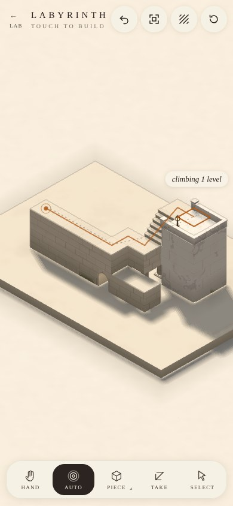

The balance between them: **auto is for painting, select is for correcting, the piece brush is the fallback.** You paint with auto, and where it read you wrong, select what came out and switch it to another reading. The piece brush is for when you already know exactly what you want. Everything it makes is something auto understands, so the two mix freely, and every brush is an operation on the same stone, undone and resolved the same way.

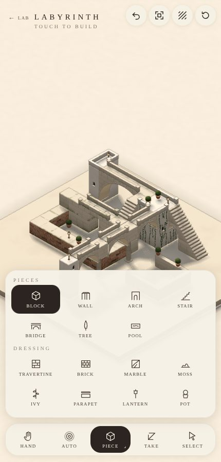

### auto: the gestures

| Gesture | On… | Builds |
|---|---|---|
| **tap** | bare stone | a plinth |
| | a top | another course |
| | a side | the stone pushed out that way (on an arch or a pier, if there's nothing under it) |
| **trace** | from the stone, across the stone | a wall along the stroke |
| | from a top, out over anything | a walkway at that height, on stone laid under it. Where it meets stone at that height it stops and joins it: it never cuts what you built |
| | from a top to another top at the same height | a walkway joining them: a bridge where it crosses the air |
| | from the stone or a top to a top at another height | steps and landings, climbing evenly along the straight parts of the stroke. Too steep for the stroke, and nothing is built: it says why (draw it longer, or straighter) |

### piece: one thing, exactly

| Piece | Where it's touched | Puts down |
|---|---|---|
| **block** | the stone, a top, a side | stone in the free cell on that side. Against a side, out over nothing too, as a tap does (the rules carry it) |
| **wall** | the same | a **thin wall**: a wall's thickness, full height, running away from what it's put against (or across the view), and on to the stone beside it. Tapped on its top, it goes up as a thin wall; on its side, out along its way |
| **arch** | the same | stone with a way through it, running where it's open either side; on an arch, the same way, making one tall arch |
| **stair** | a floor, or beside stone | a flight up a level, climbing toward the stone it was put against (or onto a neighbour's top) |
| **bridge** | a gap at a level, from beside stone | stone laid across the whole span at once (up to seven cells), marked as a bridge so the rules carry it on one arch |
| **tree** | a floor with room above it | a cypress |
| **pool** | the stone | water let into the stone |

Traced, a piece makes a run along the stroke, at the height the stroke started from:
- **blocks**: a wall;
- **walls**: a thin wall along the stroke, turning its corners;
- **arches**: an arcaded wall, each way through running across the stroke;
- **stairs**: a flight, a step up for every cell where the stroke runs straight, carried as a whole as its setting has it: hung from a wall beside it, on a rampant arch from its foot to what it climbs to (open under, a lane can go on beneath), solid as a short stoop, or on piers with nothing to lean on; stepped on to from beside its foot, left sideways at its head, and never laid across another way's walk. Selecting a step offers the carriages its setting allows.

The rest (bridge, tree, pool) are put once, where the stroke began. An arch put by hand carries what's on it like any stone, and a pool by hand sits in a court beside the court's own water.

### Dressing

Dressing changes how stone looks, never what stands. Tap a stone, or stroke over several:

| Dressing | |
|---|---|
| **travertine**, **brick**, **marble** | what the stone is. Brick is laid in narrow courses, each brick its own shade, with pavers on top; marble is white and veined, in large blocks |
| **moss** | where it has a reason: on faces turned from the sun, at the damp foot of a course, in the joints and along the edges of a top (not across it), soft patches with a few brighter flecks |
| **ivy** | real leaves: a few trailing strands hanging from the top of each open side, every leaf its own size, tilt and shade; some lean out over the top edge, so the ivy breaks the stone's outline |
| **parapet** | a low wall round the open edges of a top, a wall's thickness all along, with a coping a little proud of it, and a capped post where it ends |
| **balustrade** | the same edges railed with turned balusters, close set, on a plinth under a rail, a pedestal at each end and corner. On a stair, it climbs with the flight, a baluster on each tread, a newel at its foot and head |
| **jali** | a screen of pierced stone: round a top, up a stair, or (on a thin wall) the wall itself pierced through |
| **lantern**, **pot** | on a top with room over it: a lantern on a post, lit; a terracotta pot with a clipped shrub |
| **pergola** | over a place (the ground, or a top, touched): posts, beams, rafters, a vine |
| **mashrabiya** | a building's upper windows, each in a box of turned lattice out from the wall |
| **colonnettes** | a building's doors and arched windows framed with slim shafts (and its windows made arched) |

A stroke that starts on a stone that already has the dressing takes it off everything it passes over. Take, tapped on a lantern or a pot, takes that first. The rules dress a little of their own accord: a bridge, or an arch two levels up or more, gets a parapet along its open sides.

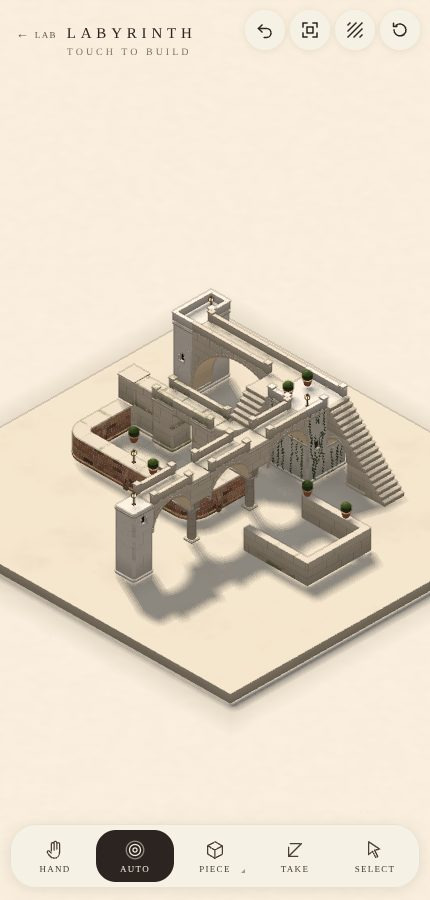
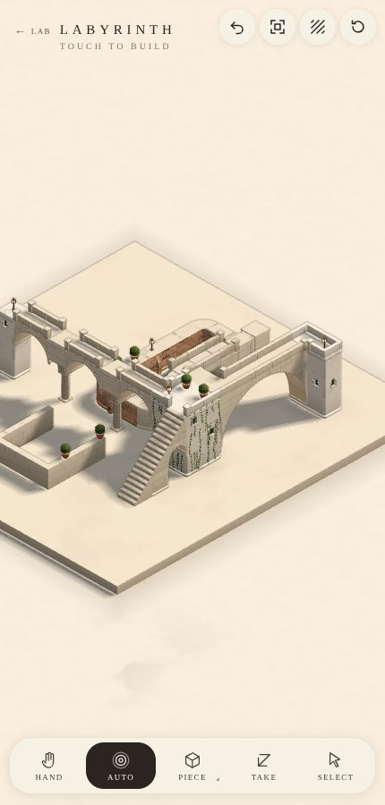
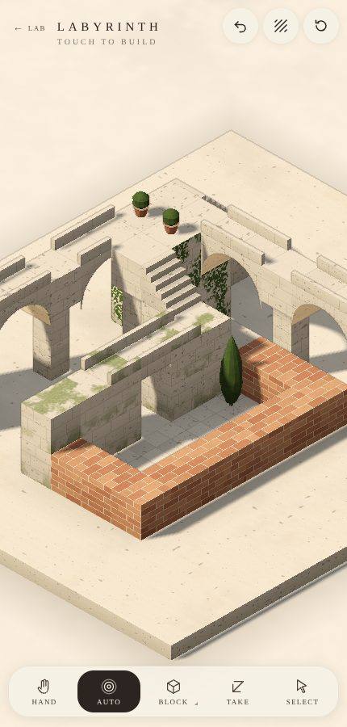

### select: taking something up, and reading it another way

Tap a piece and it's taken up: its own surfaces faintly warmed and its outline drawn round it, in the picture itself (not a box round its cells). A card says what it is, with:
- **its scope**: *piece*, then each whole it's part of (the arcade an arch is in, the flight, the wall, the tower, the court), then the whole *structure* joined to it. Tap one, or tap the thing again for the next one out;
- **every reading at once**, each with a little drawing, the current one marked. Touch one to read it that way. Switching replaces the last switch rather than piling up, and touching the first again takes the switch away altogether;
- **dressing**, all of it, to dress what's taken up in one touch;
- **take it away**.

| Taken up | Its readings |
|---|---|
| an arch the rules made | an arch · a lintel (flat, on its piers) · a colonnade (a raised row of three or more) · two bays (a pier forced under its middle, if it's three or more long) · solid (stone under it, down to what's below) |
| an arcade, or a bridge | the same, for all its arches at once. Solid fills over its piers too |
| a pier | a pier (a column, under a colonnade) · solid |
| a block (yours, or laid by a connection) | a block · a thin wall · an arch either way · a stair |
| an arch you put | an arch · turned · a block · a stair |
| a stair | each of the four ways it could climb · a block |
| a wall | a wall · a thin wall · an arcaded wall (a way through each cell of its foot) |
| a building (a tower, a terrace) | its roof as the rules choose · no roof · hipped · gable · shed · dome |

A switched reading is an operation like any other: undone, written down, replayed. From then on it's the hand's. The rules don't decide it again.

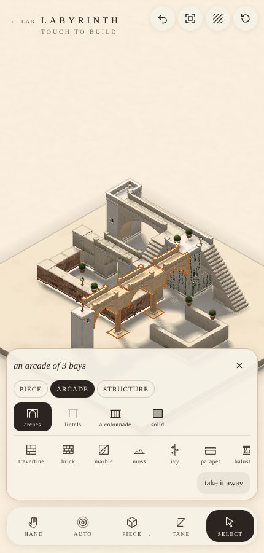

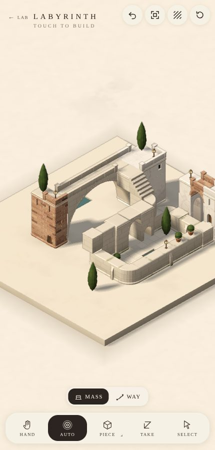

### The stone grows

There's no cap on how high it goes: tap a column up as far as you like, and the view stands back to keep it all in. The slab starts as an 8 × 8 square. After that it is only as big as what's built, plus two cells all round. Build on its edge cell and it grows two cells further; undo, and it goes back. There's always room to go on, and the view follows, framing the whole slab. The grid underneath is 48 × 48 cells.

### Moving round it

- Two fingers, the hand brush, or one finger starting on the background, turn the view. Let go near a corner and it settles on it; anywhere else, it stays where you left it.
- Two fingers moving up and down tilt it.
- Pinch, or scroll, to come closer to where the fingers (or the pointer) are.
- **Undo**, **frame it all**, **print** (draw it as a lithograph) and **clear** are at the top right.
- The view frames the whole build at the start, when you touch *frame it all*, and when what's built reaches the edge of the screen. Otherwise it stays where you put it, so the work doesn't shrink away from the hand as it grows. It never moves while a hand is on the stone.
- Stone that settles puffs a little dust.
- What's built is kept on this device.

## The storyboard

The brief's first test asks whether someone, without instruction, can build this: a small raised platform, a wall extending from it, a terrace higher up, a connection between them that resolves into stairs, and a passage cut beneath the walkway. Each picture is made with the gestures a hand would use (`demo.ts`), read by the same rules. The smoke test makes the same structure with real pointer events.

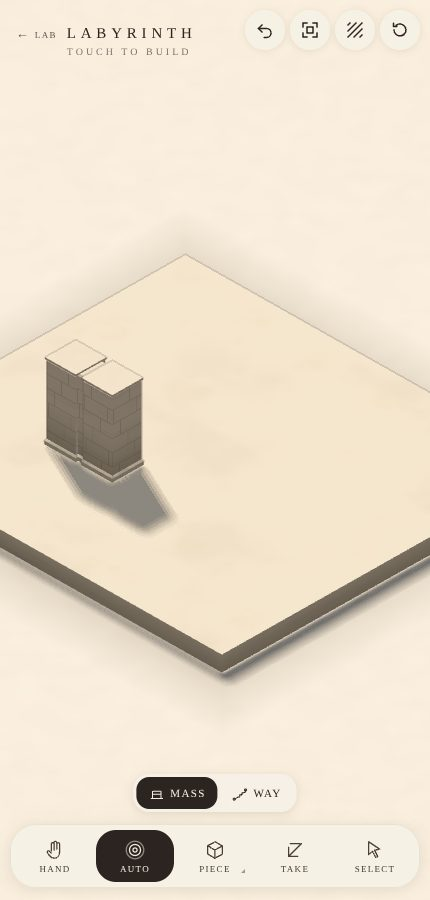
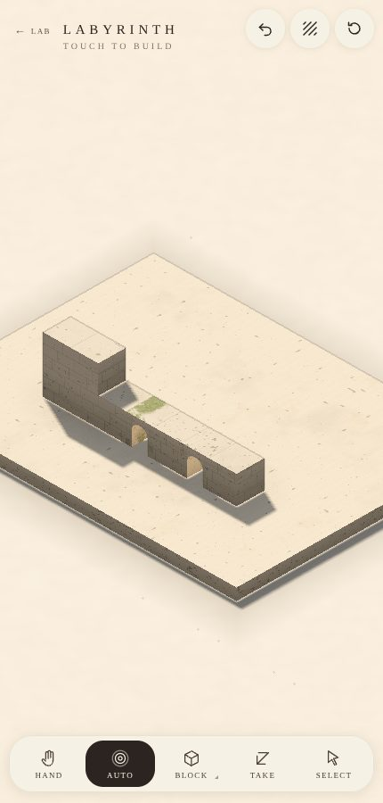
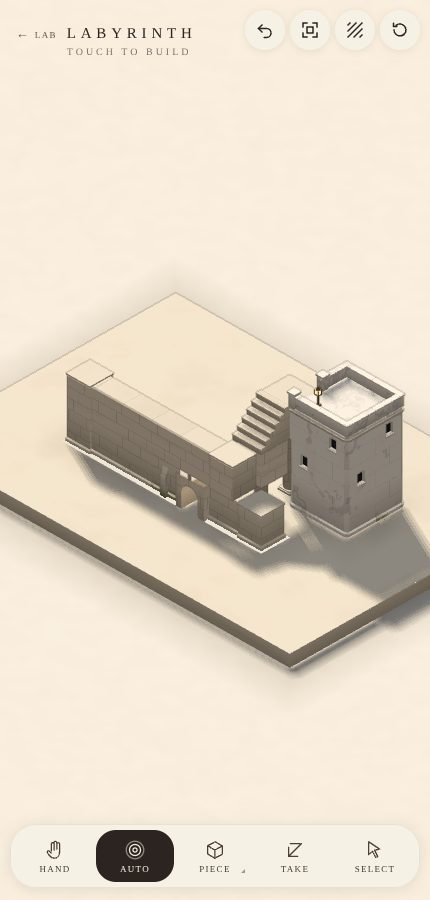
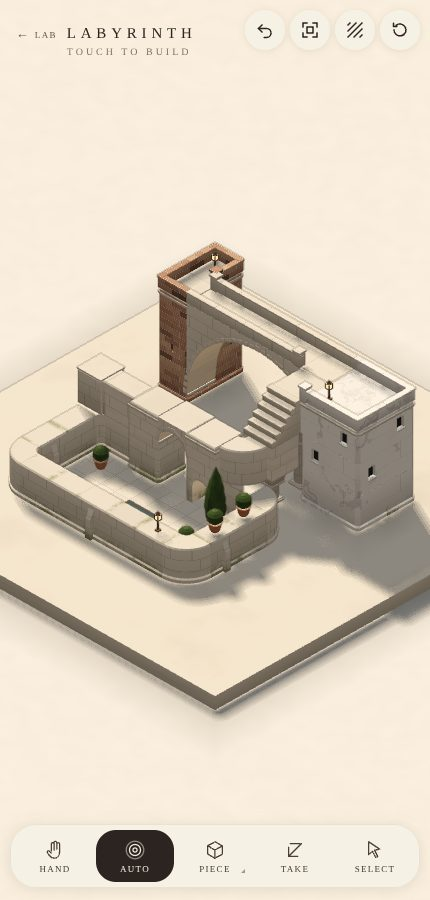

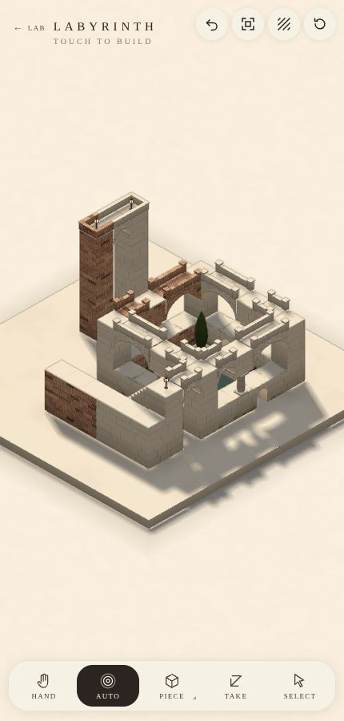
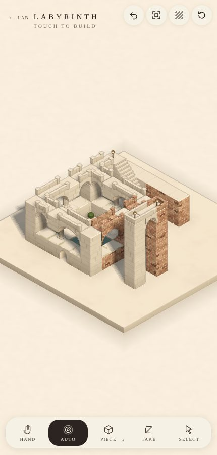

1. **First touch.** Tap the stone, tap its top, tap a side: a platform, two courses high.
2. **A traced wall.** Trace across the stone from beside it, and a wall grows along the stroke.
3. **An elevated connection.** Tap a terrace up three courses. Then trace from the platform's top along the wall's top, and up to the terrace. The landings rest on the wall. The step up comes on the last straight run, and where the route turns off the wall, piers come up under it.
4. **A resolved labyrinth.**
   - With take, stroke the wall beneath the walkway. The wall is cut through, and the walkway over the cut stands on an arch.
   - Trace a wall round in front, and the court is closed: paved, with a cypress in its corner.
   - Tap up a tower, and trace from its top to the terrace's top at the same height. The rules choose one great arch for this bridge (another stroke might get an arcade of even bays).
   - None of it is dressed by hand: the brick tower and its lantern, the ivy and moss round the court, the pots, the parapets are all the rules' own (below). `?plain` shows it bare.

And `?story=8` is **a labyrinth**: a compact build made to show what's hidden and what crosses. A cloister (a court walled round, a gallery of arches on its walls from corner tower to corner tower, a gate through each side, one framing the stair beyond). A stair climbing behind a wall, its foot hidden and its head showing over the wall, to a landing tower. From there a bridge over the passage below to the cloister's corner, so one way crosses another. A tall, narrow slot between two towers, bridged high up. And houses under roofs, their doors, windows and stairs inside the rules' own.

And `?story=11` is **gestures read**: a stroke drawn round back to its start (a court walled in, a gate where it began), a wall traced with two pauses (a gate at each), a climb too steep for its stroke (a stair tower beside the terrace), a bridge traced through a taller tower (round it), and a climb with a block in its way (round it to a straight flight).

And `?story=10` is **flow**: a wall traced on the diagonal (drawn as one straight diagonal wall), a court whose corners sweep round, a terrace out from a tower and stone pushed out over nothing (carried on piers that meet it in coves), and a wall traced across a stair's foot, which leaves the stair's way open.

And `?story=9` is **features, placements and rhythms**: a colonnade along the plaza between two towers, a jali round one tower's top; a terrace and the flight up to it, balustraded; a court screened on one side by a jali; a house with mashrabiya at its upper windows and colonnettes at its openings, and a pergola over the yard in front of it.

## How it's built

Three layers, in order of authority (`model.ts`):

1. **Operations.** Each tap, wall, piece, dressing or switched reading is recorded as what it changes in the intended solid: stone added (a cell at a level, and when it was laid), stairs added (which way each climbs), stone with a way through it, cypresses, pools, and stone cut away. A bridge's stone is marked as a bridge's. A trace that reaches out or climbs is recorded as a **connection**: where it starts (the height and the column), the columns it crosses, and where it's going. That is the intent; its stone and steps are worked out when it's replayed. Undo takes the last operation back. The world is always these operations replayed, so a new edit never redesigns an earlier one except through the rules below.
2. **The intended solid.** The stone and stairs the operations add up to. The hand decides this, and nothing below changes it. A connection works itself out around it:
   - a landing or walkway is laid on stone under it, at the height it walks;
   - steps go only where the way runs straight through a cell (in and out the same way, so each stair is climbed from its foot). They're kept together in **flights**: the last straight run takes as many as it can, ending where it ends, then the run before it, with landings between;
   - where it meets anything at the height it walks (stone, a stair, a tree), or would stand on only a stair, it stops there and joins it. It never cuts what the hand built.
3. **The resolution.** What the stone has to do so the intended solid stands. It is worked out afresh after every edit, the same every time:
   - stone with nothing under it, between stone either side along x or z, is carried on an **arch** (three cells at most, or seven for a bridge put by hand). The arch springs as low as both sides go, down to where a round arch fits, and the air under it is kept clear;
   - a longer run between stone becomes an **arcade**: piers spaced evenly, the bays as alike as they can be (any longer ones in the middle), and every arch of it springing from the same height;
   - unless the hand has switched it: a run read as a lintel is carried flat; a pier asked for is put there first;
   - a free end, or a stair over nothing, stands on a pier;
   - so cutting under stone opens an arched way through it, and a walkway drawn out over the court comes with what holds it up;
   - ground walled in all round is a **courtyard**: paved. If it's six cells or more, water where it's open on every side (four pools at most, nearest its heart), or at its heart; if it's four or more, a cypress in a corner. A low arched passage (a level or so high) counts as a wall; a bridge high over the ground doesn't.

**Reading a gesture** (`gesture.ts`) takes where the gesture started, the cells the stroke crossed, and where it ended:

- **Where it started**: the slab is height 0, a top the level above its stone, and a side the course touched (so a walkway drawn from halfway up a tower goes out at that course).
- **Where it ended counts** if it's a top at another height. From high up, ending over bare stone, the trace makes a walkway rather than stairs down: tracing *up* to a top is how you climb.
- **The way goes in** at the first column it passes beside its destination, not on round it.
- **A climb too steep** (more levels than straight cells to put steps in) is a stair tower if one will stand, else a walkway out toward it, saying why, rather than built short.
- **A diagonal stroke** is walked a cell at a time, the way it leans.
- **A stroke that doubles back** keeps only what it covered once.

**The page** (`main.ts`) turns a touch into those terms:

- **What it struck** is found by marching the ray through the actual stone. That includes the stone above an arch's curve, so a touch there is that cell's, not the air's.
- **The stroke's cells** come from projecting the finger onto the level plane it started on. Each is fixed once the finger has passed it: reaching for a higher top later doesn't shift the cells already crossed.
- **Where it's going** is held steady. A top touched squarely is taken at once; near its edge, or moving off it, the finger has to stay a few moves before the trace goes there instead. So a wobble across an edge doesn't flip the trace between a walkway and stairs.
- **While a trace is under the finger**, it's read against a copy of the world as it was before the trace began, so picking never strikes the trace's own stone. The world is only worked out again when what the trace would build changes. The stone is laid behind the finger in the order it was crossed.
- **Letting go changes nothing.** What was shown under the finger is what's built. If a connection stopped short to join stone it met, the hint says so.
- **What it struck** is found by marching the ray in coarse steps through the air, then fine ones back from the first stone.

## Auto, with character

Auto doesn't only make what the hand asked for. Where there's a choice, the rules make it, so builds come out with some architecture and some life, not bare stone. Every choice is **seeded** (by the world's seed and where the thing is), so the same strokes always come out the same, and undo and replay give the same world. Every choice can be **corrected**: switch it with select, or dress over it by hand.

**What auto makes** (kept in the operation, so it's what you saw while drawing):
- **a wall** traced on the stone comes out plain, **gated** (a way through near its middle, and every six cells or so on a long one) or **arcaded** (a way through every other cell). A wall eight or more long is never plain. A gate is a way a figure can walk through;
- **a bridge** from a top to a top at the same height, four to seven long, is one great arch about half the time, and otherwise an arcade of even bays.

**What the rules dress** (`character.ts`), worked out afresh from what's built and never kept. It's decided a whole motif at a time, so it's coherent: a tower is all marble or none of it, and a terrace's parapet runs all round or not at all.

| On | Now and then |
|---|---|
| a tower | marble, or brick; a lantern on top, often; a parapet round its top |
| a wall | brick; moss along its foot |
| an arcade or bridge | brick, piers and all |
| a flight | a lantern where it arrives |
| a terrace | pots at its corners, a lantern |
| a court | ivy now and then, in a clump up a few of the walls round it (a cell or two high); moss at their foot; pots in its corners besides the cypress |
| anything high with a drop at its edge | a parapet round it |
| the stone at the foot of things | a little moss |

Dressing is kept sparing on purpose: a few things dressed well read better than everything dressed.

**The hand's dressing always wins**, part by part. Brick over the rules' marble is brick; a lantern taken off stays off. A stroke with a dressing starts from how the stone looks now, the rules' dressing included, so stroking ivy over the rules' ivy takes it off.

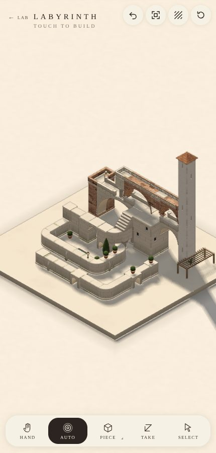
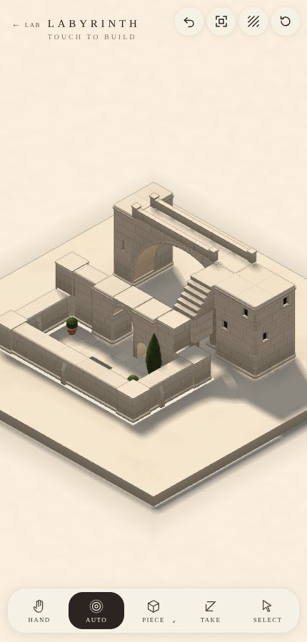

## Buildings: doors, windows, a stair inside, roofs

A solid mass of stone is read as a building (`buildings.ts`), worked out afresh from what's built, like the rules' dressing, and seeded so the same build always comes out the same. A building is solid columns all the same height, two or more high: two cells or more deep each way, or a tower of one or two cells three or more high. A wall a cell thick isn't one.

**Doors** go where they mean something:
- **where a way arrives against a building's wall at height** (a walkway, a landing, a bridge's end, the walk under a gallery): a door into it;
- **at its foot, when a stair inside is needed**, facing ground a figure can reach: when a way at one of its doors, or on its top, can't be reached from the stone any other way;
- **at the foot of a house** (a building whose top isn't walked) as a rule, and now and then at the foot of others facing a court.

**A stair inside** joins a building's doors to each other, and to its top if its top is walked. It's a way the stone doesn't show, so the walk graph knows of it (`walkable`). In storyboard 4, nothing on the stone climbs to the terrace, the platform or the walkway between them. The terrace has a door at its foot, so its stair inside is how they're reached.

**Windows**, one style to a building (arched, square, or a slit), go on its open faces, alternating along a front and from one level to the next. A tower with a stair inside has a slit a level, climbing round it as the stair does.

Each opening is set back in the wall: its reveals, its head (arched, or square), a sill under a window, a step at a door. A door has a leaf of weathered planks; a window has dark glass that catches the sun.

**A roof** goes where the top isn't walked, nothing has been put on it, and the plan is a plain rectangle (other plans are next):

| Plan | Roof |
|---|---|
| square | hipped (a pyramid, on a tower); now and then a dome on a drum, on a tower |
| long | gabled along it, the ends walled up in stone (now and then hipped) |
| leaning on taller stone along one side | a shed roof, falling away from it |

Roofs are terracotta tiles in courses up the slope, each tile its own shade. Each slope is a slab with a thickness, its edges closed, so where it overhangs a wall (at the eaves, and a little at a gable's verge) it reads as a roof rather than a cut. A gable's end is walled up in stone, with a band at its foot along the eaves' line. There's a ridge along the top. Domes are lead in standing seams, with a finial. Nothing the rules dress goes on a roofed top.

**Select** a building (its tower, or its terrace) to read its roof another way: *as the rules choose*, *no roof*, *hipped*, *gable*, *shed*, *dome*. The choice is kept as a rule, and from then on it's the hand's.

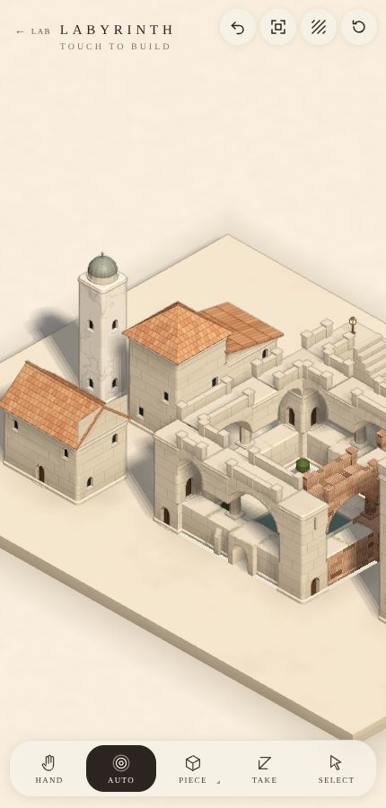
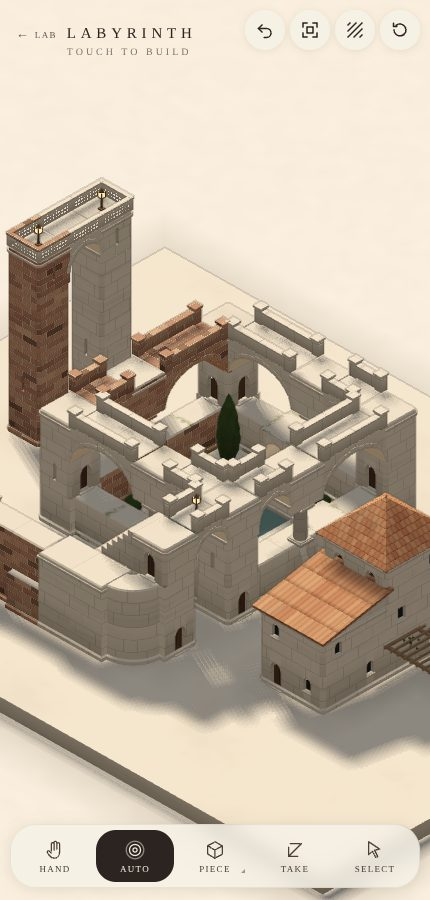

## Features, placements and rhythms

Each feature goes where it belongs, at its own rhythm. The rules put them of their own accord (`character.ts`, `model.ts`), and the hand puts them as dressing or switches them with select.

| Feature | Where it goes | Its rhythm | How it comes |
|---|---|---|---|
| **balustrade** | the edges of terraces, roofs that are walked, stairs, a colonnade's top | dense and quick: a turned baluster every ninth of a cell, a pedestal at each end and corner | the rules, on a high top with a drop (a balustrade about four times in ten when they rail one), on a long or high flight now and then, along every colonnade; dressing |
| **colonnade** | a raised run along a plaza or a facade | slow and wide: massive columns, evenly spaced, with a swell to the shaft (entasis), a moulded base and a cushioned capital, under an entablature (an architrave, a cornice) run on over them | the rules, about a third of the time on a raised row of three bays or more, each bay three cells wide or more, not beside a court; select's *a colonnade* reading |
| **arcade** | courts, cloisters, walks under a gallery | fluid: arches rolling from pier to pier | the rules (as before); select's *arches* reading keeps it arches |
| **colonnettes** | doors and arched windows | tight and paired: two slim shafts each side of a door, one each side of a window, on little bases, under little capitals where the arch springs | the rules, on some buildings whose windows are arched; dressing (which makes a building's windows arched) |
| **mashrabiya** | the upper-floor windows of a house | fine: a box of turned lattice out from the wall on two corbels, solid at its foot and head, under a little lean-to roof; the sun comes through it in points | the rules, on some roofed houses; dressing |
| **jali** | court partitions, railings round a top or up a stair | a pierced stone screen of circles and stars, framed at its foot, its head and each cell's edge | the rules, on some thin walls beside a court, and on some high edges; dressing |
| **pergola** | the yard in front of a house's door, a court, a terrace | posts at its corners (and along a long side, every other cell; none where a wall takes the beam), beams round it, rafters across the short way, a vine up the posts and over the top | the rules, over the court in front of some houses' doors; dressing (on a place) |

Pierced things (a jali, a mashrabiya's lattice) are cut through in the shader, in the picture and in the sun's view alike, so their shadows are dappled.

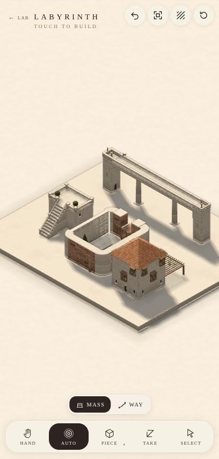
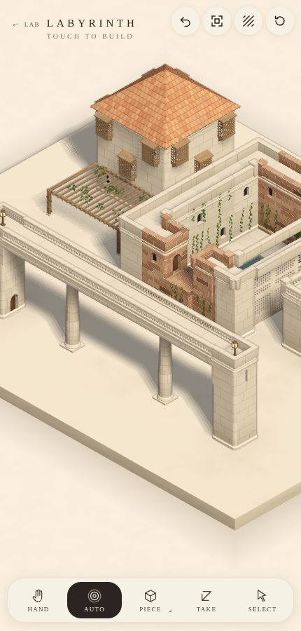
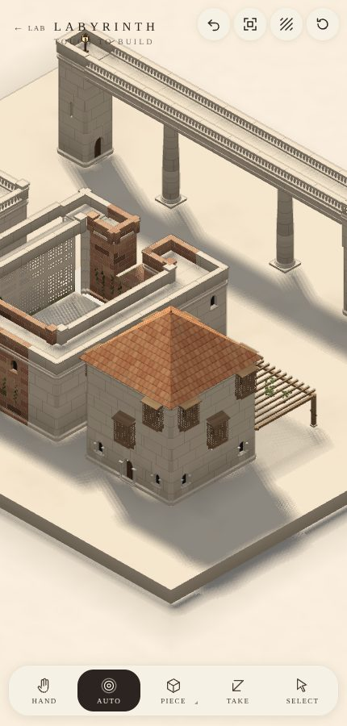
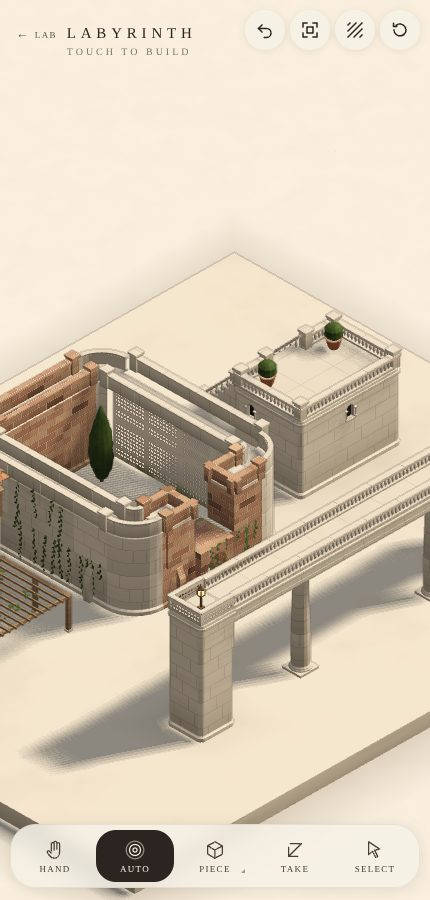

## Form: the shape inside each cell

The cells are what's built, selected and walked. How each is drawn is worked out from what's round it (`form.ts`), so blocks that meet join as architecture rather than sitting side by side as cubes. A touch strikes the same shape (`inStone` reads the same outline the mesh is drawn from), so what you see is what you touch.

- **A mass** (a block that's part of something two or more deep, or of a building, or a pillar on its own) fills its cell. Its outside corners are rounded where open air meets on both sides.
- **A wall** (a block in a run a cell thick: its neighbours at its level are only blocks, thin walls, or a gate through the run, and what's on it is wall too) is a wall's thickness, not a cell's. Where it goes straight on, just that. Where it turns, meets another, or ends, a post a little wider, capped. It runs on to a gate in it, and the gate stands a little proud, like a gatehouse. On the stone, a long straight run has a buttress every third cell either side, sloped back into the wall.
- **Along every open side**: the top edge bevelled, the top capped, a plinth splayed at the foot on the stone, a cornice under a mass's top up high, a string course where the stone changes kind. The courses and copings run on from cell to cell without a seam.

- **Flowing walls**: a wall that turns once sweeps round a quarter circle, from the middle of one side of its cell to the middle of the next, instead of meeting at a post. A run of turns one after another (the stair-step of cells a diagonal stroke lays) is drawn as one straight diagonal wall: each cell a band from one side's middle to the next. Either meets a straight wall beside it at exactly a straight wall's thickness, so the run flows on without a seam. Copings, plinths, parapets and balustrades follow the curve or the diagonal. Where walls meet (a T, a cross), a post.
- **Piers that carry**: a pier standing in the middle of its cell under a block meets it in a cove, curving out from its head to the block's edges. Piers side by side make a round arch between them, and toward the open air the cove reads as a corbel, so stone pushed out over nothing is carried, not a box on stilts. Toward an arch springing from it, a pier rises straight and the arch makes the curve. A block over air shows its underside.
- **The ground** is shaded by masses, not by walls: the ground round a curve or a diagonal isn't darkened cell by cell.
- **Buildings** need real mass, two cells by two somewhere in them (or a tower). A ring of wall round a court, or a wall on the diagonal, is a wall, however wide it spans.

Next for the form: junctions by kind (a wall into a tower with a buttress at the joint; a stair against a wall with its side wall; a parapet into a tower), and a few variants of each corner, chosen alike along a run.

## Gestures read for more than their ends

A gesture used to be read as "join where it started to where it ended", and refused when that couldn't be built. Now it's read for more of what was drawn, and **something is always built** where anything can be: the plain reading if it stands, else the nearest thing that does (a stair tower, a way round, a walkway out toward a top too steep to reach, a block raised beside a stair's way rather than in it).

**Choosing another reading is a matter of going on with the gesture**, not a row of buttons. Hold still at the end of a stroke, or on a tap, and if it could be read another way the readings fan out above the finger, the one it is now below it; lean toward one and it's built that way at once, in place of what was; let go to keep it. Lean back to the middle for the first again. On a stroke, going on past them (or off another way) just carries on the stroke, as if nothing had been offered; a short pause on the way is still a pause (a gate, a landing). (`?chips` brings back the old row of chips.)

| Drawn | Read as | Also offered |
|---|---|---|
| a stroke on the stone | a wall, its kind the rules' choice | the other kinds: a wall, a gated wall, an arcaded wall, a thin wall |
| a stroke drawn round, back to where it began (a ring of eight cells or more) | a court, walled round, a gate where it began | a ring of wall, an arcaded court, a thin wall |
| a pause on the way (the finger still a moment) | a gate there, in a wall; a landing there, on a climb (if the climb leaves room) | |
| a climb too steep for a flight along the stroke | a stair tower beside the destination (an octagonal turret, its door at its foot facing the way it was come to, a stair inside, its top joined to the top it's beside) | |
| a climb whose flight would stop short on something in the way | round it, to a straight flight into the destination; or a stair tower | the flight as drawn, joining what it meets |
| a bridge four to seven long | one great arch, or an arcade, the rules' choice | the other |
| a bridge or walkway with something in the way at its height | round it, the shortest way | joining what it meets |
| a climb that would make it | a flight | a stair tower |
| a tap in a stair's way | the cell beside it raised instead, the way kept open (refused only if nothing beside it would stand) | raise it anyway |
| a climb too steep, and no room for a tower | a walkway out toward it, at the height it starts from, to climb from later | |
| a piece where it can't go (a stair, a cypress or water against a side; a bridge with no gap) | on the top of what was touched; a block out from it | |

Declines are counted: the page keeps the last 200 gestures that came to nothing or less than was asked (`__labyrinth.declines()`), and the random-gesture check reports them. Over 60 worlds of random strokes, connections that stop short of where they were going fell from 48 in 175 to 8 in 172; ten climbs are still too steep with no room for a tower.

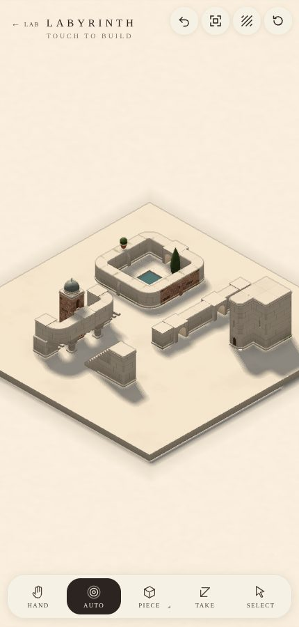
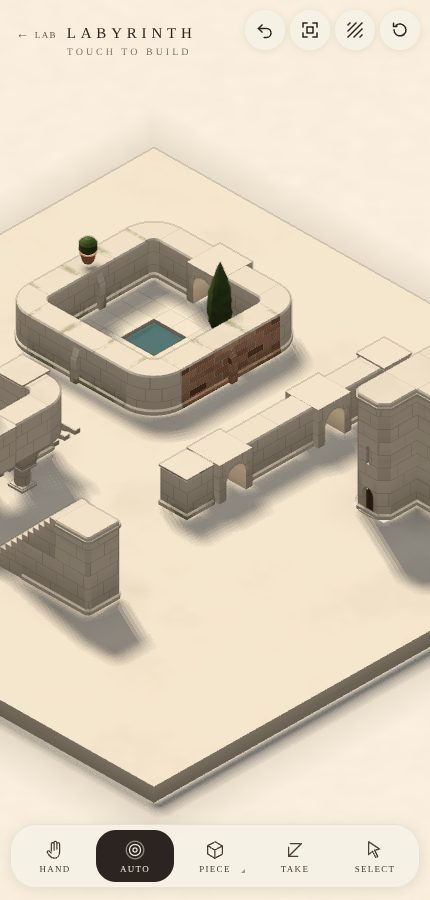

## How cells answer their neighbours

Every kind of cell reads the six cells round it (four sides, above, below) and answers them. In outline:

| Cell | Reads | Answers |
|---|---|---|
| **block** | stone, wall, arch, stair, the land beside it; what's above and below | drawn as a wall or a mass by its run; no face against stone, a stair's back, an arch across it, or **the land itself**; a lid unless something stands on it (or a basin in it); an underside over air; a plinth, foundation, cornice, string course, post cap |
| **thin wall** | stone beside it (its arms), what's above | runs out to what's beside it; an end where nothing is; no parapet (too thin to carry one) |
| **arched way** | an arch the same way above or below | one tall arch; walked only along its way |
| **arch (span)** | what its ends stand on; what fills under its ends (how low it springs); its readings | spandrels, deck, soffit; a parapet of its own accord when it's high or a bridge |
| **pier** | its column; a colonnade over it; a way beside its foot | slimmer the higher it is; stepped aside off a way; a cove under a block; a column under a colonnade |
| **corbel** | stone to hold it from, the far side open | brackets out of that face: **as many as what it carries is wide** (one under a thin wall, two under a wall, three under a block) |
| **stair** | what's beside it, its head and foot, the room over them | its way kept open by everything; **a balustrade wherever there's a drop beside it**, flight or not, and the landings of a railed flight railed with it; **an underside where it's over nothing**; no face into the land |
| **basin** | **a plain block under it**; basins beside it; the drops at its edges | a rim, open toward the next basin; one spout; no roof over it, nothing put in it |
| **court** | what walls it round; its level | paved; water, a cypress, pots by its size, **never in a stair's way or a pier's cell** |
| **the land** | what's used beside a bank | a retaining wall; flat to it either side |
| **building** | its solid columns, what reaches it, the hill, taller stone, water on its top | doors, a stair inside, windows, a roof (or a lean-to on the hill, or none) |
| **parapet** | open edges of a top: no stone, no stair, **no land** at its height beyond | posts at true ends, pedestals at corners |

Still to answer (found by going through every kind): a wall, an arched way and an arch in one run aren't the same thickness where they meet; a building's windows can look straight onto a neighbour's roof; buttresses are spaced by the grid, not the run; a pool rim across a step in the land; a sideways change of stone gets no joint; an arched way has no plinth or cornice where it's in a run of walls.

## Corbels

Stone pushed out a cell from stone that stands, with nothing beyond it, is held out on corbels rather than carried on piers to the ground: three brackets out of the face it's held from, curving up and out to the outer edge, so the way under it stays open. A pier asked for there (select's *two bays* reading puts one) still stands. Deeper projections are still carried on piers, which meet them in coves.

## Ways kept open

A stair needs its way: the place at its foot, the place at its head, and the headroom over it and over its head (`World.way`). Nothing auto does builds into one:

- **a tap** there raises the cell beside it instead; only where nothing beside it would stand is it refused ("that's a stair's way: kept open"), and held, it can still be raised anyway;
- **a wall traced** across one leaves a gap there;
- **a connection** stops short of one, and a stair that would climb straight into what stopped it isn't laid at all, so no stair ever leads into a wall;
- **the rules' dressing** (lanterns, pots, pergolas) never stands in one, nor before a door. A flight's lantern goes beside where it arrives;
- **a court's** water, cypress and pots keep clear of them.

The piece brush still puts exactly what it's asked to, where it's asked. It's the explicit brush.

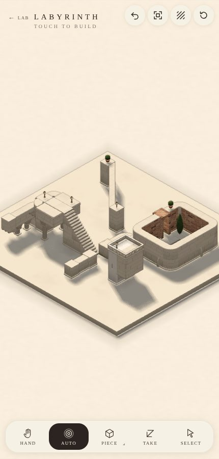
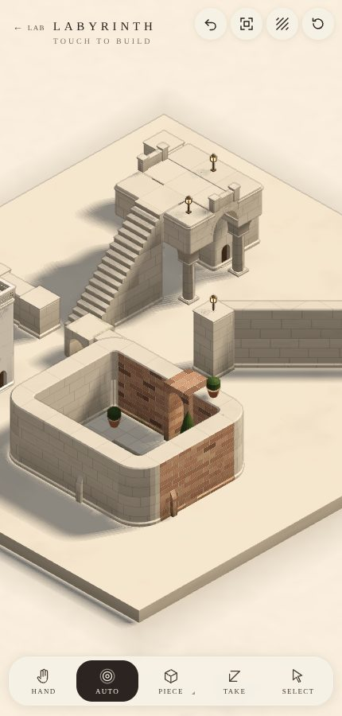
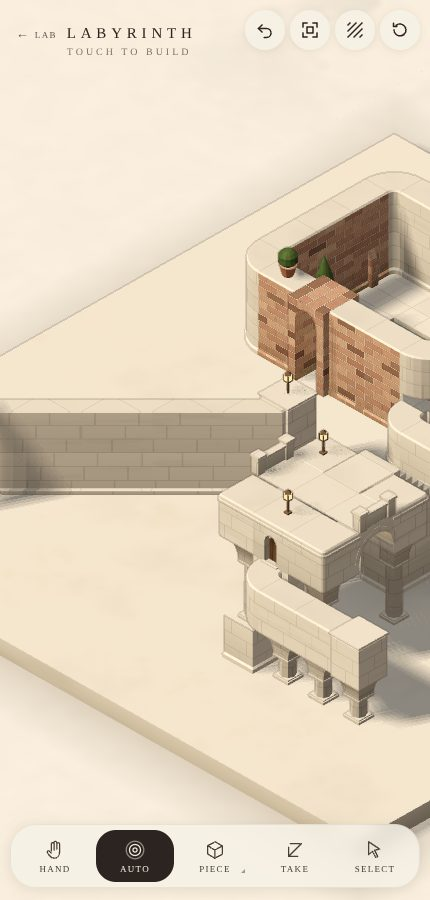
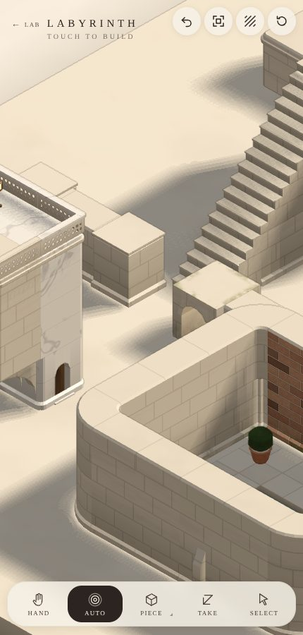

## Three tiers of wall

| | How thick | How high | Made by |
|---|---|---|---|
| **a block wall** | a wall's thickness (a whole cell where it's part of a mass) | a level a course | auto's trace on the stone, the block piece |
| **a thin wall** | a wall's thickness | a level a course | the wall piece; select's reading of a block, or of a wall |
| **a parapet** (or a balustrade, or a jali) | thinner, with a coping (or a rail) | low | dressing; the rules, round a high drop |

Select reads a wall three ways: a wall, a thin wall, an arcaded wall. A block reads as a thin wall too.

## Motifs

The rules work cell by cell, but what's built is read as bigger things (`motifs.ts`), so it can be taken up whole and kept coherent:

| Motif | What it is |
|---|---|
| **arcade** | arches end to end in a row, over piers between them |
| **bridge** | one arch of three cells or more, or a bridge put by hand |
| **flight** | stairs one after another, each a level up the same way |
| **wall** | a run of three or more columns on the stone, one cell thick |
| **tower** | a solid column, or a few together, three or more high, over everything round it |
| **terrace** | four or more solid columns side by side at the same height, two or more deep each way (not a wall's top) |
| **court** | ground walled in |

Coherence comes from the rules:
- an arcade's bays are alike;
- a connection's steps are kept together in flights;
- a high arcade or bridge gets its parapets.

## Where you could walk

`nav.ts` works out, from the resolved world, where a figure could stand and walk:

- **A place** is a cell with a floor under it (the slab, the top of stone, the deck over an arch) and nothing in it. The air under an arch counts, so a passage cut under stone is walked.
- **A stair** joins its foot (behind it, at its level) to its head (ahead, a level up), or to the next stair of a flight.
- **A way through an arch** (a gate in a wall) is a place too, walked only along its way.
- **Places beside each other** at the same height join.

Nothing is drawn from it yet. The tests use it to check that every connection that reached where it was going can be walked, end to end.

## How it's drawn

From the resolved world (`mesh.ts`), then WebGL2 (`render.ts`):

- **Blocks** have their faces where nothing hides them, darker at the foot, and their exposed edges **bevelled**: a narrow chamfer along each top edge over an open side and down each corner where two open sides meet, so edges catch the light. Where a block meets stone of its own kind there's no edge, and the courses run on.
- **Where the stone changes kind** from the course below, a string course marks it. **Brick is capped in stone**: its top is a travertine coping.
- **Stairs** have six steps, each tread with a **nosing** a little proud of its riser.
- **Arches** have spandrels and a deck over an elliptical soffit, and are built, not cut: a **ring of voussoirs** a little proud of the face, a keystone at the crown, and an **impost** where each side springs. Small archways have their ring too. The light under an arch is what bounces up from the sunlit ground: warm near its mouth, little where it's deep.
- **Piers** are slender columns, a little tapered, with a base and a capital. The higher they stand and the taller they run, the slimmer they are. On open ground a pier stands in the middle of its cell. Where it lands on a way (a walkway, a landing, a bridge's deck) it stands aside at the edge of its cell, across the way, so the way past it stays open. A figure walks past it, and the hand can build where it stands: the hand's stone takes over what it carried.
- **Thin walls** are a wall's thickness, full height, running out to the stone beside them. They're the middle tier between a block wall and a parapet, and they close a court as a wall does.
- **Courtyards** are travertine flags with their joints.
- **The stone** is dressed travertine laid in courses (a joint every third of a level, the upright joints staggered course to course), banded, pitted with pores, and each block a shade of its own.
- **The stone's detail** is kept quiet: the travertine is banded with a few pores, and its fine detail fades with distance rather than shimmering. Marble has a few broad, connected veins. Each material has its own sheen: polished marble most, travertine a little, brick and terracotta hardly.
- **Light**: a low warm sun. Shadows are crisp where what casts them is close (at the foot of a pier, a parapet, a stair) and softer the further it is. The dappled shade of a tree out of the picture falls across one side, near the build.
- **Drawn multisampled** (4×), so its edges are clean.
- **No outlines**: barely a line where the depth folds.
- **Rising**: the stone rises as it's laid, arches come down from their deck, and courtyard things grow when the court closes.
- **Print** (kept from before) turns the light into hatching on paper, with the edges in ink. It's next to take what Taohua learned about drawing.

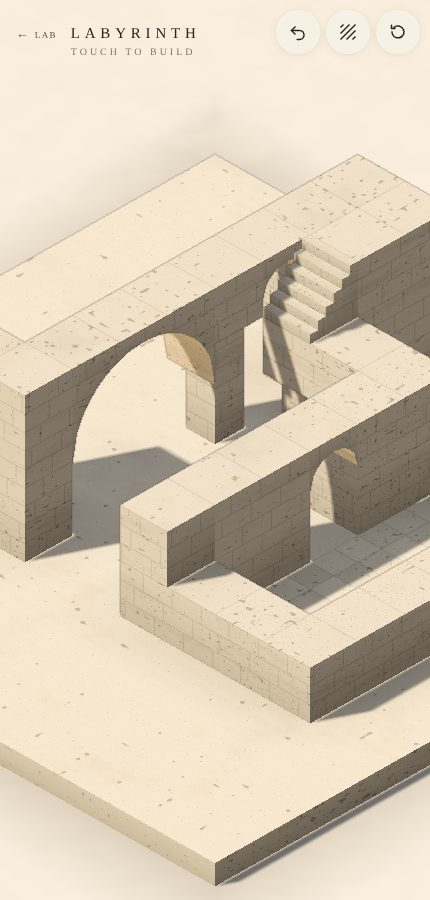
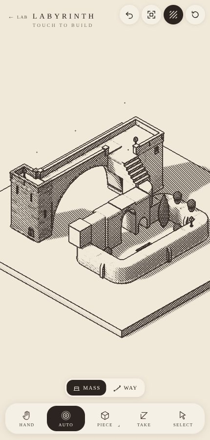

## Checked

- `node cells/lab/devtools/labyrinth-shaders.mjs` compiles the shaders in a bare page, so a shader that won't compile says why at once.
- `node cells/lab/devtools/labyrinth.test.mjs` builds 60 worlds from 60 random actions each (taps, traces between surfaces, carving, and palette pieces), read by `gesture.ts` and `palette.ts`. It checks:
  - whatever the hand built stands: on what's below it, on an arch of three cells at most whose sides are stone, or on a pier that itself stands and carries something;
  - every connection that reached where it was going can be walked from its start to its end (`nav.ts`);
  - a connection never cuts the hand's stone, and it either reaches or stops where it met something;
  - an edit changes piers and arches only within nine cells of what it touched;
  - a climb too steep for its stroke, with no room for a tower, is a walkway out toward it, saying why; drawn longer it's built, reaches the top, and can be climbed;
  - the rules dress every random world, the same way every time (replayed, the dressing is identical), using every kind of dressing; a tower is all one stone; about half the walls come out gated or arcaded;
  - the hand's dressing wins over the rules';
  - there's no cap: a column tapped up fourteen times is fourteen high, read as a tower, climbed by a fourteen-step flight that can be walked, and drawn to the top;
  - a gate in a wall is walked through, along its way only;
  - blocks are struck where they're drawn: just inside each open side of every block's outline it's stone, just outside it isn't (over a thousand sides tried);
  - a straight run is a wall's thickness, with a post where it turns and buttresses along it; a mass fills its cells with its outside corners rounded; a wall runs on to a gate in it;
  - every opening is in a building's own stone and looks out on air; every door looks out on a place to stand; a roof only over a top nothing arrives at; buildings come out the same every time;
  - storyboard 4: the terrace's top can't be reached from the stone by the stone alone; so it has a door at its foot and a stair inside, and it can; and from there, the platform's top along the connection;
  - storyboard 7: a door where the high walkway leaves the tower, halfway up;
  - storyboard 8: the houses roofed each their own way (dome, gable, hipped, shed), none over a walked top, every house with a door; the slot's towers climbed inside to the bridge between them; a building's roof read every way, gabled, then none;
  - a wall keeps its kind as the stroke grows, and its openings stay where they are; walls come in all three kinds;
  - a high walkway's free end comes down on a pier onto a walkway below: the pier is slim, stands aside, and the walkway below can still be walked past it, and built on;
  - the wall piece run round makes thin walls, which close a court; a tap on a thin wall goes on as one, up or out along its way; struck where it is, not beside it;
  - the random worlds also switch readings on what select would take up, dress stones, and run pieces; every arcade's bays spring alike;
  - the land: the same seed, the same land; its stream falls all the way under its banks; its shelf is flat; its surface is flat at each column's level through its middle;
  - storyboard 12 stands, is written down with its land and made again the same, has its court, both its ways reach (the first by flights through the gate, the second over the stream on an arch), can be walked from the low ground into the court and over to the house, and the house is a house;
  - random gestures on 24 pieces of land, mass and way: what stands, stands; nothing's built into the land; auto never builds into a stair's way; every way that reaches can be walked, end to end;
  - gestures read: a loop walls in a court (and is one), a wall offers its other kinds, a pause makes a gate in a wall and a landing in a climb (kept when written down), a bridge blocked at its height goes round and reaches, a climb too steep is a stair tower with a door at its foot and a stair inside that reaches the top, and where there's no room for one it's refused, saying why;
  - corbels: stone pushed out a cell is held out on corbels, from stone that stands, with nothing beyond; a pier asked for there still stands;
  - over 60 random worlds of gestures, auto never builds into a stair's way, and never lays a stair that climbs into stone;
  - form: a wall that turns once is a curve, a stair-step of turns is a diagonal that meets a straight wall at its thickness, a T is a post; a touch strikes the curve where it's drawn; storyboard 10 is what it says, its diagonal and its court not taken for buildings;
  - the arcade read as a colonnade: every bay flat, under an entablature; read back as arches, none a colonnade;
  - storyboard 6: the arcade is alike bays, the flight is three steps and can be climbed to the terrace, towers and the court are found, the lintel and the dressing are there and written down; every reading of the arcade stands; a bridge of five read as two bays gets a pier under its middle;
  - every arch's air is clear;
  - every way of reading a gesture occurs;
  - undo, and doing it again, gives the same world;
  - what's written down makes the same world again;
  - each storyboard stage is what it says it is.
- `node cells/lab/devtools/labyrinth-smoke.mjs` does the palette on a fresh stone (each piece where it's touched: block; arch; arch on arch, making one tall arch; stair against a block; a bridge across a three-cell gap on one arch; cypress; pool; take). It also does the brief's scenario with pointer events: the platform from taps, a wall from a trace, a terrace from taps, the connection traced up to it (stairs, with landings on the wall; what was shown before letting go is exactly what's built), the chips after the wall (read it as a thin wall, and back), a climb too steep for a flight (a stair tower), a way drawn up land 6 with the pointer (paved, climbing as the land rises, reaching), and a take-stroke carving under the walkway (an arch carries it). On storyboard 6 it uses the brushes:
  - the hand says what an arch is and that it's part of an arcade;
  - select takes up the arch, then the arcade; the card shows every reading, the current one marked; it switches to lintels, on to another, and back to arches, leaving no operations behind; the structure scope takes up everything joined; the card's dressing dresses it whole;
  - the piece brush, touched again, opens its sheet; brick from it is held and shown on the brush (still called piece), and dresses a stone;
  - blocks traced make a run; the wall piece traced makes a thin wall;
  - take, tapped, takes a piece away. Then undo, a turn from the background, print, what's built kept across a reload, and clear.

**What the tests don't establish** is the brief's real criterion: whether someone can anticipate a result, correct it and repeat it on purpose. That needs a person with the phone.

## Links

- `?story=1` … `?story=4` is the storyboard; `?story=5` adds pieces; `?story=6` motifs and dressing by hand; `?story=7` auto alone, no cap; `?story=8` a labyrinth.
- `?nomsaa` draws it without multisampling.
- `?at=i.j` looks at that cell rather than framing it all.
- `?plain` draws it without the rules' dressing.
- `?brush=select` (or any brush, piece or dressing) starts with it in hand. `?sheet` opens the piece brush's sheet; `?select=k.i.j` takes up what's at that cell, and `&whole` its whole.
- `?ops=` builds from operations, as the model writes them.
- `?print`, `?turn=1` (a quarter turn), `?zoom=0.4` (closer).
- `?preview` is the index's card: stage 4, turning slowly.

## Next

- **Cats, further**: tails and ears answering each other; a mother and kittens; cats on roofs; a cat followed into a building's door; more of a cat's own places (a sill, a pot, a sunny step).
- **Surroundings, further**: terraces cut into a hill as a gesture (a way's stroke that levels the ground it crosses); a building's windows turned to the view and its blank wall to the hill; a garden wall following the slope in steps; a bridge's abutments built into the banks.
- **Water, further**: fountains (a jet in a court's pool), runnels along a way, water through an arch (a mill-race), a basin read as a cistern; a stream turned aside by what's built.
- **Intent brushes**: a *path* (say where you want to walk, and the walk graph makes it walkable), *keep open* (nothing is to go here).
- **Stamps**: whole motifs put at once (a gate, a cloister, a loggia).
- **More readings**: a court's water or none; a flight with a landing halfway.
- **The walk drawn**: the places and stairs from `nav.ts`, shown faintly while a trace is under the finger.
- **Spatial grammar**: the rules making sequences, not only supports: galleries round courts, a passage lined up on a far stair, a stair turned behind a wall, of their own accord.
- **Worn stone**: a worn centre to a stair's treads, a darker edge to a pool.
- **Roofs on any plan**: an L or a T as joined roofs (valleys and hips), a roof stepping down a building of two heights; roofs over walks (a loggia's roof on columns).
- **Doors and windows by hand**: a door or window as a piece, and select reading a building's openings (none, more, another style).
- **Features, further**: a loggia (a colonnade on the stone, roofed); a balcony out from an upper door on corbels, with a balustrade or a mashrabiya; a pergola with its vine in leaf or bare by season; a colonnade's order chosen (plain, or fluted).
- **Interiors**: a building opened up (a cut through it shows its floors and its stair).

- **Snapping on relationships**: geometric (a stroke ending near an edge or a terrace joins it), topological (two walkways meeting make a junction you can walk), architectural (a buttress under an exposed terrace edge).
- **Strokes off the grid, further**: diagonals at other slopes (a knight's move), curves of a longer radius across several cells, a wall bending round a tower; masses with diagonal faces where a trace cut a corner.
- **Constraint resolution for transitions**: where stairs meet arcades, corners, intersections.
- **Escher, as a separate authored layer**: first impossible-*looking* space (deep arcades, conflicting stairs), later impossible topology (connections that are valid only from one view).

Every picture: [views](labyrinth/views.md), made by `node cells/lab/views.mjs labyrinth`.
