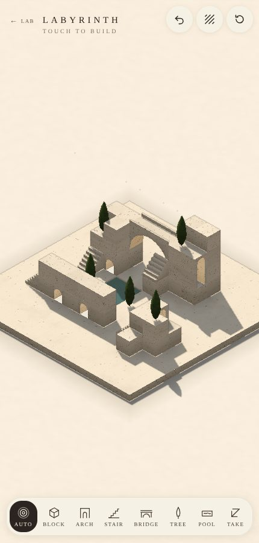
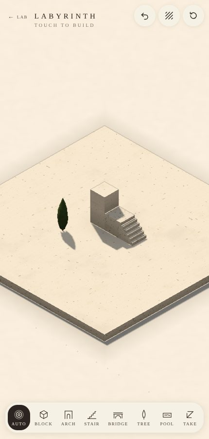
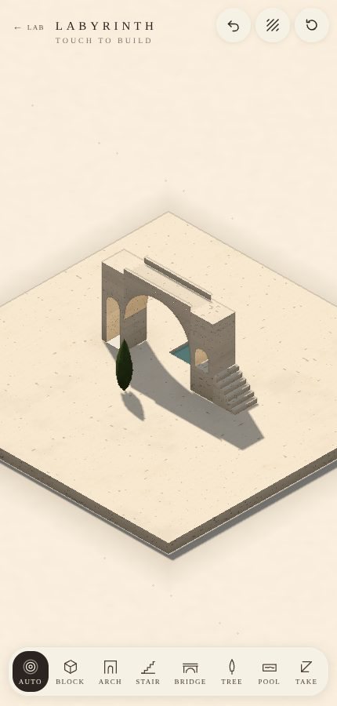
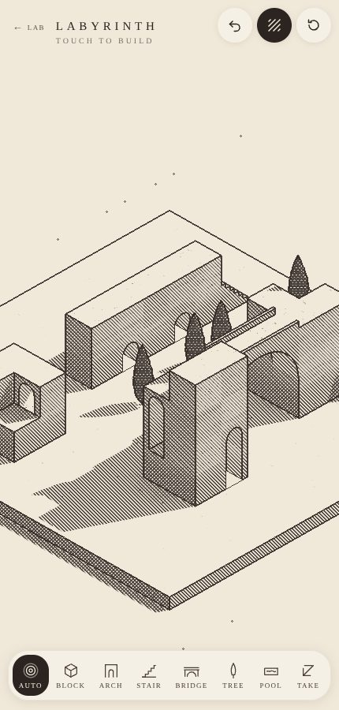

# Labyrinth

A flat travertine stone on a table in the sun, built up one piece at a touch: blocks, arches, stairs, bridges, cypresses and pools. It's modelled on a sketch of the idea: chunky cream stone, tall arches with the light gathered in them, long stairs, a bridge on one great arch between two towers, water in the court, dark cypresses. It can also be drawn as a print.

## Using it

- **Touch to build.** The row along the bottom says what a touch puts down:
  - **auto** reads the place you touch:
    - the stone gets a block;
    - a block's top gets another block;
    - a block's side gets a stair up onto it, where there's a floor to start from;
    - a block's side over a gap gets a bridge across to the stone on the other side.
  - **block**: a cube of stone, standing on the stone or on stone.
  - **arch**: a block with an arched way through it, running where it's open. An arch on an arch the same way makes one tall arch.
  - **stair**: a flight up one level, climbing toward the stone you touched (or onto a neighbour's top).
  - **bridge**: touch a gap between two pieces of stone at the same level, and the whole span is built at once.
  - **tree**: a cypress, on a floor with room above it.
  - **pool**: water let into the stone itself.
  - **take** removes a piece, if nothing rests on it.
- **Drag sideways** to turn it. When you let go, it settles on a corner.
- **Pinch**, or scroll, to come closer.
- Top right: **undo**, **print** (draw it as a lithograph), and **clear**.
- What you've built is kept on this device.

## How it's built

The stone is 12 × 12 cells, each one unit across and one high, up to eight levels (`model.ts`). Each piece takes a cell, or a bridge takes its span. Every piece stands on something: the stone, or the top of a block, an arch, or a bridge's deck. Nothing is ever in mid-air.

- **Arches** stand like blocks, with a way through along one axis. An arch on an arch the same way joins it into a single tall arch, its head in the upper cell.
- **Bridges** span a straight run of free cells at one level, between a block or arch at each end. The arch under the deck springs as low as stone goes at both ends, down to where a round arch fits. So between two tall towers it is a great semicircle; between two low ones, a flatter arch. The air under the arch belongs to the bridge, so nothing is built through it.
- **Stairs** climb one level toward a side.
- A piece can be taken away only if nothing rests on it, including a bridge resting against it.
- Every piece is an action, kept in order. Undo takes back the last one. What's built is written down as text (`?p=`) and makes the same stone again.

**auto** is a small reading of the place (`decide` in `model.ts`). It knows what was struck (the stone, a top, or a side) and the free cell on that face's side. From that it chooses the piece the place most wants: on the stone, a block; on a top, a block; on a side with a floor below, a stair onto it (or a block, if the stair would climb into a wall); on a side over air, a bridge to whatever is level with it across the gap.

## How it's drawn

From the model, each time it changes (`mesh.ts`):

- **blocks** have faces where nothing is against them, darker at the foot where they meet a floor;
- **arches** have jambs and a semicircular head, lit from within;
- **stairs** have six steps;
- **bridges** have an elliptical arch with spandrels, a deck and a low parapet each side;
- **cypresses** are lathed spindles, lumpy with foliage;
- **pools** are water a little below the stone, with a rim;
- **the slab** sits on a table, which darkens near the slab's foot.

Then in WebGL2 (`render.ts`):

- **travertine**: cream stone, banded as it was laid down and pitted with pores, each block a shade of its own;
- **a low warm sun** with soft shadows (25 taps of a shadow map), and the dappled shade of a tree out of the picture falling across one side, stirring;
- **light in the archways**: their insides glow warm;
- **water** that is dark, with the sky and the sun's glint on it, a little stirred;
- **a filmic shoulder** on the light, and barely a line where the depth folds.

In **print**, the light becomes hatching on paper: one direction of lines, then crossed, then a third direction as it gets darker, with the edges in ink. The next step for print is to take what Taohua learned about drawing.

Everything rises as it's built: blocks from their floor, bridges down from their deck, trees up from their foot.

## Checked

- `node cells/lab/devtools/labyrinth.test.mjs` builds 80 labyrinths of 120 random touches each, with every piece and auto, removing a piece now and then. About 7,800 checks:
  - everything stands on something;
  - every bridge spans from stone to stone;
  - nothing that carries something is taken away;
  - undo takes back the last piece;
  - what's written down makes the same stone again;
  - every kind of piece gets built.
- `node cells/lab/devtools/labyrinth-smoke.mjs` uses it in a browser:
  - auto's block on the stone, block on a block, stair onto a side, and bridge between towers;
  - each piece in the palette going where it's touched;
  - undo and take;
  - turning;
  - print;
  - what's built kept across a reload;
  - clearing.

## Links

- `?demo` is the labyrinth above; `?p=` builds a labyrinth from its pieces (each `kind.level.i.j.axis.length`, where kind is `b` block, `a` arch, `s` stair, `br` bridge, `cy` cypress or `p` pool).
- `?print`, `?turn=1` (a quarter turn), `?zoom=0.45` (closer), `?hand=bridge` (start with a piece in hand).
- `?preview` is the index's card: the demo, turning slowly.

Every picture: [views](labyrinth/views.md), made by `node cells/lab/views.mjs labyrinth`.

## Before this

The first Labyrinth built whole levels at a touch: each level a perfect block maze on arches over the one below. That's in the history (`git log -- cells/lab/client/labyrinth`). This one builds a piece at a time instead.

## Next

- Print, after Taohua: its ink, its strokes, its few tones.
- A walker who goes up the stairs and over the bridges.
- Wider pieces: an arch two cells wide, a long flight over two cells.
