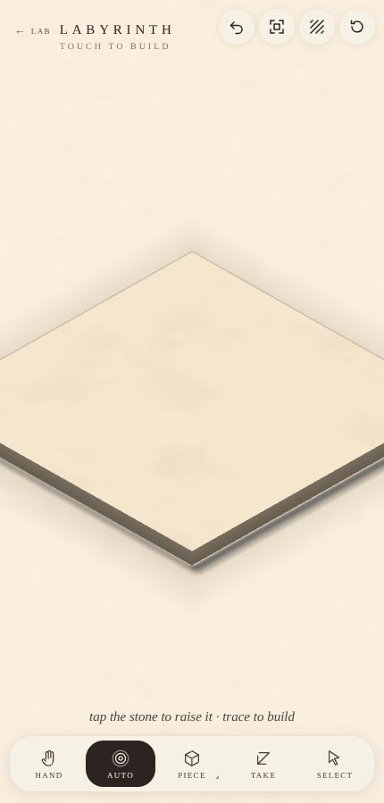
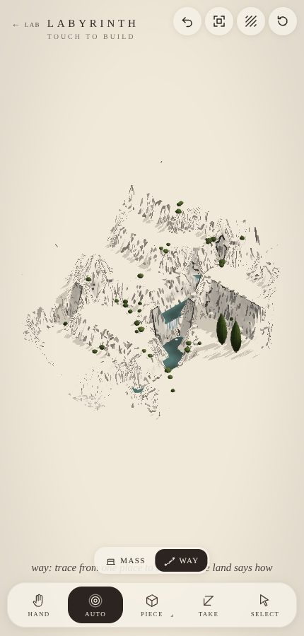
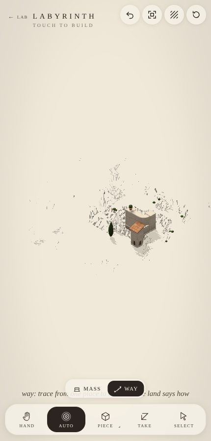

# labyrinth: every view

Made by `node cells/lab/views.mjs labyrinth` from `client/labyrinth/views.mjs`. The README is `../labyrinth.md`.

## The storyboard

## The palette

## Motifs and dressing

## A labyrinth

## Features and rhythms

## Flow

## Gestures read

## The land

## Water

## The cats

## Auto, with character

## The brushes

## Close to

## Print

