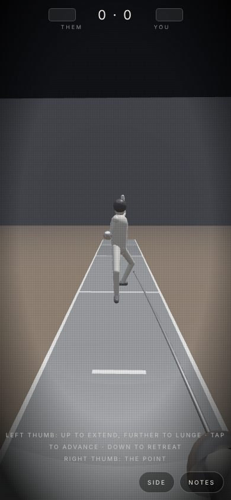
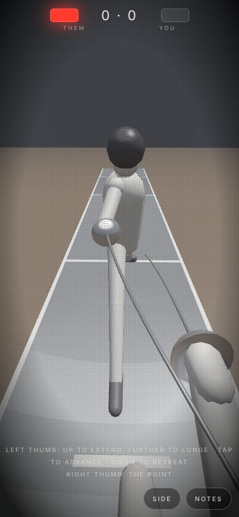
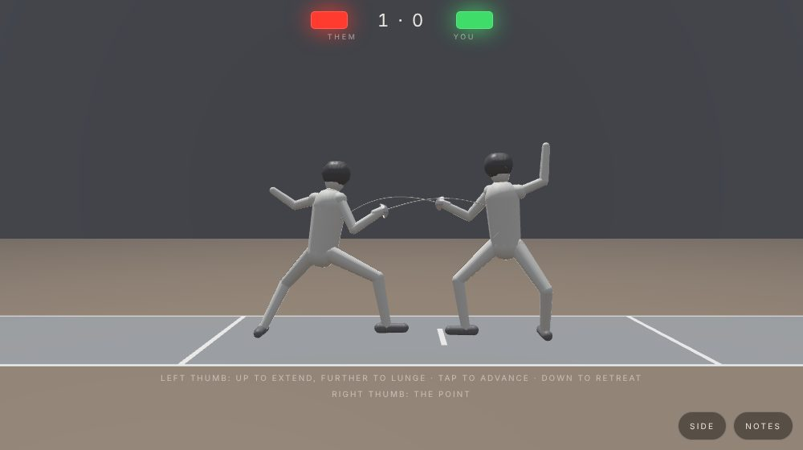
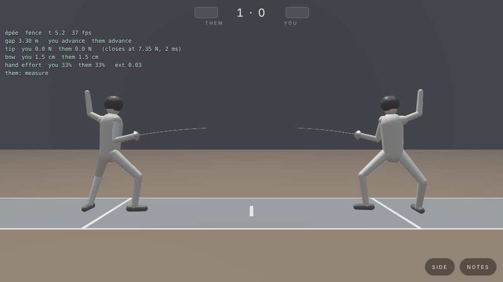

# Piste

> A fencing bout seen through your own mask, with two thumbs on the glass. Nothing is animated: the weapon is physics, and the lamps are a scoring box.

You stand at your en garde line with an épée. Your opponent stands at theirs, four metres away, their point toward you. The referee says *allez*. Everything after that is worked out, not played back: where your hand goes, what the blade does when it meets theirs, whether your tip was pressed hard enough for long enough to light your lamp, and whether theirs lit inside the same 45 ms.

## Your thumbs

- **Left thumb: the body.** Push it up and your arm extends, as far as you push. Push on past full extension and you lunge, and stay down for as long as you hold it there; let go to recover. A tap is an advance. Pull down for a retreat, and keep it down to keep retreating. The arm comes first and the legs follow, as they should.
- **Right thumb: the point.** Where the thumb goes from where it landed is where your point goes. The hand moves a little that way and the wrist turns the point a lot, so a small movement is a fine one. Let go and the hand comes back to its guard. A second finger on the right rolls the hand (its sideways drag).
- **At a desk:** drag with the mouse for the point. W or ↑ advances, S or ↓ retreats, Space extends, Shift lunges.

A ring under your right thumb shows its travel. A rail above your left thumb shows where full extension is, and where the lunge begins.

## What's real

**The weapon is a flexible blade.** It's a chain of fourteen particles solved by XPBD in steps of 1/2000 s. The pommel and the guard are the hand: two heavy points, each pulled toward where you mean it to be by a muscle (a spring-damper with a force it can't exceed). Beyond the guard the blade is a tapered beam. Each joint's stiffness comes from the blade's EI, and the blade carries the set a fencer bends into it. So leverage isn't scripted. A beat on the foible moves a few grams of steel and knocks the point aside; the same beat on the forte meets the hand and the arm behind it, and does little. A bind slides with steel's friction. A point pressed home bows the blade into an arc.

**The tip is a button.** The contact between the tip and a body is compliant (cloth over flesh, 6000 N/m). That makes its force a real force, and only its component along the blade's axis presses the button. It has to stay over 7.35 N (750 g) for 2 ms to register. A flat touch, a grazing one, or a jab from an arm too weak to press home lights nothing.

**The box knows only tips.** The first touch starts the lockout, and the other fencer can still register within 45 ms (épée), a coup double. After that the box locks. At one touch from the end, with the score level, a double counts for nobody. Retreating off the end of the piste is a touch against.

**The opponent sees you late.** It is a controller like your thumbs and gives the same kind of intent. It perceives the bout a reaction time (200 ms) ago. It keeps the distance it likes and attacks when it sees a chance: an extension, a lunge behind it, and an advance first if it's a little far. When your point comes at it, it parries to the side your blade is on and ripostes. Its touches land where its point actually goes, so it hits your wrist when you come forward carelessly.

## How it's built

Everything that happens is the bout. Everything else only connects it to a person.

| | |
|---|---|
| `weapons.ts` | a weapon as data: blade length and taper, mass, EI, set, guard, tip spring and dwell, lockout, valid target. Épée and foil. |
| `blade.ts` | the weapon as physics: the particles, the muscles, length and bend constraints (bending as a second difference, linear in the positions, so its gradients are constants) |
| `contact.ts` | blade on blade (friction; sides remembered, so a fast blade can't pass through another between substeps), blade on the bell, blade on the body, the tip's compliant contact and its axial force, the floor |
| `fencer.ts` | the body: footwork (advance, retreat, lunge, recover), the pose, the capsules the blade meets, the arm's IK, and the intent turned into where the hand is sent |
| `intent.ts` | **the one interface**: what a fencer means this instant (the hand's offset, the wrist's turn, extension, roll, a step, the lunge), in their own frame and in metres and radians |
| `box.ts` | the scoring apparatus (dwell, lockout) and the rules of what the lights are worth |
| `bout.ts` | time (the substep loop), the referee (allez, halt, en garde, the end of the piste, the score) |
| `ai.ts` | the opponent: a few tactics chosen by a small state machine, seeing the bout late. Also a dummy. |
| `input.ts` | two thumbs (and a keyboard) read as an Intent. Every number that shapes the feel is in `GAIN`. |
| `draw.ts` | WebGL 2, plain on purpose: capsules, steel that reflects a made-up hall, fog |

Anything that decides speaks only `Intent`: a thumb scheme, a better opponent, a recorded bout played back, a test script. Anything that shows only reads the bout: another look, a sound, a referee's view. The tests (`devtools/piste.test.mjs`) run the bout with no page. They cover the blade at rest, determinism, a lunge in and out of distance, a hand too weak to close the tip, a beat, a blade thrown through another at 20 m/s, the box's lockout and dwell, the end of the piste, and two stand-ins fencing a bout.

## Ways to look

`view=side` watches from beside the piste, and `view=over` from over your shoulder. `readout` shows the gap, each tip's peak force against its threshold, how far each blade is bowed, how hard each hand is working, and what the opponent is doing. `time=0.2` slows everything, physics included. `auto` lets a stand-in fence for you, and `ai=dummy` gives you something to practise on (`ai=line` holds its arm out). `weapon=foil` gives a 500 g tip, a 14 ms dwell and a 300 ms lockout, and only the trunk is target. `to=15` makes the bout longer, and `mask=0` takes the mesh away from your eye.

## Not yet

- **Right of way.** Foil's box is right, but a double at foil goes to the referee, who isn't here yet. Sabre needs cuts, not a button.
- **The body is kinematic.** It goes where the feet put it, and a blade can't push it. There's no flèche, no recovery forward, no ducking, and no displacement of the target.
- **The numbers are estimates.** The FIE gives the blade's length, the guard, the tip's spring and the lockout. The blade's stiffness, the arm's strength and the hand's mass are estimated, and left as dials to be measured.
- **The picture** has no shadows, no kit and no sound of steel. It's there to show what the simulation does, and looks can come later over the same bout.
