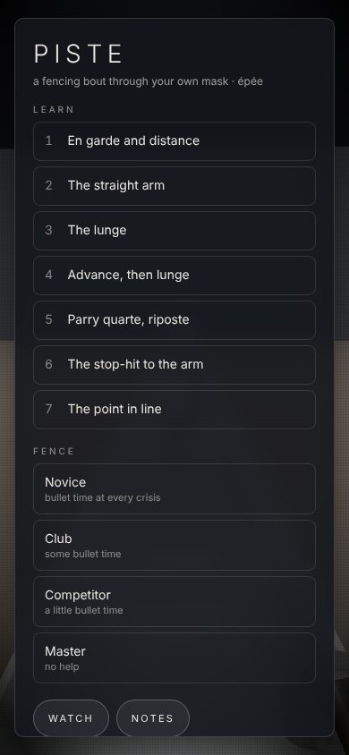
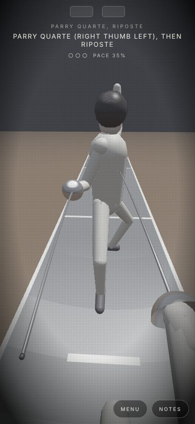
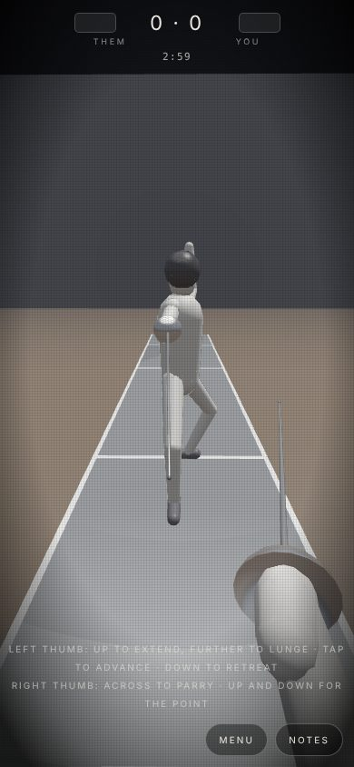

# Piste

> A fencing bout seen through your own mask, with two thumbs on the glass. Nothing is animated: the weapon is physics, and the lamps are a scoring box.

Open it and choose: **learn**, seven lessons in the order a beginner is taught, or **fence** against one of four opponents.

You stand at your en garde line with an épée. Your opponent stands at theirs, four metres away, their point toward you. The referee says *allez*. Everything after that is worked out, not played back: where your hand goes, what the blade does when it meets theirs, whether your tip was pressed hard enough for long enough to light your lamp, and whether theirs lit inside the same 45 ms.

## Your thumbs

- **Left thumb: the body.** Push it up and your arm extends, as far as you push. Push on past full extension and you lunge, and stay down for as long as you hold it there; let go to recover. A tap is an advance. Pull down for a retreat, and keep it down to keep retreating. The arm comes first and the legs follow, as they should.
- **Right thumb: the hand.** Sideways carries your hand across your body: left to quarte, right to sixte. Meanwhile the wrist keeps your point toward them, so a parry is one movement and the point is still there for the riposte. Up and down tilts the point into the high and low lines. Let go and the hand comes back to its guard. A second finger on the right rolls the hand (its sideways drag). (`thumb=point` is the first scheme instead: where the thumb goes, the point goes.)
- **At a desk:** drag with the mouse for the point. W or ↑ advances, S or ↓ retreats, Space extends, Shift lunges.

A ring under your right thumb shows its travel. A rail above your left thumb shows where full extension is, and where the lunge begins.

## Learning

The lessons follow the order most clubs teach beginners. Each lesson is the fencing master's *lesson*: a coach sets up a situation over and over (a distance, an opening, an attack along a line), and you answer it.

1. **En garde and distance.** They step, and you keep the gap: just outside their lunge, a step from yours.
2. **The straight arm.** They open their guard in reach, and you extend: the arm hits, not the legs.
3. **The lunge.** The same a metre further. Arm first: lunge with a bent arm and the judge says *feet first*, even if it lands.
4. **Advance, then lunge.** From a little out of reach.
5. **Parry quarte, riposte.** They attack your inside line from arm's length. Take their blade (your right thumb left), then back at them, at whatever their bell leaves open.
6. **The stop-hit to the arm.** They step in carelessly, arm half out, hand up. Hit the arm as they step, before their attack comes.
7. **The point in line.** What you may have found for yourself: arm straight, point on their chest, and they walk onto it. Set it before they step; the judge checks that you did, not only that it landed.

The judge reads the bout, so it can say what went wrong, not only whether you scored. It knows how extended your arm was when the lunge began, where on each blade a parry met (forte, middle, foible), which way your hand went, how hard your tip pressed, and how many milliseconds into their attack you hit. So you get *late: move as their arm starts, not as it lands*, or *wrong side: quarte is to your left*, or *you met it on your foible: it slid through*.

A lesson starts slow (35–60% pace). Each good repetition speeds it up by 15% and each bad one slows it by 10%. It's passed with three good repetitions at full speed, and passed lessons are ticked in the menu (kept in this browser). *See it again* replays the repetition.

The coach is fair rather than fierce. Its hand gives way to a parry made right: it lets its blade go and lifts it clear for your riposte, as a coach does. Its attacks come at a lesson's tempo, about half a second from the first movement to the landing, which leaves time for a normal reaction at full pace. In the stop-hit lesson the attack behind the preparation comes at a fencer's speed, because the time to hit was during the step. Every lesson is tested both ways: a student doing it right passes, and one doing it wrong is told the right thing (`devtools/piste.test.mjs`).

## Bullet time

Real exchanges are decided in a tenth to a third of a second. Add your reaction time, the glass's latency and two thumbs for a wrist, and full speed is too fast to learn from. So the bout slows at the moments that decide a touch: their point coming at you, yours arriving, the blades meeting. It judges those moments only from what you could see, never from what the opponent is thinking. The edges of the view close in and the rate shows in the corner. It eases in fast and out slowly, and it won't linger: a long bind is fenced at speed.

How much it slows is the opponent's level. The **novice** allows a fifth of real time at every crisis, the **club** fencer some, the **competitor** a little, and the **master** none. `assist=0` to `assist=1` overrides it. The physics is the same at any pace: bullet time only runs the same 1/2000 s steps fewer times a second.

## Replays

After every touch you see it again: the last second and a bit, from the side (from high behind you on a tall screen), slowing to under a fifth of real time into the hit. What happened is written as it happens: *blades meet: your middle on their foible*, *their blade on your bell*, *them: arm (+23 ms)*. A replay isn't a recording. The bout is deterministic, so a replay is a copy of the bout as it was a moment before, run on again with the same intents, substep for substep. Tap to go on; `replay=0` turns replays off.

## What's real

**The weapon is a flexible blade.** It's a chain of fourteen particles solved by XPBD in steps of 1/2000 s. The pommel and the guard are the hand: two heavy points, each pulled toward where you mean it to be by a muscle (a spring-damper with a force it can't exceed). Beyond the guard the blade is a tapered beam. Each joint's stiffness comes from the blade's EI, and the blade carries the set a fencer bends into it. So leverage isn't scripted. A beat on the foible moves a few grams of steel and knocks the point aside; the same beat on the forte meets the hand and the arm behind it, and does little. A bind slides with steel's friction. A point pressed home bows the blade into an arc.

**The tip is a button.** The contact between the tip and a body is compliant (cloth over flesh, 6000 N/m). That makes its force a real force, and only its component along the blade's axis presses the button. It has to stay over 7.35 N (750 g) for 2 ms to register. A flat touch, a grazing one, or a jab from an arm too weak to press home lights nothing.

**The box knows only tips.** The first touch starts the lockout, and the other fencer can still register within 45 ms (épée), a coup double. After that the box locks. At one touch from the end, with the score level, a double counts for nobody. Retreating off the end of the piste is a touch against.

**The clock.** A bout is three minutes of fencing time; the clock stops at every halt. Ahead at time, you win. Level at time, there's a minute more and priority is drawn by lot. In that minute the first single touch wins, and if the minute runs out level, priority wins.

**The arm tires.** An épée held out at shoulder height is heavy at the end of a long lever. Held straight, your arm tires within seconds: about nine to exhaustion. A tired arm has lost over half its strength, its point trembles at a tired muscle's eight to twelve beats a second, and it sags. Bend it and it recovers in about five. The bar at the bottom left shows yours. So holding a line is a choice with a cost.

**The opponent sees you late.** It is a controller like your thumbs and gives the same kind of intent. It perceives the bout a reaction time (200 ms) ago. It keeps the distance it likes and attacks when it sees a chance: an extension, a lunge behind it, and an advance first if it's a little far. When your point comes at it, it parries to the side your blade is on and ripostes. It judges a threat by how fast your point and its body are closing, whoever is moving, so stepping onto a still point counts. And it watches its own point and corrects it, as a fencer does.

**It goes for what's open.** Held out, an épée's bell is a shield 13.5 cm across, and from the front it covers the chest. That's why épée is so often won on the arm, the shoulder, the mask and the thigh. So the opponent picks, for each action, the nearest target your bell doesn't hide, and keeps to it. At close range it uses only as much arm as the distance wants, because a straight arm there is longer than the distance and the point slides past.

**It deals with a line.** It notices your point in line (the better it is, the more often) and won't walk onto it. A fresh line is a strong arm, so it waits that out, out of reach. A line held for seconds is a tired arm, so it beats it: a sharp blow on your blade, going in the instant the blow meets steel, and breaking off if it meets nothing. If you stop-hit its advances, it remembers. Its next step is a lure, made to draw your arm out so it can parry it and riposte.

Tested against line players with a human's reaction time (0.22 s) and aim (a few centimetres off, wandering): a rigid held line beats the novice and club fencer but loses to the master. A line timed to their steps, bent back and re-extended as they advance, beats the lower levels and loses to the competitor and the master, who learn to draw it out.

## How it's built

Everything that happens is the bout. Everything else only connects it to a person.

| | |
|---|---|
| `weapons.ts` | a weapon as data: blade length and taper, mass, EI, set, guard, tip spring and dwell, lockout, valid target. Épée and foil. |
| `blade.ts` | the weapon as physics: the particles, the muscles, length and bend constraints (bending as a second difference, linear in the positions, so its gradients are constants) |
| `contact.ts` | blade on blade (friction; sides remembered, so a fast blade can't pass through another between substeps), blade on the bell, blade on the body, the tip's compliant contact and its axial force, the floor |
| `fencer.ts` | the body: footwork (advance, retreat, lunge, recover), the pose, the capsules the blade meets, the arm's IK, the arm's fatigue, and the intent turned into where the hand is sent (with `aimAt`, its exact inverse, and `reachFor`, the extension a target wants) |
| `intent.ts` | **the one interface**: what a fencer means this instant (the hand's offset, the wrist's turn, extension, roll, a step, the lunge), in their own frame and in metres and radians |
| `box.ts` | the scoring apparatus (dwell, lockout) and the rules of what the lights are worth |
| `bout.ts` | time (the substep loop), the referee (allez, halt, en garde, the end of the piste, the score, the clock and the priority minute) |
| `ai.ts` | the opponent: tactics chosen by a small state machine, seeing the bout late: keeping distance, attacking, parrying and riposting, noticing a line and answering it (beat, take, wait), drawing out a stop-hit; open targets; its own point watched and corrected. The four levels, each with its bullet time. A dummy. |
| `coach.ts` | the coach: a controller a lesson drives (it opens a line, steps, attacks along a line at a lesson's tempo, gives its blade to a good parry) |
| `lessons.ts` | the lessons as data (brief, prompt, controls, distance, starting pace) with each one's coach part and judge; the runner (repetitions, pace, the count) |
| `time.ts` | bullet time: how critical the moment is, from what can be seen, and the pace it sets |
| `replay.ts` | exact copies of a bout, a recorder (snapshots and intents), and replays |
| `input.ts` | two thumbs (and a keyboard) read as an Intent, in either scheme; a lesson can allow only some controls. Every number that shapes the feel is in `GAIN`. |
| `draw.ts` | WebGL 2, plain on purpose: capsules, steel that reflects a made-up hall, fog |

Anything that decides speaks only `Intent`: a thumb scheme, a better opponent, a coach, a replay, a test script. Anything that shows only reads the bout: another look, a sound, a referee's view. The tests (`devtools/piste.test.mjs`) run the bout with no page. They cover:

- the blade at rest, determinism, and an exact copy of a bout running on identically;
- a lunge in and out of distance, a hand too weak to close the tip, a beat, and a blade thrown through another at 20 m/s;
- the box's lockout and dwell, and the end of the piste;
- a replay lighting the same lamp at the same instant, and bullet time;
- every lesson done right and done wrong, and a lesson's pace;
- a tired arm (weaker, trembling, recovering), and the clock and priority minute;
- the master against a held line and a timed line, played with a human's reaction and aim;
- two stand-ins fencing a bout.

## Ways to look

`view=side` watches from beside the piste, and `view=over` from over your shoulder. `readout` shows the gap, each tip's peak force against its threshold, how far each blade is bowed, how hard each hand is working, and what the opponent is doing. `time=0.2` slows everything, physics included. `auto` lets a stand-in fence for you, and `level=0` to `level=3` chooses the opponent, `lesson=<id>` opens a lesson, and `ai=dummy` gives you something to practise on (`ai=line` holds its arm out). `weapon=foil` gives a 500 g tip, a 14 ms dwell and a 300 ms lockout, and only the trunk is target. `to=15` makes the bout longer, and `mask=0` takes the mesh away from your eye.

## Not yet

- **Right of way.** Foil's box is right, but a double at foil goes to the referee, who isn't here yet. Sabre needs cuts, not a button.
- **The body is kinematic.** It goes where the feet put it, and a blade can't push it. There's no flèche, no recovery forward, no ducking, and no displacement of the target.
- **More lessons.** I set two aside. *Parry sixte*: side on, your outside line is your sword arm's, and a sixte parry is only the right answer to an attack that gets round your blade, which takes a coach who can disengage. *The beat attack*: the coach's line came back faster than a student's attack could get in. Still to do: those two, the low lines (septime and octave), the disengage, compound attacks and second intention.
- **Wrist shots.** Against a straight arm the bell shields the wrist from the front (it's what it's for). Real wrist hits come from angled thrusts and flicks the opponent doesn't have yet.
- **The numbers are estimates.** The FIE gives the blade's length, the guard, the tip's spring and the lockout. The blade's stiffness, the arm's strength and the hand's mass are estimated, and left as dials to be measured.
- **The picture** has no shadows, no kit and no sound of steel. It's there to show what the simulation does, and looks can come later over the same bout.
