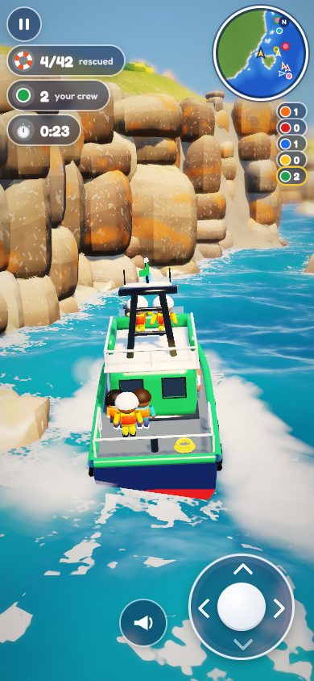
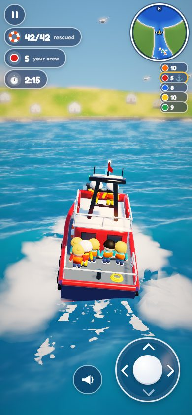

# Lily’s Rescue Boats

*All boats home.* Lily’s lifeboat game, built from the concept boards (“Lily’s Rescue Boats”, “Lily’s Rescue Rangers”, “Little Boats”) and Sol’s write-up. Two ways to play on one coast:
- **the Rescue Service** (Play): the five crews out together on a call, working with each other until everyone is home safe;
- **the Rally**: Lily’s race, as she wrote it, a training day where racing is fair.

Her rules are the Rally, and everything the Service is built from:

> You will have a boat, and there are little people in tiny boats. There will be different colours of the tiny boats with the people inside. You have to steer the boat and try to go near enough, and then when you are near enough you will see them coming on to your boat. Try to get as many as you can and reach the finish line.
>
> There will be other boats in the sea, and when you get to the finish line the winner will be the one that rescued the most people. There are five of the big boats (the players), and there will be a 1st place, a 2nd place, a 3rd place, a 4th and a 5th place.

Why two: arrive fast, help slowly. A race for pickups rewards rushing past people; the Service rewards slowing down, coming close and holding steady while they climb aboard, so the game is about what the boards show. The race stays whole as the Rally, and Lily's 1st to 5th is still the Service's last word, as the crews' honours.

It shares no code with the original [Rescue Race](/rescue), which stays as it is: its own coast, rules, models and drawing.

## The menu

The title is the boards' title card: your lifeboat charging along under the lighthouse's headland in the weather you've chosen, the logo (*All boats home* under it), and the menu:
- **Play:** straight out on a call, in the Rescue Service.
- **Rally:** Lily's race.
- **Boats:** choose your lifeboat. All five are the same all-weather lifeboat: a navy hull with tyre fenders along its sides, a tall rounded wheelhouse with framed windows and an upper steering position, a black mast; each wheelhouse in its own colour: Puffin orange, Seal red, Gannet blue, Otter yellow, Dolphin green. Each shows your best with it.
- **Weather:** seven tiles; the title behind changes as you pick.
- **Settings:**
  - how good the other crews are (easy, medium, hard);
  - which side the stick goes;
  - sound;
  - a new coast;
  - these notes.

## Playing

| | Touch | Keys |
|---|---|---|
| steer | the stick in the bottom-right corner: left and right turn, up goes faster, down slows and backs | the arrow keys, or WASD |
| stop | let go of the stick | let go of the keys |
| sound the horn | the horn by the stick (your crew wave) | |
| pause | the button top-left | escape |

- **The stick stays put** in its corner (the bottom-left instead: Settings, or `?hand=left`), so your thumb never covers the sea ahead. Push it to one side alone and the boat turns while going steadily on. Let go and the knob springs home and the boat eases to a stop.
- **The camera** rides low and close behind your boat, as on the boards' gameplay panel: your lifeboat a third of the way across, the coast ahead on the horizon. It turns with the boat but smoothly, and rises over a cliff rather than look through it. Slowing for someone waiting nearby, it eases down and round a little toward them. When a little boat is alongside it cuts in low beside your hull to watch them climb aboard (the boards' close rescue), and eases back out when they're all across.

**On the screen**, laid out as on the boards' in-game view:
- **top-left:**
  - pause;
  - in the Service, everyone rescued so far, of everyone out there (*12/47*), and under it your own crew's count in your colour; in the Rally, how many you've rescued and your place;
  - the clock (in the Rally's last call, the time left, in red).
- **top-right:**
  - a round map turned to your heading, N going round its rim, showing the little boats still waiting (in their colours; in the Service, one another crew is going for has their colour round it), the other lifeboats and the harbour mouth;
  - under it, the five crews' counts (the Rally: the five places).
- **a speech bubble:** what to do next ("Push the stick to go!", "Slow down — let go of the stick!", "Nice and steady — climbing aboard!", "Everyone's aboard! Bring them home to the harbour"; the Rally's "Last call! Head for the harbour!"), and the other crews on the radio ("Gannet: All yours, Puffin — we'll find someone else!").
- **a lifebuoy and a bar** that fills while people come aboard.
- **arrows** at the edge to the nearest little boats out of sight (in the Service, ones no other crew is going for), and to the harbour when it's time.
- **the stick and the horn**, bottom-right.

## Coming alongside

Lily’s “near enough”, done the way a lifeboat does it:
- **Come alongside** a little boat, with it close by your side.
- **Ease right off.** Let go of the stick and the boat slows to a stop.
- **The line goes over.** Your crew throws a line, and the little boat is pulled in against your hull.
- **They climb aboard** one at a time, in the boards' four moments:
  - **come alongside:** they stand at the edge of their little boat and reach up, while a crew member leans right over the rail and reaches down;
  - **take the hand:** hands held, they're lifted a little;
  - **climb aboard:** feet on the fender, up the side, over the rail;
  - **safe on deck:** down beside the crew member, then to a place on deck.

  Each is counted as they land.
- **Hold steady** (the Service). How fast they climb across depends on how steady you are for them, and the sea decides most of that:
  - **the open sea** is rougher than water in the lee of a headland or an islet (sheltered water looks it: calmer, greener, fewer whitecaps);
  - **your own hull** shelters them: lie side-on to the swell with the little boat on the side the waves run toward, and the water alongside goes calm (you can see the smoothed patch);
  - **moving or turning** shakes it.

  On the weather side out in the open they still come across, just more slowly; nobody ever falls in. The bar fills as fast as you hold steady and goes amber when it's rough, and the bubble says what would help ("Bumpy here! Turn side-on to the waves to shelter them"). A lifeboat stopped out on the water drifts a little the way the swell runs. The other crews come alongside on the sheltered side when the swell gives them a choice. (The Rally keeps Lily's rule: once alongside and slow, the climb takes the same time anywhere.)
- **Drive off** before they're all across and the rest let go, to wait for the next lifeboat.

How slow is slow enough depends on the level: under half of top speed on easy, under a third on hard. On easy and medium the boat eases off by itself as you come up to a little boat, so a quick tap of the stick toward it is enough. A ring in your colour round each little boat near you says “come alongside here”. If you're too fast, the screen says so.

## The Rescue Service

- **The crews work together.** Each crew going for someone says so (it's ringed in their colour on your map) and the others leave them to it. If you're plainly nearer, they leave them to you, and say so on the radio. Nobody races anybody for a pickup.
- **No last call.** Each crew comes home when there's no one left for it. One that's home while someone is still waiting with no one going for them goes back out.
- **Over when everyone's home:** everyone aboard a lifeboat, and every lifeboat in the harbour. Home early yourself, you watch a crew at work (or wait in the harbour, ⏩, to skip to the end).
- **At the end:** *Everyone home!*, everyone rescued and every crew in at the quay; then the crews' honours, 1st to 5th by Lily's rule, as the postscript. Stars: three when everyone's home and your crew did its share, two when everyone's home.

## The Rally

Lily's race, as she wrote it: the same coast, the same boats, the same coming alongside. The crews race for the little boats and the places.

### The finish

- **The finish** is the harbour mouth: through the gap between the two lighthouses, under the FINISH banner (only the Rally has the banner; the Service comes home between the lighthouses).
- **The first boat through** starts the last call. On easy and medium it's always long enough for you to get home from where you are, if you head straight for it.
- **Crossing it**, a FINISH banner springs up on the screen, and a picture is taken of the moment.
- **In the harbour**, each boat goes on to the quay.
- **At the end, 1st to 5th** by Lily's rule: the boats home first, by most rescued (a tie goes to whoever was home first), then the rest by most rescued.
- **The rewards**, as on the boards' finish panel (the Service has the same polaroid and best, kept apart from the Rally's):
  - stars: three for 1st, two for 2nd or 3rd, one for getting home;
  - the picture from the finish, as a polaroid, with how many you rescued;
  - your best with that boat (kept in this browser).
- **Then:** again, a new coast, or the menu.

## The coast

Each coast comes from a seed (on the line-up, and `?seed=`). It's a channel of open sea running north between granite cliffs:
- **The start:** a wide bay by the lifeboat station and its slipway.
- **The course:**
  - headlands and coves along both shores;
  - grassy islets, sea stacks and reefs out in the channel, one with a lighthouse;
  - red buoys to the west and green to the east, in pairs up the course;
  - about twenty-six little boats in six colours, spread along it and across it: rowing boats with one to three people, sailing dinghies with two, kayaks with one.
- **The finish:** the narrow harbour mouth, a lighthouse either side. Beyond it, the harbour with its quay and a town of cottages on the hill.

One field says where the land is: the distance to the nearest shore, positive over water and negative on land. Everything is made from it, so nothing disagrees:
- **the cliffs:** granite split along its joints. Stacks of big squarish blocks with rounded edges stand shoulder to shoulder along every rocky shore, as tall as the land behind them. Each block is a little set back, turned or narrower than the one below, so the face has ledges and joints and its top steps up and down. The rock is crusted with orange lichen above the splash zone and dark and wet below it;
- **the ground:** a steep face behind the blocks, then cliff-top turf (olive and sun-dried gold, greener in the hollows, with thrift and gorse in flower), sandy coves, quays, the town's hill, the seabed;
- **the boulders:** a few fallen at the cliffs' feet, heaped along beaches and low shores; skerries (little reefs of rock) a stone's throw off the cliffs, where the surf breaks. No rock reaches further into the water than a hull is allowed to go;
- **where a boat can go:** the hull keeps 2.6 m from the shore, so it can't sail into a rock;
- **the routes** the game's boats find;
- **the swell:** a little smaller near the shore, and much smaller in the lee of land. Looking back the way the swell comes from each patch of water (three rays, 8 m apart over the whole coast), land close upwind shelters it: behind a headland or an islet the water is calm, out in the channel it's open, and inside the harbour it's calm whatever the weather. The same number sets the waves the boats ride and the waves that are drawn, the whitecaps and the colour of the water, how steady a lifeboat can hold alongside, and how far a stopped one drifts;
- **the surf:** breaking white along every shore, and spray thrown up where a crest meets the rocks.

## The weather

Picked on the line-up (`?weather=`), from the boards' weather panel: Calm, Windy, Foggy, Choppy, Night, plus the title card's sunset. Each one sets:
- **the sea:**
  - how high the waves are and how steep (the boats ride the same waves, so a big sea pitches and rolls them and throws spray off the bow);
  - how much foam: whitecaps where the crests fold, streaks along the wind, surf on the rocks;
- **the light:** the sun's way, colour and strength (the moon's, at night), and the sky's fill in the shade;
- **the sky:** its colours, how much cloud and how dark beneath, stars on a clear night;
- **the air:** fog, how near it starts and how thick it gets.

| | the sea | the air | and |
|---|---|---|---|
| ☀️ sunny | choppy, whitecaps | clear, cumulus | gulls |
| 🌤️ calm | a gentle swell | clear | gulls |
| 💨 windy | bigger, steeper, foam streaks, spray flying | broken cloud racing | gulls |
| ⛈️ stormy | high and grey, the next boat lost behind a wave | a lid of dark cloud, rain | lightning and thunder; the beams turning |
| 🌫️ foggy | moderate | thick fog, the coast lost in it | lighthouse beams and your searchlight cut through; a foghorn |
| 🌙 night | moderate | stars, the moon on the water | windows lit, beams turning, your searchlight ahead |
| 🌅 sunset | moderate | low gold sun ahead | the sea and cliffs warm |

The weather doesn't change the rules: every boat rides the same sea.

## The other boats

Each of the four is steered by the game:
- **Choosing:** it goes for the little boat worth most to it: its people, over the time to get there and take them aboard. It prefers its own side of the channel. In the Rally it passes over one another of the game's boats is plainly nearer. In the Service it claims the one it's going for, leaves alone any another crew has claimed, and never gives up on anyone, however far.
- **Finding the way:** it goes straight where the water's clear. Where an islet or a headland is in the way, it follows a route found over a 4 m grid of open water (the water round each buoy is closed on that grid, so a line of buoys is gone round, not through). It bends its way round a buoy, or a little boat it isn't going for, and only into clear water. If it's really getting nowhere (pinned against something, whatever its engine is doing), it backs off and tries again.
- **Coming alongside:** it slows as it nears and passes with the little boat a beam's width off its side (in the Service, on the sheltered side when the swell gives a choice), then stops while the people come aboard.
- **Heading home:** it makes for the harbour when nothing's left for it (in the Rally, when nothing's worth going for or the last call won't wait), and eases on to its berth at the quay.

The level sets how quick they are:
- **easy:** four-fifths of your speed;
- **medium:** nine-tenths;
- **hard:** nearly yours.

In the Rally, on easy and medium, they ease off when well ahead of you and push on when behind.

## How it's drawn

Its own WebGL2 renderer: the lab ships one bundle with no packages, so Three.js wasn't an option here. Lit like the boards:
- **Light:** a warm sun with shadows, and a cool sky filling the shade.
- **Materials:** glossy painted toys, glass and metal, skin and cloth, granite (grain, flecks, lichen on top, darker and glossy where the sea wets it), lamps, gorse.
- **The sky:** cumulus over the horizon.
- **Distance:** hazed toward the horizon.
- **The finish:** everything is drawn in linear light into a floating-point buffer (where the phone allows); one pass then adds the glow of the brightest things, a soft focus away from what the camera is looking at (stronger on the title and close-ups, so the scene reads as a model), the exposure, one filmic tone curve, and a light vignette.
- **Checked against the boards:** `?ref=hero`, `?ref=rescue` and `?ref=coast` hold fixed scenes laid out like the boards' hero shot, close rescue and coastal landscape (the HUD hidden, nothing moving; `&u=0..1` sets how far through the climb aboard the rescue is). `node devtools/rescue-coast-fidelity.mjs <dir>` draws them and puts each beside its target panel, kept in `devtools/fidelity/`.

The sea:
- **The swell:** eight Gerstner waves, from a 24 m swell down to 1.7 m chop, the same sums on the CPU (the boats ride them) and in GLSL; the weather scales their height and steepness. Faces turned to the light are brighter, backs and troughs darker, so the relief reads from above.
- **Its colour:** light coming back up out of the water, lit by the sun and the sky, dark navy in the troughs and teal where a crest is thin enough for the light to come through it, greener in the shallows; the sky reflected more at a glancing angle; a sheen toward the sun and fine glints where a ripple turns just right.
- **Foam:** only where something makes it, as bubbly clumps that fill in as there's more of it and thin out at their edges, lit and shaded like a rough white thing on the swell:
  - whitecaps where a high crest folds (in patches, not on every crest);
  - old foam drawn out thin downwind, here and there;
  - round each lifeboat's hull a collar and a bow wave that grows with speed, a lap of white round each little boat;
  - surf along every shore and round every rock that stands through the water (the coast's field keeps the distance to both);
  - wakes, white straight behind the stern and two long broken arms, lying on the sea as it's drawn (displaced sideways by the waves, as the boats are);
  - spray off the bow when going fast (most when it slams into a wave), and on the rocks.

**Cost on a phone** (counted in the browser, a race in full swing): about 125 draw calls and 800k triangles a frame. That's within Sol's budget for draw calls, but the triangles want watching: the boulders and the ground are most of them.
- **Already in place:**
  - distant ground and boulders are drawn coarser;
  - people and gulls are left out of the shadows;
  - the screen's resolution follows the frame time, between 0.8 and 1.75 × the CSS pixel.
- **Not yet done:** it hasn't been timed on a phone.

| | |
|---|---|
| `client/rescue-coast/coast.ts` | the coast from a seed: the shore field, ground, islets, boulders, lighthouses, town, station, buoys, the little boats and their people |
| `client/rescue-coast/race.ts` | the rules: steering, the shore and other hulls, coming alongside, the line and the climb, the game's boats (flow fields over the water), the last call, the places |
| `client/rescue-coast/waves.ts` | the swell (CPU and GLSL) |
| `client/rescue-coast/shapes.ts`, `models.ts` | making meshes; the lifeboat, people, little boats, buoys, boulders, lighthouses, cottages, station, banner, gulls |
| `client/rescue-coast/world.ts` | the coast made drawable, in pieces along it |
| `client/rescue-coast/render.ts`, `fx.ts` | the drawing; wakes, spray, the line, the rings |
| `client/rescue-coast/joystick.ts`, `sound.ts`, `main.ts` | the stick; the sounds; the page |

**Tests:**
- The coast and the rules, without a page: `node cells/lab/devtools/rescue-coast.test.mjs`.
  - The little boats are in open water, apart, and every one can be reached.
  - There's a way through the harbour mouth to every berth.
  - No boulder reaches past a hull's clearance.
  - Alongside and slow claims; fast or far doesn't; everyone climbs aboard and is counted once; drive off and the rest wait.
  - Whole races steered by the game finish with no hull inside the shore and the places by Lily's rule.
  - The Service: every coast has water open to the swell and water in the lee of land, and a calm harbour. Whole calls steered by the game (two levels; and in a storm) end with everyone aboard and every lifeboat home: no hull inside the shore, no two crews after one little boat, no last call. Nearer, you take one over and the crew that had it says so. Alongside, people come across sooner in the lee of the hull than on the weather side, and sooner in sheltered water than in the open, and always come across in the end.
  - The same seed gives the same race, and the same call.
- In a browser, by hand: `node cells/lab/devtools/rescue-coast-smoke.mjs` (the line-up and the tagline, Play into the Service and the fleet's count, the Rally from its own button, the stick up, right, let go, the keys, the left-handed corner, both ends).
- The pictures: `node cells/lab/views.mjs rescue-coast`.

**Addresses:**
- `?mode=rally` the Rally (the Service unless asked);
- `?seed=` a coast;
- `?level=easy|medium|hard`;
- `?boat=0..4` yours;
- `?auto` every boat the game's;
- `?t=40` that far into the race;
- `?still` time held;
- `?view=podium` straight to the end;
- `?near=n` (or `near=any`) a little boat and the lifeboat coming for it;
- `?study` a close look at your lifeboat;
- `?zoom=`;
- `?hand=left`;
- `?weather=sunny|calm|windy|stormy|foggy|night|sunset`;
- `?preview` small and quiet.

**Not here yet**, though the boards have them:
- the world map and missions;
- stars, shells and stickers;
- towing;
- the other kinds of boat (inshore, hovercraft, RIB).

They're beyond Lily's two pages, and they'd come after the race itself looks and plays right.
