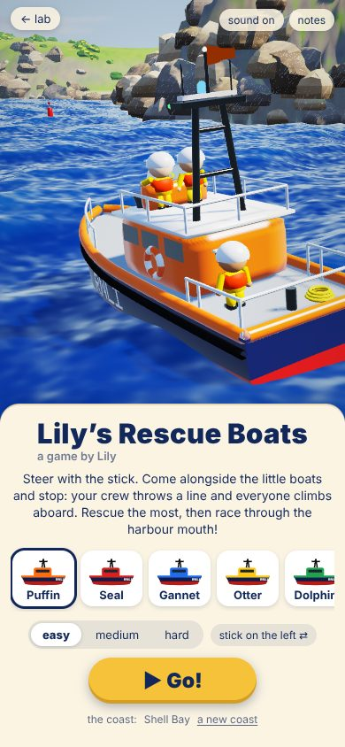

# rescue-coast: every view

Made by `node cells/lab/views.mjs rescue-coast` from `client/rescue-coast/views.mjs`. The README is `../rescue-coast.md`.

## The race

## Coming alongside

## The finish

## Looks

