# Roof Jumps

A figure running over an endless city of rooftops, in any direction, leaping whatever is in the
way. Drag anywhere and it runs that way (the drag is a stick: further is faster). What it does
about what is in front of it is its own, and it is not one jump: it hops clutter, bounds and
flips across gaps, springs up a storey, dives down one and rolls out, glides the long ones,
dashes off a clean landing, balances along ledges, runs along walls and up them. Tap to
jump, and once more in the air (a flip). A second finger turns the eye. Keys: WASD or the arrows, space,
Q and E.

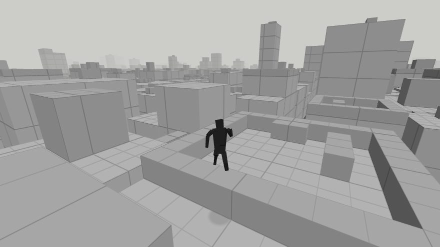

This is a study of two things only, the geometry and the figure moving over it, and it is drawn
as plainly as it can be on purpose: one grey, one light, fog. The point is to have a core that
looks can be tried over later without touching it.

Under `dials` is every number of the run, turned while it runs, and the plan: where this heading
leads, drawn into the city. Keys: P the plan, O the dials, K hold time, L one step of it.

`?seed=` the city · `?look=grid|clay|wire|tags|normals` · `?auto` it runs itself, wandering ·
`?t=` start that many seconds into such a run · `?still` hold the frame · `?preview` nothing over
the picture · `?follow=0` the eye never turns by itself · `?far=` chunks drawn each way (4) ·
`?side=90&zoom=1.6` the eye side on and close, for looking at the rig · `?study=<move>&mu=0.5`
one move's pose held, that far through it · `?sheet=<move,move…>` and `?strip=<seconds>` the study
sheets (below).

## The geometry (`city.ts`)

The world is a plane of chunks, 64 m square, each made from the seed and its own coordinates
alone: any chunk, at any time, in any order, always the same. A chunk is a list of boxes on a
one-metre lattice, about 160 of them (1,600 triangles):

- the chunk inside its streets is split in two again and again into lots, with a street, an alley
  or nothing between the halves;
- each lot is a building, low and close: two to six three-metre storeys, its height from a slow
  noise over the plane (so a neighbour is mostly within a storey of it), the odd taller one, and
  alleys of one to three metres between;
- across a gap, now and then, a wall a metre thick, about as high as the roofs it joins;
- on its roof, perhaps a rim a metre high, a raised part a storey up, a stair hut, a few units, a
  tank.

Every box carries a tag saying what it is, and nothing about how it looks. The sim asks the city
one question, `heightAt(x, z)`. A renderer gets the boxes.

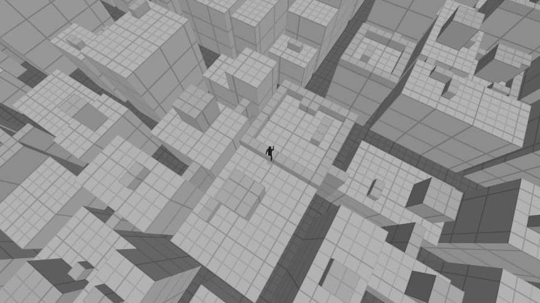

## The runner (`runner.ts`)

A point with a velocity, and the judgement that makes the running effortless. At an edge, a step
or a wall it looks along the way it is going for where it can next stand: the first flat place
within a storey up or a couple down, else a wall, else the highest place in reach however far
down. Then it throws itself there on an arc worked out to land it: high enough to clear what is
between, flat enough to keep its pace. Which move it throws is chosen by what is in front of it:

| move | when | what it is |
|---|---|---|
| hop | clutter or a rim in the way, close | low and quick, a hurdle |
| bound | a gap at about this height | flat and fast, the legs split |
| flip | every other long bound; anything tall in the way | tucked and turned over forwards |
| spring | a storey up | steep, the arms thrown up, knees to the chest, a deep landing |
| dive | a storey or two down | headfirst and flat, rolled out of |
| glide | a long way across or down; any fall | the slow one: arms out, sinking gently, steerable |

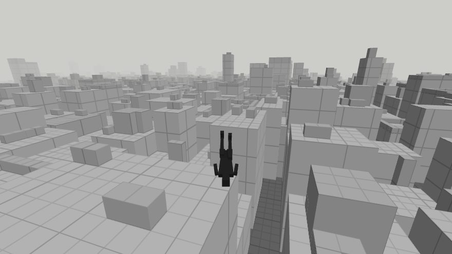
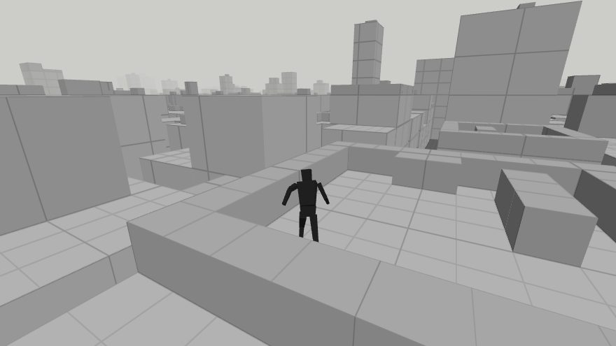

On the ground it runs, sprints after a couple of seconds, bursts into a dash out of a roll or off
a clean landing with room ahead, and balances along anything narrow (a rim, a wall across an
alley), drawn onto its line if you are going its way. In the air a wall alongside is run along,
tilted off it, then kicked away from: wall to wall down an alley. A wall ahead too high to spring
onto is jumped at, caught and run up. Turn away in the air and the leap is yours again.

 Its test holds a direction for a minute, sixteen ways in four
cities, and checks it never stops, never leaves the surface, makes at least 5 m/s good, and makes every move
(`node cells/lab/devtools/roofjumps.test.mjs`).

## The plan (`plan.ts`)

Where a heading leads, further than the next jump. A route is the runner itself run on ahead: a
copy of it, as it is this instant, stepped through the next three seconds holding one direction,
with every leap, wall and roll it would make on the way. Nothing is guessed: it is the same code
that moves the real one, so the route drawn is the route taken for as long as the heading holds
(the test checks that to the last decimal).

A plan is a fan of those: the way asked (the primary) and four ways either side of it, eleven
degrees apart, each scored: ground made, less what it costs (coming down to the street, climbing
back up, time spent gliding), more for walls and ledges. The best to the left and the best to the
right are the alternatives: turn that much and that one is the primary.

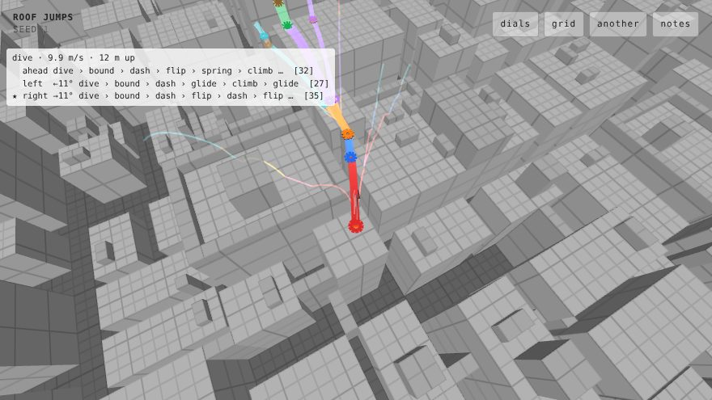

`?plan` (or P) draws it into the city: each route a ribbon coloured by the move it is in, a ring
where each move begins; the primary broad, the two alternatives narrower, the rest of the fan
hairlines; faint where a building stands in front. `?readout` says it in words, with each route's
score and a star on the best. `?assist=1` leans your heading onto the best by itself; the
self-running mode steers by it entirely.

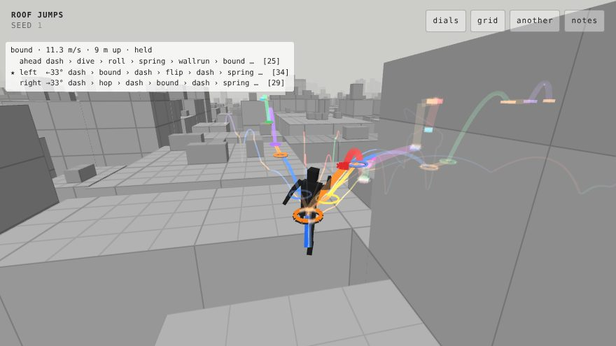

| colour | move | colour | move |
|---|---|---|---|
| near black | run | green | spring |
| orange | dash | red | dive |
| white | ledge | cyan | glide |
| pink | roll | magenta | wall run |
| yellow | hop | brown | climb |
| blue | bound | violet | flip |

## The dials (`tune.ts`, `palette.ts`)

Every number worth turning, named, ranged, grouped, with a mark where the house keeps it (a
double tap on a name puts it back; `house` puts them all back). The runner, the planner and the
eye read them each step, so a dial turned is felt at once, and the plan redraws to show what it
changed. The address keeps the ones that differ from the house, by key, so a tuning is a link.

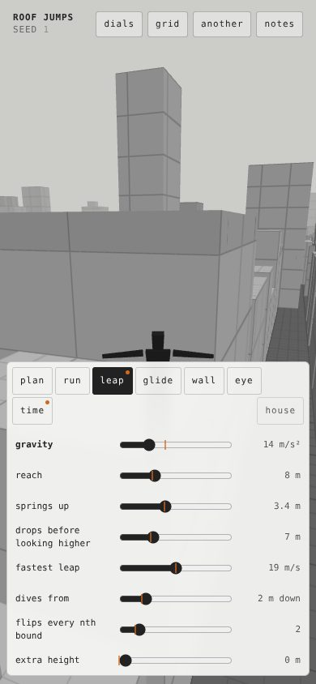

| group | what is in it |
|---|---|
| plan | show it, say it, how far ahead, how many ways each side and how far apart, assist, and the four weights of the score |
| run | run, sprint and dash speeds, how long a dash lasts, quickness, pace on a ledge and how strongly a ledge draws you |
| leap | gravity, reach, how far up it springs, how far down it drops before looking higher, the fastest leap, where dives begin, how often it flips, extra height |
| glide | where glides begin (down, across), gravity gliding, the fastest it sinks, steering in the air |
| wall | wall runs on or off, how long one lasts, its pace, how near a wall must be, gravity on it, the kick off, the speed up a wall |
| eye | distance, height, lens, how much it widens with speed, how fast it comes round behind, swung round the figure |
| time | the speed of time (down to a twentieth), held, runs itself |

## The figure (`rig.ts`)

Thirteen bones: pelvis, torso, head, two-part arms, two-part legs, feet. No keyframes. Each pose
is sixteen joint angles worked out from the move and how far through it is, the stride's phase,
the landing's weight, the wall's side.

## Studying it

A pose is a function of the body alone, so it can be looked at without running anything, and that
is how the poses are worked on. The study tools are the page itself, opened a particular way, so
each is a link, and each picture here is one of them:

- **A pose sheet**, `?sheet=hop,bound,flip&side=90&zoom=2.1`: each move named, at five points
  through it, the figure alone on its shadow. `side=` is where it is seen from (90 from the side,
  28 from behind and to one side, which is nearer what the chase eye sees); `lead=0` the other leg
  leading; `wall=-1` the wall on the other side.

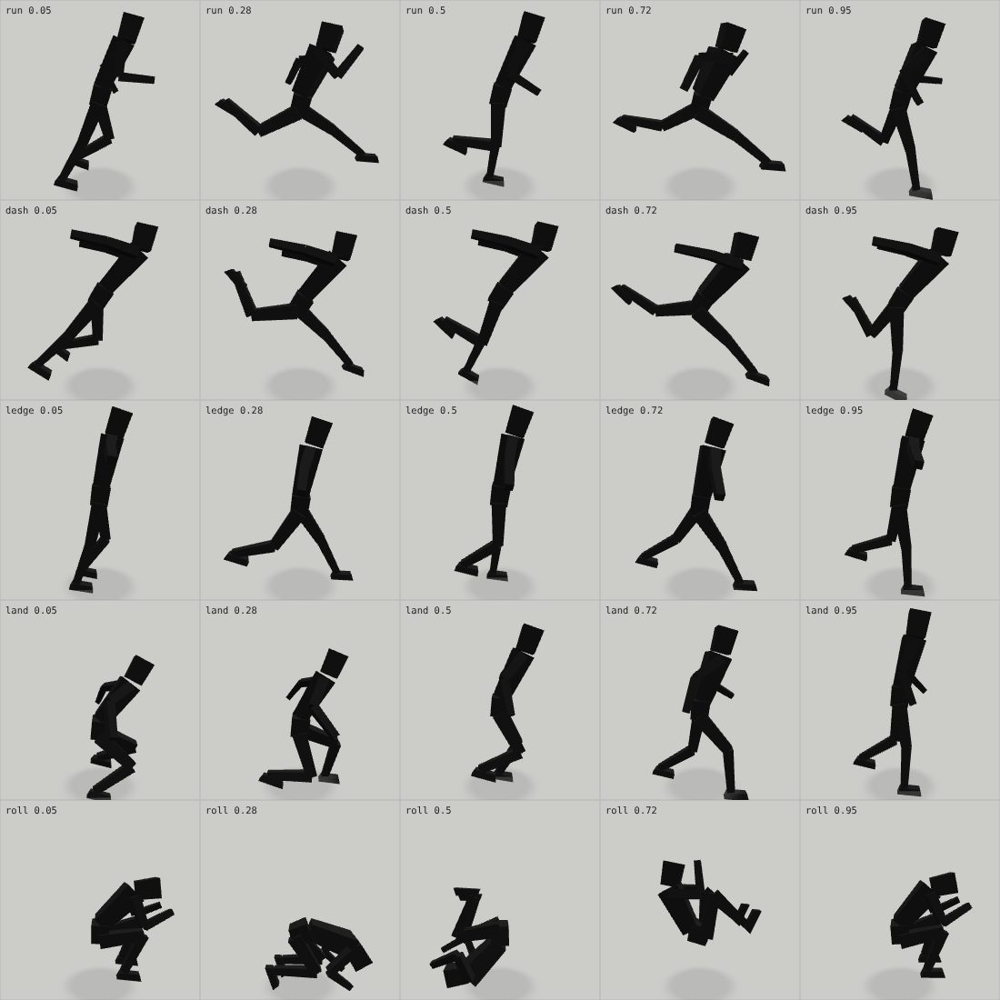

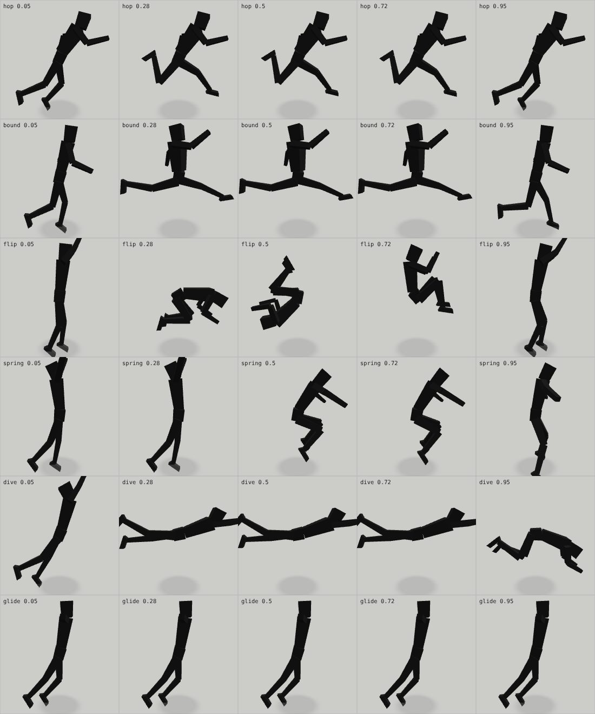

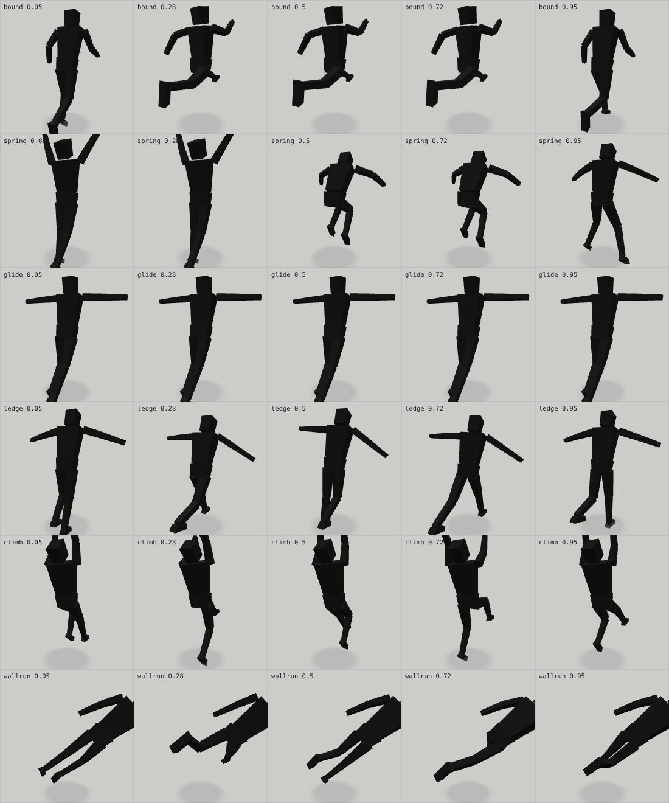

- **A strip**, `?strip=5&frames=30&every=0.1`: its own run from that many seconds in, laid out a
  frame at a time with the time, the move and the pace on each: the joins between moves, which a
  held pose cannot show. With `side=80&zoom=1.25`, from the side.

- **One pose**, `?study=dive&mu=0.6&side=90&zoom=2`: held, to turn the eye round.
- **A move caught**, from the console: `__roofjumps.seek('wallrun', 0.5)` runs it on, at once,
  until it is in that move and that far through it, and holds there (the pictures of moves above
  are made so). `__roofjumps.pose(move, mu)` holds a pose; `__roofjumps.set(key, value)` turns a
  dial; `__roofjumps.probe()` says where it is, what it is doing and what it plans.
- **Slowly**: the `time` dial, down to a twentieth; K holds it, L steps it.

What the first sheets showed, and what was changed for it: the run sank into its own split (the
hips now carry over it: a run has its moment off the ground); the dash leant so far it read as a
fall; the bound's front arm went straight up; a leap over something tall was a slow bound with
the legs together (it is a flip now). What they still show: the glide is one pose from start to
end; hop and bound read alike from behind; hands reach for nothing. The hips ride at the height that puts the lower foot on the ground.
`bones()` gives each bone's matrix and its extent as a tapered block; the lab draws the blocks,
and anything else could hang on the same matrices.

## The looks (`render.ts`)

Everything about how it is drawn is in one fragment shader, switched by `look`: `grid` (clay with
the lattice drawn faintly over it: a metre, a storey), `clay`, `wire` (every triangle's edges),
`tags` (what each face is), `normals`. A new aesthetic is a new look there, or a new renderer
over the same chunks and bones.

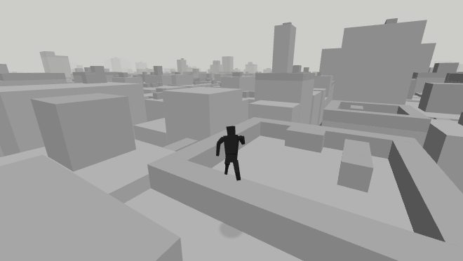

## Pictures

`node cells/lab/views.mjs roofjumps` makes every picture here from `client/roofjumps/views.mjs`
(each `static/roofjumps/v-<name>.jpg`, the whole set in `static/roofjumps/views.md`).

## Not yet

Sloped roofs, ledges, planks and wires between buildings (everything is a box so far); vaults,
slides; feet placed by IK; hands that reach what they vault; a pose for the kick off a wall;
sound.

## After

A twenty-second clip by 梔虚月 (@KYOGETSU_2026, "空間の連続性を検証中": testing the continuity of
space): one take, close behind a figure who crosses low crowded rooftops over rails and units,
arms straight out in the air, then sinks down an alley to the street. What is taken from it is
the eye (close behind, a little above, wide), the city's grain (low, dense, alleys you could
touch both sides of) and the lightness (the glide). None of its look, on purpose.
