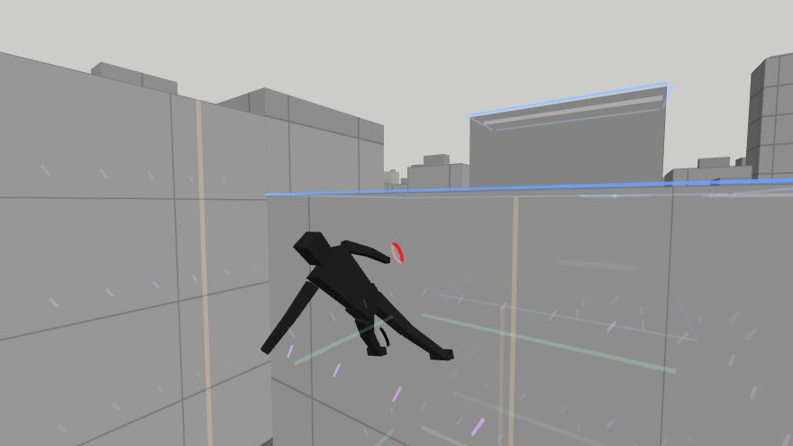
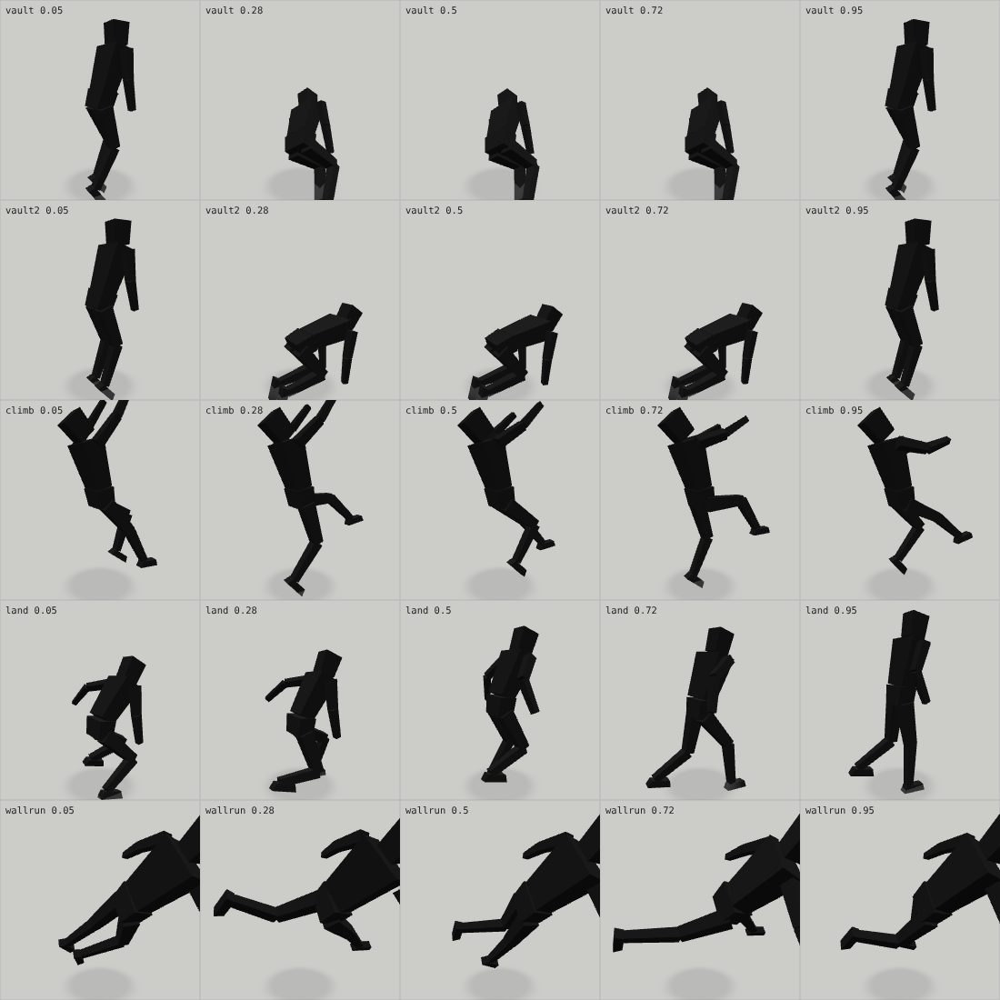
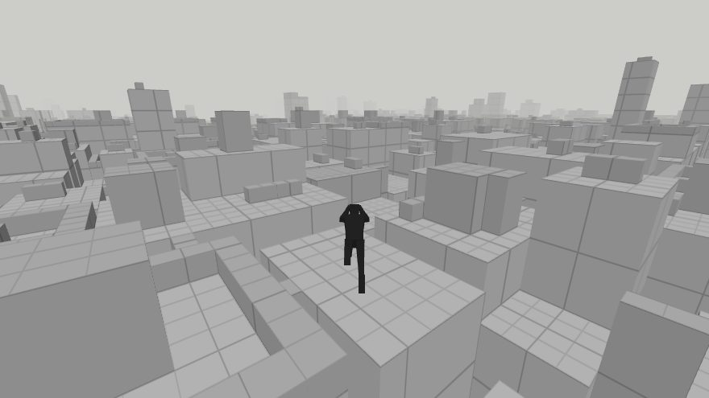
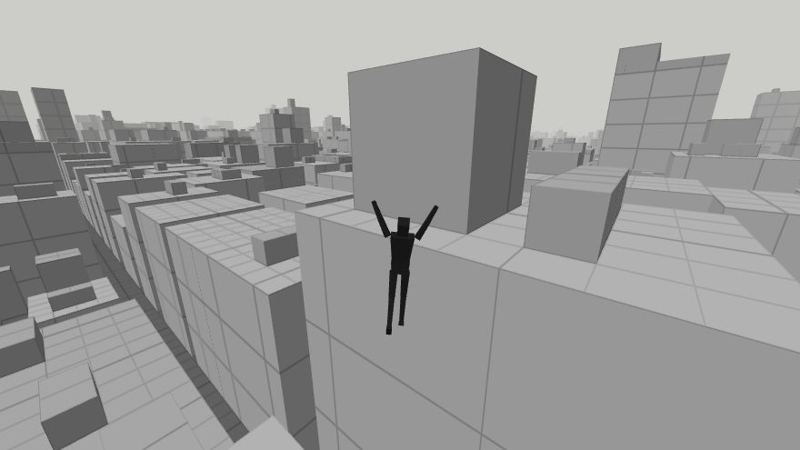
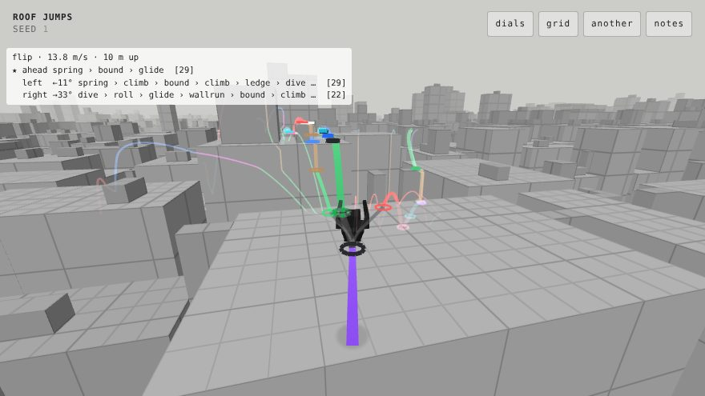
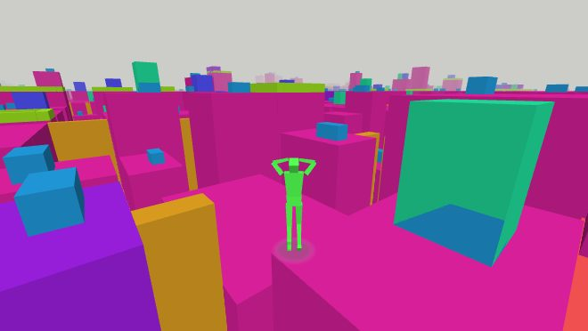

# Roof Jumps

A figure running over an endless city of rooftops, in any direction, leaping whatever is in the
way. Drag anywhere and it runs that way (the drag is a stick: further is faster). What it does
about what is in front of it is its own, and it is not one jump: it hops clutter, bounds and
flips across gaps, springs up a storey, dives down one and rolls out, falls and catches a lip,
dashes off a clean landing, balances along ledges, runs along walls and climbs them hold to hold. Tap to
jump, and once more in the air (a flip); hold (Space, or a touch held still) to glide. A second finger turns the eye. Keys: WASD or the arrows, space,
Q and E.

This is a study of two things only, the geometry and the figure moving over it, and it is drawn
as plainly as it can be on purpose: one grey, one light, fog. The point is to have a core that
looks can be tried over later without touching it.

Under `dials` is every number of the run, turned while it runs, and the plan: where this heading
leads, drawn into the city. Keys: P the plan, O the dials, K hold time, L one step of it.

`?seed=` the city · `?look=grid|clay|wire|tags|normals` · `?auto` it runs itself, wandering (a hand on it, the stick, the keys, a tap, takes over at once; let go and the wander comes back in over a second and a half) ·
`?t=` start that many seconds into such a run · `?still` hold the frame · `?preview` nothing over
the picture · `?follow=0` the eye never turns by itself · `?far=` chunks drawn each way (4) ·
`?side=90&zoom=1.6` the eye side on and close, for looking at the rig · `?study=<move>&mu=0.5`
one move's pose held, that far through it · `?sheet=<move,move…>` and `?strip=<seconds>` the study
sheets (below).

## The transfer line

Open `/roofjumps?line=transfer` and drag straight up. Four roofs give you a level gap, a one-storey drop, and a second gap. Reload to repeat the approach. Hold a forward drag for a running bound, or tap with a second finger during the last stride for a higher spring. Ease off earlier to stop. From the start, the high wall on the left gives a separate test: turn toward it, tap on the approach, and keep pressing toward the lip to catch it. Try easing the stick before the first lip, then taking the same run with a shallow correction in flight.

The runner loads its last step at the lip. A rising obstacle draws braking into the approach. Each automatic takeoff can add or shed up to 1.5 m/s of horizontal speed after that ground step. A roll uses the available runway. On a short roof the runner absorbs the landing in its legs. The acceleration out of a roll begins on a supporting step while you are still driving forward.

## The geometry (`city.ts`)

The world is a plane of chunks, 64 m square, each made from the seed and its own coordinates
alone: any chunk, at any time, in any order, always the same. A chunk is a list of boxes on a
one-metre lattice, about 160 of them (1,600 triangles):

- the chunk inside its streets is split in two again and again into lots, with a street, an alley
  or nothing between the halves;
- each lot is a building, low and close: two to six three-metre storeys, its height from a slow
  noise over the plane (so a neighbour is mostly within a storey of it), the odd taller one, and
  alleys of one to three metres between;
- across a gap, now and then, a wall a metre thick, about as high as the roofs it joins;
- on its roof, perhaps a rim a metre high, a raised part a storey up, a stair hut, a few units, a
  tank;
- up one side of some of the taller ones, a stair: a storey a step, each step a metre deep (as an
  iron stair up a wall would go if the city were all boxes; a height field can't hang one off a
  face), sprung up a storey a beat, each step's narrow top a rail;
- across some alleys between two roofs of a height, a bar on posts a little above them: drawn, not
  stood on (a chunk's `props`), a hold for the hands to go under it by.

Every box carries a tag saying what it is, and nothing about how it looks. The sim asks the city
one question, `heightAt(x, z)`. A renderer gets the boxes.

## The holds (`city.ts`)

Made with the boxes: the places a hand or a foot can take. They are tags, not things: nothing is
added to the geometry, but they are drawn on it (within ten metres of the figure; the `holds`
dials), so what is there to be used can be seen. Each is a line with the way it faces, and says
what it is for, by hand and by foot:

| hold | where | by hand | by foot | about how many a chunk |
|---|---|---|---|---|
| edge (blue) | every box's four top edges | grab | push off, land on | 600 |
| sill (green) | on three in four of a building's faces, one at each storey, set in from the corners | grab | toe | 350 |
| pipe (orange) | on two in five faces, ground to roof | grip | clamp | 75 |
| rail (white) | down the middle of anything a metre wide: a rim, a wall across an alley | plant | balance along | 80 |
| face (violet ticks) | every wall two metres high or more, the whole of it | steady | tread: run along, run up, kick off | 310 |

They have their own dice, so the boxes are the same city with or without them. A mover asks what
is in reach (`holdsNear`, `gripAt`), and what it does depends on what is there. The `holds` dial
shows them, with a red ring where each hand is and a black one where each foot is down.

What the runner does with them so far:

- **Up a wall** a committed rising jump can put one foot on the face. The runner drives up from that contact. Keeping pressure toward a reachable top edge catches it with the hands and pulls the hips over. A missed catch returns to flight.
- **Over clutter** with an edge to plant a hand on it vaults, one hand or (every other time) two,
  the body brought down to the hand and carried over on it; with nothing to hold it hops.
- **Landing a storey up**, both hands come down on the lip it lands over.
- **Along a wall** the near hand trails on it. **Out of a dive** both go to the ground first. **A
  deep landing** is three-pointed.
- **The feet are placed.** A stride has each foot down for part of it; when one comes down it is
  given a place and stays there, the body going over it, until it lifts. Running, that is the roof
  ahead of it; along anything narrow, the rail's line; at a lip, the lip. Along a wall and up one,
  the wall (a sill or a pipe if one is by).

The figure is posed, and then its arms are taken to what they hold (`rig.ts`): from where the
pose had the hand toward the hold, shoulder to elbow to hand, eased on and off, so it is drawn
like a drawing and holds on like a mannequin. Because the plan is the runner run ahead, routes are
already costed by what is available: a wall with holds is a quick way up, a bare one a slow one.

Not yet: the takeoff and landing feet chosen for their holds (they fall where the stride has them);
catching an edge at the end of a leap
that falls short, and hanging from it; swinging; choosing a route for its holds rather than
finding them on the way.

## The runner (`runner.ts`)

A point with a velocity, and the judgement that makes the running effortless. At an edge, a step
or a wall it looks along the way it is going for where it can next stand: the first flat place
within a storey up or a couple down, else a wall, else the highest place in reach however far
down. Then it throws itself there on an arc worked out to land it: high enough to clear what is
between, flat enough to keep its pace. Which move it throws is chosen by what is in front of it:

| move | when | what it is |
|---|---|---|
| vault | clutter or a rim in the way, close, with an edge to put a hand on | lower and quicker: over it on a hand, or two; every third one-handed one turned right round on the hand (a palm spin) |
| hop | the same, with nothing to hold | a hurdle |
| bound | a gap at about this height | flat and fast, the legs split |
| flip | an airborne second tap or a tall obstacle | tucked and turned over forwards |
| side flip | every other tall obstacle, or the tap with a lean across the way | tucked and turned over sideways |
| spring | a storey up | steep, the arms thrown up, knees to the chest, a deep landing |
| dive | a storey or two down, however far | headfirst, arched out over the drop, folding into the roll |
| fall | a leap that missed its landing | arms up and out, knees drawn up: catches a lip in reach, else lands and rolls |
| glide | only while the jump is held | the slow one: arms out, sinking gently, steerable |
| hang | on the way up a face | from a sill or a pipe: caught (the feet walking up), loaded (both feet set on the wall), sprung for the next hold |
| underbar | a gap with a bar across it at about head height, the far roof level | feet first under the bar, the hands on it, laid back, legs straight through |
| chimney | up a narrow alley, leaning in on a wall run | wall to wall, a kick every 0.27 s, hands on both walls |
| kick | off a wall | the pushing leg long behind, the arms flung away, turned off it |

On the ground it runs, sprints after a couple of seconds, bursts into a dash out of a roll or off
a clean landing with room ahead, and balances along anything narrow (a rim, a wall across an
alley), drawn onto its line if you are going its way.

A tall wall met at a slant at pace is stepped onto off one foot and run along, straight off the ground; in the air a wall alongside is run along, tilted off it. Left to itself that is a shallow arc,
rising then sinking as gravity has it. Leaning into the wall drives it up the wall as it goes
along: that is how height is gained, and it is paid for, in how long the run lasts and in pace
along. It ends on the wall's top if it gets there. Away from the wall, or a jump, kicks off it:
wall to wall down an alley. A grazing contact keeps speed along the face. Pressed into a tall wall met near square, with a hold in reach, it braces (both hands on the wall) and, still pressed after a beat (0.35 s), goes for it, as a tap would (a tap goes at once): a foot planted on the face, the lip caught. A lip caught (off a plant, coming down against a wall, at the top of a climb) is a hang first: a beat (0.3 s) for the hips to swing in under it; then pressing on toward the wall pulls over (a tap too), pressing away lets go and drops, held along the wall it lets go after a while and goes on that way (a brush past), and left alone it hangs. So a rescue, a deliberate ascent and a brush past are three different things, and holding a direction alone climbs far less (19 m a minute in the test runs, from 39). Its top out of reach, a sill or a pipe in reach is hung from, and the climb is a chain, as up a fire escape: caught, loaded (knees up, feet on the wall), sprung for the next hold, a storey a beat; pressing in goes again as soon as it's loaded, a tap goes at once, pressing away lets go. A wall with nothing in reach ends in a brace. Between two walls no more than 3.2 m apart, leaning in on a wall run, held through its first beat (0.25 s, not just the angle it arrived at), goes up the alley wall to wall (the chimney, after the references): a kick every 0.27 s, about 0.9 m a kick, a top in reach caught and pulled over, let go and it drops. Landings are graded. Light and on its mark, it flows on. Heavy (from about two storeys), it goes deeper and longer into the legs, is slower to drive out of, and pays in pace. Off its mark (a fall, off a wall, into one), it staggers, loses a little pace, and is knocked off balance. Balance is a state of its own, knocked by those landings, by narrow tops (a sway that's really there), and by sharp turns at pace; it is corrected like a spring (the body leaning with it, the arms out against it, windmilling as it comes back), and while it's off, steering is weaker. The figure has weight: each joint moves to its pose as a spring a little under critical damping (a limb carries past and comes back), the chest lags the hips (stopped short by a landing it carries on down and comes back), the arms drive up hard at every takeoff. Effort is shown by size: the bigger the release (a storey up, a spring from a hold, a long bound), the deeper and longer the wind-up; small hops stay light. The `effort shown` dial (`emphasis`, none by default) holds a big wind-up at full load a moment before it goes (only from a stand or a hold: a running takeoff is never stopped), holds a heavy landing's legs at their deepest while the body goes on, and dips the eye with it. And effort is a budget: big releases spend it (a storey up, a chain's springs, the chimney's kicks), easy running gives it back after a beat; spent, it runs a little slower, winds up slower, waits longer before the next spring up a face, and breathes hard when it stops. Let go with room ahead, it settles, through a walk to a stand; with an edge close, it stops short. A leap the takeoff's limit would leave short keeps its aim with a higher arc (too long, a flatter one), so it lands where it meant to far more often; one that can't comes down where it can, and a fall is only a real fall. An aimed landing on something narrow is stuck: the pace taken in the legs, a moment to settle. The `held at the top` dial (`apexHold`, none by default) holds the pose at the top of a flight a moment, as a drawing would, while the body goes on across at its pace and on its arc (the flight is the same, step for step); then the pose catches up. A committed jump (a tap) goes as the approach and the plant say: standing, a strong spring straight up (1.8 m on the practice roof); off a step or two, the highest; at a run, a little lower and long, carrying the pace and adding to it; a deeper last plant, and effort left, give more of all of it. A flight doesn't gain pace in the air (steering turns it; only a glide drives). `?line=transfer&takeoff=stand|step|run&strip=0.25&side=90&zoom=1.7` films the three takeoffs side on. The glide sinks at most 4.5 m/s (the first reference's long sink down an alley), arms straight out and level, legs together, swaying slowly. The eye pulls out wider, higher and steadier while it climbs, comes a little lower flat out, and keeps clear of walls beside its line as well as in it. Going up a storey costs pace; while the legs are still taking a landing it drives less, so a landing is a beat and the burst comes out of it. Small turns steer an aimed leap gently. A decisive turn gives full air control.

The fixed-step suite checks surface contact, movement on open routes, planner agreement, and intentional jumps, wall contacts and landings on the transfer line.
(`node cells/lab/devtools/roofjumps.test.mjs`).

The body has breadth: a circle 0.35 m across its middle, on the ground and in the air, against anything standing higher than a step (in the air, than its knees). It's pushed out of what it overlaps (exactly: the city is boxes) and slides along it, the speed into it taken off; so the figure stays out of walls (it used to be a point, and could stand half inside one). Meeting a wall is an event with a direction and a force: within a storey and gone at, it's leapt onto; tall, at a slant at pace, run along; pressed into, braced, both hands on the face; else slid along, and met hard (more than 3 m/s into it) a hit, a knock to the balance, pace lost, a moment to recover. Off balance with a wall in reach (or sliding along one slowly), the near hand goes on it, and that steadies it: the balance comes back twice as damped. A jump at a wall carries into it, at full effort, so it meets it and a foot goes on it; a wall just gone for isn't gone for again for a moment, and a corner it can't land beyond isn't leapt into.

Imperfection is authored, and the save is a footfall. A hard leap (a late turn into it, near its fastest, near its reach, or spent) carries a small error, chosen from what made it hard (a turn: wide; speed: long; reach: short), a few tens of centimetres, and checked to be saveable; easy leaps are clean. Landing off its mark (by that error, by steering in the air, or by carrying too much speed into a turn) is a save, and the save is a footfall: the catching foot (the side the hips are carrying to) put down where they're going, as far out as the error asks, at the moment it's needed, and the stride picked up from it. Short: a short step at once, pitched forward over it, a hand slapped down, the trailing knee through high. Wide: out wide, the outside arm flung open, an exit on a slightly wider line. Long: two quick steps ahead, the speed kept (a running save, not a roll). The knock to the balance goes toward the error, not by which leg led; most landings stay quiet (about one in eight is saved, in held runs). `?line=transfer&catch=clean|late|correct&strip=1.5&frames=10&every=0.05&cols=10` films a diagonal bound three ways, each planted foot marked, orange while the save is made: you can point to the footfall that saved it.

A flight gets ready for the ground a fixed while before it, whatever its length (the legs coming under, the arms out, the head down to find it); a long dive spends its middle looking for the ground, and folds into the roll by the time left, not the share of the flight; out of a roll the weight comes up over the front foot, a hand pushing off. The head leads into turns. A lip caught keeps what the body brought: the near hand first, the body swinging on under it and dipping, the far hand joining only as the swing needs it; then the beat, then the pull. After a big arrival with nothing near to go for (or spent), a couple of settling strides rather than a burst.

Roofs carry ground detail, from their own dice and only on bare roof: debris (rubble, loose tiles), clutter (pipe runs, vents, low curbs) and skylights (no-go). None of it is stood on or in the way of the body; the feet mind it: a footfall that would land on it goes to the nearest clear place (a shorter or longer step, a little in or out), and shortened with an edge close ahead it's a stutter, the stride fitted to the takeoff; clutter under the stride is stepped over high. The eye can move with the body: `eyeLope` (rides the stride: a bob each footfall, a sway each stride, a roll into turns) and `eyeImpact` (feels the landings: a dip by how hard, a shake on a heavy one, a lurch on a short save; at 2 the lens punched in and the dip held), each from 0 (none) through 1 (a hand-held eye) to 2 (exaggerated), 0.4 by default.

## The plan (`plan.ts`)

Where a heading leads, further than the next jump. A route is the runner itself run on ahead: a
copy of it, as it is this instant, stepped through the next three seconds holding one direction,
with every leap, wall and roll it would make on the way. Nothing is guessed: it is the same code
that moves the real one, so the route drawn is the route taken for as long as the heading holds
(the test checks that to the last decimal).

A plan is a fan of those: the way asked (the primary) and four ways either side of it, eleven
degrees apart, each scored: ground made, less what it costs (coming down to the street, climbing
back up, time spent gliding), more for walls and ledges. The best to the left and the best to the
right are the alternatives: turn that much and that one is the primary.

`?plan` (or P) draws it into the city: each route a ribbon coloured by the move it is in, a ring
where each move begins; the primary broad, the two alternatives narrower, the rest of the fan
hairlines; faint where a building stands in front. `?readout` says it in words, with each route's
score and a star on the best. `?assist=1` leans your heading onto the best by itself; the
self-running mode steers by it entirely.

| colour | move | colour | move |
|---|---|---|---|
| near black | run | green | spring |
| orange | dash | red | dive |
| white | ledge | cyan | glide |
| pink | roll | magenta | wall run |
| yellow | hop | brown | climb |
| lime | vault | | |
| blue | bound | violet | flip |

Each route is also judged as a choreographer would (`choreo`, weighed by `wChoreo`): each event worth what it is to watch (an underbar, a chimney, a wall run more than a bound; a fall less than nothing), less if it's one of the last few again, less if it's crowded on the last (under half a second) or after dead air (over two and a half), more for going up and down. For your own run it only leans in as far as `assist` says; running by itself, and for the director, it leads.

## Directing a seed (`direct.ts`, `devtools/roofjumps-direct.mjs`)

Any seed can be made a scene, and so an eval of what the body chooses and how it does it. Every 1.5 s the director looks down sixteen headings (the runner run on ahead, the same code), and picks the one that's best to watch (the choreographer's judgement), makes ground, stays off the street, and doesn't go back over ground it's covered; the run holds that heading until the next decision, exactly as foreseen, so the same seed directs the same run, and the page replays it (`?direct=x,z,heading,seconds;…`). The run is measured: events, how many kinds and how evenly (entropy), repeats, the longest dead air, misses, saves, time stood still, frames in a wall, pace, what it was worth to watch a minute; and one score to climb (worth a minute, with variety, less repeats, misses, stalls and dead air). `node cells/lab/devtools/roofjumps-direct.mjs [seeds] [--pictures] [--set dial=v,…] [--name n]` writes each seed's waypoints, measures and timeline, a report, and (with pictures) a strip of the whole run and one of its best moment; `--compare a.json b.json` sets two reports side by side. A run diverges from a small change (a stride's timing sends it down another alley), so a change is judged on the mean over many seeds, not one.

The first climb on it (24 seeds, 40 s each; the noise floor is about ±2.5 on the mean, so a change has to move it by 5 to count): the baseline 85.2. Then quietness was added to the score (a save on more than 12% of landings costs), since a save should mean something: 78.3, saves on 23% of directed landings. A turning cost on the director, to smooth its lines: no change (81 to 83), saves unchanged, so its turns weren't the cause; rejected. A wider threshold for a sideways save (0.3 m): 77.1, saves 20%, within noise; rejected. A flight redirected decisively drops its mark (where it lands is its choice, not a miss): 80.6, saves 18%; kept, a principle more than a gain. The mark moved with steering made early in a flight: saves rose to 21%; rejected. Still open: why directed landings drift off their marks twice as often as held ones; the next step is to measure the drift itself, not guess at it.

A critique of that climb, and what changed for it: the score was one composite with guessed weights, changed mid-climb, rewarding density against our own notes on phrasing, judged by the same function the director chooses with, and blind to the body; three of four turns were guesses. Now the eval reports dimensions, each guarded: what it does (interest a minute, entropy, misses, saves as a share of landings, stall, crowding of big events) and how the body does it (frames a joint jumps more than 0.25 rad, a settled planted foot's slide, head or hips in a wall, a hand or foot deep in one). `roofjumps-direct-baseline.json` holds each dimension's mean and standard error over 24 seeds; `--check` fails a change that makes any worse beyond its noise. Test minimums for how often each move happens are now only that each still happens: how often is the eval's business.

And the drift was measured before anything else was changed: half the aimed landings in directed runs were off their marks, and of those about half were authored "wide" errors judged from the turn rate (which the director's heading changes and wall deflections keep high), and about a quarter came down early on something on the way, metres short. The wide error is now judged from a real late turn (how far what's asked is off the way it's going as it leaves), an aimed flight is only steered by a change in what's asked since takeoff (not pulled toward the direction it took off holding), and an offset of more than a stride is landing somewhere else, not a save: saves from 19% of directed landings to 10%. The time to the ground is marched along the flight (it flickered over gaps), and the rig follows a smoothed copy of the stride's phase, so a re-timed footfall is caught up with, not snapped to.

What the body measures show next: a settled planted foot slides about 1.9 m/s at a run (a footfall 0.45 m ahead held for 0.9 m of travel is out of a leg's reach from hips at running height: the leg clamps and drags it), which wants a swing leg that targets its footfall and a stance the leg can hold; most joint jumps are the arms thrown overhead at a dive's takeoff (4 rad in 0.15 s), which wants the throw begun in the wind-up; hands and feet are deep in walls 3.9% of the time; and a third of big events still come within 0.7 s of the last.

The stride was measured against a sprinter's and rebuilt. It was about right in length but churned (5 to 5.5 steps a second at pace, against 4.5 to 4.8), and drawn much shorter than it ran: the hips rode near standing height, so a leg could only reach about 0.3 m either side of them, and a planted foot was clamped and dragged, then let go early (feet split about 1 m, against about 1.5). Now a step is 0.55 + 0.17 × pace (2.3 m at 10.5 m/s, 4.5 a second); a foot comes down about 0.25 m ahead of the body and the body goes about 0.8 m over it, pushing off on its toe (the heel lifting, the foot pivoting about its ball); the hips dip through each stance and rise in each flight, low enough for the leg to hold its footfall; the swing drives the thigh further and kicks the heel up, the front leg reaching late to meet the ground; and the footfall is taken up within a few frames, so a planted foot stays where it was put (about a centimetre a footfall, from about nine). The body leans further at pace.

Footsteps are planned, and the body follows them: as a foot comes down the next two are planned from where the body will be (so a change of pace never leaves the feet behind it), and one that would land on debris, clutter or a skylight is moved to the nearest clear place, with room for the foot, the change spread over both steps (the one after needing a change, this one takes half of it). The step's timing follows its length (cadence up for a short one, down for a long one), its flight is pushed higher for a long step or one over clutter, a short one brakes a little, and a footfall set out to the side draws the body's line toward it (the torso leaning back over, the far arm out) and back on the next step. Along a wall the stride has its own phase, by pace, not by how fast the run's time is spent. A flight gets ready for the ground only ever further (the ground falling away beneath never unfolds it); falling past or into a wall, a hand goes on its face; up against a wall the figure straightens.

Checked against the baseline (the previous code, measured the same way): stall, joint snaps (now the pose asked for jumping more than 0.3 rad within one move, not a joint's speed) and foot slide better (186 to 116 cm/s; what's left is mostly turning on a planted foot, and the wall run), nothing worse. Still to do: the head is a long way from the body's collision circle diving headfirst, hanging, and tilted along a wall run, and goes into walls (about 0.4% of frames, before and after); a planted foot pivoting through a turn.

The legs were then looked at case by case, measured frame by frame (each knee's angle and speed, each planted foot's reach from its hip, by state and move) and filmed close from the side. What read as stretching was one thing: a footfall held that the leg couldn't reach, so the leg was pulled out straight and the foot left short of where it stood (29% of held footfalls in directed runs, 69% along walls). The causes, and what was done:

- **along a wall** the pelvis was set half a metre off it, so the feet on it were 0.75 m to the side: it's now 0.3 m off, tipped the same, and the knees bend;
- **in a chimney** the pushing foot was found afresh every frame, so it slid up the wall with the body: it's now found once a kick and stays, and the leg lets go as the body leaves it;
- **at a takeoff** the stride was jumped to put the takeoff foot down at once, a whole step early, where it couldn't reach: the foot that comes down next is the takeoff foot now, and the stride brings it down;
- **the swing** folded the knee past 150° and finished with the thigh well forward of where the stance takes it from: the fold is held to a sprinter's ~130°, the thigh pawed back to meet the ground, and no knee, whatever adds up (a save, a step over clutter, a landing), bends past ~140° on the ground;
- **a jog to a run** switched poses at 2 m/s: the two are crossfaded;
- and in general the hips go to a foot they can't otherwise reach (down, on the ground; toward the wall, on one), as far as a body would sink or lean, and past that the foot lets go rather than the leg being pulled out straight. The leg's own drawing says when: nothing in the runner changes for it.

The eval measures it now (`stretch`: held footfalls the leg can't reach). Against the previous code, measured the same way: legs stretched 28.8% to 13.7% (what's left is mostly the push-off, onto the toe, and saves), foot slide 116 to 65 cm/s (a foot let go isn't counted as sliding), body in walls better, the score 53.1 to 58.8, nothing worse. Locked straight while planted, by move: wall run 61% to 0.3%, chimney 27% to 6%, climb 45% to 11%, run 21% to 13%. Still to do: the kick and the underbar hold the legs straight on purpose but look stiff; a save still jumps the stride to its foot.

From behind, the legs bent out to the sides: the feet were put under the hips (about 0.11 m either side of the line), so a running figure stood in an A. A runner's feet come down near the line the body runs on: they're now 0.04 m out, and the swinging leg is set a little in from the hip (the swing foot 0.08 m out, from 0.11).

**A takeoff is a footfall, and the run-up is planned to it.** Between jumps the strides were far short (a step of 0.7 to 1.4 m where a sprinter at that pace takes 2), because a takeoff went off when the wind-up was ready at a distance from the lip, wherever the stride was: the body left from between its feet, or after a stutter step put down 0.3 m from the last. Now at each footfall the runner looks up to three strides ahead for the lip it's going for (the stick held on, the way it's going, a lip it can leap from) and puts the takeoff foot just short of it (0.25 to 0.55 m, by pace). Within about half a stride of where it is, the foot just put down is the takeoff: one contact, and gone, so a landing close to the next lip goes again off the foot it came down on, and a roll comes up straight into the next jump. Further, the fewest steps that fit, each opened up to about a third longer (a stride is only ever shortened as much as it has to be), rising toward the last but one, the last a little shorter to get under the takeoff; a long step flies higher, the hips rising between footfalls as far as a body carried over that flight would (g t² / 8, a little more). The stride's timing keeps to the step as planned, not to the pace, so a foot comes down where it was meant to even as the runner speeds up. The wind-up begins in the last steps and is taken through the takeoff contact; the jump goes as the body comes over that foot. Stumbles keep their own steps: a save isn't planned over.

Measured: on a flat roof with a gap at any point in the stride, every takeoff off a planted foot 0.5 m short of the lip, the last strides 1.1 of a stride (none under 0.92), and each lip that comes within 1.6 m of a landing taken off the landing foot. In directed runs two thirds of takeoffs are off a planned foot (`offFoot` in the eval; the rest are out of a stumble, from near a stand, or a late turn), the steps before a long gap 2.6 m against a sprinter's 2.3; the knee's fold off the ground eased in (it peaked past what a knee does, about 18 rad/s now), slide measured at the ball of the foot (the heel lifts about it), the toe's lift solved, not stepped (the ankle jumped 2 cm). Score 58.8 to 61.3, legs stretched 13.7% to 9.4%, nothing worse.

**Standing and walking: the feet stay put and step.** Standing still and brushing the stick about showed it: below 2 m/s no foot was ever put down, so the feet slid over the roof at 2 to 7 m/s (a third of the frames they were near it); a light push was a sprint (3.7 m/s in a tenth of a second); and the body spun round on the spot (a right angle in 0.15 s). Now:

- standing, both feet are down where they belong under the body (hip-width, the lead a little ahead); when the body turns or drifts so a foot is left too far from there, it's stepped back under, one foot at a time, lifted, carried and put down; coming to a stand, a step or two settles them;
- a walk has both feet down for a while each step (more than half the stride a foot is down), opening into the run's flight by about 2.6 m/s; each step's time down is fixed by the step as planned, so slowing in it doesn't put a lifted foot back down; a foot left out of reach behind is taken up early, not dragged;
- a stepping foot at a walk (or standing) is carried in an arc from where it left to where it'll land, lifted first, the same choice of where as the foot will make; at a run the swing's own pose carries it;
- a foot down keeps pointing where it was put while the body turns over it; well off it, it pivots on its ball, as a foot does, about a foot's length at most, and then the body twists over it until it's stepped;
- a light push walks (the stick's response curved: half-pressed is a third of the pace), getting going takes a moment, and going slowly the body turns as fast as its feet can be stepped round;
- the body moves with them: a walk swings its arms; the hips sway over the foot that's down; turning, the head and then the shoulders go round toward the new way before the hips and feet; and at every pace the hips turn with the leading leg and the shoulders against them (they'd been turning with it, the wrong way).

`?brush=1` films the standing study (brush.ts: from a stand, short light pushes aside, back, a diagonal, a turn right round, a walk); a test runs it: both feet down at a settled stand, a foot down moving in 3% of frames (from 21% when first put down, and every frame before), a stepping foot dragged in 36 frames of 8 s, the fastest 3.7 m/s. The cost: a start from a stand takes a beat, so directed runs stand a little longer (0.12 to 0.26 s in 40); foot slide 56 to 36 cm/s.

**A cartwheel.** Some vaults taken slowly (under 7 m/s; every third one-handed vault) go over sideways on the hands instead: the hand on the side it turns to goes down on the edge first and the other after it, the body wheels right over about the line it's going (straight arms up to the hands, the legs wide and near straight), and gathers to come down on its feet.

**Hanging, catching, loading, bearing weight.**

- *A still hang* walked the wall: the feet kept being put down and lifted on it by the climb's own rhythm while the body hung there. Now, caught, the legs swing in free under the hands; once the swing's spent both feet are set on the wall and kept there (a cat hang), knees bent, arms straight, head up to the lip, and a pitch carried in from the flight is taken out at once (the head had been going into the wall). Pressing toward the wall at all pulls over (a slant counted as "along it" and let go); pressing away lets go.
- *A lip within reach is caught, not just one met falling against it.* Before, a hand only went to a lip when the body came down against its wall; rising into it braced and slid, a wall run took over beneath it, and coming up short or dropping past it fell a storey. Now a lip within an arm's reach overhead (above the hips), beside the body, that it's heading for (going toward it, or asked to) and won't land on (rising, it won't clear it, or won't be over it when it comes back down; falling, it's below it) is caught, however the flight got there, unless it's falling too fast to hold. In directed runs: 20 catches to 82, missed lips (one in reach that it fell past) 41 to 27.
- *A takeoff is a load and a release.* The wind-up bent both legs alike (a squat) and the body left still folded. Now the leg that's down takes it, the other drives its knee up and through, the chest drops over the foot; from a stand it's a real dip (a fifth of a second, the hips sinking over the planted feet, the arms swinging back), at a run a shallow one (the hips a little lower over the last steps, not a squat), deeper for a bigger jump; and the first tenth of a second in the air is explosive (the joints' springs as quick as on the ground), so the body opens long off the foot.
- *The weight over the foot that bears it.* On one foot, the hips go over it (right over it walking or standing, or loading it to go; a little at a run) and the free side's hip lets down a touch. In the standing study the hips lean toward the bearing foot 83% of the time on one foot, always at a run.

A test holds the hang (both feet set and still for the whole hang, elbows within 25°, a slanted press pulling over). Score 58.1 to 69.2, stall back to 0.18 s, nothing worse.

**The force has to come from somewhere.** With the jumps exaggerated, what sells them is the body paying for them: the load before and the sink after, as deep as the energy. Measured first: the hips before a 3 to 5 m apex jump were as high as before a hop (0.85 to 0.88 m whatever the jump), and landings sank in proportion to the impact speed, not its square. Now:

- *a takeoff's wind-up is as deep as the jump it makes.* When the run-up settles on a lip (or the lip comes into view), the leap it'll make is tried on a copy of the runner and its height (v² / 2g) and added pace set the effort; the effort sets how deep and long the wind-up sinks (deeper at a run too, for a big one), the last steps lower as it comes, and it's what stamina pays. The hips before a hop now sink to 0.84 m, before a 3 to 5 m one to 0.65 m;
- *a landing sinks by the energy it brings*: the depth by the impact speed squared, against the most the legs can push, and the legs softer the deeper it goes, so a big one sinks further and for longer; a light one barely (the sink below 4 m/s halved, above 13 m/s deeper);
- *a jump taken while a landing's still being sunk into goes from that load*, a rebound;
- and a wind-up up against a wall, or with a wall close in front, keeps the chest off it (the load goes down, not forward), and a wall run in a narrow alley is tipped off its wall only as far as the far wall allows (the head had gone into it).

Score 69.2 to 71.2, nothing worse.

**Two planner faults, found in review, fixed.** Thinking moved the athlete: a copy made to run ahead shared some of what it held with the runner (a standing step under way, a run-up's plan, where a foot was), so a forecast advanced a live step (0 to 0.24 s with the full fan on). A copy now copies everything but the city, and the test compares the whole runner before and after thinking, mid-step too. And the route shown dropped the player's press: forecasts and the fan's alternatives ran at a full press whatever was held, so easing off (a careful approach on the practice line, staying on the roof) was shown as a committed run a storey down. They now run at the press held (the line stays on its roof, as it does).

## The dials (`tune.ts`, `palette.ts`)

Every number worth turning, named, ranged, grouped, with a mark where the house keeps it (a
double tap on a name puts it back; `house` puts them all back). The runner, the planner and the
eye read them each step, so a dial turned is felt at once, and the plan redraws to show what it
changed. The address keeps the ones that differ from the house, by key, so a tuning is a link.

| group | what is in it |
|---|---|
| holds | show them and how far out, whether hands and feet use them, whether feet are placed, how high a hand reaches, how low a vault clears, how near a hold must be |
| plan | show it, say it, how far ahead, how many ways each side and how far apart, assist, and the four weights of the score |
| run | run, sprint and dash speeds, how long a dash lasts, quickness, pace on a ledge and how strongly a ledge draws you |
| leap | gravity, reach, how far up it springs, how far down it drops before looking higher, the fastest leap, where dives begin, extra height |
| glide | where glides begin (down, across), gravity gliding, the fastest it sinks, steering in the air |
| wall | wall runs on or off, how long one lasts, how hard leaning in lifts and how fast it can rise, what going up costs in time and in pace, its pace, how near a wall must be, gravity on it, the kick off, how square a wall must be met to be climbed, the speed up a wall |
| eye | distance, height, lens, how much it widens with speed, how fast it comes round behind, swung round the figure |
| time | the speed of time (down to a twentieth), held, runs itself |

## The figure (`rig.ts`)

Thirteen bones: pelvis, torso, head, two-part arms, two-part legs, feet. No keyframes. Each pose
is sixteen joint angles worked out from the move and how far through it is, the stride's phase,
the landing's weight, the wall's side.

## Studying it

A pose is a function of the body alone, so it can be looked at without running anything, and that
is how the poses are worked on. The study tools are the page itself, opened a particular way, so
each is a link, and each picture here is one of them:

- **A pose sheet**, `?sheet=hop,bound,flip&side=90&zoom=2.1`: each move named, at five points
  through it, the figure alone on its shadow. `side=` is where it is seen from (90 from the side,
  28 from behind and to one side, which is nearer what the chase eye sees); `lead=0` the other leg
  leading; `wall=-1` the wall on the other side.

- **A strip**, `?strip=5&frames=30&every=0.1`: its own run from that many seconds in, laid out a
  frame at a time with the time, the move and the pace on each: the joins between moves, which a
  held pose cannot show. With `side=80&zoom=1.25`, from the side.

- **One pose**, `?study=dive&mu=0.6&side=90&zoom=2`: held, to turn the eye round.
- **A move caught**, from the console: `__roofjumps.seek('wallrun', 0.5)` runs it on, at once,
  until it is in that move and that far through it, and holds there (the pictures of moves above
  are made so). `__roofjumps.pose(move, mu)` holds a pose; `__roofjumps.set(key, value)` turns a
  dial; `__roofjumps.probe()` says where it is, what it is doing and what it plans.
- **Slowly**: the `time` dial, down to a twentieth; K holds it, L steps it.

What the first sheets showed, and what was changed for it: the run sank into its own split (the
hips now carry over it: a run has its moment off the ground); the dash leant so far it read as a
fall; the bound's front arm went straight up; a leap over something tall was a slow bound with
the legs together (it is a flip now). What they still show: the glide is one pose from start to
end; hop and bound read alike from behind; hands reach for nothing. The hips ride at the height that puts the lower foot on the ground.
`bones()` gives each bone's matrix and its extent as a tapered block; the lab draws the blocks,
and anything else could hang on the same matrices.

## The looks (`render.ts`)

Everything about how it is drawn is in one fragment shader, switched by `look`: `grid` (clay with
the lattice drawn faintly over it: a metre, a storey), `clay`, `wire` (every triangle's edges),
`tags` (what each face is), `normals`. A new aesthetic is a new look there, or a new renderer
over the same chunks and bones.

## Pictures

`node cells/lab/views.mjs roofjumps` makes every picture here from `client/roofjumps/views.mjs`
(each `static/roofjumps/v-<name>.jpg`, the whole set in `static/roofjumps/views.md`).

## Not yet

Sloped roofs, ledges, planks and wires between buildings (everything is a box so far); a zig-zag
fire escape (the height field allows only the stepped stair); swinging round a bar (a lache) and
rooftop pipes to go under; slides; sound.

## After

A twenty-second clip by 梔虚月 (@KYOGETSU_2026, "空間の連続性を検証中": testing the continuity of
space): one take, close behind a figure who crosses low crowded rooftops over rails and units,
arms straight out in the air, then sinks down an alley to the street. What is taken from it is
the eye (close behind, a little above, wide), the city's grain (low, dense, alleys you could
touch both sides of) and the lightness (the glide). None of its look, on purpose.

A second clip by the same hand (a figure up a zig-zag fire escape to a roof, one take, the eye wide
and still) was studied frame by frame for movement and feel only. What it measured (24 fps):

- **the sprint**: from a walk to full lean in about 0.4 s; pitched 35 to 40 degrees forward, low, a
  long stride;
- **a step up onto a ledge** (about 1.3 m) off one foot, knee driven, arms reaching: about 0.25 s
  off the ground, and no stop on landing: two steps across, a deep load of about 0.1 s, and up;
- **a storey of the climb**, about 1.1 s and nearly identical each time: three quick crouched steps
  (0.45 s), a load (0.2 s), the body full length reaching for the rail above (0.2 s), a pull up into
  a tuck (0.15 s), and straight on;
- **the arrival**: a reach to the parapet, over it tucked, a deep crouch, then in about a second
  down to an ordinary walk.

What carries it: the body changing length (tucked, full stretch, tucked) in every jump; the wind-up
as long as the action or longer, slow in and explosive out; a contact for every jump (a hand on a
rail, a foot on a ledge), so the exaggeration is in height and pace while it stays grounded; a
beat rather than a steady speed. From it: chains up a face, the bound's length changing through
the flight, misses that fall and catch instead of gliding, the deeper wind-up, the landing beat.

The clips, where they came from, and what's in them, segment by segment with our labels and timings,
are recorded in `devtools/refs/roofjumps.json` (with the third clip's prompt, and a reading of how it
directs movement, in `devtools/refs/README.md`); `node cells/lab/devtools/refs.mjs roofjumps` makes
the frames again. The clips themselves are never committed.
