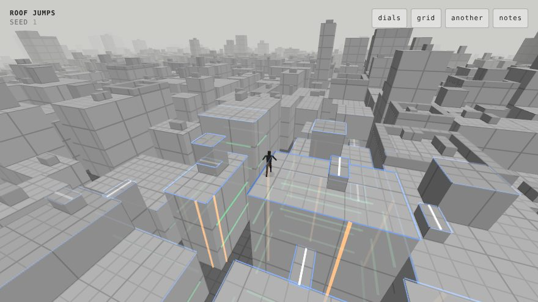
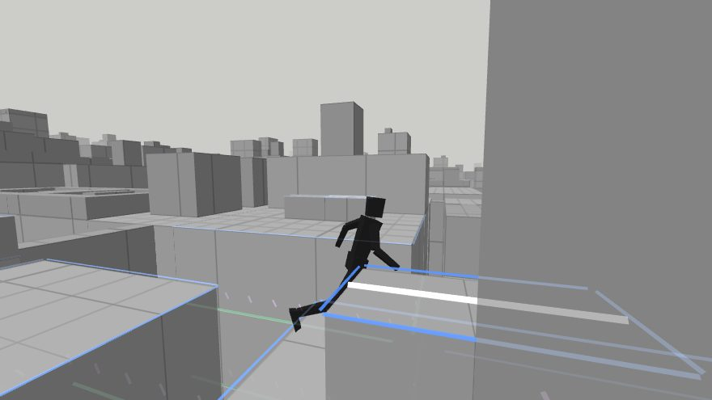
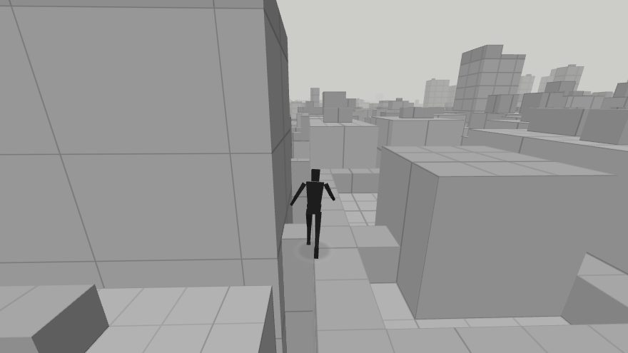
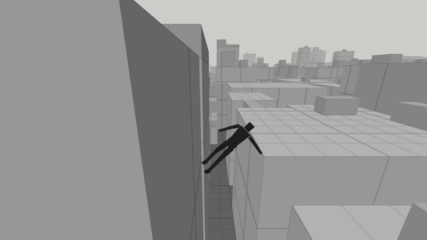
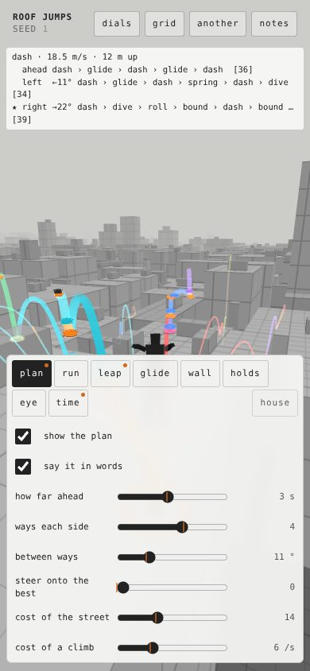
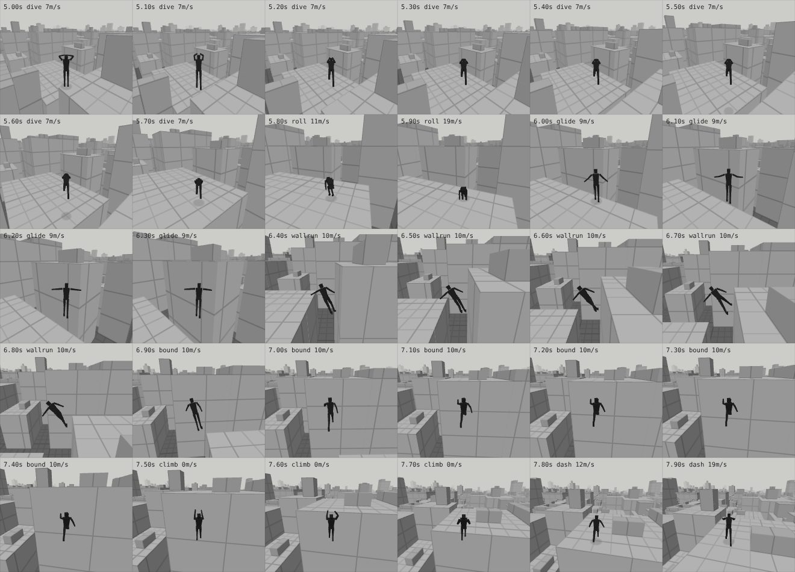
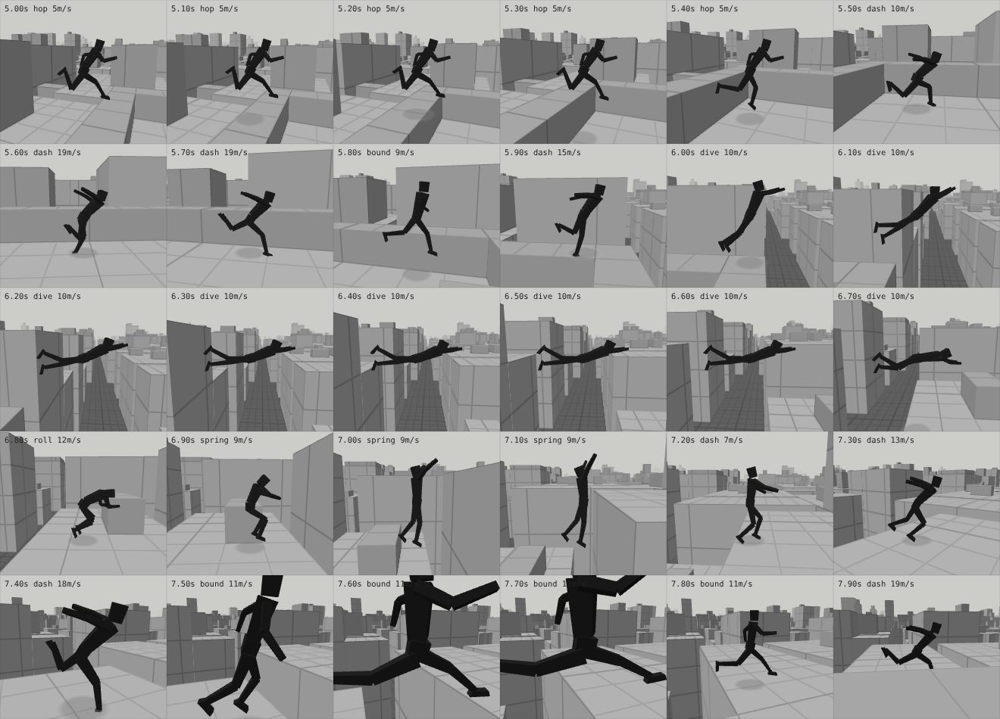
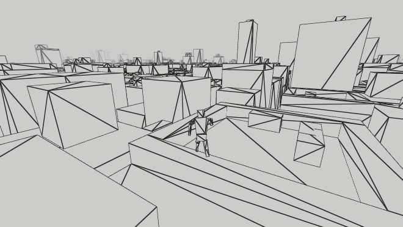
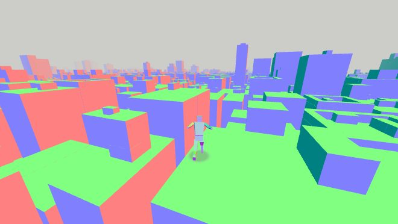

# Roof Jumps

A figure running over an endless city of rooftops, in any direction, leaping whatever is in the
way. Drag anywhere and it runs that way (the drag is a stick: further is faster). What it does
about what is in front of it is its own, and it is not one jump: it hops clutter, bounds and
flips across gaps, springs up a storey, dives down one and rolls out, falls and catches a lip,
dashes off a clean landing, balances along ledges, runs along walls and climbs them hold to hold. Tap to
jump, and once more in the air (a flip); hold (Space, or a touch held still) to glide. A second finger turns the eye. Keys: WASD or the arrows, space,
Q and E.

This is a study of two things only, the geometry and the figure moving over it, and it is drawn
as plainly as it can be on purpose: one grey, one light, fog. The point is to have a core that
looks can be tried over later without touching it.

Under `dials` is every number of the run, turned while it runs, and the plan: where this heading
leads, drawn into the city. Keys: P the plan, O the dials, K hold time, L one step of it.

`?seed=` the city · `?look=grid|clay|wire|tags|normals` · `?auto` it runs itself, wandering (a hand on it, the stick, the keys, a tap, takes over at once; let go and the wander comes back in over a second and a half) ·
`?t=` start that many seconds into such a run · `?still` hold the frame · `?preview` nothing over
the picture · `?follow=0` the eye never turns by itself · `?far=` chunks drawn each way (4) ·
`?side=90&zoom=1.6` the eye side on and close, for looking at the rig · `?study=<move>&mu=0.5`
one move's pose held, that far through it · `?sheet=<move,move…>` and `?strip=<seconds>` the study
sheets (below).

## The menu (`menu.ts`)

The page opens on a view over the city from a high ledge: every character lined up along its edge, backs to the eye, looking out over the city, the eye well above and behind them (3.6 m up, 7.6 m back, so the city below fills half the picture and can be swiped on) behind one of them (the runner, centre-left, at first), breathing slightly. They stand 1.4 m apart, so a swipe is a real move along the line. They aren't held still: over the standing pose a layer of standing about (`idlePose`: the head turned at the neck, the upper body bent at the waist, the whole leaned over the feet). At rest each slouches a little, breathes slowly, shifts its weight from leg to leg, lets its head drift, looking about and down at the drop, each on its own time. The one chosen comes up attentive (straight, chest up, a quicker breath, leaning toward the edge, eyes out over the city) and, as it's chosen, looks back over its shoulder at the eye, the shoulders turning with the head, then back out. Once one has leapt, the others follow it with their heads. The ledge is found in each city, not authored: the tallest buildings near the start, each edge long enough for the whole line, clear where they stand and along the eye's sightline to every pair of feet, scored by how open the view out over it is, how little stands up near in front, and whether a lower roof lies across a jumpable gap. What's under a finger decides what a sideways swipe changes: a character, who you are (the eye slides along the line to the next one); the sky, the time of day (dusk, golden hour, day, morning: the sun turned to the ledge's view, the sky and haze with it, for the looks that have a sky); the city below, the seed (another city, another ledge); the roof underfoot, the look. Swipe up, press Take control, or W or ↑, and the one the eye is behind leaps: it's the runner from there, pushed out over the edge for a moment and then the hand's, the eye carried down from the ledge to the chase over most of a second, the others left on the ledge watching. A tap (or Space) is a jump, as in play: the one chosen jumps where it stands on the ledge (a runner of its own for the moment, the game's own wind-up, flight and landing; tap again in the air for the second jump), then settles back to standing about; it isn't taking control. Two round buttons sit top right, in the menu and in play: settings (the dials, whose looks tab now also holds another city and the notes, which used to be buttons of their own beside the look) and, in play, the menu (back to the line on the ledge, the eye behind whoever was running; from a study or a scene, the page opened afresh on that city's menu). Keys in the menu: ← → the character, T the time, G the city, V the look, Space jump, W ↑ or Enter take control. The address keeps what was chosen (`seed`, `character`, `time`, `look`), so a reload comes back to the same ledge; `?play` or any other flag skips the menu, `?menu` asks for it. Several characters are drawn at once by giving each its own eight of the palette (a bone's material is eight times which plus what).

## The transfer line

Open `/roofjumps?line=transfer` and drag straight up. Four roofs give you a level gap, a one-storey drop, and a second gap. Reload to repeat the approach. Hold a forward drag for a running bound, or tap with a second finger during the last stride for a higher spring. Ease off earlier to stop. From the start, the high wall on the left gives a separate test: turn toward it, tap on the approach, and keep pressing toward the lip to catch it. Try easing the stick before the first lip, then taking the same run with a shallow correction in flight.

The runner loads its last step at the lip. A rising obstacle draws braking into the approach. Each automatic takeoff can add or shed up to 1.5 m/s of horizontal speed after that ground step. A roll uses the available runway. On a short roof the runner absorbs the landing in its legs. The acceleration out of a roll begins on a supporting step while you are still driving forward.

## The geometry (`city.ts`)

The world is a plane of chunks, 64 m square, each made from the seed and its own coordinates
alone: any chunk, at any time, in any order, always the same. A chunk is a list of boxes on a
one-metre lattice, about 160 of them (1,600 triangles):

- the chunk inside its streets is split in two again and again into lots, with a street, an alley
  or nothing between the halves;
- each lot is a building, low and close: two to six three-metre storeys, its height from a slow
  noise over the plane (so a neighbour is mostly within a storey of it), the odd taller one, and
  alleys of one to three metres between;
- across a gap, now and then, a wall a metre thick, about as high as the roofs it joins;
- on its roof, perhaps a rim a metre high, a raised part a storey up, a stair hut, a few units, a
  tank;
- up one side of some of the taller ones, a stair: a storey a step, each step a metre deep (as an
  iron stair up a wall would go if the city were all boxes; a height field can't hang one off a
  face), sprung up a storey a beat, each step's narrow top a rail;
- across some alleys between two roofs of a height, a bar on posts a little above them: drawn, not
  stood on (a chunk's `props`), a hold for the hands to go under it by.

Every box carries a tag saying what it is, and nothing about how it looks. The sim asks the city
one question, `heightAt(x, z)`. A renderer gets the boxes.

## The holds (`city.ts`)

Made with the boxes: the places a hand or a foot can take. They are tags, not things: nothing is
added to the geometry, but they are drawn on it (within ten metres of the figure; the `holds`
dials), so what is there to be used can be seen. Each is a line with the way it faces, and says
what it is for, by hand and by foot:

| hold | where | by hand | by foot | about how many a chunk |
|---|---|---|---|---|
| edge (blue) | every box's four top edges | grab | push off, land on | 600 |
| sill (green) | on three in four of a building's faces, one at each storey, set in from the corners | grab | toe | 350 |
| pipe (orange) | on two in five faces, ground to roof | grip | clamp | 75 |
| rail (white) | down the middle of anything a metre wide: a rim, a wall across an alley | plant | balance along | 80 |
| face (violet ticks) | every wall two metres high or more, the whole of it | steady | tread: run along, run up, kick off | 310 |

They have their own dice, so the boxes are the same city with or without them. A mover asks what
is in reach (`holdsNear`, `gripAt`), and what it does depends on what is there. The `holds` dial
shows them, with a red ring where each hand is and a black one where each foot is down.

What the runner does with them so far:

- **Up a wall** a committed rising jump can put one foot on the face. The runner drives up from that contact. Keeping pressure toward a reachable top edge catches it with the hands and pulls the hips over. A missed catch returns to flight.
- **Over clutter** with an edge to plant a hand on it vaults, one hand or (every other time) two,
  the body brought down to the hand and carried over on it; with nothing to hold it hops.
- **Landing a storey up**, both hands come down on the lip it lands over.
- **Along a wall** the near hand trails on it. **Out of a dive** both go to the ground first. **A
  deep landing** is three-pointed.
- **The feet are placed.** A stride has each foot down for part of it; when one comes down it is
  given a place and stays there, the body going over it, until it lifts. Running, that is the roof
  ahead of it; along anything narrow, the rail's line; at a lip, the lip. Along a wall and up one,
  the wall (a sill or a pipe if one is by).

The figure is posed, and then its arms are taken to what they hold (`rig.ts`): from where the
pose had the hand toward the hold, shoulder to elbow to hand, eased on and off, so it is drawn
like a drawing and holds on like a mannequin. Because the plan is the runner run ahead, routes are
already costed by what is available: a wall with holds is a quick way up, a bare one a slow one.

Not yet: the takeoff and landing feet chosen for their holds (they fall where the stride has them);
catching an edge at the end of a leap
that falls short, and hanging from it; swinging; choosing a route for its holds rather than
finding them on the way.

## The runner (`runner.ts`)

A point with a velocity, and the judgement that makes the running effortless. At an edge, a step
or a wall it looks along the way it is going for where it can next stand: the first flat place
within a storey up or a couple down, else a wall, else the highest place in reach however far
down. Then it throws itself there on an arc worked out to land it: high enough to clear what is
between, flat enough to keep its pace. Which move it throws is chosen by what is in front of it:

| move | when | what it is |
|---|---|---|
| vault | clutter or a rim in the way, close, with an edge to put a hand on | lower and quicker: over it on a hand, or two; every third one-handed one turned right round on the hand (a palm spin) |
| hop | the same, with nothing to hold | a hurdle |
| bound | a gap at about this height | flat and fast, the legs split |
| flip | an airborne second tap or a tall obstacle | tucked and turned over forwards |
| side flip | every other tall obstacle, or the tap with a lean across the way | tucked and turned over sideways |
| spring | a storey up | steep, the arms thrown up, knees to the chest, a deep landing |
| dive | a storey or two down, however far | headfirst, arched out over the drop, folding into the roll |
| fall | a leap that missed its landing | arms up and out, knees drawn up: catches a lip in reach, else lands and rolls |
| glide | only while the jump is held | the slow one: arms out, sinking gently, steerable |
| hang | on the way up a face | from a sill or a pipe: caught (the feet walking up), loaded (both feet set on the wall), sprung for the next hold |
| underbar | a gap with a bar across it at about head height, the far roof level | feet first under the bar, the hands on it, laid back, legs straight through |
| chimney | up a narrow alley, leaning in on a wall run | wall to wall, a kick every 0.27 s, hands on both walls |
| kick | off a wall | the pushing leg long behind, the arms flung away, turned off it |

On the ground it runs, sprints after a couple of seconds, bursts into a dash out of a roll or off
a clean landing with room ahead, and balances along anything narrow (a rim, a wall across an
alley), drawn onto its line if you are going its way.

A tall wall met at a slant at pace is stepped onto off one foot and run along, straight off the ground; in the air a wall alongside is run along, tilted off it. Left to itself that is a shallow arc,
rising then sinking as gravity has it. Leaning into the wall drives it up the wall as it goes
along: that is how height is gained, and it is paid for, in how long the run lasts and in pace
along. It ends on the wall's top if it gets there. Away from the wall, or a jump, kicks off it:
wall to wall down an alley. A grazing contact keeps speed along the face. Pressed into a tall wall met near square, with a hold in reach, it braces (both hands on the wall) and, still pressed after a beat (0.35 s), goes for it, as a tap would (a tap goes at once): a foot planted on the face, the lip caught. A lip caught (off a plant, coming down against a wall, at the top of a climb) is a hang first: a beat (0.3 s) for the hips to swing in under it; then pressing on toward the wall pulls over (a tap too), pressing away lets go and drops, held along the wall it lets go after a while and goes on that way (a brush past), and left alone it hangs. So a rescue, a deliberate ascent and a brush past are three different things, and holding a direction alone climbs far less (19 m a minute in the test runs, from 39). Its top out of reach, a sill or a pipe in reach is hung from, and the climb is a chain, as up a fire escape: caught, loaded (knees up, feet on the wall), sprung for the next hold, a storey a beat; pressing in goes again as soon as it's loaded, a tap goes at once, pressing away lets go. A wall with nothing in reach ends in a brace. Between two walls no more than 3.2 m apart, leaning in on a wall run, held through its first beat (0.25 s, not just the angle it arrived at), goes up the alley wall to wall (the chimney, after the references): a kick every 0.27 s, about 0.9 m a kick, a top in reach caught and pulled over, let go and it drops. Landings are graded. Light and on its mark, it flows on. Heavy (from about two storeys), it goes deeper and longer into the legs, is slower to drive out of, and pays in pace. Off its mark (a fall, off a wall, into one), it staggers, loses a little pace, and is knocked off balance. Balance is a state of its own, knocked by those landings, by narrow tops (a sway that's really there), and by sharp turns at pace; it is corrected like a spring (the body leaning with it, the arms out against it, windmilling as it comes back), and while it's off, steering is weaker. The figure has weight: each joint moves to its pose as a spring a little under critical damping (a limb carries past and comes back), the chest lags the hips (stopped short by a landing it carries on down and comes back), the arms drive up hard at every takeoff. Effort is shown by size: the bigger the release (a storey up, a spring from a hold, a long bound), the deeper and longer the wind-up; small hops stay light. The `effort shown` dial (`emphasis`, none by default) holds a big wind-up at full load a moment before it goes (only from a stand or a hold: a running takeoff is never stopped), holds a heavy landing's legs at their deepest while the body goes on, and dips the eye with it. And effort is a budget: big releases spend it (a storey up, a chain's springs, the chimney's kicks), easy running gives it back after a beat; spent, it runs a little slower, winds up slower, waits longer before the next spring up a face, and breathes hard when it stops. Let go with room ahead, it settles, through a walk to a stand; with an edge close, it stops short. A leap the takeoff's limit would leave short keeps its aim with a higher arc (too long, a flatter one), so it lands where it meant to far more often; one that can't comes down where it can, and a fall is only a real fall. An aimed landing on something narrow is stuck: the pace taken in the legs, a moment to settle. The `held at the top` dial (`apexHold`, none by default) holds the pose at the top of a flight a moment, as a drawing would, while the body goes on across at its pace and on its arc (the flight is the same, step for step); then the pose catches up. A committed jump (a tap) goes as the approach and the plant say: standing, a strong spring straight up (1.8 m on the practice roof); off a step or two, the highest; at a run, a little lower and long, carrying the pace and adding to it; a deeper last plant, and effort left, give more of all of it. A flight doesn't gain pace in the air (steering turns it; only a glide drives). `?line=transfer&takeoff=stand|step|run&strip=0.25&side=90&zoom=1.7` films the three takeoffs side on. The glide sinks at most 4.5 m/s (the first reference's long sink down an alley), arms straight out and level, legs together, swaying slowly. The eye pulls out wider, higher and steadier while it climbs, comes a little lower flat out, and keeps clear of walls beside its line as well as in it. Going up a storey costs pace; while the legs are still taking a landing it drives less, so a landing is a beat and the burst comes out of it. Small turns steer an aimed leap gently. A decisive turn gives full air control.

The fixed-step suite checks surface contact, movement on open routes, planner agreement, and intentional jumps, wall contacts and landings on the transfer line.
(`node cells/lab/devtools/roofjumps.test.mjs`).

The body has breadth: a circle 0.35 m across its middle, on the ground and in the air, against anything standing higher than a step (in the air, than its knees). It's pushed out of what it overlaps (exactly: the city is boxes) and slides along it, the speed into it taken off; so the figure stays out of walls (it used to be a point, and could stand half inside one). Meeting a wall is an event with a direction and a force: within a storey and gone at, it's leapt onto; tall, at a slant at pace, run along; pressed into, braced, both hands on the face; else slid along, and met hard (more than 3 m/s into it) a hit, a knock to the balance, pace lost, a moment to recover. Off balance with a wall in reach (or sliding along one slowly), the near hand goes on it, and that steadies it: the balance comes back twice as damped. A jump at a wall carries into it, at full effort, so it meets it and a foot goes on it; a wall just gone for isn't gone for again for a moment, and a corner it can't land beyond isn't leapt into.

Imperfection is authored, and the save is a footfall. A hard leap (a late turn into it, near its fastest, near its reach, or spent) carries a small error, chosen from what made it hard (a turn: wide; speed: long; reach: short), a few tens of centimetres, and checked to be saveable; easy leaps are clean. Landing off its mark (by that error, by steering in the air, or by carrying too much speed into a turn) is a save, and the save is a footfall: the catching foot (the side the hips are carrying to) put down where they're going, as far out as the error asks, at the moment it's needed, and the stride picked up from it. Short: a short step at once, pitched forward over it, a hand slapped down, the trailing knee through high. Wide: out wide, the outside arm flung open, an exit on a slightly wider line. Long: two quick steps ahead, the speed kept (a running save, not a roll). The knock to the balance goes toward the error, not by which leg led; most landings stay quiet (about one in eight is saved, in held runs). `?line=transfer&catch=clean|late|correct&strip=1.5&frames=10&every=0.05&cols=10` films a diagonal bound three ways, each planted foot marked, orange while the save is made: you can point to the footfall that saved it.

A flight gets ready for the ground a fixed while before it, whatever its length (the legs coming under, the arms out, the head down to find it); a long dive spends its middle looking for the ground, and folds into the roll by the time left, not the share of the flight; out of a roll the weight comes up over the front foot, a hand pushing off. The head leads into turns. A lip caught keeps what the body brought: the near hand first, the body swinging on under it and dipping, the far hand joining only as the swing needs it; then the beat, then the pull. After a big arrival with nothing near to go for (or spent), a couple of settling strides rather than a burst.

Roofs carry ground detail, from their own dice and only on bare roof: debris (rubble, loose tiles), clutter (pipe runs, vents, low curbs) and skylights (no-go). None of it is stood on or in the way of the body; the feet mind it: a footfall that would land on it goes to the nearest clear place (a shorter or longer step, a little in or out), and shortened with an edge close ahead it's a stutter, the stride fitted to the takeoff; clutter under the stride is stepped over high. The eye can move with the body: `eyeLope` (rides the stride: a bob each footfall, a sway each stride, a roll into turns) and `eyeImpact` (feels the landings: a dip by how hard, a shake on a heavy one, a lurch on a short save; at 2 the lens punched in and the dip held), each from 0 (none) through 1 (a hand-held eye) to 2 (exaggerated), 0.4 by default.

## The legs, measured (`devtools/roofjumps-legs.mjs`, `devtools/roofjumps-wander.mjs`)

The legs read as robot or drunk, not athlete, and the tools measure why: each scene run as the page runs it, the rig taken every 1/120 s and the legs set against what running and walking people do (the knee as the foot lands, under load, in the swing; how long a foot is down; where it lands across and ahead of the line; how close the swinging foot comes to the far side; the sole just before it lands; the foot's speed along the ground as it lands; snaps; heel rise; lift; hip sway and bob), with strips every 1/40 s from the side, behind and in front. The wander (`gait-wander`, a semi-random walk about a wide roof at a slow, changing pace) is measured footfall by footfall at any speed for what reads wrong (toes off facing, planted feet twisting or sliding, a hop at a walk, feet across the line, slaps, stamps), its worst moments filmed. What they found and what changed:

- *A walk of its own.* It had none: a slow run, both feet down together 1% of the time. Now a walk's step (0.40 + 0.22 × pace) and stance (the body going 1.24 steps over each planted foot, the foot landing under a third of that ahead), both feet down together a fifth of the time, blended into the run's between 1.8 and 2.6 m/s; at a walk a foot isn't lifted before the other is down, nor kept down further behind than the leg reaches heel up. The hips vault over each foot on a nearly straight leg (as high as such a leg reaches to the foot ahead or under), so the knee lands at about 18° instead of 40°; and the body faces the way it walks at any walking pace (below 1 m/s it had walked sideways and backwards, legs reaching out like sitting).
- *No frozen splits.* Slowing from a run, a stride planned at speed was crawled over (the legs held a lunge while the body glided). Now below 3 m/s a step is never much longer than the pace's own, a plan made well above the pace is let go, and one rate times the feet and foresees them.
- *No snaps.* A walking footfall goes where the drawn step was going; a foot swinging on the ground can't come down until it could have got there (held, and swung on from where it's drawn: a sudden brake once planted a foot 1.5 m from where it left in a frame).
- *Turns step round.* A planted foot the body has turned over onto the other side of the line is stepped round; a foot taken up early swings at once; a walking step is drawn round its own side of the body; a swinging leg is swung out at the hip when its foot comes near the line.
- *Landing.* From a jog up, over its last tenth of a second the swinging foot is taken onto its footfall, a place fixed on the ground, coming down the last centimetres, and its sole turns from the swing's angle to flat as the weight comes on: the foot arrives at about 0–3.5 m/s along the ground (it had been flung forward at 6–14 m/s and stopped dead), its sole settling instead of slapping 18° flat in a frame; the knee at touchdown 21–25° at a jog and a run.

Still to do: the knee lands a little bent when the run-up is long (30° at an edge stop and a two-gap run), the foot still lands about 0.35–0.4 m ahead of the hips (typically under 0.3), the walk lands flat rather than heel first, and the sharpest turns at a walk still sweep a foot across before it's stepped round.

### Locomotion from motion capture (`mocap.ts`, `mocap-clips.ts`, `devtools/mocap/`)

The hand-made gait is the body as formulas; games that read as athletic (rotoscoped Prince of Persia, captured Tomb Raider and Assassin's Creed) play the body as people move and keep only the contact with the world procedural. So does this now. Three takes from the CMU Graphics Lab Motion Capture Database (mocap.cs.cmu.edu, whose data "may be copied, modified, or redistributed without permission") are fetched, read (ASF skeleton, AMC frames, forward kinematics) and retargeted onto the rig's own pose angles by `node cells/lab/devtools/mocap/cmu.mjs`: a walk (16_15, 1.11 m/s), a jog (16_36, 2.67 m/s) and a run (143_01, 6.06 m/s). Each keeps one cycle, left footfall to left footfall, from the steadiest stretch of the take: the pelvis's turn and pitch, the chest's movement about its own carriage and its turn against the hips, each thigh's swing and splay, each knee, each upper arm's swing and spread, each elbow; where in the cycle each foot lifts and lands; and the swing foot's path (its ankle's height and how far along it is through the swing). 48 steps a cycle, looped, about 19 kB. The capture files themselves stay out of the repository (`devtools/out/mocap/`).

They're played by distance, not time: each leg at its own place in the runner's stride (0 its footfall), its stance stretched or squeezed to the runner's, so the clip is always in step with where the feet are actually put; blended by pace between the walk, the jog and the run, and into the hand-made sprint between 6 and 8 m/s. Everything that touches the world stays the rig's: where each foot lands and stays, the hips' height, the guided landing, the toe pivot. Three places where the two meet were changed. The stepping foot at a walk takes the captured path (up fast and early behind the body, carried forward low), not an even arc. Mid-swing the clip's own leg carries the foot (thigh driven through, knee folded and opening), the path only lifting it off and setting it down. And at a walk the heel comes up as far as the clip's knee asks (to 55°), so the knee is already bending through the push-off with the toe still down, instead of staying straight to the last and swinging through stiff. `?mocap=0` (or `MOCAP=0` for the tools) plays the hand-made gait alone, for comparison.

Measured against it: at a walk the knee bends to 63° in the swing (it was 47°; the capture has 65°) and lands at 22° (it was 18.5°; real walking measured the same way is 21–27°), the heel rises 37° before push-off, and the trunk stays upright; at a jog the swing knee folds to 84° (it was 57°) and the swing foot clears 0.20 m (it was 0.06); the run above 8 m/s is unchanged. The walk's arms swing little, because the captured walker's did: a livelier walk is a matter of choosing another take.

### Weight (`runner.ts` ground, `rig.ts`)

The body had no weight. Braking from 6 m/s into an 85° turn took it to 1.2 m/s and round onto the new heading in an eighth of a second (nearly 4 g), and while it stood on one foot spinning there, the other foot hung in the air for over half a second. The stride's clock runs on pace, so when the pace collapsed, the foot in the air hung with it, swinging round behind and then across. From in front that was a leg flung out sideways and then the legs scissoring: what read as drunk.

Now the feet carry it. Braking and turning take the feet, and they push the body back or round only so hard (`grip`, about 1.4 g). Slower, they push less: a walker pushes only as far as a foot is out from under them, about 2.5 m/s² plus 1.6 for each m/s. So a hard stop is two or three steps and a sharp turn at a walk is stepped round over half a second, not spun on one foot. Running (from 3 m/s, fully by 5) keeps the run's own handling, which the courses are made for, and a reversal (asked back against the way it's going) is a skid braked as hard as before. The figure shows where the weight is:

- **Shared between the feet.** All on one foot when it stands alone. Between two feet, by where the body is along the line from one to the other, so the weight moves across during the double support instead of jumping at the footfall.
- **Hips over the support.** The hips are carried part of the way over the point of support (about 2 cm each side at a walk; real walkers shift 2–3 cm), so they lead into a turn over the foot that's taking it.
- **Leaning against the push.** Back over the feet braking, forward driving on, banked into a turn by the sideways push (where push and gravity balance, about half of it in the trunk).

On the wander's sharp turn (the worst moment this morning), the swing foot across the line fell from 41 cm to 11 cm, stamps from 3 to 2, hops at a walk from 3 to 1; the courses hold as before (142 of 144).

Tried and left out: bringing a swinging foot down early to catch the body when it falls off its support (its momentum carried past the standing foot, or too long on one foot). Measured properly, single support was never as long as it looked once braking was spread over steps, and the early footfalls cost stamps.

Two filming bugs were found on the way. The films hid the footfall markers with `feet=0`, which is also the dial that places the feet, so every strip since had planting off (the flag is now `marks=0`). And the legs tool's front and behind were swapped.

### One account of the feet (after an outside review)

A review of the build (by Astra) put it plainly: the runner decided the body's velocity and the feet were fitted to a body already going that way, and three parts of the program kept their own idea of whether a foot was down. Five changes followed, each measured (`devtools/roofjumps-footing.mjs`: disagreements, gaps with no foot down, planted slide and the share of each cut made with a foot down, over the 28 scenes and eight 12-second trials of random stick input on a flat roof; `devtools/roofjumps-determinism.mjs`: the bones read at different rates):

- *Drawing is reading.* Reading the bones used to change state: the heel's lift and where a free foot was drawn, both fed into the next step. So the same run drawn at 30 Hz and 120 Hz came out up to 5.7 cm apart. Both are now kept by a solve at the end of each fixed step, and reading the bones changes nothing. All 28 scenes agree exactly, and a unit test holds it.
- *One account of the feet.* The runner keeps each foot's footing: whether it's down, where, the way the surface faces, its share of the weight, and its phase (touching, taking weight, pushing, unloading, in the air). The figure reads the weight from it. A foot the figure can't reach is let go of by the runner as a step, instead of the runner claiming it while the figure has given it up (581 ticks of disagreement → 10).
- *The handover.* A walk always has a foot down. A let-go foot comes down as soon as nothing else holds the body. A walking stance doesn't end while the other foot is still up. The far-behind release needs the other foot down below a true jog. A jog's moment in the air is held to about its own length. The worst time on the ground at a walk with no foot down went from 425 ms to under 160 ms.
- *The planted foot makes the cut.* Running on the open roof, braking and turning happen only while a foot is down (none in the air between steps), and up to three times as hard while it is. In sharp-turns the share of the cut made with a foot down went from 28% to 93%, planted slide from 11.7 to 0 cm/s, and the reversal from 0.45 to 0.34 s. Every course holds except vault-angles' known slide (143 of 144).
- *Arms for balance.* When the body's momentum carries it off to the side of what's bearing it, past a step's width, and no step is coming (standing, along something narrow, the other foot still up), the arm on the far side from the fall lifts out to carry weight back over the support, the near arm a little, and the elbows straighten. There's a dead zone, so easy walking and running show none of it. A running cut falls into its turn on purpose, so little shows there.

Then three more from the same review:

- *A step can change its mind, as far as the foot still can.* Each foot in the air at a walk or jog is committed to where it's going. Its aim follows what's wanted (the stick, the pace, the plan) only as fast as a foot can change course in the time left: freely just off the ground (4 m/s), hardly at all about to land (0.5 m/s). The drawn step and the footfall both go to it. A late flick lands short of the new line, and the next step and the planted-foot cut take the rest. `devtools/roofjumps-flick.mjs` flicks the stick right and straight back left at eight moments through a stride: walking, every footfall lands exactly where its drawn step was going, with no snaps. Running keeps its own landings, since the way it's going can't change in the air.
- *Knees with a memory.* A planted knee bends the way it bent last step (more so the straighter the leg, where the hips alone say little), and toward the way its foot points once it bears weight. So it goes with the foot it stands on, not round with the turning hips: knees turning round the leg fell from 59 to 44°/s on average, and in sharp-turns from 126 to 83°/s.
- *Saves that can fail.* A save that finds no roof for the catching foot used to plant it anyway, on air, and take 85% of the body's motion toward the fall. Now it fails: no foot, nothing taken off, and the stumble carries on into a run-out, a hand catch or a fall. A foot that could only get part way out corrects that much less. No authored scene happens to need a failed save yet.

*Committed at every pace.* Limiting the committed aim to walking and jogging had kept the courses passing, but it hid two faults that showed when it was applied at a run. First, the run-up planned each footfall only as the previous foot came down, by which time the foot it was planning was already in the air: the course numbers relied on moving that foot in its last tenth of a second, which no body can do. Second, when the takeoff foot couldn't make the lip, the runner could put a foot down behind the other at 10 m/s. Now:

- *Plans two steps out.* As each foot lands, the planner gives the next foot its spot and the foot after that its own, so a foot is committed to a planned spot as it leaves the ground and later plans only fine-tune it.
- *Sees four strides ahead* (was 3.2). The adjustment is spread over the last three steps, rising toward the lip, the way a jumper opens into a takeoff: for a lip 30.8 m away, 1.10 · 1.14 · 1.18 strides, where it had been 0.96 · 1.22 · 1.23, and before that, committed with no change to the planner, 1.07 · 1.26 · −0.23.
- *Never aimed behind the hips at a run.* A plan made before a jump doesn't carry through the flight.
- *What a running foot commits to is its choice of spot* (the plan's longer or shorter step, a step aside), not where the body will be when it lands. That moves with the body: a few hundredths of a second either way is tens of centimetres at 11 m/s, and the way it's going can't change in the air.

The courses hold (143 of 144), the run-up's last strides average 1.09 with none under 0.91, and flicks at a jog land 9 cm on average from where the foot was heading a tenth of a second before (was 15–21 cm), with no snaps. Running the planner four strides out instead of four and a half kept edge-stop's teeter (at 4.5 it stopped short of the lip and didn't check its balance).

### Brushes from a stand (after a second review)

Astra on standing brushes, the stick touched for a moment: a small stick brush read as janky. Measured, the free shoe jumped up to 46 cm in a tick; a first swing began with its clock a quarter through; the path round the hips flipped mid-swing; a settling step was rebuilt from a straight line; an interrupted stand step jumped to where it was going; a 12 px brush carried the body 41 cm after the thumb lifted; the first foot was always the left; and the touch stopped counting as a tap only well after it had started moving the runner. `devtools/roofjumps-brushes.mjs` measures it: brushes in eight directions, reversals mid heel-lift, a circling thumb, eight brushes in a row, and the filmed 12 px back brush (the first regression). For each it reports the worst shoe jump in a tick, snaps over 6 cm, how far the body goes on after the thumb, and ticks with no foot down.

- *A foot travels, never appears.* The rig reports where each shoe is drawn, and the runner starts every swing, settling step and release from there; a step it set off in the middle of carries on from where the foot is. The first swing from a stand is taken from the shoe over what's left of its clock. The way round the hips is decided once a swing, and its clearance lets go at both ends, so it starts and ends on its spots. A foot in the air moves no faster than 4 m/s plus twice the body's pace, whatever carries it (the path, the clip's leg, the share between them); the clip's leg takes a foot over, or hands it back, no faster than 8 a second. A lifting foot no longer pivots about a ball on the ground. A foot is down only once it gets to its spot: drawn still well short, with the other holding the body up, its swing goes on to there.
- *A brush is a step, not a stroll.* On a light press the body gets going as a person's does: a couple of m/s² from a stand, more as it goes, over a quarter second to a walk (a full press still bursts off, and over 1.2 m/s it's the stride's business). Slower than a walk, the foot under the body can check it (its ankle and hips), so a brushed step ends where it was going instead of drifting on until a foot comes down ahead.
- *The first foot is the one a person would take.* Setting off on a light press: a foot already in the air from a step at a stand; going off to a side, the foot on that side; forward or back, the one furthest behind the way it's going, which the weight is coming off (the rear foot going forward, the front one stepping back).
- *A thumb that has moved the runner isn't a tap.* The touch stick's tap now ends at the same tenth of its reach where movement starts (it was 0.18, so a small drag could move the runner and then jump on release).
- *A tic-tac goes off a foot*, waiting between steps for the next to come down while there's room.

Snaps over 6 cm in the brush set: 215 to 0; the worst tick 5.9 cm, a circling thumb's swing at its speed limit. The filmed brush now goes on 2 cm after the thumb, not 41. Every brush stops within 3 cm; the circle, a walk kept up for 1.4 s, stops in 16 cm. Walking gaps across the footing runs 1 of 36 (worst 33 ms; was 2, 75 ms), and the courses are as they were (141 of 144). Not yet: the tic-tac in its scene takes off just after a foot leaves the roof unless the stride happens to land one there (its run-up isn't planned to the wall as a gap's is), which is why a full press keeps the stride's own first foot; and a backstep that's more than a weight shift and a settling step.

### A failed jump grabs what's there

Asked for: a figure that misses a wall or a ledge should grasp any handhold in reach, not fall past it. Lips were already caught (the wall's own top, in reach overhead), but nothing else was: a jump short of a roof too high to reach, a run up a wall that didn't make it, a drop into the gap it meant to cross all fell past every sill and pipe on the face.

- *Grabbed in the air* (`reachHold`): once a jump is failing (below where it went from and not coming down where it was aimed, or against the wall), a sill or a pipe on the face in front, in a hand's reach overhead, is caught. From there it's a hang like any on the way up a face: loaded and sprung for the next hold or the lip, or let go of. Not on a drop it chose, not going away from the face, not falling too fast for hands to hold (over 11 m/s).
- *Off a run up a wall that runs out*, still leaning in at all: a hold in reach is grabbed before it pushes off.
- *A hang isn't a place to be stuck*: asked some other way than up for half a second, or up with nowhere further to go for a second, it lets go, down the face and on (left alone, it hangs). Let go of on purpose, it doesn't grab again until it's down, so it doesn't ladder down a face grab by grab.

A scene for it, `short-grab`: across a 5.5 m alley at a roof 12 m up from one at 6 m, the jump comes up short; it grabs the 9 m sill, springs to the lip and is over (spring › fall › hang › climb). Over the street test's held lines (four cities, sixteen ways, a minute each), 138 grabs, 78 of them going on up. Building it found a fault the new path set off: placed a hair too far out from a face, the hang read the roof's height past the face's end as the ground and sprang down to it; a hang's next lip now has to be above it.

### More to hold, held more ways, climbed by what's there

Asked for: more kinds of hold, holds caught side-on or one-handed, and climbs that vary with what's on the face.

- *Kinds* (`city.ts` `fixturesOf`, by their own dice so sills and pipes are where they were). A stone **ledge** across a face at a storey (two hands, shimmy along it, the feet stand on it); **units** under windows (a short top to grab, a step for the feet); a **sign's** bracket out from the wall (a short bar to hang from, no use to the feet); a **balcony**, a slab a metre out with a rail round it (a good grip, the slab under it to stand on). Each only where the face has room in front of it, all of it, to its depth. All are drawn (thin boxes, not stood on), and now so is every pipe (a thing to climb should be seen) and every hold a course places by hand (`holdProps`). Sills stay undrawn in the plain looks: there are some 400 a chunk, and they'd nearly double the city's geometry.
- *Caught side-on, one-handed.* A hold to the side of the body (an arm reaches further out sideways than up the front), or too small for two hands at once (a pipe, a bracket), is caught by the near hand alone. The body hangs turned off it, the free arm out, and swings square under it as the other hand comes on (beside it on a sill; under it on a pipe; behind it along a bracket). A spring across to a hold beside is caught the same way, leading hand first.
- *Climbs by what's asked and what's there* (`hang`):
  - **up:** a hold the feet can stand on (a ledge, a unit, a balcony) is stepped up onto, knee and then foot, and stood on, chest to the wall, hands flat on it; from there a reach and a little jump (`up-from-standing`). A pipe goes up hand over hand, knees clamping it, the feet straddling it and stepping in turn. Anything else is sprung from, as before.
  - **up and to a side:** sprung for a hold up that way (`diagonal`); with nothing that way, straight up.
  - **along the face:** shimmied hand over hand, the hands leapfrogging in 0.45 m steps at 1.1 m/s, never into a building standing against the face; at the hold's end, or off something small, sprung across to a hold beside (`across`). Two and a half seconds of going along since last down and it lets go: a traverse, not a way across a block.
- *Scenes:* `pipe-one-hand` (a one-armed catch on a pipe to the side, and up it), `ledge-step-up`, `shimmy-across` (along a sill, across to a pipe, up it), `diagonal-unit` (up and across to a unit, stood on, the lip). Over the street test's held lines: 166 grabs, 55 of them one-handed; climbs 284 up, 43 shimmies, 13 pipes, 13 step-ups (10 then up from standing), 12 diagonals. The time split is the same as before (hanging 24%, on the street 18%).
- *Found on the way:* a hold up and to the side with the stick a little off square left it hanging for good (neither straight up nor across); it goes straight up now. A shimmy could carry the body into a building abutting the face; it stops there now.

## The plan (`plan.ts`)

Where a heading leads, further than the next jump. A route is the runner itself run on ahead: a
copy of it, as it is this instant, stepped through the next three seconds holding one direction,
with every leap, wall and roll it would make on the way. Nothing is guessed: it is the same code
that moves the real one, so the route drawn is the route taken for as long as the heading holds
(the test checks that to the last decimal).

A plan is a fan of those: the way asked (the primary) and four ways either side of it, eleven
degrees apart, each scored: ground made, less what it costs (coming down to the street, climbing
back up, time spent gliding), more for walls and ledges. The best to the left and the best to the
right are the alternatives: turn that much and that one is the primary.

`?plan` (or P) draws it into the city: each route a ribbon coloured by the move it is in, a ring
where each move begins; the primary broad, the two alternatives narrower, the rest of the fan
hairlines; faint where a building stands in front. `?readout` says it in words, with each route's
score and a star on the best. `?assist=1` leans your heading onto the best by itself; the
self-running mode steers by it entirely.

| colour | move | colour | move |
|---|---|---|---|
| near black | run | green | spring |
| orange | dash | red | dive |
| white | ledge | cyan | glide |
| pink | roll | magenta | wall run |
| yellow | hop | brown | climb |
| lime | vault | | |
| blue | bound | violet | flip |

Each route is also judged as a choreographer would (`choreo`, weighed by `wChoreo`): each event worth what it is to watch (an underbar, a chimney, a wall run more than a bound; a fall less than nothing), less if it's one of the last few again, less if it's crowded on the last (under half a second) or after dead air (over two and a half), more for going up and down. For your own run it only leans in as far as `assist` says; running by itself, and for the director, it leads.

## Directing a seed (`direct.ts`, `devtools/roofjumps-direct.mjs`)

Any seed can be made a scene, and so an eval of what the body chooses and how it does it. Every 1.5 s the director looks down sixteen headings (the runner run on ahead, the same code), and picks the one that's best to watch (the choreographer's judgement), makes ground, stays off the street, and doesn't go back over ground it's covered; the run holds that heading until the next decision, exactly as foreseen, so the same seed directs the same run, and the page replays it (`?direct=x,z,heading,seconds;…`). The run is measured: events, how many kinds and how evenly (entropy), repeats, the longest dead air, misses, saves, time stood still, frames in a wall, pace, what it was worth to watch a minute; and one score to climb (worth a minute, with variety, less repeats, misses, stalls and dead air). `node cells/lab/devtools/roofjumps-direct.mjs [seeds] [--pictures] [--set dial=v,…] [--name n]` writes each seed's waypoints, measures and timeline, a report, and (with pictures) a strip of the whole run and one of its best moment; `--compare a.json b.json` sets two reports side by side. A run diverges from a small change (a stride's timing sends it down another alley), so a change is judged on the mean over many seeds, not one.

The first climb on it (24 seeds, 40 s each; the noise floor is about ±2.5 on the mean, so a change has to move it by 5 to count): the baseline 85.2. Then quietness was added to the score (a save on more than 12% of landings costs), since a save should mean something: 78.3, saves on 23% of directed landings. A turning cost on the director, to smooth its lines: no change (81 to 83), saves unchanged, so its turns weren't the cause; rejected. A wider threshold for a sideways save (0.3 m): 77.1, saves 20%, within noise; rejected. A flight redirected decisively drops its mark (where it lands is its choice, not a miss): 80.6, saves 18%; kept, a principle more than a gain. The mark moved with steering made early in a flight: saves rose to 21%; rejected. Still open: why directed landings drift off their marks twice as often as held ones; the next step is to measure the drift itself, not guess at it.

A critique of that climb, and what changed for it: the score was one composite with guessed weights, changed mid-climb, rewarding density against our own notes on phrasing, judged by the same function the director chooses with, and blind to the body; three of four turns were guesses. Now the eval reports dimensions, each guarded: what it does (interest a minute, entropy, misses, saves as a share of landings, stall, crowding of big events) and how the body does it (frames a joint jumps more than 0.25 rad, a settled planted foot's slide, head or hips in a wall, a hand or foot deep in one). `roofjumps-direct-baseline.json` holds each dimension's mean and standard error over 24 seeds; `--check` fails a change that makes any worse beyond its noise. Test minimums for how often each move happens are now only that each still happens: how often is the eval's business.

And the drift was measured before anything else was changed: half the aimed landings in directed runs were off their marks, and of those about half were authored "wide" errors judged from the turn rate (which the director's heading changes and wall deflections keep high), and about a quarter came down early on something on the way, metres short. The wide error is now judged from a real late turn (how far what's asked is off the way it's going as it leaves), an aimed flight is only steered by a change in what's asked since takeoff (not pulled toward the direction it took off holding), and an offset of more than a stride is landing somewhere else, not a save: saves from 19% of directed landings to 10%. The time to the ground is marched along the flight (it flickered over gaps), and the rig follows a smoothed copy of the stride's phase, so a re-timed footfall is caught up with, not snapped to.

What the body measures show next: a settled planted foot slides about 1.9 m/s at a run (a footfall 0.45 m ahead held for 0.9 m of travel is out of a leg's reach from hips at running height: the leg clamps and drags it), which wants a swing leg that targets its footfall and a stance the leg can hold; most joint jumps are the arms thrown overhead at a dive's takeoff (4 rad in 0.15 s), which wants the throw begun in the wind-up; hands and feet are deep in walls 3.9% of the time; and a third of big events still come within 0.7 s of the last.

The stride was measured against a sprinter's and rebuilt. It was about right in length but churned (5 to 5.5 steps a second at pace, against 4.5 to 4.8), and drawn much shorter than it ran: the hips rode near standing height, so a leg could only reach about 0.3 m either side of them, and a planted foot was clamped and dragged, then let go early (feet split about 1 m, against about 1.5). Now a step is 0.55 + 0.17 × pace (2.3 m at 10.5 m/s, 4.5 a second); a foot comes down about 0.25 m ahead of the body and the body goes about 0.8 m over it, pushing off on its toe (the heel lifting, the foot pivoting about its ball); the hips dip through each stance and rise in each flight, low enough for the leg to hold its footfall; the swing drives the thigh further and kicks the heel up, the front leg reaching late to meet the ground; and the footfall is taken up within a few frames, so a planted foot stays where it was put (about a centimetre a footfall, from about nine). The body leans further at pace.

Footsteps are planned, and the body follows them: as a foot comes down the next two are planned from where the body will be (so a change of pace never leaves the feet behind it), and one that would land on debris, clutter or a skylight is moved to the nearest clear place, with room for the foot, the change spread over both steps (the one after needing a change, this one takes half of it). The step's timing follows its length (cadence up for a short one, down for a long one), its flight is pushed higher for a long step or one over clutter, a short one brakes a little, and a footfall set out to the side draws the body's line toward it (the torso leaning back over, the far arm out) and back on the next step. Along a wall the stride has its own phase, by pace, not by how fast the run's time is spent. A flight gets ready for the ground only ever further (the ground falling away beneath never unfolds it); falling past or into a wall, a hand goes on its face; up against a wall the figure straightens.

Checked against the baseline (the previous code, measured the same way): stall, joint snaps (now the pose asked for jumping more than 0.3 rad within one move, not a joint's speed) and foot slide better (186 to 116 cm/s; what's left is mostly turning on a planted foot, and the wall run), nothing worse. Still to do: the head is a long way from the body's collision circle diving headfirst, hanging, and tilted along a wall run, and goes into walls (about 0.4% of frames, before and after); a planted foot pivoting through a turn.

The legs were then looked at case by case, measured frame by frame (each knee's angle and speed, each planted foot's reach from its hip, by state and move) and filmed close from the side. What read as stretching was one thing: a footfall held that the leg couldn't reach, so the leg was pulled out straight and the foot left short of where it stood (29% of held footfalls in directed runs, 69% along walls). The causes, and what was done:

- **along a wall** the pelvis was set half a metre off it, so the feet on it were 0.75 m to the side: it's now 0.3 m off, tipped the same, and the knees bend;
- **in a chimney** the pushing foot was found afresh every frame, so it slid up the wall with the body: it's now found once a kick and stays, and the leg lets go as the body leaves it;
- **at a takeoff** the stride was jumped to put the takeoff foot down at once, a whole step early, where it couldn't reach: the foot that comes down next is the takeoff foot now, and the stride brings it down;
- **the swing** folded the knee past 150° and finished with the thigh well forward of where the stance takes it from: the fold is held to a sprinter's ~130°, the thigh pawed back to meet the ground, and no knee, whatever adds up (a save, a step over clutter, a landing), bends past ~140° on the ground;
- **a jog to a run** switched poses at 2 m/s: the two are crossfaded;
- and in general the hips go to a foot they can't otherwise reach (down, on the ground; toward the wall, on one), as far as a body would sink or lean, and past that the foot lets go rather than the leg being pulled out straight. The leg's own drawing says when: nothing in the runner changes for it.

The eval measures it now (`stretch`: held footfalls the leg can't reach). Against the previous code, measured the same way: legs stretched 28.8% to 13.7% (what's left is mostly the push-off, onto the toe, and saves), foot slide 116 to 65 cm/s (a foot let go isn't counted as sliding), body in walls better, the score 53.1 to 58.8, nothing worse. Locked straight while planted, by move: wall run 61% to 0.3%, chimney 27% to 6%, climb 45% to 11%, run 21% to 13%. Still to do: the kick and the underbar hold the legs straight on purpose but look stiff; a save still jumps the stride to its foot.

From behind, the legs bent out to the sides: the feet were put under the hips (about 0.11 m either side of the line), so a running figure stood in an A. A runner's feet come down near the line the body runs on: they're now 0.04 m out, and the swinging leg is set a little in from the hip (the swing foot 0.08 m out, from 0.11).

**A takeoff is a footfall, and the run-up is planned to it.** Between jumps the strides were far short (a step of 0.7 to 1.4 m where a sprinter at that pace takes 2), because a takeoff went off when the wind-up was ready at a distance from the lip, wherever the stride was: the body left from between its feet, or after a stutter step put down 0.3 m from the last. Now at each footfall the runner looks up to three strides ahead for the lip it's going for (the stick held on, the way it's going, a lip it can leap from) and puts the takeoff foot just short of it (0.25 to 0.55 m, by pace). Within about half a stride of where it is, the foot just put down is the takeoff: one contact, and gone, so a landing close to the next lip goes again off the foot it came down on, and a roll comes up straight into the next jump. Further, the fewest steps that fit, each opened up to about a third longer (a stride is only ever shortened as much as it has to be), rising toward the last but one, the last a little shorter to get under the takeoff; a long step flies higher, the hips rising between footfalls as far as a body carried over that flight would (g t² / 8, a little more). The stride's timing keeps to the step as planned, not to the pace, so a foot comes down where it was meant to even as the runner speeds up. The wind-up begins in the last steps and is taken through the takeoff contact; the jump goes as the body comes over that foot. Stumbles keep their own steps: a save isn't planned over.

Measured: on a flat roof with a gap at any point in the stride, every takeoff off a planted foot 0.5 m short of the lip, the last strides 1.1 of a stride (none under 0.92), and each lip that comes within 1.6 m of a landing taken off the landing foot. In directed runs two thirds of takeoffs are off a planned foot (`offFoot` in the eval; the rest are out of a stumble, from near a stand, or a late turn), the steps before a long gap 2.6 m against a sprinter's 2.3; the knee's fold off the ground eased in (it peaked past what a knee does, about 18 rad/s now), slide measured at the ball of the foot (the heel lifts about it), the toe's lift solved, not stepped (the ankle jumped 2 cm). Score 58.8 to 61.3, legs stretched 13.7% to 9.4%, nothing worse.

**Standing and walking: the feet stay put and step.** Standing still and brushing the stick about showed it: below 2 m/s no foot was ever put down, so the feet slid over the roof at 2 to 7 m/s (a third of the frames they were near it); a light push was a sprint (3.7 m/s in a tenth of a second); and the body spun round on the spot (a right angle in 0.15 s). Now:

- standing, both feet are down where they belong under the body (hip-width, the lead a little ahead); when the body turns or drifts so a foot is left too far from there, it's stepped back under, one foot at a time, lifted, carried and put down; coming to a stand, a step or two settles them;
- a walk has both feet down for a while each step (more than half the stride a foot is down), opening into the run's flight by about 2.6 m/s; each step's time down is fixed by the step as planned, so slowing in it doesn't put a lifted foot back down; a foot left out of reach behind is taken up early, not dragged;
- a stepping foot at a walk (or standing) is carried in an arc from where it left to where it'll land, lifted first, the same choice of where as the foot will make; at a run the swing's own pose carries it;
- a foot down keeps pointing where it was put while the body turns over it; well off it, it pivots on its ball, as a foot does, about a foot's length at most, and then the body twists over it until it's stepped;
- a light push walks (the stick's response curved: half-pressed is a third of the pace), getting going takes a moment, and going slowly the body turns as fast as its feet can be stepped round;
- the body moves with them: a walk swings its arms; the hips sway over the foot that's down; turning, the head and then the shoulders go round toward the new way before the hips and feet; and at every pace the hips turn with the leading leg and the shoulders against them (they'd been turning with it, the wrong way).

`?brush=1` films the standing study (brush.ts: from a stand, short light pushes aside, back, a diagonal, a turn right round, a walk); a test runs it: both feet down at a settled stand, a foot down moving in 3% of frames (from 21% when first put down, and every frame before), a stepping foot dragged in 36 frames of 8 s, the fastest 3.7 m/s. The cost: a start from a stand takes a beat, so directed runs stand a little longer (0.12 to 0.26 s in 40); foot slide 56 to 36 cm/s.

**A cartwheel.** Some vaults taken slowly (under 7 m/s; every third one-handed vault) go over sideways on the hands instead: the hand on the side it turns to goes down on the edge first and the other after it, the body wheels right over about the line it's going (straight arms up to the hands, the legs wide and near straight), and gathers to come down on its feet.

**Hanging, catching, loading, bearing weight.**

- *A still hang* walked the wall: the feet kept being put down and lifted on it by the climb's own rhythm while the body hung there. Now, caught, the legs swing in free under the hands; once the swing's spent both feet are set on the wall and kept there (a cat hang), knees bent, arms straight, head up to the lip, and a pitch carried in from the flight is taken out at once (the head had been going into the wall). Pressing toward the wall at all pulls over (a slant counted as "along it" and let go); pressing away lets go.
- *A lip within reach is caught, not just one met falling against it.* Before, a hand only went to a lip when the body came down against its wall; rising into it braced and slid, a wall run took over beneath it, and coming up short or dropping past it fell a storey. Now a lip within an arm's reach overhead (above the hips), beside the body, that it's heading for (going toward it, or asked to) and won't land on (rising, it won't clear it, or won't be over it when it comes back down; falling, it's below it) is caught, however the flight got there, unless it's falling too fast to hold. In directed runs: 20 catches to 82, missed lips (one in reach that it fell past) 41 to 27.
- *A takeoff is a load and a release.* The wind-up bent both legs alike (a squat) and the body left still folded. Now the leg that's down takes it, the other drives its knee up and through, the chest drops over the foot; from a stand it's a real dip (a fifth of a second, the hips sinking over the planted feet, the arms swinging back), at a run a shallow one (the hips a little lower over the last steps, not a squat), deeper for a bigger jump; and the first tenth of a second in the air is explosive (the joints' springs as quick as on the ground), so the body opens long off the foot.
- *The weight over the foot that bears it.* On one foot, the hips go over it (right over it walking or standing, or loading it to go; a little at a run) and the free side's hip lets down a touch. In the standing study the hips lean toward the bearing foot 83% of the time on one foot, always at a run.

A test holds the hang (both feet set and still for the whole hang, elbows within 25°, a slanted press pulling over). Score 58.1 to 69.2, stall back to 0.18 s, nothing worse.

**The force has to come from somewhere.** With the jumps exaggerated, what sells them is the body paying for them: the load before and the sink after, as deep as the energy. Measured first: the hips before a 3 to 5 m apex jump were as high as before a hop (0.85 to 0.88 m whatever the jump), and landings sank in proportion to the impact speed, not its square. Now:

- *a takeoff's wind-up is as deep as the jump it makes.* When the run-up settles on a lip (or the lip comes into view), the leap it'll make is tried on a copy of the runner and its height (v² / 2g) and added pace set the effort; the effort sets how deep and long the wind-up sinks (deeper at a run too, for a big one), the last steps lower as it comes, and it's what stamina pays. The hips before a hop now sink to 0.84 m, before a 3 to 5 m one to 0.65 m;
- *a landing sinks by the energy it brings*: the depth by the impact speed squared, against the most the legs can push, and the legs softer the deeper it goes, so a big one sinks further and for longer; a light one barely (the sink below 4 m/s halved, above 13 m/s deeper);
- *a jump taken while a landing's still being sunk into goes from that load*, a rebound;
- and a wind-up up against a wall, or with a wall close in front, keeps the chest off it (the load goes down, not forward), and a wall run in a narrow alley is tipped off its wall only as far as the far wall allows (the head had gone into it).

Score 69.2 to 71.2, nothing worse.

**Two planner faults, found in review, fixed.** Thinking moved the athlete: a copy made to run ahead shared some of what it held with the runner (a standing step under way, a run-up's plan, where a foot was), so a forecast advanced a live step (0 to 0.24 s with the full fan on). A copy now copies everything but the city, and the test compares the whole runner before and after thinking, mid-step too. And the route shown dropped the player's press: forecasts and the fan's alternatives ran at a full press whatever was held, so easing off (a careful approach on the practice line, staying on the roof) was shown as a committed run a storey down. They now run at the press held (the line stays on its roof, as it does).

**From the street.** 192 runs of 20 s started on the street (alleys near each city's start, held hard eight ways), every frame checked for the body going further than its motion explains, and for the drawn hips jumping. Found and fixed:

- *every landing put the body a radius on*: the look ahead that finds the ground was where the body was put, 0.36 m forward in a frame; now it's put where it is, or only as far on as it takes to stand on what it stepped up onto;
- *the hang's spring between holds* went up a storey in 0.32 s (launched at 19 m/s); now as long as gravity takes to rise that far;
- *a chimney up an alley that ended in a building* was put on that building's roof (4 to 6 m up in a frame); now it stops against it; a wall run going into a chimney before it had reached its wall measured the alley wrong (the crossing went into the far wall); now it reaches the wall first;
- *a wall run's start* jumped the body to the wall (to 0.6 m); now the gap's closed over its first moments;
- *the drawn hips* jumped when a state changed (a wind-up's crouch gone the instant it left the ground; a step up): now they rise no faster than legs push, a step up starts them low (the knees bending) and lets them up, and any correction in where the body's put is drawn out of over a few frames (the reach of a planted foot allowing), never trailing below where it's been put;
- *stuck in a dead end*: pressed into a tall wall in an alley narrow enough to bridge, going slowly, it now goes up it wall to wall from where it stands (it stood pressing for the rest of the run); a press away from the wall it's hanging from, when away is the alley's other wall, pulls up rather than lets go; a lip that gave nothing to stand on, or a chimney that went nowhere, isn't tried again there straight away (both looped); a climb over finds its footing on a rim's depth, not just past the lip; a chimney faces along its alley, not the way it's crossing.

Drawn hips jumping in those runs: 955 frames to 182; the body put further than its motion explains, up: 355 to 84, sideways 707 to 374 (what's left is mostly being put onto a lip or a wall's top, drawn out of). Started on the street it's off it 58% of the time (from 36%). A test holds it (16 street runs: off it most of the time, the drawn hips jumping in at most 1 frame in 2,000). `from=x,z&hold=<radians>` films a street start. The slowest held line in the city sweep is a dead end too wide to chimney and too tall to climb, where it runs the walls back and forth (pace 4.9; the bar is 4.5). In the director's runs, more getting up and over (score 71 to 80, stall down), with big events more crowded (35% to 43%) and a little more foot slide (36 to 44 cm/s) from the climbing and chimneying in the mix.

**A takeoff has a foot under it.** Jumps taken quickly after a landing were starting from two feet set side by side: while a save's catching step was coming, both feet were put down under the body at once (0.24 m apart), and a jump in that moment went off both. Now the body comes down on the foot it landed on, the other still coming through (into the catching step, or straight into the jump). And a takeoff with no foot down at all (the stride between footfalls: about one in eight, mostly off an edge met without a run-up, or a wall met) now has the next foot put down first, under the body and short of the lip, and goes off it the next step, the body not moved meanwhile. Of the quick jumps after a landing in directed runs, all but three go off one foot (the three: a near-stop, taken off both as a standing jump would be); takeoffs with a foot down 88% to 99% (held by the drawn body 86% to 92%), off a planned foot 69% to 84%, legs stretched 10.7% to 8.8%, nothing worse. A test holds it (every takeoff in a held-line sweep with a foot down; quick ones off one foot).

**Scenes: what it should do, filmed and checked.** Fourteen short authored courses (`scenes.ts`), each run with a scripted stick, the same every time: a clean two-gap transfer; a late change of mind before the first lip; an underpowered approach to a higher roof; hanging, then asked to stay, pass along and go up; stopping at a lip; sharp turns and a reversal; down a storey and straight on; a precision landing on a wall top; up a face sill by sill from the street; a lip just beyond reach in a corner (a tic-tac); under a bar; vaults met at three angles; out of a dead-end alley; up onto a chest-high box. They aren't a showcase: each says what it asks, what to watch, what we suspect it can't do, and what the athlete *should* do, as checks on the run, and the failing checks are the critique. A course is authored in the city itself (`Course`: its boxes, holds and bars by hand, nothing by dice, the rest of the city empty if asked). `?scene=<key>` films one; `node cells/lab/devtools/roofjumps-scenes.mjs [keys] [--film]` runs them all, checks them, films each from the chase eye and the side, and writes a contact sheet (`devtools/out/scenes/report.html`) with the dated notes of the last viewing (`devtools/scene-notes.json`). First pass: 43 of 69 checks hold. What it found it can't do: an approach that doesn't limit the jump (a light press still springs a 4.2 m gap and 2.5 m rise clean); a late change that costs nothing; a waist-high wall climbed rather than vaulted, and vaults not chosen by angle; no mantle; a one-storey step down taken as a dive and roll, no rebound; a face's sills unusable from the street; no tic-tac; a dead end pressed head-on left standing; planted feet moving 5 to 25 cm/s in every scene; the underbar's clearance happening rather than ensured.

**What the scenes asked for, done.** The five gaps the first pass found, closed, and each scene's check now holds (51 of 70 checks, from 45 of 69):

- **The approach limits the jump.** A takeoff has a power (how committed the press, whether a foot was planted for it, the effort left, and less for turning off it as it goes), and the power caps the rise it can give (5 m/s from nothing, up to 12 m/s at full). A light, unprepared press comes up short of a roof it would have made at full, and catches its lip instead.
- **A late change costs.** At speed the ground can only turn the body so fast (sideways acceleration limited, about 19 m/s² at 13 m/s; at a walk, at once), so a swing in the last stride is still being made as it leaves: the landing is a wide save, and the line into the next gap is later, slower and at a slant.
- **A low wall met at a run is vaulted, and how by the angle.** The run-up takes off a body's length and more back from something to get over, not at its face; the thing under the hand isn't in the way (while the body is up by it, not once it's falling past); a low, narrow top (under 2.6 m along the way, taken at 5 m/s and more) is something to get over, not to land on; the body is carried up onto the hand over a few frames, not in one. Square on and fast, two hands; at 25 degrees, a side vault (a cartwheel if slow); past 55 degrees, a palm spin.
- **A mantle.** Pressed into something chest to head high (0.9 to 1.9 m) at a jog or slower, the hands go on its top and the hips come in over them as it rises: no spring, no hang. Any climb with no foot on the wall now brings the hips in over the hands, so the step on at the top is short, not a jump of a body's breadth.
- **A storey down is dropped, not dived.** Dives start at 4.5 m (`diveDrop`, from 2), and the roll is skipped when the landing has no room for it, so a drop to a roof 2 m short of the next gap lands and goes on within a few hundredths of a second. The directed score drops for it (from 79.5 to 71.4): its WORTH table counts a dive and roll at 1.9 and a bound at 1, so every storey step-down run out of on the feet scores less. With dives back at 2 m it scores 83.

Along the way: a wall run blocked ahead in an alley goes up it (a chimney, with no pace along into the end wall) instead of kicking back and forth; the page feeds a scene its stick on the frame's own time, as the tests do (a summed clock drifted a frame, and the late change's second gap turns on one frame: a bound, or a dive off the far side). Still to do: a shimmy along a lip; a face's sills from the street; the tic-tac; a dead end pressed head-on; feet sliding at landings; the underbar's clearance; a balance check at an edge; the mantle shown (it takes a third of a second); the dashes between vaults carrying it to 18 m/s.

**The courtyard: a room to cross three ways.** After Astra's brief: one room that takes fifteen seconds to cross and an evening to exhaust. From the start roof (13 m) the far side's high opening (a notch 13.4 m up, between a taller building and a side wall) is in view; a narrow parapet (0.5 m, 12.5 m) runs from just off the start roof toward it; below and beside it a broad roof (10 m); on the left a side wall (20 m) rises past everything. The parapet is a line to run and an edge to catch; the side wall a wall to run and a wall for the feet from a swing. Three scenes run it, scripted as three people would: finding a way (down onto the broad roof, slow round the parapet's end, a pause under the opening, up into it from below); knowing the room (onto the parapet at a run, along it, off it into the side wall, up the wall into the opening without a stop); saving a line (turned off the parapet too square and too late: over its side, a hand on its edge, the swing, the feet to the side wall, up to the sill). Two more run the same lines with the room mirrored and with the parapet moved half a metre, to see the movement transfer rather than the script. Each is filmed from a still eye on the room as well (`?fixed`, or `fixed=x,y,z`: a tripod that only turns to keep the figure in view), to judge what's there to be seen before it's needed.

What it took:

- **A hang is a pendulum.** Caught, the hips swing on under the hands, along the wall and out from it, from what the body brought (going over an edge, out; along a wall, along); the feet take a swing back into the wall. The stick works through it: let alone, the swing dies away; held along the wall, hand over hand along the lip (a shimmy), letting go at its end, pulling up against a wall; toward a wall the swing takes the feet to (behind, or beside), the swing is pumped toward it, the feet go to it and off them up and across to a hold above (a sill from below), or, with none, the feet aren't put there and the pump ends in a pull up; away with nothing behind, let go with what the swing has; toward the hang's own wall, pulled over once the swing's come back in. Where a swing's feet went to a wall and came back to the same hang, it isn't tried there again for a while.
- **A narrow top turns the body only so far.** Landed on along its length, a parapet is run, the chest still going (a precision stick is for a short top). Off its side, the foot on it can turn the body 25° if the turn was asked at the last moment, up to 60° if it was set up a few strides out; asked well past that it can't drive the turn: the hips go on over the side (an overrun), and the edge it just left is caught by a hand going by. The pull of a ledge onto its line is lighter (`ledgePull` 0.3), so a turn of 40° off it is the athlete's. On something narrow a foot set down first goes on its line.
- **Pulls take time.** A pull over a lip with no foot on the wall (out of a hang, or a mantle) is a pull up to the hands, a press over them, a knee onto the top, about 0.5 s and 0.18 s a metre, and the feet leave what they stood on as it starts.

And the rest of what the last films showed: no dash out of a vault (a dash per wall on a line of them ran it to 18 m/s with every landing a save; a dash now needs a gap ahead, not a low wall); a vault taken close to its wall launched steeper, and carried onto the hand over a few frames; sills found from the street at any height a jump and a reach cover, and taken as they come into reach; a tic-tac (a tall wall beside the line and a lip ahead too high for a straight jump: a foot on the side wall, up and across to it); a dead end pressed head-on climbed off its side walls; under a bar, the hips let down a hand's breadth clear of it; let go running at a lip, it brakes only as hard as it takes to stop just short, and checks its balance there (a teeter: tipping out over the drop and back, arms out). The planted foot's slide was mostly the measure and one fault: a foot still coming down was counted as sliding, and the heel lifted about a point at ankle height, so the drawn toe slid five centimetres at every push-off; it pivots about the ball on the ground now, and every measure (scenes, tests, eval) takes the ball there. 104 of 106 scene checks hold; what's left: a few centimetres of slide at a hard turn and in one vault, a 60° vault that glides rather than turns, a tic-tac taken from the corner, a teeter's arms forward rather than out, and the eye in tight corners.

**One stride across a small gap.** Astra's note: the runner lost the stride as soon as it left the roof. On a small running jump both feet gathered under the pelvis and the run seemed to pause in the air and start again on landing. Three things did it: the bound's middle phase gathers both knees by design (right for a long leap, wrong for a gap a stride wide); a landing-preparation layer took over the last 0.3 s or so of every flight, most of a short one, drawing both legs to similar bent positions; and that layer was written for the anatomical left and right, so off the left foot it pulled the wrong leg forward. A study measures it: three strides on a flat roof, then the same with a 1.4 m gap where a footfall would be, once off each foot, filmed at 1/30 s round the takeoff (`Scene.close`); checked for off one foot and onto the other, for the feet not gathered together under the hips (within 30 cm of each other along the run for under a third of the flight), and for the push leg coming through into the next step. Before: 54% and 76% of the flight gathered. Now a small running bound (off the ground at a run, a flight under about 0.6 s, not a precision) is carried in one stride: the flight is the run's own half-stride stretched to fit it (the push leg from its toe-off through its fold, the heel recovering behind the hips; the other leg driven through and reaching for the far roof), followed as briskly as on the ground, and the landing layer, now the leading leg's whichever side it is, stands aside for it. Gathered: 3%; the push knee comes through 0.22 s after the landing. A precision aimed at something narrow still gathers, since there the feet coming together is the point. From the chase eye the stride barely reads (the legs overlap from straight behind); it reads in profile, so that's framing and silhouette, left for a decision about the eye.

**The stairwell, and the skill basin.** Astra's next brief: a move nobody named, found in play, found again, taught. Its smallest test is one grey stairwell (`stair-swing`): two flights beside a narrow well, a half-landing round the well's end, the inside rail doubling back round it, and the upper landing's edge out over the well's end, its underside a little above the rail. Nothing marks that underside as a place for a foot. Run down the first flight too fast for the turn and ask for it: the hand on the inside takes the rail and the body swings round it, the hips on an arm's length from the hand in all three ways (a rail swing: its own state). The free foot can be put against any face a leg can reach from the hips (a wall, a tread, an underside), not across toward the hand, choosing the one nearest where the trailing foot is; the leg on it is a spring that only pushes, and loses energy, never gains it. The stick, read through the swing: held as it was, keep carrying; leaned off it, reach (the foot to a face in that lean, or, with none yet, a beat's wait for one the swing is bringing); turned again with a foot just loaded, or let go, leave: the hand pushes off the rail, and the leg's load comes out along the leg and, as far as the sole grips, along the face, its push aimed toward the stick by up to 20° and 60° more for a hard press (the same budget a foot on a narrow top has). Swung flat and wide, the trailing foot comes up under the landing's edge, takes load, and on leaving sends the body out onto the second flight, landing running; too square and slow, the feet hang low and find the landing's edge instead (still out down the flight, another rhythm), or the swing comes round onto the half-landing. To make it, the city learned undersides in one narrow way: a slab (`TAG.SLAB`) is floor only to a body at or above its underside, open beneath, and a ceiling for one rising into it (`City.refY`, `ceilingAt`, `facesNear`); stairs are run down as ground, an edge being a break between neighbouring samples rather than a drop from where the body stands (`edgeAlong`), at no more than 8 m/s; and a rail to swing from is one that stands up off what's under it, not a tread's top. `?fixed` films it from a still eye inside the stairwell.

The basin tool (`node cells/lab/devtools/roofjumps-basin.mjs <scene> [--fine] [--show=dx,late,deg]`) asks whether a move is a skill or a lucky clip: the scene's run again with what a player can't hold exactly perturbed (the start moved across, the stick a few frames late from the moment of decision, the stick turned a few degrees), each run reduced to its signature (`Scene.signature`, against the move it's after, `Scene.move`), and the share that come out the same mapped, with where its edges are and what's found past them. The stairwell's move started at 3% (one exact input; two frames late and it was gone) and the map said why, one cause at a time: a lean a moment early read as leaving; a loaded leg couldn't aim its push; the stairs were run at 11 m/s, a swing too fast for any thumb; and the reach never offered the underside at all, because the arm's side was measured in three dimensions. Now 66%: the start a metre either way, up to 8 frames late, the stick −6° to 20° off; past those, the foot finds another face or the body goes into the well. The courtyard save: 63%, robust to 12 frames late. The report shows each scene's basin where one's been measured.

## The dials (`tune.ts`, `palette.ts`)

Every number worth turning, named, ranged, grouped, with a mark where the house keeps it (a
double tap on a name puts it back; `house` puts them all back). The runner, the planner and the
eye read them each step, so a dial turned is felt at once, and the plan redraws to show what it
changed. The address keeps the ones that differ from the house, by key, so a tuning is a link.

| group | what is in it |
|---|---|
| holds | show them and how far out, whether hands and feet use them, whether feet are placed, how high a hand reaches, how low a vault clears, how near a hold must be |
| plan | show it, say it, how far ahead, how many ways each side and how far apart, assist, and the four weights of the score |
| run | run, sprint and dash speeds, how long a dash lasts, quickness, pace on a ledge and how strongly a ledge draws you |
| leap | gravity, reach, how far up it springs, how far down it drops before looking higher, the fastest leap, where dives begin, extra height |
| glide | where glides begin (down, across), gravity gliding, the fastest it sinks, steering in the air |
| wall | wall runs on or off, how long one lasts, how hard leaning in lifts and how fast it can rise, what going up costs in time and in pace, its pace, how near a wall must be, gravity on it, the kick off, how square a wall must be met to be climbed, the speed up a wall |
| eye | distance, height, lens, how much it widens with speed, how fast it comes round behind, swung round the figure |
| time | the speed of time (down to a twentieth), held, runs itself |

## The figure (`rig.ts`)

Thirteen bones: pelvis, torso, head, two-part arms, two-part legs, feet. No keyframes. Each pose
is sixteen joint angles worked out from the move and how far through it is, the stride's phase,
the landing's weight, the wall's side.

**Characters** (`character.ts`, `?character=<name>`, the dials' looks tab). Who runs is a character: a body and what it wears. The body comes from continuous proportions (stature; age, where under eighteen a child's proportions come in proportion, a larger head, shorter legs, slighter, and over fifty a little stoop; build, slight to broad; shoulders and hips apart from it; legs against the trunk), every segment's length and every block's width worked out from them by the usual anthropometric fractions of stature, scaled from the runner's own. With the size come what follows from it: the legs' reach and where the hips ride (`legScale`), the arms' reach above the feet and the hang below a hand (`reachScale`), the stride's length (and so its cadence: a shorter leg steps faster at a pace); where a foot comes down, how far out from the line, how far the body passes over it, all scaled to the leg. How capable the athlete is (the jump, the pushes) stays the dials'. What it wears: a palette by material (skin, hair, top, bottoms, shoes, two accents, trim), which material each bone is, and attachments, blocks fixed to a bone in its own space (a hood, a bag, a cap, a ponytail, a scarf's end, a coat's skirt), sized with the body. The mesh carries each block's material, and a look dresses the figure from the character's palette (`uFigure`) without knowing who it is. The default, the runner, is exactly the body the rig always had, so nothing that doesn't ask for a character changes. Six presets: the runner (1.82 m), a teenager in a hoodie (1.64 m), a child with a bag (1.30 m), tall and broad in a cap (1.95 m), slight with a ponytail and a scarf (1.66 m), older in a coat (1.74 m). The body collides as a standing cylinder, a radius in plan against walls and a height (what's higher is overhead; a slab lower than its crown is a ceiling it meets), both the character's: the runner's 0.35 m and 1.8 m, scaled to the shoulders and size (the child 0.24 m, the broad build 0.41 m). The limbs are only drawn, so nothing more is needed yet; a crouched height for a roll or the underbar is the next thing it would want. The step a foot takes up stays everyone's 0.45 m: scaled to the child's legs a stair's riser would be a wall. Poses are checked per character (`devtools/roofjumps-poses.mjs [--film]`, `poses.ts`): every move held at five points through it, for every character, measured against the runner's own (which were tuned by eye, and whose heights are scaled to each body's legs), for large misses: feet further into or off the ground where it stands, a block further below the ground, the head below the hips where the runner's isn't, a hand further from its hold; and filmed as a contact sheet, a row a move and a column a character. The held poses' own faults (the same for every character, since a held pose has nothing real under its feet or in its hands) are listed apart. The scenes run as any of them (`devtools/roofjumps-scenes.mjs … --character=<name>`): all but the child make the core scenes whole; the child, at reach ×0.63, can't make the stairwell move (its leg never reaches the underside, an honest result for a room built round an adult's reach), and with its own radius its feet stay put; its swing in the stairwell still jumps a few frames. Not yet: attachments that move (a ponytail, a scarf trailing), and poses tuned per body (a vault's hand height, a hang's reach) where proportions far from the runner's need them.
## Studying it

A pose is a function of the body alone, so it can be looked at without running anything, and that
is how the poses are worked on. The study tools are the page itself, opened a particular way, so
each is a link, and each picture here is one of them:

- **A pose sheet**, `?sheet=hop,bound,flip&side=90&zoom=2.1`: each move named, at five points
  through it, the figure alone on its shadow. `side=` is where it is seen from (90 from the side,
  28 from behind and to one side, which is nearer what the chase eye sees); `lead=0` the other leg
  leading; `wall=-1` the wall on the other side.

- **A strip**, `?strip=5&frames=30&every=0.1`: its own run from that many seconds in, laid out a
  frame at a time with the time, the move and the pace on each: the joins between moves, which a
  held pose cannot show. With `side=80&zoom=1.25`, from the side.

- **One pose**, `?study=dive&mu=0.6&side=90&zoom=2`: held, to turn the eye round.
- **A move caught**, from the console: `__roofjumps.seek('wallrun', 0.5)` runs it on, at once,
  until it is in that move and that far through it, and holds there (the pictures of moves above
  are made so). `__roofjumps.pose(move, mu)` holds a pose; `__roofjumps.set(key, value)` turns a
  dial; `__roofjumps.probe()` says where it is, what it is doing and what it plans.
- **Slowly**: the `time` dial, down to a twentieth; K holds it, L steps it.
- **From the dials**: the panel's last tab, *studies*, lists every authored scene (and its still eye, where it has one) and each scripted run the tests and tools use (the transfer line, the three takeoffs, the three catches, the brushes from a stand, a start from this seed's street held four ways, held lines, the pose sheets, its own run frame by frame), each a link that opens the page in it with the dials kept; and what's running now, again from its start, or back to the free run.

What the first sheets showed, and what was changed for it: the run sank into its own split (the
hips now carry over it: a run has its moment off the ground); the dash leant so far it read as a
fall; the bound's front arm went straight up; a leap over something tall was a slow bound with
the legs together (it is a flip now). What they still show: the glide is one pose from start to
end; hop and bound read alike from behind; hands reach for nothing. The hips ride at the height that puts the lower foot on the ground.
`bones()` gives each bone's matrix and its extent as a tapered block; the lab draws the blocks,
and anything else could hang on the same matrices.

## The looks (`render.ts`)

Everything about how it is drawn is in one fragment shader, switched by `look`: `grid` (clay with
the lattice drawn faintly over it: a metre, a storey), `clay`, `wire` (every triangle's edges),
`tags` (what each face is), `normals`. A new aesthetic is a new look there, or a new renderer
over the same chunks and bones.

**Looks are self-contained** (`looks.ts`, `looks/`). A look is one GLSL function (`vec3 look(Surf s)`: a face's colour from what the mesh says of it) and what it asks of the renderer around it: the haze it fades into, a sky behind, where the sun is, how the figure's shadow falls (a disc, or cast), and whether the working guides are drawn over it. The renderer builds its program from whatever is in `LOOK_DEFS`, so adding one is a file and a line, and taking one out is the line; the look button cycles them, and the dials have a *looks* tab. The mesh says enough for a look to dress a face by where it is on its building (its box's footprint, bottom and top, and a seed its box keeps; for the figure, which bone), never what colour it is.

**Gouache** (`looks/gouache.ts`, `?look=gouache`), the first painted one, after stills made from the grey boxes: chalky, muted concrete, a different one per building (warm grey, blue-green grey, now and then a faded terracotta), mottled in broad patches with the brush in it, streaked green-grey where water runs down from the top, rust coming through on some; a paler coping along every top edge and round every roof with its shadow under it; windows in storeys and bays on the larger walls, sparse enough to give scale without crowding the figure (a dark pane, a pale frame and sill, a stain under it); rooftop units with their louvres and grilles; a low warm sun, cool shade, a lavender sky with painted cloud, the distance going to lavender. The figure dressed (dark jacket, darker trousers, pale shoes that make the feet easy to follow, dark hair) with a darker edge where it turns away. Its shadow is cast: its own triangles thrown along the light onto the roof under it and onto the nearest wall within seven metres, kept within those faces, fading with distance, so how much air there is between the body and the wall shows. Guides are off in it. It is only paint: the windows are drawn where the city has no hold, and the sills a hand can take still run whole façades; the next step is one placement giving both the painted feature and the thing a hand or a foot can take (a coping, a short sill, a pipe or bar, a unit), from the same identity on its wall or roof. `node cells/lab/devtools/roofjumps-scenes.mjs [keys] --film --look=gouache` films scenes in it, into `devtools/out/scenes-gouache/`.

The first gouache was a nod: paint-coloured textures on a render, still plainly low-poly 3D (marks fixed to the walls, ruled edges, light as a gradient, a wide CG lens). The second makes the frame the way a painting is made. **Light** first: a shadow map from the sun (2048 texels over 96 m round the figure, snapped to its texels so the shadows don't crawl), so the buildings throw their big diagonal shadows across each other and the figure throws its own onto everything; the look masses it into two values, lit planes warm and every shadow one cool grey-lavender, with a little warmth bounced up into shadowed walls. Then the **paint stack** (`paint.ts`, which a look asks for with `paint`): the scene drawn off screen, its structure found (which way its edges run), an anisotropic Kuwahara filter gathering the colour into flat brush-shaped patches that follow that structure, at half resolution, the brush larger with distance so far things simplify into shapes; the figure marked in alpha so the brush never mixes it with what's behind it and paints it with a fine one (the subject stays the sharpest thing); edges darkened where the depth or the colour jumps, as pigment pools; the picture sampled through a slight wobble fixed to the world, so the hand's unevenness doesn't swim; a paper grain fixed to the canvas, the pigment settling into it. And a **painter's camera** (the dials' looks tab, `camera: painter`; `--eye=painter` for the film tool): a 30° lens, high and behind at three-quarters, framed for a tall picture with the figure in its city. Not yet measured on a phone; the Kuwahara is the heavy pass.

**Brushwork** (`strokes.ts`; `?look=stroke-gouache`, `?look=sumi`): every visible mark a brush stroke, after Switchback's painted mode, where the model is drawn into depth and the visible mountain is marks placed on it. The geometry says what exists, what can be touched and what's in front; the rules say what to say about it. *Features*, each with a stable key: a plane (a wall, a roof, the street: its outline, axes, normal; planes wholly behind a neighbour skipped), a lip (an edge hold, so the coping drawn is the one a palm can catch: from the hold and the box it tops, with what's across from it), a sill or pipe (from its hold), a bar, the runner's bones (a line in front of each bone toward the eye, its width as seen, which side takes the sun; whether a foot bears weight, whether a hand is closed on a hold), and what the runner's shadow falls on (the roof under it, the wall the light carries it to). *Marks*: a path on a support (a plane, or an edge turned about its own line to the eye), width and taper, pigment and opacity, a footprint (a loaded pull with irregular sides, bristles and a dry lift at its exit; a wash pooling at its edge; ink pressed at its heart with flying white; a wash hung from an edge; a dab), a layer, a rank, a seed from its key. *Stamps*: a mark is one instanced, oriented quad lying on its support, or a few that tile it exactly, each knowing its share of the whole so the taper, load and bristles run across the joins. The frame: paper; the city and the posed body into depth only; the paint against that depth with depth writes off, by layer (broad colour, shadow, edges and lips, accents), the runner's shadow between the shadow and the edges, the runner last. Because a stamp is a quad on its plane, each pixel is depth-tested at its own support (a long coping crossing the screen at a slant, or one whose centre is behind the eye, is clipped as geometry); it sits toward the eye by a bias that grows with distance and is cut to its receiver's box. A dry gap in a near wall shows paper, never what's behind, because the wall is still in depth. The city's stamps are made once a chunk and kept; a chunk next to the eye's has all its marks, one further off only those that would still show from there, made again whole when the eye comes near; marks withdraw whole with distance by rank (all of a mark's stamps fade together on its anchor), and a lip of a building is rank 1, never withdrawn within what's drawn. Shadow passages are laid once, where a ray toward the sun from their place meets the city's tops (no sun map in these looks). *Stroke gouache* (`looks/stroke-gouache.ts`): walls one to four broad pulls across, lit concrete or the one cool shade, with dry exits; shadow passages on lit planes, to 60 m; roofs a few pulls along; each lip a loaded coping on its wall, firmer than the wash of its shadow under it, and a dark lip line on the roof; sills (the holds) a pale ledge over a shadow line; the street a few dark pulls; the sky broad passages with paper between. The runner: torso and hips as masses, each limb a pull with a lit pull on the sun's side, a dark under-stroke so it holds against walls, a hand dab (smaller and darker when closed on a hold), the bearing shoe loaded and dark with a sole line, the other drier; its shadow painted on the receiving roof and wall in that surface's shade. No screen-space filter: what's seen is what the strokes give. *Second pass, on the splash frame* (seed 1, dusk, phone size, eye held): the paint redistributed. The light is the frame's: a time of day (menu.ts) or the look's own, passed to the rules as a `Light` (sun, the sky's two ends, the haze, and the roof the picture leads to); the city is repainted progressively when it changes, the old paint drawn until each chunk is made again. The sky is one continuous field (deep above, warm only in a narrow band at the horizon, a slow unevenness fixed to the sky), with a few broad, quiet, close-valued pulls over it, instead of rings of stamps. Every plane is first underpainted flat, a value down and cooler (the clip is its edge, so no paper at a box's edges; far off, that's all there is, so the skyline gathers into masses in the haze); near, walls are dragged down in a few broad strokes from the top, roofs pulled across, both with two pigments in the brush (by irregular bristle groups, heavier on one side: toward the sky's cool in shade, the horizon's warmth in light), the dry lifts and broken edges showing the darker underpainting; a weathering streak or two from under a coping. Cast shadows are one passage per lit plane masked by the sun's shadow map, its edge broken by the bristles, so a building's shadow and the runner's (and the whole line's on the menu) come out as shapes; a planted shoe gets a small dark contact. Every lip a hand can catch keeps a dark line; the full coping (loaded band, shadow under it) shows only within about 40 m. On the menu, the first roof below the ledge that the eye can see three metres of is warmed (`Light.focus`). The paint is cut to its receiver give or take a pixel's footprint and offset by the slope too, so an edge pixel isn't left as paper.

*Sumi* (`looks/sumi.ts`): the same features, most left out; a loaded ink lip where a roof meets an alley (darkest where the course's line crosses it), a shorter answering mark on the lower lip across, the lightest wash hung down the shaded wall that turns the plane, now and then a short stroke off a corner elsewhere; the runner in ink (torso and hips, a head dab, thin limbs pressed at the joint, hand and shoe the darkest marks); its shadow a pale wash. Judged on one replay, `?scene=paint-alley` (an approach, the stick swung in the air and back, a lip caught short across an alley, tall dark blocks behind): `node cells/lab/devtools/roofjumps-brush.mjs` films each moment in the deployed gouache, stroke gouache and sumi from the same eyes (chase, a closer side view, the room's still eye, an orbit round one moment, a phone-sized chase), times each pass with `?cost` (`__roofjumps.cost()` on a phone) and counts the paint's fragments a pixel (`__roofjumps.count(true)`, then `overdraw()`). First measures, at phone size (390 × 844 at 2×) on the replay: stroke gouache draws about 137,000 stamps over 53 chunks, about 2.4 paint fragments a pixel on average (1.8 of them the city's broad and shadow layers, 0.5 the sky), up to 29 where pulls stack; sumi about 62,000 stamps (most of them withdrawn by distance in the vertex shader), 0.24 a pixel. Not yet: the stroke looks' marks are straight (no curved paths or corners), the runner's shadow is its bones' segments rather than one mass, the head seen from above shows a little paper, attachments aren't painted in sumi, and nothing has been timed on a real phone (the pass times in the headless browser are software-rendered).

## Pictures

`node cells/lab/views.mjs roofjumps` makes every picture here from `client/roofjumps/views.mjs`
(each `static/roofjumps/v-<name>.jpg`, the whole set in `static/roofjumps/views.md`).

## Not yet

Sloped roofs, ledges, planks and wires between buildings (everything is a box so far); a zig-zag
fire escape (the height field allows only the stepped stair); swinging round a bar (a lache) and
rooftop pipes to go under; slides; sound.

## After

A twenty-second clip by 梔虚月 (@KYOGETSU_2026, "空間の連続性を検証中": testing the continuity of
space): one take, close behind a figure who crosses low crowded rooftops over rails and units,
arms straight out in the air, then sinks down an alley to the street. What is taken from it is
the eye (close behind, a little above, wide), the city's grain (low, dense, alleys you could
touch both sides of) and the lightness (the glide). None of its look, on purpose.

A second clip by the same hand (a figure up a zig-zag fire escape to a roof, one take, the eye wide
and still) was studied frame by frame for movement and feel only. What it measured (24 fps):

- **the sprint**: from a walk to full lean in about 0.4 s; pitched 35 to 40 degrees forward, low, a
  long stride;
- **a step up onto a ledge** (about 1.3 m) off one foot, knee driven, arms reaching: about 0.25 s
  off the ground, and no stop on landing: two steps across, a deep load of about 0.1 s, and up;
- **a storey of the climb**, about 1.1 s and nearly identical each time: three quick crouched steps
  (0.45 s), a load (0.2 s), the body full length reaching for the rail above (0.2 s), a pull up into
  a tuck (0.15 s), and straight on;
- **the arrival**: a reach to the parapet, over it tucked, a deep crouch, then in about a second
  down to an ordinary walk.

What carries it: the body changing length (tucked, full stretch, tucked) in every jump; the wind-up
as long as the action or longer, slow in and explosive out; a contact for every jump (a hand on a
rail, a foot on a ledge), so the exaggeration is in height and pace while it stays grounded; a
beat rather than a steady speed. From it: chains up a face, the bound's length changing through
the flight, misses that fall and catch instead of gliding, the deeper wind-up, the landing beat.

The clips, where they came from, and what's in them, segment by segment with our labels and timings,
are recorded in `devtools/refs/roofjumps.json` (with the third clip's prompt, and a reading of how it
directs movement, in `devtools/refs/README.md`); `node cells/lab/devtools/refs.mjs roofjumps` makes
the frames again. The clips themselves are never committed.
