# Splats

Gaussian splatting, from scratch, on a phone. A first viewer written to learn from and to build on: no library, about
600 lines in four files, each doing one part of the job.

## What a splat is

3D Gaussian Splatting (Kerbl et al., SIGGRAPH 2023) represents a scene as a large number of fuzzy, coloured ellipsoids,
each a 3D Gaussian, rather than as triangles. A scene typically has a few hundred thousand to a few million of them. Each
splat has:

- a **centre** (x, y, z);
- a **shape**: three scales along its own axes, turned by a **rotation** (a quaternion). Together they make a 3×3
  covariance matrix, Σ = R S Sᵀ Rᵀ;
- an **opacity**;
- a **colour**. In a trained scene this is a set of spherical-harmonic coefficients, so the colour can change with
  viewing direction (sheen, reflections). This viewer uses only the first band, the colour seen from every side.

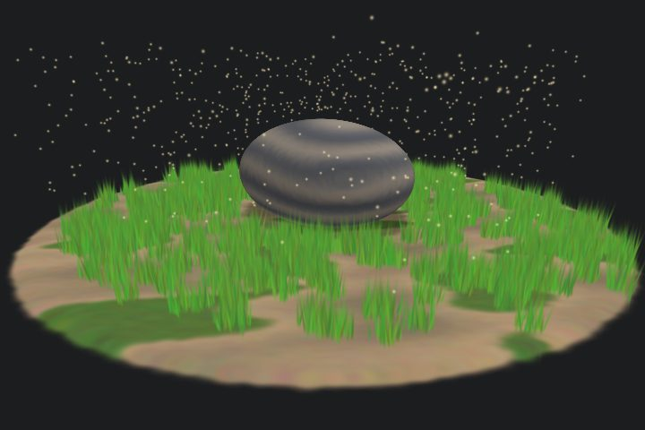
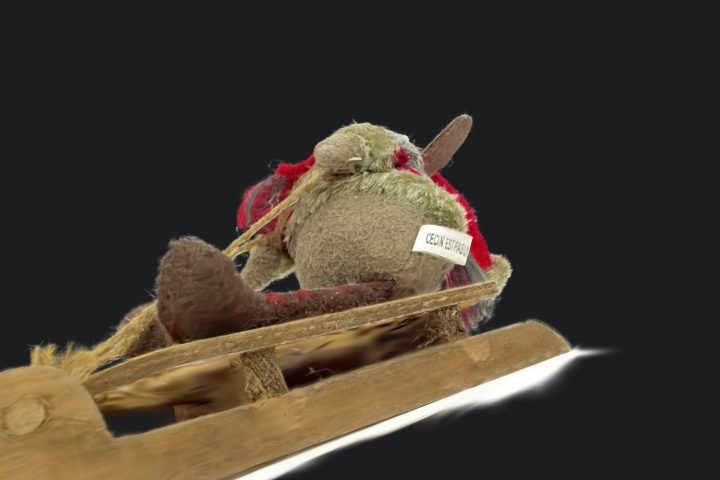

The splats are found by optimisation. Training starts from a sparse point cloud from photogrammetry (COLMAP). It
renders the splats, compares the result with the photographs, and adjusts every parameter by gradient descent, splitting
splats where detail is missing and pruning those that contribute nothing. This viewer only *renders* splats; it doesn't
train them.

## How they're drawn (the four files)

1. **`format.ts`**: the data. It reads `.splat`, the antimatter15 format: 32 bytes a splat, already decoded. It reads
   `.ply`, which the trainer writes: scales stored as logs, opacity before its sigmoid, colour as SH coefficients. It
   also generates a scene, *garden*, from shapes. The garden shows how surfaces are made: the ground and the stone are
   flat discs, each a splat squashed along its normal, and the grass is needles, each a splat stretched along one axis.
2. **`sort.ts`**: the order. Splats are translucent and blended, so they must be drawn back to front, and the order
   changes as the view turns. The sort is a counting sort on a 16-bit depth along the view direction: linear time, about
   12 ms for half a million splats on a laptop. It runs in a worker, so the page keeps drawing with the previous order. Only the
   view's direction matters, so it re-sorts only when the view turns.
3. **`render.ts`**: the projection. All the splats live in one integer texture, 32 bytes each. Each is drawn as an
   instanced quad, in the sorted order. The vertex shader projects the 3D covariance to a 2D one on the screen,
   Σ' = J W Σ Wᵀ Jᵀ. W is the camera's rotation and J is the Jacobian of the perspective at the splat's centre, the
   local linear approximation that makes the projection affine. The shader adds 0.3 px² so no splat is thinner than a
   pixel, takes the eigenvectors of Σ' as the ellipse's axes, and spreads the quad to 3σ along them. The fragment shader
   is the Gaussian itself: opacity × exp(−r²/2), blended premultiplied.
4. **`main.ts`**: the page: the orbit camera, the scenes, the controls.

The **see** buttons show the stages: *ellipses* draws each splat's 1σ and 2σ contours; *footprints* fills each quad
solid, which shows the overdraw that costs most on a phone; *centres* shows the point cloud alone.

## The research, briefly (late 2026)

- **Mobile web renderers.** Most still sort on the CPU in a worker and draw instanced quads in WebGL2, the approach
  antimatter15's viewer made popular. GPU sorting (bitonic or radix) is the next step. WebGL2 viewers such as
  Portality do it with bitonic sort.
- **WebGPU is where the frontier is.** WebSplatter (2026) does a wait-free GPU radix sort and reports that other WebGPU
  viewers crash or stall on mobile GPUs. Mobile-GS uses WebGPU where available and falls back to WebGL2 on
  Safari-class browsers. The order of work here is WebGL2 first, then WebGPU.
- **Compression matters more than anything for delivery.** PLY is about 250 bytes a splat with full SH. `.splat` is
  32 bytes, with no view-dependent colour. **SPZ** (Niantic) is quantised and gzip-compressed, about 10× smaller than PLY.
  **SOG** (PlayCanvas) stores attributes in WebP images, 15–20× smaller. These two are the formats to learn next.
- **Quality on phones.** Most of the cost is fill (overdraw from large translucent quads) and the sort, not vertex
  work. A lower resolution (the slider), dropping SH bands, and culling tiny or transparent splats are the usual levers.

Sources: [kishimisu/Gaussian-Splatting-WebGL](https://github.com/kishimisu/Gaussian-Splatting-WebGL),
[catid/Mobile-GS](https://github.com/catid/Mobile-GS),
[WebSplatter (2026)](https://www.emergentmind.com/papers/2602.03207),
[Portality](https://radiancefields.com/portality-webgl2-gaussian-splat-viewer),
[PlayCanvas splat formats](https://developer.playcanvas.com/user-manual/gaussian-splatting/formats/),
[SOG open-sourced](https://blog.playcanvas.com/playcanvas-open-sources-sog-format-for-gaussian-splatting/).
Captured scenes are the examples from antimatter15's viewer, hosted on Hugging Face.

## One Stone: splats as a drawing

`?scene=stone` (`stone.ts`). The idea is procedural drawing as a way to author a 3D world: each feature gets a way
of drawing itself, and the Gaussian is what the marks are made of. The interesting decisions are where a mark belongs,
what it describes, and when the drawing can do without it.

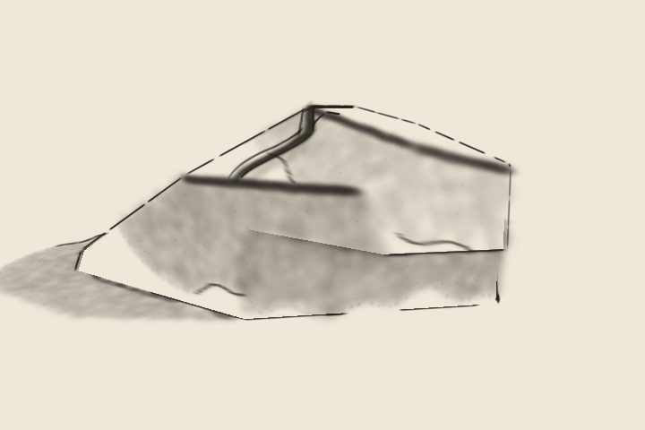
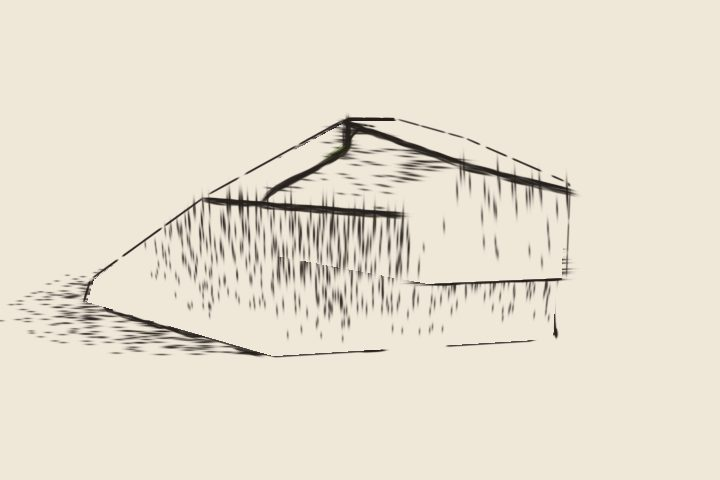
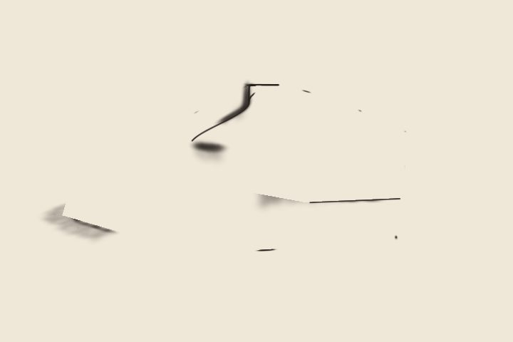

**The stone** is a cut stone of unequal geological planes on warm paper:
- a crown of two planes meeting off-centre (high toward the tall end, falling away to the tapering one: a wedge);
- bevels and slabs of different sizes, and one broken corner;
- on its back-left, a substantial projecting slab, whose face overhangs a deep recess with a flat soffit and a narrow
  crevice where they meet;
- a seam in a fracture plane, hooking over the crown.

Its mesh, rays, faces and edges are all exact, from the planes.

**Composed, not catalogued.** An earlier version simplified by category ("the wash goes first"). Thinning evenly
turned out to keep more of the planes than that did, and the sparse drawing became perimeter plus crack. So every mark
now belongs to a stroke, every stroke to a feature (the seam, the ledge, the foot, the crown, a face), and each
feature reduces within itself before it goes. Three states are composed deliberately (*state* buttons):

- **Sparse** (¼): a core of about eight groups, each kept small:
  - the seam with its hook, and a short wedge of shade in the fracture by the hook;
  - the lip, with a firm tone under it, and the dark crevice;
  - one turn of the crown, and the broken corner's accent;
  - one moss cluster on the seam;
  - two or three dark contact points at the foot;
  - a short wedge of tone at the heart of each shadowed plane.
- **Intermediate** (½): those grown, plus:
  - the planes' tonal shapes near their anchors;
  - the seam's branch and a second tuft;
  - a cast shadow with a direction;
  - profile accents from this view.
- **Resolved**: the tonal shapes in full, granulation, chips, loose stipple, every hatch.

**Tonal shapes.** A face in shadow takes a shape anchored on an edge: the arris it shares with a lighter face (its
terminator), or under the ledge, the lip. It's firm at the anchor (a dense band laid along it), softens away, and
its far boundary is uneven (a slow noise along the anchor sets how far it reaches). The darkest ink is kept to narrow
places: the crevice, the contact points.
- **Wash:** small dense discs at the anchor that never cross it, growing broad and faint toward the boundary.
- **Dry:** hatching in directional families (along the strike of a shelf face, down the dip of a steep one), in rows
  with deliberate gaps; the strokes are long and close at the anchor and shorter and sparser toward the boundary.

**The shadow** is cast: the stone's outline is pushed along the light onto the ground, firm at the foot on the far
side and fading along the light. The lit side of the base is only lightly and brokenly touched, and the darkest contact
is at two or three points.

**Contour** marks sit along every arris, each knowing both its faces' normals. One is drawn only where one face turns
toward you and the other away: the profile from this view, eased in as a face turns, broken into accents. The
fracture belongs to the rock and the contour belongs to this view of the rock.

**The brush develops a feature.** Touch the seam and its branch, chips and moss come. Touch under the ledge and its
underside develops. Touch a face and its tonal shape grows. Each feature comes back in its own order, heart first, so
what appears has the feature's shape, not the brush's. Keep brushing to develop it further. It's on the stone, so it
stays as you turn.

Renderer details that make it work: each corner of a mark's quad takes the depth of the surface it lies on, so broad
marks aren't cut by their own face. The stone's exact mesh is the depth-only occluder. `?only=wash` (or fracture,
contour, stipple, shadow, lip, chip) shows one kind of mark alone.

Boards: `node cells/lab/devtools/splats-stone.mjs [states|pairs|views|detail|occluder|brush] [wash|dry]`. *states* is
the main one: the three composed states from the reverse view (the projecting lip, the line-overhang-shadow
relationship it's built around), then the hero and grazing views by the same rules.

Next: the Bamboo connection. A cliff face could give up its wash while a ledge keeps its lip and a fissure its line.
A culm could keep its silhouette and nodes while its shaded body drops away.

## Brushes: a shared medium

`?scene=brushes` (`brush.ts`, `subjects.ts`). One Stone showed the ideas; this generalises them into a medium that
Taohua's lines and washes, Labyrinth's architecture, Bamboo's moving landscape and Autograph's gesture could all
share:

    scene structure → drawing instructions → strokes and washes → splats → image

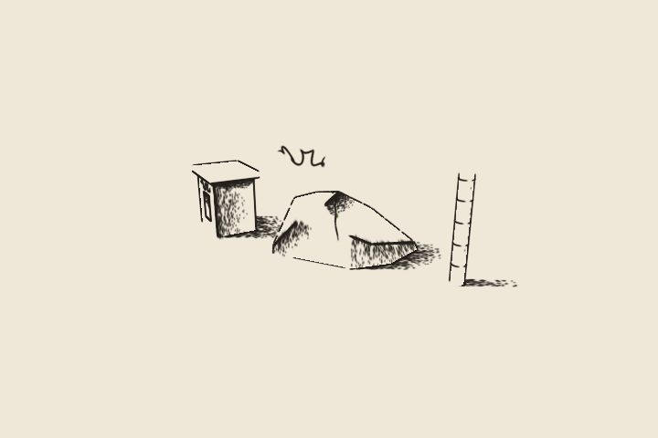

A **stroke** and a **wash** are objects that keep their identity: a path, a gesture, a material, a place in a group.
They become splats only when deposited, so a stroke can be shortened, re-pressured, regenerated at another density, or
withdrawn with its group, and its gesture is kept. There are three operations:

1. **Stroke along a path.** *Support*: on a surface (it lies flat and wraps over it) or in open space (round in
   section). *Gesture*: width, pressure along it, taper, breaks, tremor. *Material*: ink, dry (fragmenting where the
   pressure's light), wash-line.
2. **Wash within a region.** Any patch of a surface that can sample itself, test a point and project onto itself
   (a plane polygon, a cylinder, a strip beside a curve). It's firm along an anchor edge, softens away, has an uneven
   reach, and leaves places open. *Material*: wash (discs) or dry (hatching along a direction).
3. **Group.** A principal, its supports and its accents simplify together. The principal goes last, the wash withdraws
   toward its anchor, and the accents drop to the one that matters.

Each stroke names its heart (where its meaning lives), and reduces toward it.

The test is whether the same brushes, given only different paths, regions and anchors, can draw unlike subjects:
- **A stone:** the seam with its wedge, the lip with the underside and crevice, the faces' tones, and the profile.
- **A bamboo culm:** silhouette strokes up its facets, node strokes round it, and a shaded body that goes first,
  so it keeps silhouette and nodes as it simplifies.
- **An architectural corner:** the cornice's lip with the shade under it (the same relationship as the stone's
  ledge), a niche with its shadow, and the shadowed wall on the corner.
- **A written gesture:** one curve with a hand's pressure, drawn by the same stroke in open space and wrapped over
  the corner's wall.

`subjects.ts` makes no marks itself. Board: `node cells/lab/devtools/splats-brushes.mjs [wash|dry]`.

## Composed: one small scene

`?scene=composed` (`subjects.ts` `composedScene`, `edit.ts`). A stone, three culms and an architectural corner, with a
bank passing between them, drawn with the same brushes throughout:
- the corner behind the stone and to its left, its niche toward the camera;
- two culms behind it to the right;
- one culm in front, crossing the stone's right side.

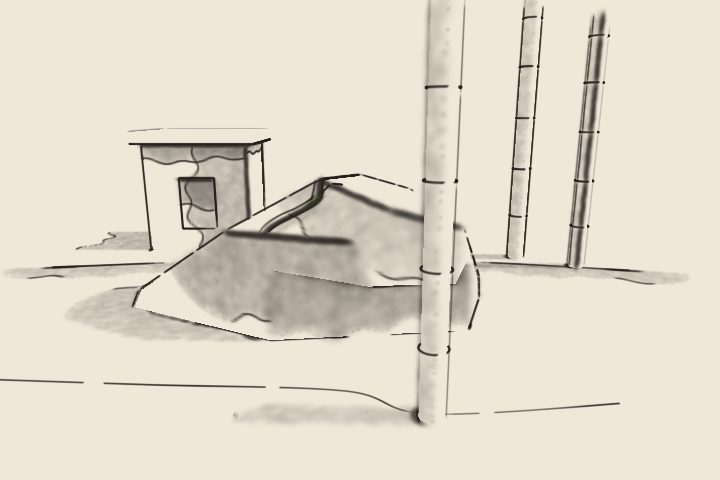
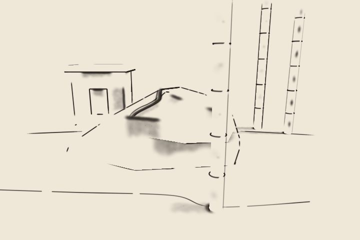
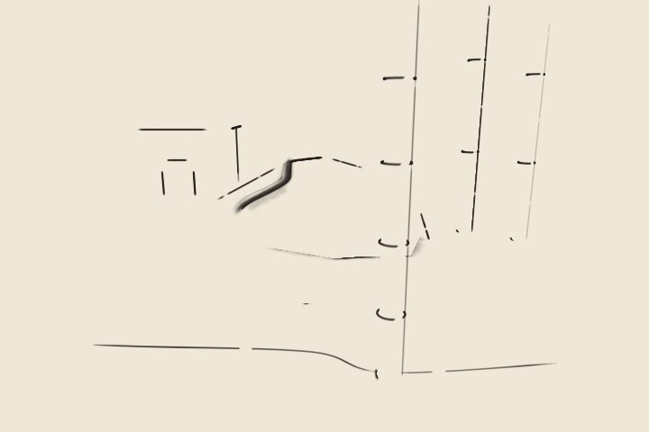

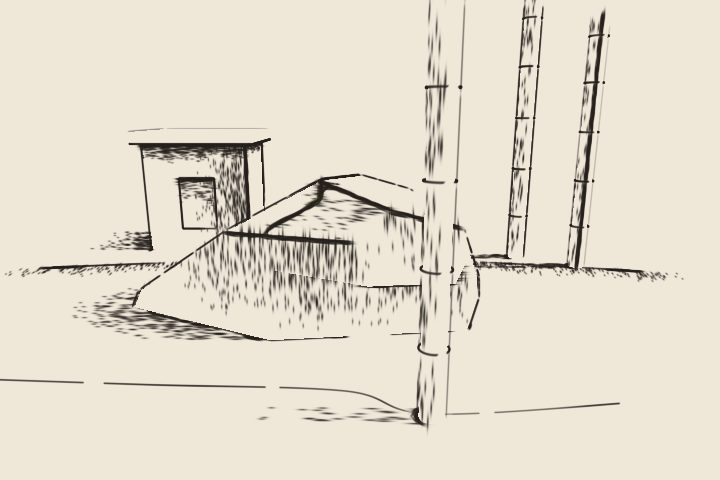

`?compose=0` (or the *relate* row) draws each object as if alone.

**Three decisions, made separately.** The first version scaled rank, width, opacity and wash depth together by one
"importance", which weakened a secondary object every way at once and didn't protect the subject's identity. Now:

| decision | controls | how |
|---|---|---|
| structure | which marks must survive, together, to explain shape, contact and overlap | each object's minimum description: its structural members, ranked to survive the sparse state at full strength |
| emphasis | where the strongest contrasts belong | only the contrast of material marks: lighter washes, thinner lines on lesser objects |
| material detail | what can go freely | everything else, ranked below all structure, lesser objects' first |

The minimum descriptions are authored:
- **stone:** the seam's hook with its wedge of tone, its lip with its underside shadow, its crown, and the upper
  silhouette's arrises (the crown ridge and the broken face's edges carry most of it).
- **culm:** the lit side's silhouette, continuous, and its nodes (all of them on the front culm, two on the others).
- **corner:** its turning arris, its cornice lips, and its niche's frame.
- **ground:** the line in front of the stone.

These follow the reference drawings (below).

**Groups are kept as objects** (`group()` returns members that point to their group, with its principal, supports,
accents and minimum). Structural washes fall gently from their anchor, so a group's minimum appears and goes together.

**Views** (main.ts, each frame, eased so nothing pops). Values computed from the view open and close gates (render.ts:
a feature with its top bit set is a gate), choosing among anchored alternatives without rebuilding marks:
- **The stone's lit-side alternative:** a little tone low on each lit side face. It opens as the stone's shadowed faces
  turn away; around 270° the stone was an empty outline.
- **A tone cap:** no other object's wash may carry more than 30% of the stone's tone as seen from here. Each wash is
  judged by its apparent weight: area × darkness × facing ÷ distance². At 180° the corner's shaded wall measured 62% of
  the stone's; it's now capped to about half its strength.

**Fixes from the review:**
- **One ground, order-independent:** every cast shadow is merged into one wash. Its region is the union of the shadows
  less every footprint; its anchor is every shadow's far side in pieces, each with its own reach.
- **Semantic keys** for every authored element (`stone/seam`, `culm-back/node/3`, `corner/wall/2-3`), so inserting one
  doesn't shift the rest.
- **The halo** now applies only to lines (ink strokes and profiles), never washes or contact accents, with one ring of
  eight reads instead of two.

**Material gestures:**
- **culms:** long loaded pulls, full at the foot and lifting toward the top; compressed nodes.
- **stone:** interrupted, slightly angular outline strokes.
- **corner:** measured, even edges, heavier only where a lit wall turns into a shaded one.

**Editing in the scene** (the Bench's editor, generalised, `edit.ts`):
- the stone's **seam** (its wedge follows), its **lip** (its soffit's shade follows), and the **bank** (its slope
  follows);
- bend them by handles that displace the authored path smoothly, so the seam keeps its jaggedness;
- change pressure (presets, or *as made*), weight and material, and widen or narrow the anchored wash;
- undo.

An edit deposits again only the stroke and its washes (2 of 168 elements).

**Checked** (`splats.test.mjs`):
- shadow marks under another object's footprint (the stone's included): 0;
- the same drawing, element for element, when the objects are made in reverse order (163 elements compared);
- no element keyed by its position in its scope;
- every object's minimum survives the sparse state;
- each group's minimum goes together (within the 0.04 fade band);
- the same element on the three culms goes earlier the less it's emphasised, and all material detail ranks below all
  structure (0.79 < 0.88);
- the seam, bent and re-pressured in the scene, undone exactly.

**Motion** (`node cells/lab/devtools/splats-motion.mjs`): an orbit stepped 10° at a time, with frames rendered at each
step so the eased gates move as they would.

| configuration | change per 10° step (median) | largest | largest / median |
|---|---|---|---|
| sparse | 3.4 | 4.0 | 1.16 |
| resolved | 13.5 | 15.9 | 1.17 |
| resolved, no halo | 13.7 | 16.1 | 1.17 |
| sparse, no halo | 3.7 | 4.7 | 1.25 |

No step stands out, so nothing pops at this resolution. A 10° step is coarse, though: a small mark appearing could hide
inside the camera's own motion. Finer steps across the gates' transitions would be a stricter test.

**Edit latency** (headless Chrome, software GL; upper bounds for the CPU side, not phone timings):

| edit | deposit | assemble and upload |
|---|---|---|
| seam | 4 ms | 21 ms |
| bank (its slope is a large region) | 100–200 ms | about 15 ms |

**Reference drawings** (`devtools/splats/targets/composed-{sparse,intermediate,resolved}.jpg`). Three studies of
this scene, made as artistic targets. Because they're generated, their geometry is close to the scene's but not the
same, so they're judged by eye for *what survives together*, not compared pixel by pixel or used as training pairs.

| state | the targets keep |
|---|---|
| sparse | the stone's upper silhouette, broken and angular; its crack with a small dark wedge; its overhang's edge with a dark wedge of underside shadow; the front culm as one continuous side with compressed nodes; the back culms as single lines with node ticks; the corner as cornice edges, one arris and the niche's frame (no sill); one ground line running into the culm's foot |
| intermediate | the stone's full outline with its lower blocks; tone along edges; a broader underside shadow; culms with both sides and light tone; the cornice's thickness; the niche's inner shade |
| resolved | full tone, moss, cast shadows on rising ground |

What changed to follow them:
- **The scene is laid out round the stone's designed side.** That's its reverse view, where One Stone put its seam,
  lip and overhang. The composed scene had placed everything round the other side, so its strongest features faced away
  from the main view.
  - Places are now given across and along a reference camera's view (`REF_CAM`, `PLACES`, `?cam=ref`, the composed
    scene's default).
  - Light comes from the picture's right, where the targets' comes from the left.
- **The pairs that survive together are now structural:**
  - crack with wedge; lip with underside shadow;
  - one culm side with its nodes (the lit side; the shaded side comes at intermediate);
  - the niche's frame; the corner's turning arris;
  - the stone's upper silhouette only (its lower outline comes at intermediate);
  - a ground line in front of the stone, running into the front culm's foot.

  The bank behind and the stone's and corner's contacts became detail.
- **The rules keep no non-structural tone at the sparse state,** where they had been leaving blobs of the culms' body
  tone.

Board: `node cells/lab/devtools/splats-targets.mjs [wash|dry]`: each state beside its target, by ranks and by rules.

**Gaps against the targets:**
- **The stone:** theirs is a tall tilted block filling most of the width, with the overhang's underside wedge as the
  strongest mark at sparse. Ours is lower and boxier from this side, so that wedge reads weakly. That's geometry, not a
  drawing decision.
- **Missing pieces:** the culms don't lean, and there's no moss or rising ground.

Boards: `node cells/lab/devtools/splats-composed.mjs [wash|dry]`:
- states with and without composition;
- the orbit at sparse and resolved, with the stone's visible tone per view;
- close inspection;
- editing in the scene.

**Still open:**
- **Shadows on objects:** the back culm stands in the stone's shadow but is drawn lit.
- **The tone cap only dims.** It can't choose a different, lighter description of the corner; from behind, its dry
  hatching is still heavy.
- **The bank is a line on flat ground,** with no rise in the geometry.
- **Washes are still smoky patches more than connected tonal shapes.**
- **The phone is unmeasured.**

## The pen: Autograph's hand and tool in the Splats brush

`?scene=pen` (`pen.ts`, `penscene.ts`; `&part=word|board|culm|bank`, `&reference`). Three experiments each had part of
a drawing medium:
- **Autograph** has the most developed model of *making* a mark: a hand that plans and moves, a pen that answers the
  movement.
- **Bamboo** has the most developed model of *where* marks belong: which edges describe a real change of mass, where a
  trail cuts a bank, how a broken line withdraws.
- **Splats** keeps the mark as an editable object in space.

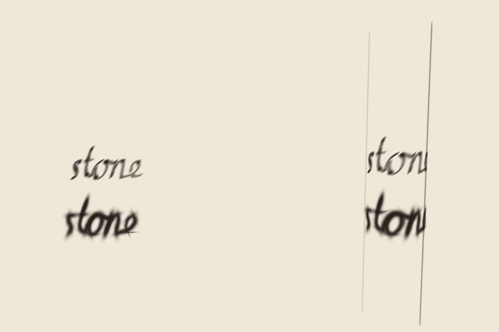

Until now the Splats brush's "pressure" was a prescribed width profile along a supplied path: convenient and
controllable, but a mark didn't look as it did because of how it was made. This brings in Autograph's hand and pen,
reused rather than copied (`move()`, `body()`, `widths()`, `BROAD`, `LOUD`, `INK` exported from Autograph, unchanged):

| part | responsibility | here |
|---|---|---|
| drawing rules | what to describe, which marks belong together | Bamboo (its bank-rim selection and dashes, unchanged) |
| hand (optional) | a timed trajectory from a plan | Autograph's `move()` (speed by the two-thirds power law, rest at the ends, stops at cusps) and `body()` (a critically damped follower: hurried, it rounds corners) |
| tool | movement and carried state into material | **the pen**: Autograph's rules for speed, broad nib, press, voice and ink; a nib-aligned Gaussian at every step |
| spatial support | where the page goes in space | `planeMap`, `cylinderMap`, `groundMap`: the nib keeps its angle to the surface |
| deposition and display | splats, rendered | Splats |

**How the pen keeps the tool's character in splats:**
- The nib is an elongated Gaussian laid along its edge at every step. Moving across the edge sweeps a broad band;
  moving along it leaves a hairline. The contrast comes from the tool's shape, not from a width profile.
- **No self-darkening:** a step's opacity is shared among the steps that overlap it along the motion. Where a stroke
  crosses itself, the later pass leaves what the earlier one laid. That's the splat equivalent of Autograph's union of
  swept shapes.

**Astra's three questions, answered** (`splats.test.mjs`, a CPU rasterisation at fine resolution):

| question | result |
|---|---|
| does the broad nib keep its directional character? | 56.9 mm moving across its edge, 5.0 mm along it: **11.4×** |
| is the tone held without accidental darkening? | peak darkness 0.85 whichever way it moves; a self-crossing 0.83 against the line's 0.87 (**0.99** without the union) |
| does the gesture keep its character on a curved surface? | wrapped round a cylinder: 56.9 mm and 5.0 mm, the same **11.4×** |
| does ink behave? | a long stroke goes from 0.84 to 0.35 as the pen runs dry; after a pause it's dipped (0.85) |

**On the boards** (`node cells/lab/devtools/splats-pen.mjs`):
- **The word:** Autograph writes "stone" with the broad pen, timestamps and pen state kept. On a board and round a culm,
  the pen gives the broad nib's contrast (full downstrokes, hairline joins), close to Autograph's own rendering
  (overlaid with `&reference`). Today's static stroke along the same path is uniform and blobby. Wrapped round the culm,
  the contrast survives, foreshortened toward the edges.
- **The bank:** one of Bamboo's bank rims (seed 1, chunk −2,−2), chosen and broken into dashes by Bamboo's own drawing
  (`strokes.ts` now reports each rim run it draws through an optional tap; its output is unchanged, byte for byte).
  - Left: today's brush, width and strength from Bamboo's weight.
  - Right: moved by a hand (a looser one than writing) and drawn by the pen. Each dash is its own stroke with the pen
    lifted between, press from Bamboo's weight, ink running down and dipped at the pauses.

  The difference is real but quiet at this scale: the pen's dashes thicken and thin with their direction and press.

**Gaps:**
- **Tone on screen:** the pen is paler than Autograph's solid ink at viewing distance. The nib's thin edge is under a
  pixel, and the renderer's minimum footprint spreads its opacity. A minimum on-screen thickness, or rendering the
  hairline as its own splat, would help.
- **The nib's frame:** its angle is fixed to the surface. A pen held against the picture plane (the page as seen) is a
  different and equally valid choice, not tried.
- **Hand settings:** the bank's hand was chosen by eye (pace 5, stiffness 45). Bamboo's other features (contours, cut
  edges, rock rims) aren't routed through it yet.
- **Editing:** now joined. The brush has a `pen` material (`material: 'pen'`, with a manner: voice, pace, press).
  A pen stroke is unbent into a flat curve with the same lengths and turns, timed by Autograph's `move()`, and laid
  back on its surface by `penStroke` (pen.ts). The composed scene's plain ink lines (edges, nodes, culm sides, the
  corner) all go through it, each subject with its own manner: the stone deliberate (pace 9, voice 0.3), the culms
  quicker and louder, the corner ruled (voice 0). An edit changes the path, and the hand re-times and redraws it. The
  Bench's material buttons include `pen`. Strokes with a profile (the seam's wedge, contacts) keep the round brush.

### Washes as tonal shapes

Washes were cloudy stipple, not tone. A `wash` (not `dry`) now has a pooled edge. Along the firm side, a thin run of
narrow marks sits a little inside the boundary, a touch darker: the rim where wet pigment dries. The body is laid
with fewer, larger, steadier marks, darkest near the firm edge and fading inward, so it reads as one connected tone.
Rare specks give granulation. `edge: 'soft'` turns the rim off. Washes now make up about 18.6k of the composed scene's
34.7k marks, up from about 24.6k in all.

The first pass was better but still mottled at viewing distance: the tone depended on where random marks clumped and
left gaps. The body's marks are now spaced (blue noise: each kept a minimum distance from the others), at a steadier
size, so a wash reads as one flat graded tone with its rim. That also cut the mark count back (the composed scene is
about 38.7k with the additions below).

### One brush for the One Stone

`?scene=stone` used to be drawn by about 230 lines of bespoke marks in stone.ts: its own seam, wedge, chips, moss,
hatching, contours and shadow. Those are retired. The study is now the composed scene's stone, made of brush elements,
its plain lines drawn by the pen in the stone's manner (`stoneDrawing`). Three things it lacked were added as brush
elements, so the composed stone has them too:
- the seam's branch (a lesser fracture);
- three moss clusters (small dry washes in moss green, accents of the seam's group);
- a light, broken base line where the stone meets the ground, so its lower outline reads where no arris shows it.

The chips were dropped. stone.ts now holds only the stone's shape: its planes, mesh, ray, faces, arrises and tone.

### A Bamboo passage: rock and bank (`?scene=pen&part=rock`)

This is one real Bamboo passage drawn only by the brush (rockbank.ts). The scene picks the biggest outcrop on Bamboo's
slope (seed 1) with a bank rim within a few metres. The outcrop is a slab, about 2.3 × 2.0 × 1.2 m, with eight
neighbours and fragments round it. Each of them is drawn as Bamboo made it:
- **the blocks' edges:** as Bamboo inks them (crest, sides, joints, foot), each a pen stroke. The crest is loudest,
  the foot pressed, the joints light and broken.
- **their shadowed faces:** the blocks' own triangles grouped by plane, each face turned from the light washed in a
  pooled wash anchored on its top edge.
- **the bank's rim:** in the dashes Bamboo broke it into, by the pen, with press from Bamboo's weight.
- **the bank's slope:** between the rim and the trail's edge below it, one pooled wash anchored on the rim.

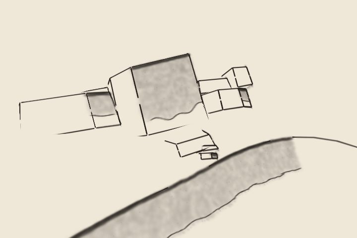

The blocks' meshes and Bamboo's ground are the occluder. The ground is sampled finer than Bamboo's cells and set a
little low, so it doesn't cut into the slope's wash. In all: 21 faces washed, 79 edges, 3 dashes, about 22k marks.

**Gaps:**
- The far edges of the washes still wave regularly (the brush's two-sine unevenness).
- The blocks have no cast shadows yet.
- Bamboo's escarpment blocks are left out: one tier alone reads as nothing, only the formation does.

### Measuring on a phone (`&perf`)

`?scene=composed&perf`, `?scene=mist&perf`, `?scene=room&perf` and `?scene=walk&perf` run a fixed benchmark while the
camera turns:
- **composed:** resolved, halo and ranks; resolved without halo; sparse with halo; sparse with rules; resolved with
  rules;
- **mist:** stored, analytic and neural lighting;
- **room:** each region with the water's mirror and the sway on and off, then the scene drawn 2 to 16 times over;
- **walk:** the canopy from 12, 5 and 1.5 m, then drawn 8 to 128 times over.

Each phase settles for 1.5 s, then records for 6 s: fps, p50 and p95 frame time, p50 and p95 draw time (each frame
is waited for with a one-pixel read, so its cost shows whatever the display's rate), sort time, and policy time. Then it
times ten seam edits (deposit and upload). A table appears with the GPU name and a copy button. It's also kept in
`localStorage` (`splats-perf`) and on `window.__perf`. Headless Chrome uses software GL, so only a real device's
numbers mean anything (`devtools/splats-perf.mjs` just checks that it runs).

## A drawing policy: learning which marks to keep

`policy.ts`, `?scene=composed&policy=ranks|rules|learned`, `?judge`. The idea comes from the Mist experiment,
generalised: use an expensive process offline to teach a compact model a useful decision. Here the decision is which
marks best describe the scene at a given detail and view, decided at the level of groups, above deposition.

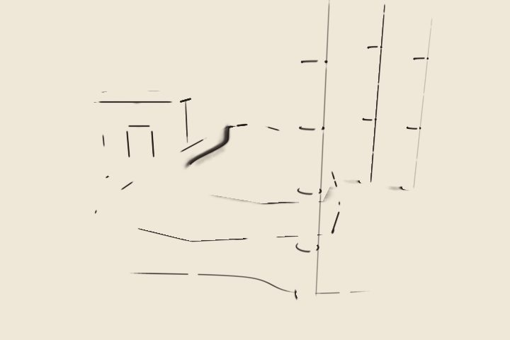
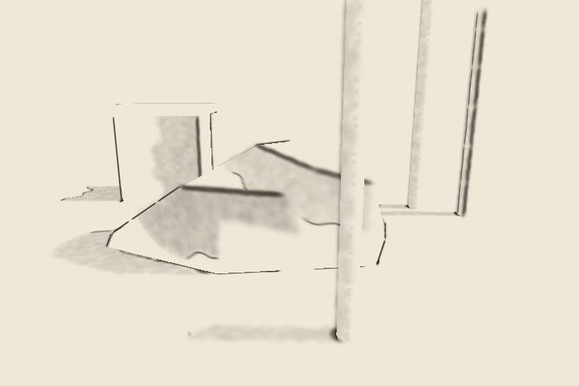

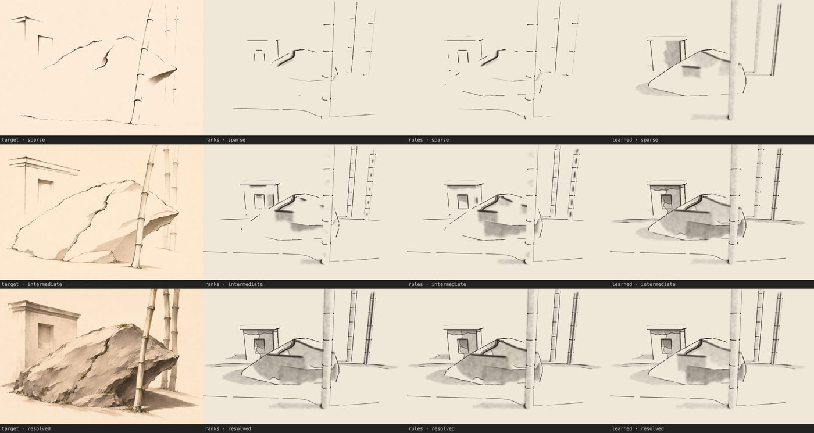

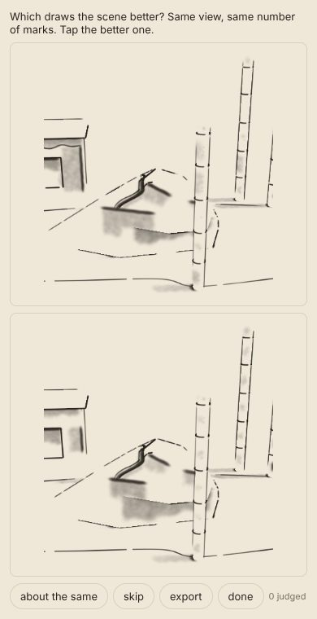
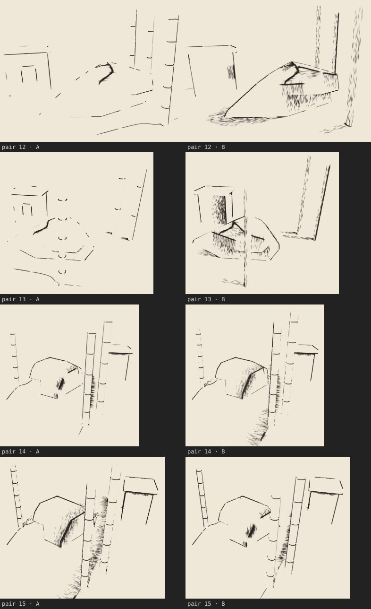

**What a policy controls.** For each group (a seam with its wedge, a cornice with its underside, a culm's sides), a
treatment:
- **extent:** how much of the group survives, heart first by its marks' ranks;
- **strength:** a multiple of its marks' opacity.

The brushes still make every mark, so identities, anchors and editability are untouched. The renderer reads each mark's
group (a 24-bit index in the third texel) and the group's control (a texture of thresholds and strengths).

**Its inputs**, per group per view:
- role (line, edge, contact, tone or ground), and whether it's structural or an alternative;
- its object's emphasis;
- projected size, how far it faces the eye, and how much of it a nearer object hides (tested against stand-ins for each
  object's shape);
- how many other objects' groups crowd it on the screen;
- the detail asked, and the previous decision.

**Policies, always compared at the same mark budget** (the number of marks the ranks would keep at that detail):

| policy | how it decides |
|---|---|
| ranks | the scene's own ranks against the global detail: no control |
| rules | hand-written rules over the inputs (structure keeps a floor; tone only as far as it faces you; hidden or tiny detail keeps less; lesser objects give way where they crowd; contacts stay strong), scaled to the budget |
| learned | a small model (the group's features plus the treatment, 2 × 12 hidden units) scores each group's possible treatments; each group gets the best score less a price per mark, the price found to meet the budget, the rest filled greedily |

All three draw through the same controls. Treatments are eased between frames, and the target is worked out every third
frame.

**The teacher is you.** A good sparse drawing is an artistic judgement; training on the rank rules would only reproduce
their limits.
- `?judge` (or the *judge* button) shows two treatments of a random view at the same budget, unlabelled and in random
  order: the rules against a variation of them, the rules against the ranks, or (once there is one) the model against
  the rules.
- Tap the better one, or *about the same*. Choices are kept in the browser, rejected treatments included. *Export*
  downloads them as JSON.
- Put the JSON in `devtools/judgements/` and run `node cells/lab/devtools/splats-policy-train.mjs`. It fits the model by
  pairwise logistic loss (a drawing's score is the sum of its groups') and writes `policynet.ts`. It needs at least 20
  decided pairs.

**What's checked so far:**
- Budgets: rules keep 12,841 of 12,840 marks, a model 12,831 (`splats.test.mjs`).
- Extent 0 keeps none of a group and 1 all of it.
- **The machinery, on synthetic preferences only** (`--synthetic`): pairs labelled by a hidden utility written in the
  trainer. The fitted model agrees with it on 100% of held-out pairs, and its policy beats the rules by that utility in
  20 of 30 fresh views. That shows the pipeline can learn a preference and act on it at a fixed budget. **It says nothing
  about drawing quality.**
- Motion (`splats-motion.mjs`): the rules policy over a stepped orbit at sparse has its largest step at 1.21× the median
  (ranks: 1.16). Its median change is higher (4.7 against 3.4) because it spends marks on larger elements such as the
  bank.
- Cost (Node on a desktop): the inputs plus rules take about 1.5 ms a frame; a model about 4.5 ms, which is why the
  target is recomputed every third frame. Unmeasured on a phone.
- `node cells/lab/devtools/splats-policy.mjs [wash|dry]`: ranks against rules at the sparse state from six views (same
  budget), and the judging page.

**Not yet:**
- **Judged:** 31 pairs by the author on a phone, then 32 by Claude from headless boards
  (`devtools/splats-selfjudge.mjs make 16`, then `save ABsA…`), on the same criteria: a seam hook kept, a lip with
  its shadow, a closed silhouette, things grounded, one picture rather than clutter. Leaving out ties, that's 59 pairs.
  The model agrees with 82% of the pairs it was trained on and 83% of held-out pairs. The two figures agree, so the
  two teachers seem to agree.
- **What the judgements say:** the rules beat the ranks 13 to 3, and random variations of the rules beat the rules 13
  to 2. At the same budget the preferred drawings keep less structural outline, especially the stone's edges and the
  corner's lines, and more contacts, tone and grounding: masses, not contours. *learned* is now the default. At sparse
  it draws the stone as a mass with its shadow, where the rules keep broken outline. What it loses there is the seam's
  hook, which the reference studies always keep.
- **Unseen arrangements:** a policy trained on this layout should be tested on others.
- **Groups are judged one at a time.** The competition input summarises their neighbours, but a whole-composition
  judgement (balance across the picture) isn't modelled.
- **Reference fitting** (adjusting the instructions to match target images, as DiffVG does for vector shapes) is a
  separate, optimisation-only path, not started.

## Captured scenes in ink: the splats drawing themselves

Everything above lays strokes made by procedure. That uses Gaussians as stamps, not as what they are: a soft field
fitted to a real thing, that a phone can capture. `?scene=nike&ink` (or *plush*, *train*, a URL or your own file, with
the *ink* button) draws a captured scene in ink from its own splats (ink.ts). Every splat stays where it was captured,
with its own shape; what changes is what it means:
- **paper:** each splat as a paper-coloured body at its own opacity, always kept. The thing still hides its own far
  side, so it's opaque where it is and blank paper where it's lit.
- **outline:** each surface splat gets a thin ink disc facing outward, shown only from where it's near edge-on (mark
  kind 9, decided in the shader every frame). A disc seen edge-on is a short line, and the surface's discs that are
  edge-on from the eye are the ones on its outline. So the contour comes out of the field itself, from any view, with
  nothing traced.
  - Which splats are on the surface, and which way is out, comes from their neighbours: a splat well off its
    neighbours' centre is on the surface, and its offset is outward. These directions are smoothed over neighbouring
    cells, one disc a cell, none where the neighbourhood is thin.
  - The capture's own discs were tried first. On fur they point every which way, so the "outline" fired everywhere as
    hatching.
- **tone:** each splat darker than the scene's paper level, or darker than its neighbours, also as ink, its opacity in
  four steps and ranked by darkness. So the detail slider develops it from the darkest masses down. A capture's
  long, thin splats turn into hatching of their own: the shoe's mesh upper and swoosh draw themselves.

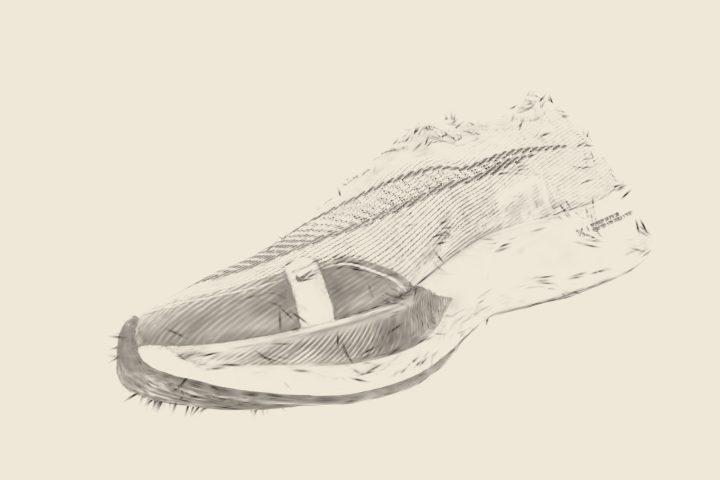
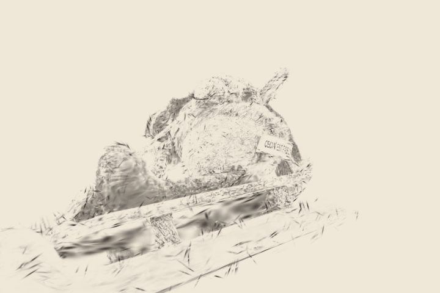

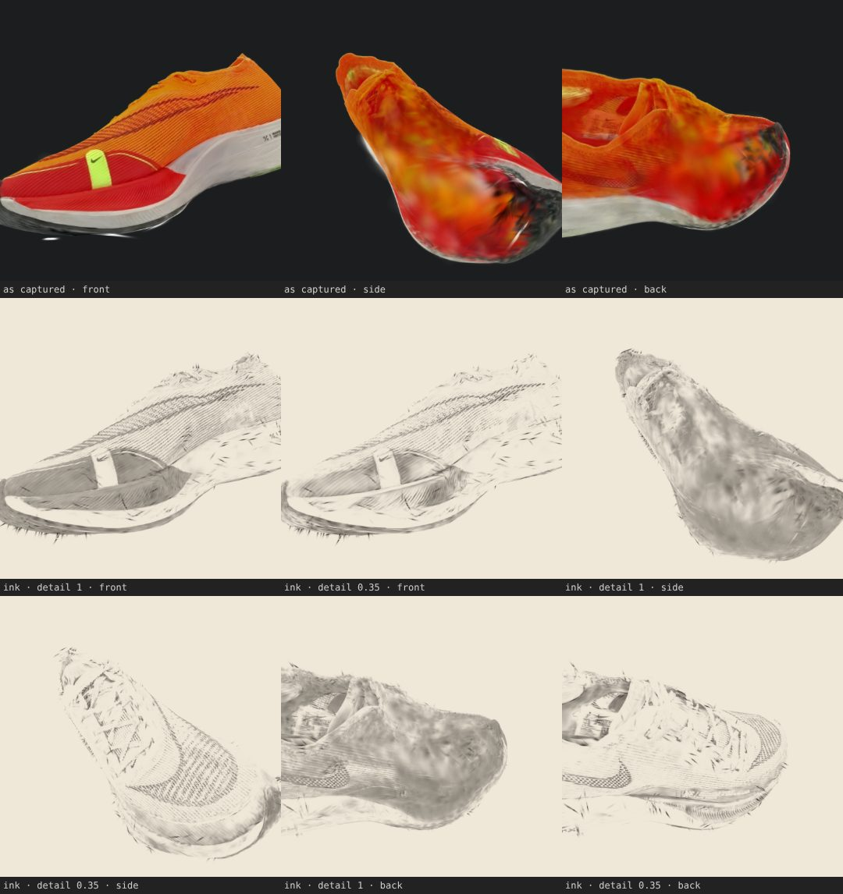

The shoe at half detail reads as a pen sketch from the front. The plush reads but is busy, because fur is noise at
this scale. Both captures are only good from the front, inked or not.

**Gaps:**
- Nothing yet chooses what to keep the way the composed scene's policy does. Ranks are darkness and size, and could
  be judged and learned the same way.
- Tone is a lightness threshold, not light: a dark object is all tone.
- Outline discs are one size. A capture's fine detail (laces, stitching) would want smaller ones where the surface
  curves tightly.

## A drawing fitted as a field (`?scene=field`)

Can a drawing be what splats are, a field fitted to pictures, rather than strokes placed by procedure? This is the
first, bounded test, on the stone.
- **The teacher:** the brush-drawn stone (`?scene=stone`), rendered by the real renderer from 36 views round it at
  three heights, at 160 × 120 (`devtools/splats-field-targets.mjs`). 12 views between them are held out.
- **The field:** 16,751 small flat discs laid evenly over the stone's surface (12,853) and the ground round it
  (3,898), their places and shapes fixed. What's learned is each disc's ink opacity as a function of the direction
  it's seen from: a logit in nine low-order terms of the view direction (constant, linear, quadratic), the way a
  radiance field's colour depends on view. So a mark can be there from one side and gone from another.
- **The fit:** `devtools/splats-field-fit.mjs`, in Node, by gradient descent (Adam, 300 iterations, about 6 minutes)
  through a small splat renderer written for it.
  - Ink is composited as ink is: each mark absorbs a share of the light, so a pixel's light is the product of
    (1 − αG) over the marks there. That doesn't depend on order, and its gradient is exact and cheap.
  - Since every mark is one ink colour, the real renderer's sorted blending gives the same result.
  - Discs behind the stone from a view are left out, using its mesh rasterised per view.
- **The baseline:** the same discs with one constant opacity each, no view dependence.

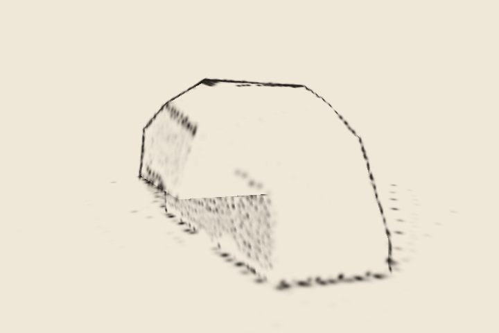
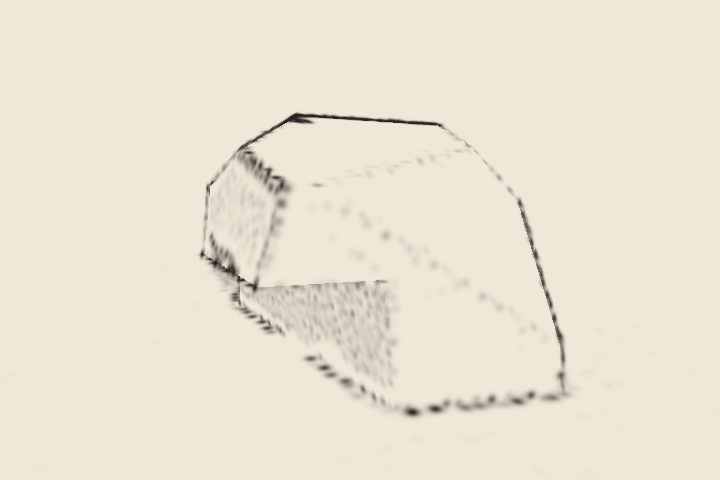

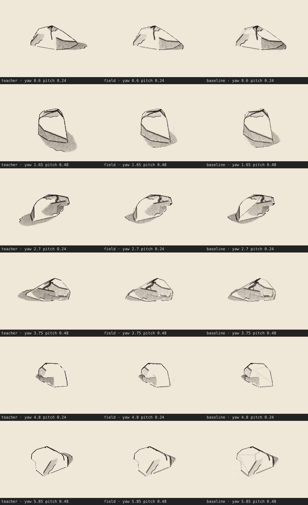

**Result:** on the held-out views, the mean squared error (× 1000) of the drawing's darkness is:

| | held-out error |
|---|---|
| blank paper | 26.3 |
| constant opacity (baseline) | 4.45 |
| view-dependent field | 3.52 |

That's 21% lower than the baseline. On the board (`devtools/splats-field-board.mjs`, the real renderer at twice the
fitting resolution) the difference is the point of the experiment:
- **The baseline draws ghost lines across every face.** With one opacity, a line must exist from everywhere, so it
  becomes a faint average of all the stone's edges.
- **The fitted field shows each edge only where the teacher does.** It learned, from pictures alone, which edges to
  draw from which side, on views it never saw. That's the contour rule the brush hand-codes (a profile shows only
  edge-on), recovered as a property of the field.

The renderer evaluates each disc's opacity from its terms every frame (mark kind 11). The terms are packed into the
bits a drawing's feature and element ids use; the file stores 19 bytes a disc.

**Gaps:**
- The field's lines are thinner and greyer than the teacher's, its cast shadow fainter (the ground discs are coarser),
  and the seam's darkest stroke softer. Only opacity is fitted: the discs' places, sizes and orientations aren't.
- It overfits a little (training error 2.81 against 3.52 held out).
- The teacher is our own procedural drawing. The real test is to add the reference studies as teachers from their
  view, or to fit a captured scene's ink to drawn views of it.

### The whole composed scene as a field (`?scene=field&field=composed`)

This is the same fit at scale. There are 33,730 discs over every object (the occluder's triangles, each faced away
from its object's middle) and the ground round the scene. The teachers are the composed scene at full detail, from
36 views orbiting the reference camera's target at its distance, at 192 × 128, with 12 views held out. The fit took
200 iterations, about 4 minutes.

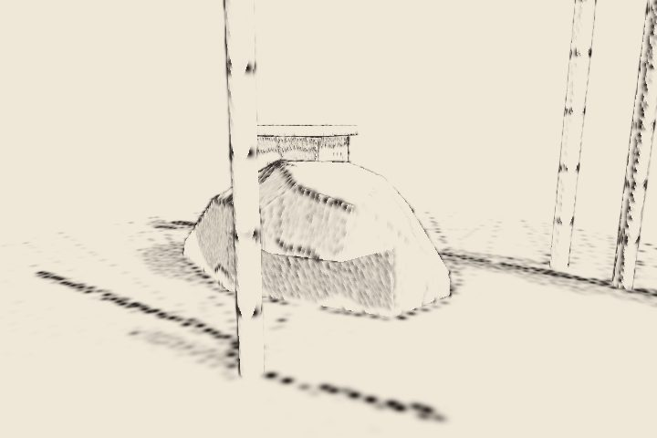

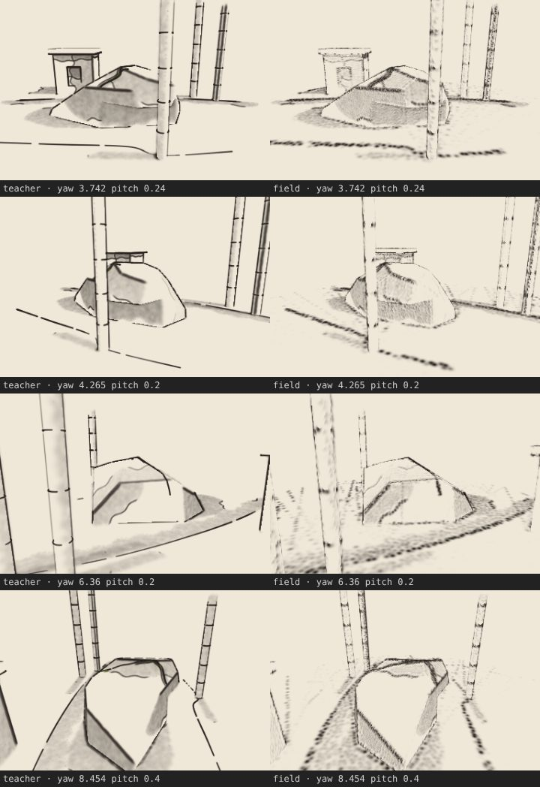

| | error (× 1000) |
|---|---|
| held out | 18.8 |
| training | 10.8 |
| blank paper | 66.8 |

From views it never saw, it draws the stone with its washes, the culms with their nodes, the corner and the ground's
lines. The gap between training and held-out error is wider than the stone's: thin culms and more occlusion, with the
same number of views.

**Gaps:**
- The ground lines (the bank, the foreline) come out beaded. The ground discs are 4.5 cm apart, too coarse for a thin
  line.
- The stone's washes are streakier than the teacher's.

### The reference studies as teachers: not as they are

The plan was to add the resolved reference study as a teacher from its own view, to see whether a drawing's character
carries round the scene. It can't be done honestly with the studies as they are:
- **Global alignment fails.** Matching the study's darkness to the scene's by a scale and shift settles on the wrong
  match: the study's culms land on the stone.
- **A camera doesn't fix it.** Fitted from seven landmarks marked by eye (`splats-field-refcam.mjs`), the best camera
  is closer and narrower than the scene's (field of view 24° against 50°). It still leaves the landmarks 14 px off
  (RMS, at 192 wide).
- **A warp doesn't fix it.** A thin-plate spline through the landmarks (`splats-field-warp.py`) hits them exactly but
  distorts everything between: the cornice stretched upward, the study's stone running into the culms, its front
  culm leaning where the scene has none. After the warp, the correlation with the scene drawn from that camera is 0.11.

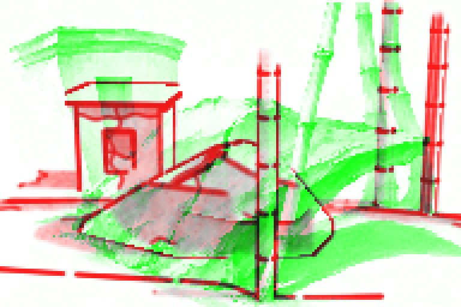

The studies are compositions after the scene, not drawings of it. Used as pixel teachers, they'd teach the field
their marks in the wrong places.

**What would work:** a drawing made over the scene itself. `devtools/splats-field-canvas.mjs` renders the composed
scene at the studies' size (1024 × 683) from the reference camera and a view either side, each with its camera
(`devtools/out/field/canvas-*.png`, `canvases.json`). Redrawn in the studies' manner with the geometry kept exactly,
for instance by an image model told to restyle without moving anything, a canvas becomes a teacher directly:
`splats-field-redrawn.py <image> ref`, then `splats-field-fit.mjs composed wash 200 --ref=redrawn-ref`. One view
redrawn tests whether the character carries to the views either side. Two or three redrawn test whether it carries
round.

### Drawn teachers: wireframes restyled by an image model

Since the studies can't teach, the scene supplied its own canvases. `devtools/splats-field-wire.mjs` draws the composed
scene's real geometry from six views, at 1024 × 683, each with its camera:
- the meshes' creases and silhouettes, hidden lines removed;
- the stone's seam, the culms' nodes and the corner's niche.

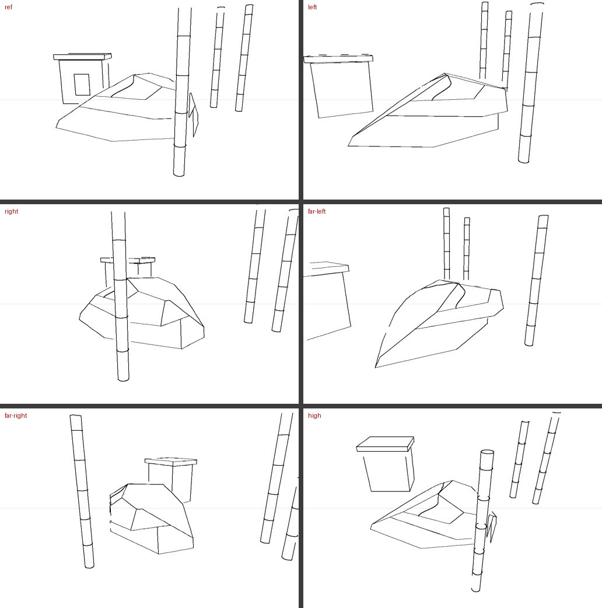

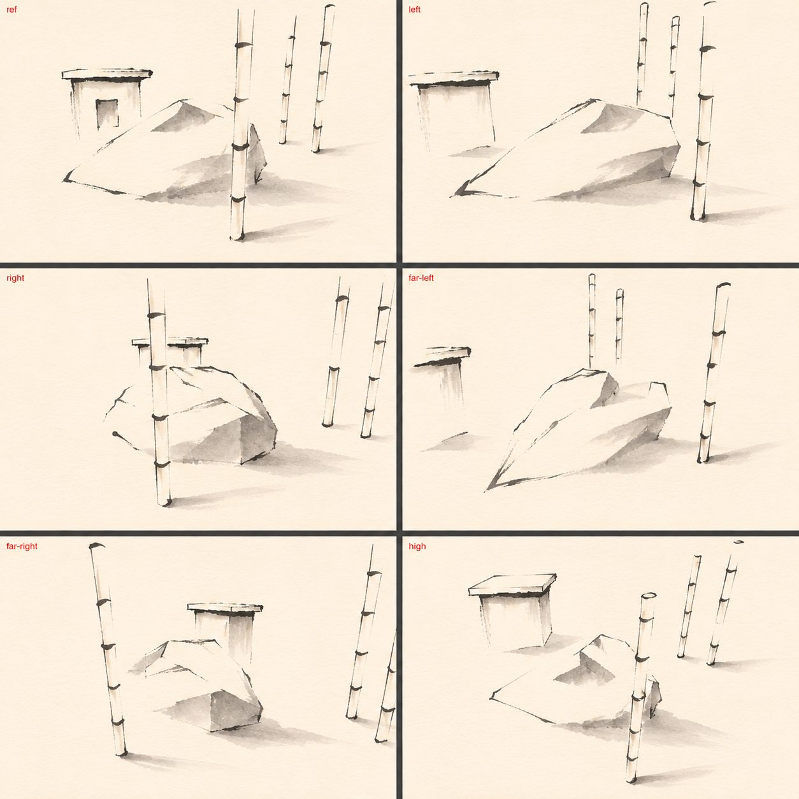
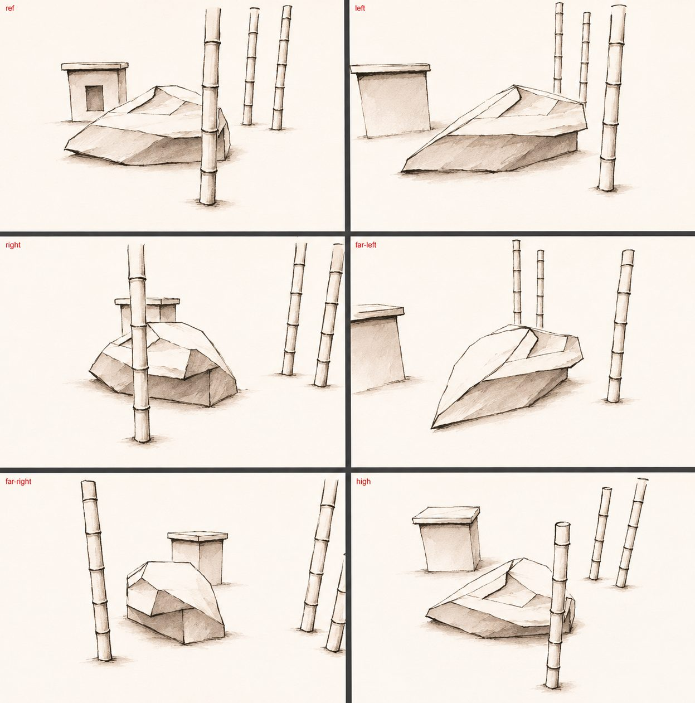
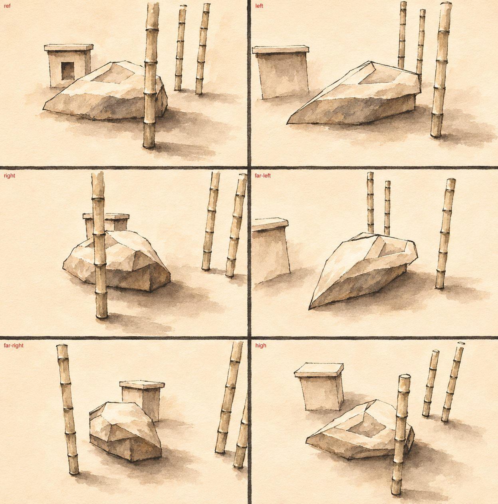
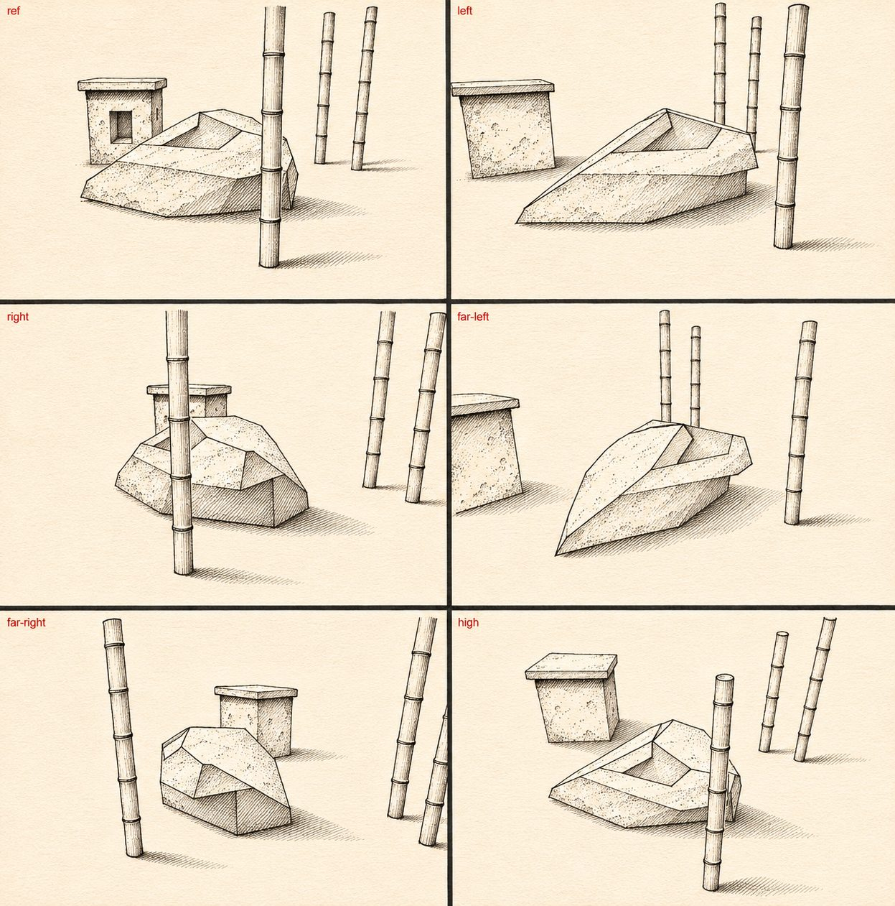

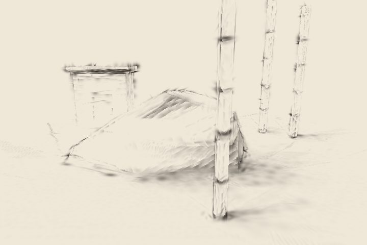
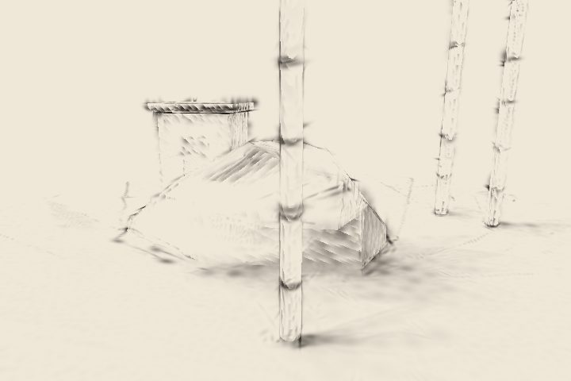
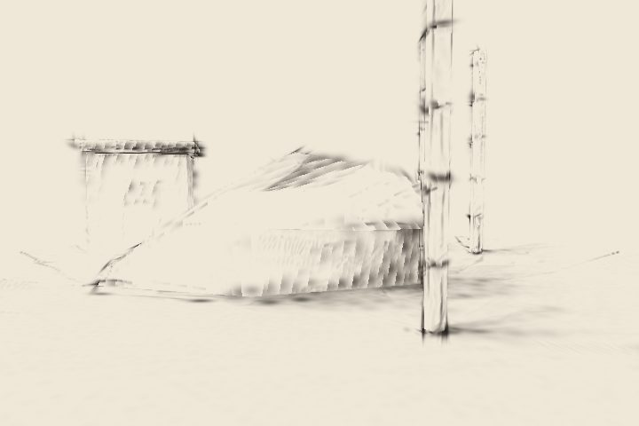

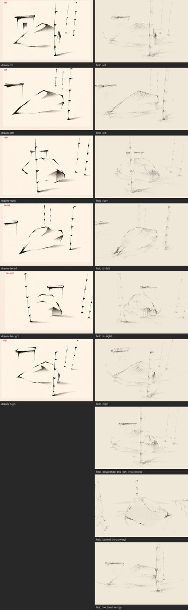
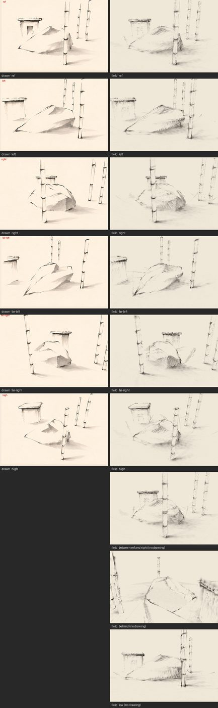

An image model redrew each view in a style, told to keep every line where it is. Seven restyles came back, each a
sheet of all six views: fine pen and wash, textured stone with strong cast shadows, three sumi-e brush executions
(spare, bold, light), warm watercolour and engraved hatching. The author's preference is sumi-e; I agree it suits
splats best, since its marks are blots, graded washes and dry-brush edges.

`splats-field-sheets.py` cuts each sheet's panels at its separators, masks the labels, and aligns each panel to its
wireframe by a small scale and shift. After alignment, the panels match their wireframes at 0.34 to 0.77 (normalised
correlation). The reference study managed 0.11 even after warping. The sparse brushes score lowest; that's sparsity,
not misplacement (checked by overlay).

**What the drawn teachers taught:**

All errors below are held-out error on the right view, with the other five views of the same execution as teachers.

- **Too few views for nine terms a disc.** The view-dependent field memorised them: training error 1.8, held-out
  10.3, worse than one constant opacity per disc (8.3). Holding the view terms toward zero (`--reg`) fixes it. At
  0.1, pen-and-wash scores 7.8 against the constant's 8.3, and sumi 9.99 against 10.35. Small wins, as they should
  be: in sumi, each view's strokes are the drawer's choice for that view.
- **Pooling the three sumi executions helps a little.** One field taught by all three averages 9.68 held out,
  against 9.74 for the single-execution fits. One field for three hands can only learn their mean.
- **Neural splats overfit first.** Each disc gets a learned 6-number feature, each execution a 2-number code, and one
  shared network turns (feature, view, code) into ink (`splats-field-fit.mjs --neural`). Pooled, it reached training
  error 2.8 but 14.7 held out. The codes do separate the three hands; the per-disc features memorise per-view detail.
- **Fitted mark shapes make it read as a drawing.** Each disc also fits two sizes in its surface's plane, a turn and a
  small shift. The fit runs at 384 × 256 with exact gradients through each disc's screen ellipse
  (`splats-field-shape.mjs`).
  - Training error falls (3.7 against 5.9 with fixed shapes); held-out pixel error doesn't (13.2 against 12.5). A
    stroke drawn a few pixels from where the held-out drawing has it is penalised twice.
  - But by eye it's a clear step. The culms are crisp with dark nodes, the cornice is a brush mark again, the stone's
    edges read as strokes, and it holds together from views no drawing covered (`?scene=field&field=composed-sumi-shape`).
  - What's wrong: streaks across the stone's faces (stretched discs), a paler, greyer tone than the bold strokes it
    learned from, and smeared ghosts at the edges from behind.

### Measuring what drawn teachers share

The sumi comparisons above were all scored by pixel error, and their differences were a few percent. Before building
on them, the measure itself was tested (`devtools/splats-field-measure.py`). The restyled sheets are independent
drawings of the same geometry, so a measure is only worth optimising if it passes two tests: given one execution's
drawing of a view, it finds the same view among another execution's six (chance 1 in 6), and it scores that view far
nearer than blank paper.

| measure, three sumi executions | finds the same view | same view ÷ blank paper |
|---|---|---|
| pixel error at 192 × 128 | 36 of 36 | 1.00 |
| tone: the same, blurred at three scales | 36 of 36 | 0.49 |
| decisions: ink along each edge, tone on each face | 28 of 36 | 0.30 |

- **Pixel error finds the view but has no headroom.** The right view by another hand scores no better than blank
  paper, because two hands put their strokes in different places. It can't rank models, and it did all the ranking
  above.
- **Tone is a valid score for a picture.**
- **Decisions are what the hands share.** The scene's known geometry (`wire-mesh.json`) turns a drawing into about 39
  inks along edges (creases, silhouettes, the seam, the nodes, the niche) and 21 tones (faces, the ground's shadow).
  Two executions agree on them at a correlation of 0.73 (0.69 across all seven styles).

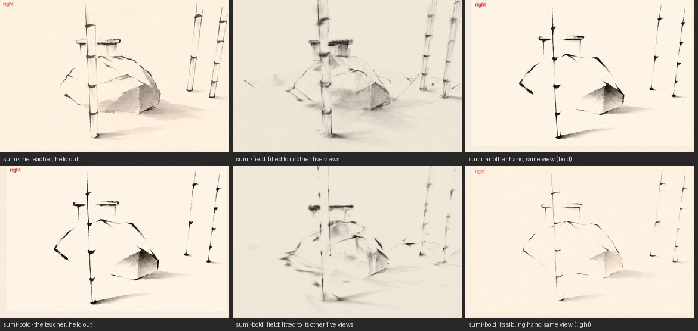

**The fields scored again** (`splats-field-score.py`), on the right view held out, each fitted to the other five views
of its own execution at 384 × 256. Lower is better for tone and decisions; agreement is the correlation of decisions.

| what drew the held-out view | sumi: tone | decisions | agreement | bold: tone | decisions | agreement | light: tone | decisions | agreement |
|---|---|---|---|---|---|---|---|---|---|
| blank paper | 7.09 | 327 | | 3.78 | 148 | | 1.88 | 166 | |
| another hand, same view | 2.11, 2.49 | 147, 109 | 0.51, 0.63 | 0.78 (light) | 28 | 0.85 | 0.78 (bold) | 28 | 0.85 |
| field, one opacity a disc | 1.33 | 68 | 0.74 | 1.67 | 83 | 0.44 | 0.69 | 63 | 0.59 |
| field, view terms and fitted shapes | 1.45 | 53 | 0.80 | 1.78 | 76 | 0.52 | 0.62 | 57 | 0.62 |

- **Every field beats blank paper by two to three times** on both measures. By pixel error the bold field had equalled
  blank paper; that was the measure, not the field.
- **The sumi field beats a different hand's drawing of the same view** on tone, decisions and agreement. It learned
  that execution's own manner across views.
- **Bold and light are one hand at two weights**, and each predicts the other's view far better than either field
  does (decisions 28 against 57 to 76). A sibling drawing of the *same* view is worth more than five views of your own.
- **Fitted shapes help the decisions every time** (53 against 68, 76 against 83, 57 against 63), which is what the
  eye said and pixel error denied. Tone is mixed.

**What follows:**
- The fields know more than they show. Their decisions are right far more often than their pictures look right: the
  smear is in the drawing of a stroke, not in knowing where one goes.
- The unit to learn is the decision. It's what hands share, it's small enough for a few views to teach, and the brush
  already knows how to draw a decided stroke black.

### Decisions as the unit: a rule, a table, and the brush

`devtools/splats-decisions.py`. Each teacher's view is about 59 decisions; three sumi executions of six views give
1,068.

**Can a decision be predicted for a view it wasn't drawn from?** Leaving one view out, all six in turn:

| what predicts the held-out view | decision error | agreement |
|---|---|---|
| blank paper | 235 | |
| a table: each entry's average over the other five views | 57 | 0.68 |
| the table with a view term per entry | 58 | 0.69 |
| a rule: one small network for every edge and face, from 25 features of its geometry and how it's seen | 62 | 0.64 |
| a sibling hand's decisions for the same view | 36 | 0.82 |

- **For these teachers a decision belongs to the edge or face, not the view.** A view term adds nothing: what changes
  with the view is which entries are in sight, which the geometry already knows.
- **A rule that doesn't know which edge is which does nearly as well as the table** (0.64 against 0.68), from kind,
  object, how the faces turn to the eye and across the picture, outline or not, direction, size and height.
- **But the rule doesn't carry to an object it never saw.** With each object held out whole, it does no better than
  the average decision for that kind of thing (error 58 against 50). One scene of five objects can't teach a rule
  about geometry. That would take restyled wireframes of other scenes, not more views of this one.

**The brush draws the decisions** (`policy.ts` `taught`, `?scene=composed&policy=taught&teacher=sumi`). Each group of
the composed scene is matched to the teacher's entry of its own object and a kind it could be (a stroke to a crease,
silhouette or line; a wash to a face), the nearest in the scene. The decision sets how much of the group is kept and
how strongly. The ground's lines get none, since the teacher was shown no bank.

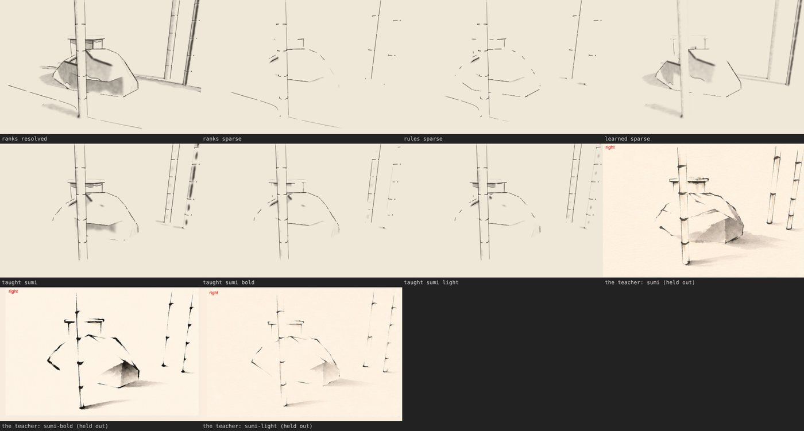

Scored on the right view, each table leaving it out (`splats-taught-score.mjs`, `splats-field-score.py`):

| what drew it | sumi: tone | decisions | agreement | bold: tone | decisions | agreement | light: tone | decisions | agreement |
|---|---|---|---|---|---|---|---|---|---|
| blank paper | 7.09 | 327 | | 3.78 | 148 | | 1.88 | 166 | |
| our best policy (rules or ranks) | 5.50 | 117 | 0.59 | 3.28 | 110 | 0.40 | 1.47 | 103 | 0.46 |
| taught, drawn by the brush | 5.06 | 98 | 0.66 | 3.17 | 121 | 0.49 | 1.43 | 126 | 0.50 |
| fitted field, shapes fitted | 1.45 | 53 | 0.80 | 1.78 | 76 | 0.52 | 0.62 | 57 | 0.62 |

- **Taught agrees with its teacher more than any of our own policies does** (0.66, 0.49, 0.50 against 0.59, 0.40,
  0.46), and it's the first of these to look like confident drawing: black strokes, the outline, the cornice, the
  nodes.
- **It still scores well behind the fitted fields.** It delivers the strokes and not the tone: the dark shaded face
  and the cast shadows are missing or faint. The mapping from a decision to how much the brush lays down was set by
  hand, and the measures count tone the brush didn't lay.
- **So the two halves have opposite faults.** The field has the tone and smears the strokes; the brush has the
  strokes and misses the tone.

**Next:** close the loop on the brush. Measure the decisions of what it drew and adjust each group until they match
the teacher's, instead of mapping by hand. Then washes and shadows carry their tone, and the score says whether crisp
strokes with the right tone beat the smeared field.

### Closing the loop on the brush, and checking the field against the renderer

**The brush fitted to each teacher** (`devtools/splats-taught-fit.mjs`). The scene is drawn with a treatment set from
outside, from the five views other than the right; what it drew is measured as the teacher's drawings are; each group
is adjusted until they match, ten rounds.
- A stroke group follows its edge: how much of the edge is inked sets how much of the stroke is kept; how heavy the ink
  is, per unit of ink, sets a per-group width (new in the controls).
- A wash group follows its face, its object's body, or the ground: the tone's peak sets its strength; how much of the
  face the tone covers sets how far the wash reaches.
- Stroke measures count ink in excess of the tone round the edge, so a wash's edge isn't taken for a stroke.
- With that correction the teachers ink an interior crease about half as much as one on the outline (0.46 to 0.61).
  The brush's own rule draws an arris only on the outline; a taught crease now shows in the interior by the teacher's
  ratio.

| on the five fitted views | sumi | bold | light |
|---|---|---|---|
| ink off by, before → after | 0.32 → 0.16 | 0.40 → 0.23 | 0.35 → 0.20 |
| tone off by, before → after | 0.15 → 0.12 | 0.17 → 0.06 | 0.18 → 0.06 |

It stalls about halfway on ink. The composed scene has washes only where its own light put them and strokes only where
its own design put them, so some of a teacher's tone has no mark to carry it (one stone face asks for 0.33 and gets
0.03 at full strength).

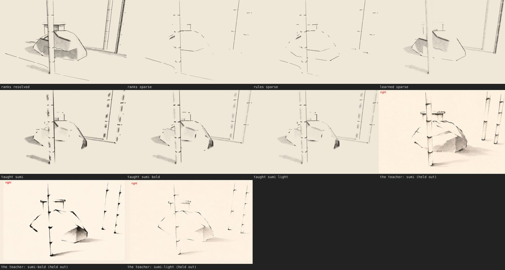

On the right view, which no fit saw:

| taught brush | sumi: tone | decisions | agreement | bold: tone | decisions | agreement | light: tone | decisions | agreement |
|---|---|---|---|---|---|---|---|---|---|
| mapped by hand | 5.06 | 98 | 0.66 | 3.17 | 121 | 0.49 | 1.43 | 126 | 0.50 |
| fitted | 4.68 | 137 | 0.44 | 2.53 | 80 | 0.60 | 1.28 | 76 | 0.55 |

- **Bold and light improve on every measure**, and now beat our own policies on decisions as well as agreement.
- **Sumi gets worse on decisions and agreement.** Its fit converged least (it has the most tone), and the loop matches
  the calibration measures, not the decisions it's scored by here.
- The cast shadows and wall tone arrive; the stone's outline thins. It's a baseline for what re-weighting an existing
  drawing can do, not the way to draw as a teacher does.

**The field against the real renderer** (`devtools/splats-field-browser.mjs`). The fields' scores above were taken
from the optimiser's own picture of the held-out view; the brush's from the browser. The same held-out sumi field,
drawn by the real renderer from the same camera:

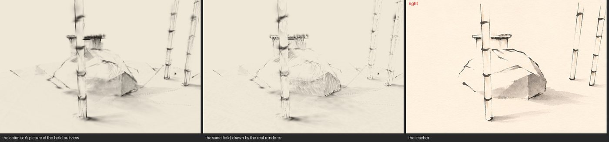

| the held-out sumi field | tone | decisions | agreement | mean darkness |
|---|---|---|---|---|
| the optimiser's picture | 1.45 | 53 | 0.80 | 0.043 |
| the real renderer | 2.55 | 60 | 0.83 | 0.024 |

- **The renderer lays down about half the ink the optimiser believes.** The field's tone error in the browser (2.55)
  is no better than another hand's drawing of the view (2.11, 2.49). Its decisions hold up (60, agreement 0.83).
- **Part of it is resolution.** The field was fitted at 384 wide, where a thin disc is padded out to a pixel; at 1024
  it's as thin as it was fitted. One field drawn in the browser at both sizes: mean darkness 0.032 at 384, 0.026 at
  1024. A field is calibrated to the size it was fitted at.
- **The rest isn't isolated yet.** Candidates: discs hidden behind the occluder (the fitters orient some normals by
  the wrong object's middle, which sets a disc 3 mm inside its surface); the view terms' quantisation to 6 or 8 bits.
- So the comparison of field and brush above overstated the field on tone. On decisions and agreement the field still
  leads for sumi; for bold the fitted brush now agrees more (0.60 against 0.52).

### The fitter and the renderer made to agree

A fitted field is only as good as the forward model it was fitted through. The check above found the browser laying
about half the ink the optimiser believed. Five differences were found, one at a time, by drawing the same field both
ways and comparing (`devtools/splats-field-agree.py`):

- **The pixel floor.** A disc thinner than a pixel is padded out to one. Padded, it covered more and so inked more, by
  an amount that depended on the resolution. A fitted mark (kind 12) is now fainter by as much as it's wider: its
  footprint's area before the padding over its area after. The fitter does the same. The same field now draws the same
  ink at 384 and 1024 wide.
- **Normals turned the wrong way.** The fitters decided which way a face points from the middle of the wrong object
  (an array indexed by triangle that is laid out by vertex), which set some discs 3 mm inside their surface, hidden.
- **Storage.** The nine view terms were quantised to 6 or 8 bits into the feature and element slots (so a fitted disc
  had no identity), and sizes above 51 mm were clipped (the ground's discs). The terms are now 16-bit floats in a
  texture of their own; feature and element are free again for a mark's identity.
- **A disc cut by its own face.** A disc lying on a face seen at a slant had its near half behind the face's depth.
  Fitted marks on a surface now take their plane's depth (as the brush's surface marks do); the fitter tests each pixel
  against the occluder the same way.
- **Faint tails.** The renderer drops a fragment under a 255th; the fitter counted them.

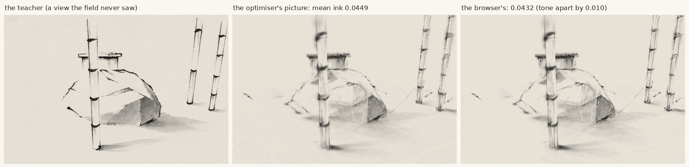

| the held-out sumi field, refitted | tone | decisions | agreement | mean darkness |
|---|---|---|---|---|
| the optimiser's picture (384 wide) | 1.29 | 47 | 0.84 | 0.0449 |
| the real renderer, 384 wide | 1.32 | 47 | 0.84 | 0.0431 |
| the real renderer, 1024 wide | 1.32 | 33 | 0.87 | 0.0432 |

- **The two pictures now agree**: the browser lays 4% less ink than the optimiser's picture (it was 45% less), and
  their tone differs by 0.010 (it was 0.128, on the measure the fields are scored by).
- **The field's score is now the drawing's**: tone 1.32 in the browser, against 2.55 before, and better than another
  hand's drawing of the view (2.11, 2.49). Its decisions are closer at full size (33) than at the size it was fitted.
- The file is a third the size: only the discs that ink anything from anywhere are kept (7,929 of 33,730; 248 KB).
- The earlier fields (`composed`, `composed-sumi` and the rest) were fitted before these fixes and are kept as they
  were; `composed-sumi-shape` is refitted.

## Marks: a stroke or a wash as an organisation of splats (`?scene=marks`)

A fitted field draws a view well and has no marks in it: nothing to pick up, nothing that says "this is a stroke".
The taught brush has marks and keeps what it learns outside the splats, in a table. The aim here is the thing between
them: **a stroke or a wash is an editable organisation of splats; a teacher can change both the organisation and its
individual deposits.**

### The conservatory studies

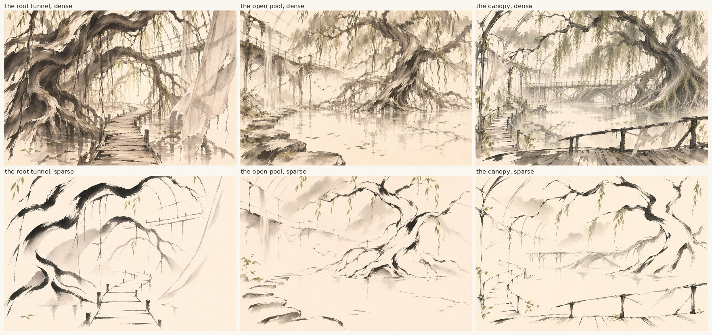

Six studies for the next scene: a flooded conservatory overtaken by a willow, in three regions, each drawn dense and
sparse. They are compositions, not views of any geometry here, so they can't teach a scene directly (as the earlier
reference studies couldn't). Two things they do give:

- **Each sparse study is a registered reduction of its dense one.** Blurred, the two correlate at 0.66 to 0.86 with no
  shift between them. The sparse keeps 25 to 31% of the dense's ink and covers 16 to 19% of the page, against 56 to
  75%. It is a teacher's statement of what stays.
- **The sparse studies are made of separable marks**: a root stroke, a spray of leaf dabs on its strand, a canopy wash,
  a veil of water. Nine of them are cut out as teachers (`devtools/splats-marks-targets.py`): each a box, the points
  its spine runs through (or its outline) read off by eye, and everything outside its own neighbourhood made paper.

### A mark

A mark (`client/splats/marks.ts`) has a few parameters that organise its deposits, and each deposit has six small
residuals of its own (ink, length, width, turn, two shifts).

- **A stroke** runs along a smooth curve through its control points, as rows of deposits side by side (a brush's
  bristles; one row for a line). 31 parameters: how its ink, its width, its offset and its dryness run along it; where
  it starts and stops and how sharply; how long its deposits are; which side is dry; how its rows overlap; a splay, for
  a spray of dabs. On a surface it lies flat; in open space it's round; as a limb, its rows go round a tube.
- **A wash** lies on a face or fills a volume. 10 parameters: a 3 × 3 grid of tone and its deposits' size.
- One function, `layout`, turns a mark into deposits. The page draws them as fitted marks (kind 12), each carrying its
  mark's id and its place in the mark, so a mark stays one thing for an editor.

### Three ways of drawing a teacher's mark, with the same number of deposits

Each teacher mark is fitted through the renderer's forward model (`devtools/splats-marks-fit.mjs`):

- **independent**: every deposit free (place, two sizes, turn, ink). A fitted field, in small.
- **organised**: the mark's parameters and its spine only. Its deposits can't move on their own.
- **organised, then its deposits**: the same, then each deposit's residuals set free within bounds.
- **the existing brush**: the lab's brush on the same spine, the best of 16 settings of its width, material and
  weight (8 of depth and reach for a wash), drawn in the browser.

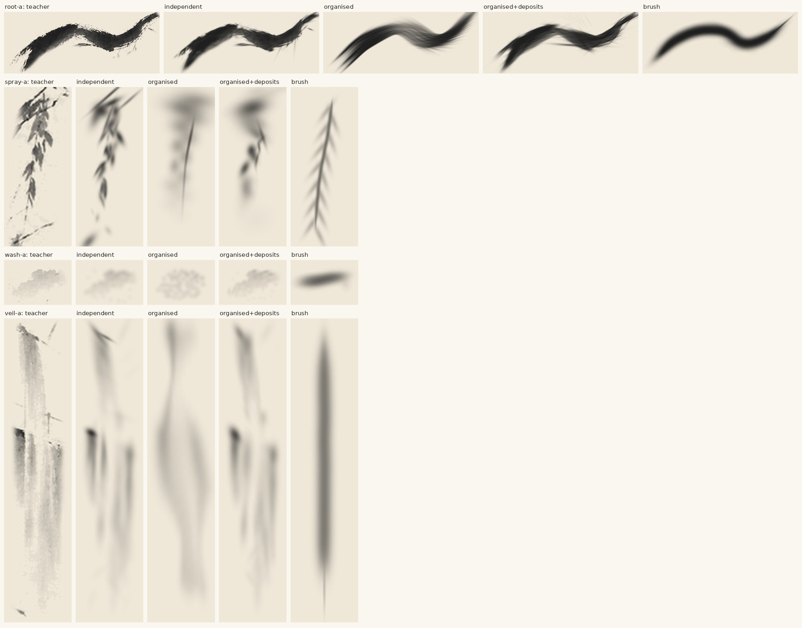

Tone error / ink on paper the teacher left bare / dryness error (strokes; all lower is better):

| teacher mark | deposits | independent | organised | organised, then deposits | existing brush |
|---|---|---|---|---|---|
| a root | 294 | 0.23 / 0.3 / 0 | 10.45 / 10.3 / 96 | 0.70 / 1.7 / 208 | 44.65 / 14.6 / 157 |
| a second root | 294 | 0.13 / 0.1 / 0 | 5.47 / 1.0 / 42 | 0.46 / 0.1 / 77 | 22.02 / 28.7 / 123 |
| a third root | 217 | 0.38 / 0.3 / 0 | 7.12 / 2.0 / 29 | 0.55 / 0.5 / 111 | 55.09 / 53.5 / 72 |
| a branch | 161 | 0.19 / 0.6 / 0 | 12.70 / 7.0 / 94 | 5.04 / 0.4 / 146 | 19.17 / 25.5 / 82 |
| a spray | 38 | 0.76 / 1.0 / 21 | 10.42 / 25.6 / 92 | 3.54 / 7.7 / 124 | 16.63 / 11.4 / 136 |
| a second spray | 38 | 0.29 / 0.4 / 1 | 5.53 / 11.2 / 108 | 1.85 / 3.2 / 174 | 7.54 / 9.1 / 122 |
| a canopy wash | 48 | 0.05 / 2.7 | 0.89 / 11.5 | 0.03 / 1.5 | 20.44 / 30.7 |
| a larger wash | 96 | 0.26 / 1.1 | 5.12 / 6.0 | 0.35 / 1.5 | 19.17 / 1.3 |
| a veil | 72 | 0.16 / 2.4 / 37 | 2.35 / 12.9 / 27 | 0.25 / 1.8 / 50 | 20.27 / 19.3 / 117 |

- **Independent deposits win the picture, every time.** For one picture from one view, with nothing to carry over,
  freedom is all advantage. They also match the dry-brush texture nearly exactly.
- **An organisation alone is 6 to 60 times worse on tone**, and soft: it follows the stroke's course and weight, and
  misses its crisp body and ragged edge. A spray is its weakest: evenly spaced dabs don't land on the teacher's.
- **With its deposits' residuals it comes within 1.4 to 4 times of independent on the roots and washes**, and is
  cleaner than independent on bare paper for some. So most of what an organisation can't say, small bounded changes
  to its own deposits can. On the branch and the sprays it stays well short.
- **The existing brush is last on every mark**, 2 to 6 times worse than the organisation alone (it has few knobs, and
  its spine isn't fitted).
- **A pixel loss can't teach a texture.** Fitted to the picture alone, a stroke's dryness goes to nothing: a streak
  that doesn't fall exactly where the teacher's fell is an error twice. So a stroke's style is fitted to what's
  measured in its own frame, unwrapped along its spine: its coarse shape, how much of each part is left bare, how
  fast its ink changes along and across. Its slope is taken by drawing the stroke again with each parameter moved: 31
  numbers are few enough for that, whatever is measured. A field's thousands aren't. That lowers the dryness error
  (root: 207 to 96) at a cost in tone (8.3 to 10.4); and the residuals, fitted to the picture again, undo it (208).
  The two objectives pull against each other in a blurred medium, and this doesn't resolve it.
- **The fitter's pictures are the browser's**: all nine sheets drawn each way by the real renderer lay within 2.1% of
  the fitter's ink, tone apart by at most 0.034 (`devtools/splats-marks-browser.mjs`).

### A style, on another spine

The test a field can't take. A held-out teacher mark is drawn with the parameters learnt from another mark; only its
pose is fitted (the points of its spine, and one number each for its ink, its width and its two ends). Beside it: a
plain stroke posed the same way; the held-out mark's own organised fit; and independent deposits.

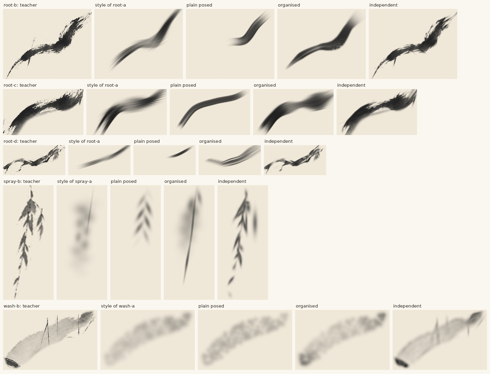

Tone error (strokes: / dryness / roughness errors):

| held-out mark | the learnt style, posed | a plain stroke, posed | its own organised fit | independent |
|---|---|---|---|---|
| a second root | 18.0 / 115 / 325 | 33.1 / 223 / 866 | 5.5 / 42 / 260 | 0.1 / 0 / 35 |
| a third root | 32.6 / 120 / 122 | 84.9 / 130 / 336 | 7.1 / 29 / 163 | 0.4 / 0 / 26 |
| a branch (another study) | 26.1 / 172 / 452 | 38.7 / 267 / 656 | 12.7 / 94 / 326 | 0.2 / 0 / 29 |
| a second spray | 6.5 / 152 / 382 | 11.0 / 138 / 294 | 5.5 / 108 / 161 | 0.3 / 1 / 21 |
| a larger wash | 7.1 | 7.9 | 5.1 | 0.3 |

- **The learnt style helps on every held-out mark**: tone error 1.1 to 2.6 times lower than a plain stroke's, and
  the roots' texture closer too. It carries to a branch in a different study.
- **It stays 1.2 to 4.6 times short of the mark's own fit.** One teacher stroke isn't a style: what was fitted
  includes that stroke's particular thick and thin. A style wants several strokes fitted together, with what is
  particular to each kept apart from what they share. That isn't done here.
- **The spray's style barely transfers on texture** (its tone improves; its dryness and roughness don't).

### Still a mark

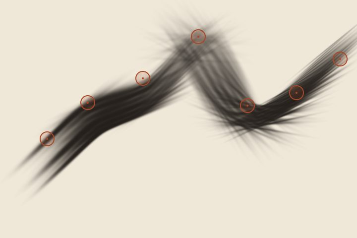

In the page a fitted mark can be tapped and bent by the points of its spine; its deposits are laid again and come
with it (a strand and its dabs move together). Independent deposits offer nothing to pick up.

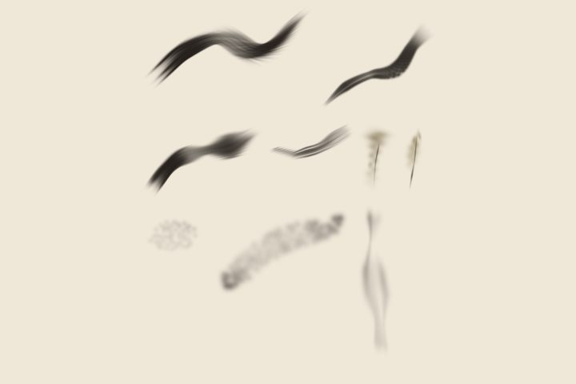
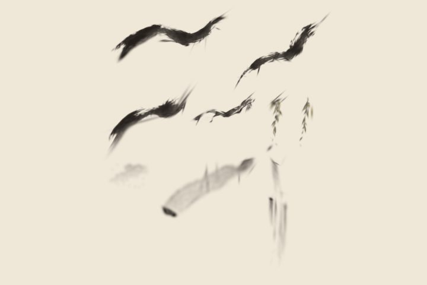
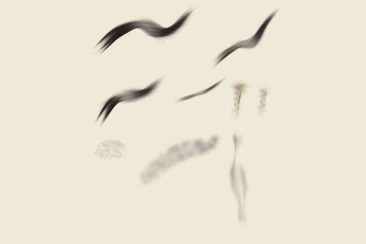

### Walking into a wash (`?scene=walk`)

From far off a teacher draws a canopy as a wash; close to, it's strands and leaves. Both are organisations of splats
in the same volume (`client/splats/canopy.ts`): a wash of 30 large pale deposits, and 90 fronds (4,424 deposits now
their leaves are formed, a few deposits a leaf: see *One frond cluster, restored*; 1,972 when a leaf was one dab).

- **Each deposit is shown by how large things look where it is**: a scene unit's size on the screen at the deposit's
  own depth, between two thresholds. The wash fades between them as the fronds come in, so at any depth the two are
  complementary. It follows the picture, not the distance: zooming in resolves it too.
- **The wash is fitted to its own fronds**, as they look from 12 m and 9 m (tone error 72.5 to 3.3): one
  organisation taught by another.
- A fitted mark keeps its ink however small it's drawn, so the fronds alone, all the way, are the reference for what
  the patch's tone should be at each distance.

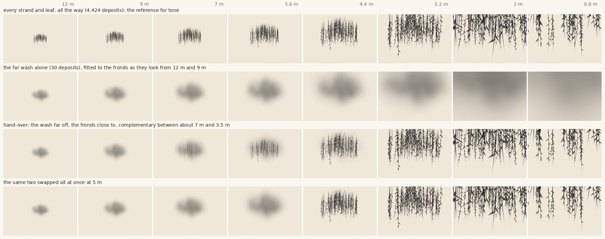

Every 20 cm from 12 m to 0.3 m (`devtools/splats-walk.mjs`):

| | tone against the fronds, beyond 3.4 m: worst / mean | largest change beyond the walk's own | deposits at 12 m / at most |
|---|---|---|---|
| the wash alone | 21% / 15% | none | 30 / 30 |
| hand-over | 13% / 9% | 0.06 (where the walk's own is 123) | 30 / 4,454 |
| swapped at once at 5 m | 20% / 11% | 22.7 (the walk's own there: 10.3) | 30 / 4,424 |

- **The hand-over doesn't pop, and carries the tone less closely than it did.** No step changes the picture more than
  the walk itself does; a swap at 5 m changes it by twice the walk's own. But the patch's darkness is now within 13%
  of the reference, where with a dab a leaf it was within 6% (the wash alone: 21%, was 10%). The formed leaves are
  darker and sharper, and thirty pale deposits hold their tone less well as they come nearer. That's the wash's
  to fix, not the leaves'.
- **It costs 30 deposits far off instead of 4,424.**
- The wash alone, walked into, fills the screen with fog. Right at the eye a deposit is let go (between 0.7 m and
  0.25 m), in scenes that are walked through.

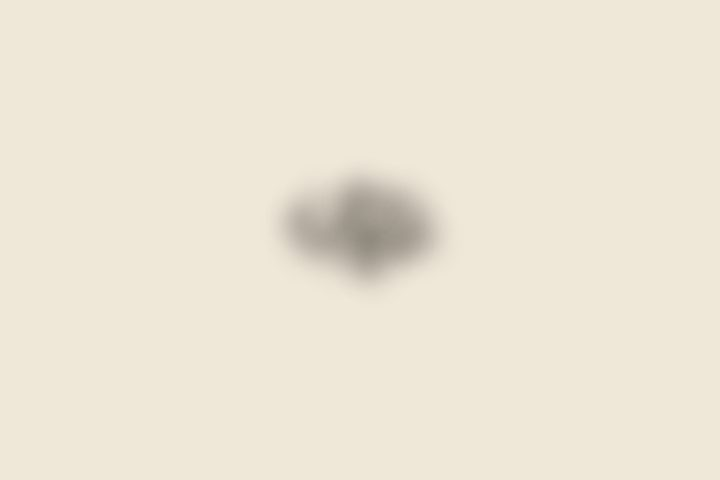

(`devtools/splats-walk-board.py` puts the board together.)

### The room (`?scene=room`)

A flooded conservatory and a willow, built entirely of marks (`client/splats/conservatory.ts`): 1,383 of them, about
30,000 deposits laid. Three regions round one looped route, the willow in the middle of the loop: a root tunnel (a
boardwalk under arching roots), an open pool (stepping stones, a veil, a far bridge) and a canopy (a deck under
hanging fronds that hand over as above).

- **There is no outline pass and no surface to shade.** Every mark is a stroke or a wash the scene put there. A limb
  is a stroke laid round a tube, inked along its underside, so it is a band of the same weight from wherever it's seen.
- **One gesture stands on nothing**: a run of seeds on the air over the pool, joined by a dotted thread.
- **Styles**: plain, as the scene lays it; from the Bench's fits above (a root's, a veil's); or taught from drawn
  views (the next section).
- **Frozen, on still water**: the water's mirror is a second pass of the same deposits turned over in it, fainter the
  higher they stand.

- **It holds together as a place walked through**, and the three regions are distinct.
- **It is soft where the teacher is crisp.** Limbs are long blurred streaks, not loaded strokes with a dry edge; far
  canopy washes are smudges without a drawn edge. This is the organised stroke's softness from the Bench, at scale.
- **As the scene lays it, nothing here has been taught from a view.** That is the next section.

### The room, taught from three drawn views

The room drawn plain from six views round the route was restyled by an image model, as the composed scene's
wireframes were. All six line up with their underdrawings with no shift (blurred, they correlate at 0.78 to 0.90),
and the teacher uses about half to two thirds of the underdrawings' ink. Three are taught from (the root tunnel, the
open pool, the canopy). The three between them are reserved: never fitted to, only scored on.

The marks stay where the scene put them; their spines aren't moved. What is taught is how they are drawn, at four
levels of freedom (`devtools/splats-room-fit.mjs`):

- **a style a role**: an offset to the parameters of every mark of one role (every arch, every plank, every strand:
  19 roles). 327 numbers for the whole room.
- **+ each mark's weight**: three numbers a mark (a stroke's ink, width and dryness; a wash's tone and size).
- **+ its deposits, bounded**: every deposit's own residuals, within the bounds a mark keeps them to.
- **deposits set free** (in place of the last): the same residuals with the bounds off. As near a fitted field as
  the room's own deposits can get.

Tone error, mean of three views (blank paper: 74.7 on the views taught from, 71.6 on the reserved):

| | numbers taught | on the views taught from | on the reserved views | reserved: ink on bare paper | reserved: ink against the teacher's |
|---|---|---|---|---|---|
| untaught | 0 | 63.6 | 33.0 | 81.6 | ×1.71 |
| a style a role | 327 | 10.8 | 15.4 | 12.6 | ×0.69 |
| + each mark's weight | + 4,149 | 7.7 | **14.9** | 14.2 | ×0.80 |
| + its deposits, bounded | + 183,000 | 1.6 | 15.8 | 26.2 | ×0.87 |
| deposits set free | (the same 183,000) | 0.8 | 25.7 | 96.3 | ×1.43 |

Each reserved view on its own (between the tunnel and the pool / the pool and the canopy / the canopy and the tunnel):
untaught 16.2 / 45.4 / 37.2; a style a role 10.8 / 14.9 / 20.7; + weights 9.5 / 13.3 / 21.8; + bounded deposits
9.1 / 17.3 / 20.9; set free 34.3 / 22.8 / 20.1.

- **On the views taught from, more freedom always fits better**: 10.8, 7.7, 1.6, 0.8.
- **On the reserved views, the organisation is what carries.** A style a role takes the error from 33.0 to 15.4:
  nearly all of the gain, from 327 numbers. Each mark's weight adds a little (14.9). Its deposits, even bounded, add
  nothing and put twice the ink on bare paper. Set free, they are much worse (25.7), with more ink on bare paper
  than the untaught room.
- **Why**: a mark not seen from a teaching view still has its role's style. A deposit not seen has nothing, and a
  deposit bent to suit one view is wrong from the next.
- **What the teacher taught, by role**: nearly every role draws with shorter, narrower deposits; trunk, arches and
  limbs with less ink; washes and mist paler and smaller (tone -0.5 to -1.0). Crisper and lighter.
- **The taught room in the browser is the fitter's**: on all six views it lays 0.94 to 1.00 of the fitter's ink,
  tone apart by at most 0.17 (`devtools/splats-room-browser.mjs`).

What this does and doesn't show:

- **One room, one teacher, three views, one run.** The reserved views lie between the teaching ones on the same
  route and share marks with them.
- **The third reserved view barely separates the levels** (20 to 22 for all four). The mean's story rests on the
  other two, and most on the first.
- **"Set free" isn't a field fitted from scratch**: it's the room's own deposits unbound, and three views are few for
  any free fit. A field given more views would do better than this; the Bench result says how much freedom buys when
  there's one picture to match.
- **A gap remains**: 14.9 on the reserved views against 7.7 on the taught ones.
- **It is still short of the teacher**, and under-inked (×0.80). The teacher's arches are single loaded strokes and
  its fronds are longer strands with larger leaves. Re-weighting marks whose spines are fixed can't reach either: the
  first is the organised stroke's softness; the second is geometry the scene would have to change.

(These numbers are from before the room's solids hid anything: see the next section.)

The page draws the room as taught by default (a style a role and each mark's weight); `&style=bench` and
`&style=plain` are the other two.

### Identity and occlusion, and what they change

Three things a review of the room found, fixed before going on:

- **Identity.** 151 ids were each used by two marks (a canopy patch's ids were reused by what was laid after it),
  183 of 265 names weren't unique, and what was taught was attached to marks by their place in a list. Every mark
  now has a key no other has (its name, and its place among marks of that name: `tunnel/boardwalk/plank #12`), a
  role said once, and an id made from its key. What is taught is kept by role and by key. A mark added to the scene
  changes no other mark's key or id.
- **Occlusion.** A drawing made only of marks still needs its unpainted interiors to hide what's behind them. The
  deck, the boardwalk and the stones are now solids just under their marks, and each limb is a tube just inside its
  own deposits, as wide as the limb is drawn. They are drawn into depth only; the fitter tests against them a pixel
  at a time, as the renderer does. What's under the water isn't drawn, and the deck hides the water's mirror.
- **Crispness never reached the limbs**: a tube ignored it, and the room's fitter left it out. That is taken up with
  the root, below.

The room taught again, the same way, with its solids (tone error, mean of three views):

| | on the views taught from | on the reserved views | reserved: ink on bare paper |
|---|---|---|---|
| untaught | 63.0 | 35.6 | 79.2 |
| a style a role | 19.1 | 22.7 | 15.2 |
| + each mark's weight | 15.3 | 22.9 | 16.3 |
| + its deposits, bounded | 4.7 | 22.0 | 16.0 |
| deposits set free | 2.4 | 25.2 | 38.4 |

- **The earlier result was partly the see-through room's.** A style a role still takes most of the gain on the
  reserved views (35.6 to 22.7) and more freedom still adds nothing there. But freed deposits are no longer much
  worse (25.2 against 22.7; it was 25.7 against 15.4). Without solids, a deposit bent to suit one view could be
  seen from the others through whatever stood between; with them, it is mostly hidden. They still put more than
  twice the ink on bare paper.
- **Every level is further from the teachers than it was** (reserved: about 22, from 15). Two reasons. The
  teachers were drawn from underdrawings in which nothing hid anything, so they show limbs behind limbs that the
  solid room hides. And a limb's ink keeps to its underside, which a solid limb hides from above: from the view
  between the canopy and the tunnel the nearest arch is almost blank, and that view no longer improves at all (39.3
  untaught, 39.8 to 42.7 taught).
- **So the teachers' scores now mix two things**: how the room is drawn, and where the solid room differs from
  what the teacher was shown. New teachers drawn from the solid room would separate them.
- **The browser is the fitter's, less closely**: 0.87 to 0.99 of its ink, tone apart by at most 0.17.

### The root: a limb as a loaded stroke

The room's limbs are its main subject, and after teaching they were still soft bands. Three materials are being
taken one at a time, starting with the root.

**The pool.** Every limb the teacher drew is cut out of its restyle and straightened along the limb's own spine, at
the restyle's full size (`devtools/splats-pool.mjs`, `.py`): 45 strokes of 24 limbs, 12 of them seen from more than
one view. A strip runs a pixel a step along the limb, and across it from -2.5 to +2.5 of the limb's half-width.

- **The teacher's ink is where the scene's limbs are**: 70% of it within the limb's band, its centre a fifth of a
  half-width off the spine.
- **Its loaded stroke keeps to the limb's lower edge**: 39 of 45 strokes carry more ink below the spine than above.
  (The underdrawings were inked along the underside, and a restyle keeps that.)

**Place by place doesn't work.** The first comparison drew each limb four ways from each stroke's view, straightened
it the same way, and matched its profile across the limb to the teacher's. Every way came out a grey band (profile
error 88 to 110, against 125 as the room draws it). Along a limb the teacher's stroke wanders from the scene's spine
by up to half the limb's width: a restyle keeps the composition, not each edge. A profile matched in the limb's frame
rewards a pale hedge.

**Read in the stroke's own frame**, no correspondence is needed. At each step along a strip the dark band is found
(nearest the last step's), and from it: how thick it is (in the limb's half-widths), how dark inside, how many pixels
its ink takes to fall at its lower edge (firm) and its upper (feather), and how its darkness varies along it. Medians
over the strokes from the views taught from / from the reserved views:

| | thick | body | firm, px | feather, px | apart from the teacher |
|---|---|---|---|---|---|
| the teacher | 1.00 / 1.08 | 0.81 / 0.81 | 6.3 / 4.5 | 6.9 / 7.6 | |
| as the room drew it (rows all round, inked beneath) | 0.83 / 0.92 | 0.63 / 0.63 | 1.9 / 2.0 | 9.7 / 14.2 | 4.4 / 6.0 |
| the same, fitted here | 0.58 / 0.92 | 0.66 / 0.68 | 3.7 / 3.7 | 8.5 / 16.5 | 4.2 / 6.2 |
| banded on its underside | 0.92 / 1.00 | 0.78 / 0.80 | 2.0 / 1.7 | 7.2 / 9.2 | 2.8 / 1.8 |
| **banded as seen** | 0.92 / 1.08 | 0.79 / 0.81 | 2.7 / 3.1 | 5.6 / 7.0 | **2.2 / 1.1** |
| a flat ribbon | 1.00 / 1.00 | 0.84 / 0.86 | 1.6 / 1.6 | 5.4 / 5.6 | 3.3 / 2.3 |
| banded as seen, 2.5 times the deposits | 0.83 / 1.00 | 0.81 / 0.83 | 2.0 / 2.5 | 5.8 / 6.6 | 2.5 / 1.5 |

- **The room's limbs weren't soft where it was assumed.** Their outer edge is firmer than the teacher's (2 px
  against 5 to 6: a tube's deposits are seen edge-on there). They were too pale (0.63 against 0.81) and their inner
  side too soft (10 to 14 px against 7).
- **Banded**: rows over an arc of the tube, each with a part by its place across it (a firm edge, a body, bristles;
  `marks.ts`, `band`). Darker and tighter, but fixed to the limb's underside, so seen from above only its fringe shows.
- **Banded as seen**: rows all round, each deposit laying its ink where it lies in the limb's lower band as the limb
  is seen. That is a quadratic in the direction it's seen from, which a deposit's nine view terms hold exactly, so
  the renderer needed nothing new. Seen level from either side, from 40° above and from below, 76 to 87% of a limb's
  visible ink is in its lower half, at the same weight (`devtools/splats-seen-check.mjs`). It is the closest to the
  teacher, and closer still on the strokes from the reserved views.
- **More deposits don't help** at this scale. The limit isn't the budget.
- **How soft this comparison is**: with the strokes' swell (how their thickness varies along them) counted in, as
  seen led by four times as much. Swell is inflated by marks that cross the teacher's strips, so it was left out,
  and the lead shrank to what's above. The order of the arrangements held; the sizes of the gaps shouldn't be leant on.

In the room (the default now; `&roots=0` for the tubes), a limb is a dark stroke with a firm edge along its lower
side from wherever it's seen, and the view between the canopy and the tunnel, where the nearest arch had gone
blank, has its arch back.

Not done:

- **No short wander.** The teacher's band wobbles by 0.06 half-widths over about 150 px. None of these do.
- **No dry edge, no tapered release.** The reading here doesn't see them (its dryness measure reads nothing in the
  teacher's strokes either, which says the measure is too coarse, not that they're wet).
- **Each limb's own pressure is made up**, from its key: a run of ink, width and drift along it, with amplitudes
  set by hand. Separating what the strokes share from what is each stroke's own, from several teacher strokes
  fitted together, isn't done.
- **The room's tone against the teachers wasn't measured again** with its limbs as strokes.

### The second teachers: from the room's geometry

The first underdrawings sent for restyling were the room drawn in its own marks, and the teacher kept their
choices: where a limb's ink sat, how soft a wash was. The second set carries none (`devtools/splats-room-wires.mjs`,
`.py`; `devtools/conservatory/wires2`): the solid room's geometry as thin even lines with what's hidden left out.
Each limb is its tube's outline; planks, posts, rails, strands, the veil and the far bridge are the lines they run
along; a leaf is a tick where it is; a wash or mist is the dotted outline of its volume. Eight views: the six (three to
teach from, three reserved), and two more reserved: back along the tunnel, and sideways from the stones.

**The root, read again.** The pool cut from the new restyles is 67 strokes of 24 limbs, 73% of their ink within the
limb's band. It reads differently from the first:

- **What the teacher does with a limb goes by how wide it is on the screen.** Narrow (under about 30 px across), one
  loaded stroke filling it. Wide, a line along each edge and a pale dry sweep between, darker to one side.
- **The loaded side is the upper one on 47 of 67 strokes.** In the first set it was the lower on 39 of 45: that was
  the underdrawing's side, kept.
- **A wireframe has its own bias.** It draws both edges of a limb, and a restyle may be tracing them. No underdrawing
  is neutral; this one biases toward outlines where the first biased toward the room's own ink.

**A limb in parts, by its width on the screen** (`conservatory.ts`, `limbParts`): far off, one loaded stroke; close
to, a loaded stroke along one side, a broad dry sweep under it, and a line along each edge. The far one hands over
to the near ones by the limb's own width on the screen, the same way a canopy's wash hands over to its fronds. The
edge lines need no outline pass: each deposit lays its ink where the tube's surface is edge-on to the eye, which
its view terms hold exactly.

Its style is fitted to the teacher's profiles across a limb, pooled over strokes by width class
(`devtools/splats-root2.mjs`). Distance from the teacher's pooled profiles, strokes from the views taught from / from
the five reserved views:

| | deposits drawn a limb | taught from | reserved |
|---|---|---|---|
| one band as seen (the first root) | 640 | 36.8 | 61.1 |
| in parts, by its width on the screen | 1,963 | 22.2 | 17.2 |

- **In parts is closer, and holds on the reserved strokes**, at three times the deposits a limb.
- **Two things that went wrong on the way, both the same mistake.** Pooled as they fell, the strokes' two loaded
  sides cancelled into a pale even band, and the fit copied it: each stroke's profile is now turned so its loaded
  side is the same before pooling. And a single band can't be a dark accent and a grey sweep at once: the sweep had
  to be a part of its own. Without it the limbs came out as pen outlines.

**The room taught again**, from three views of the second teachers, scored on five reserved (tone error; the second
teachers are sparse, so blank paper scores 27.0 on the views taught from and 24.2 on the reserved):

| | on the views taught from | on the reserved views |
|---|---|---|
| untaught (limbs in parts) | 89.4 | 99.9 |
| a style a role, the limbs' ink left as the strokes taught it | 24.5 | 23.9 |
| + each mark's weight | 23.4 | 24.7 |
| a style a role, the limbs' ink taught too | 17.7 | 18.8 |
| + each mark's weight | 13.9 | 20.3 |

- **With its limbs as the strokes taught them, the room is no nearer these teachers in tone than blank paper.** The
  views full of limbs are the worst (the tunnel 37, back along it 42, against 32 for blank).
- **Let the tone objective weigh the limbs' ink and it takes their calligraphy out**: the edge lines go (by 3 to 4
  in the logit), the loaded accents go (by 3), and a pale sweep stays. Tone improves to 18.8. At a quarter of the
  restyles' size, a crisp dark line a few pixels from the teacher's costs twice; a faint broad band costs little.
- **So the two readings disagree, and they measure different things.** Strokes read at full size in their own frame
  say the edges and accents are there. Blurred tone at low resolution says remove them. The room is drawn by the
  first for its limbs (what the tone objective taught them is kept aside, not used) and by the second for the rest.
  A better objective for the room would score marks where they are marks.
- **What it looks like.** Nearer the teacher in weight: thin posts and planks, limbs as grey sweeps with dark edges.
  But the fronds have faded almost out (the teacher's leaves aren't where the scene's are, and tone can only fade
  what it can't place), the washes are faint, and a limb is even from end to end: no pressure along it, no frayed
  release. (The next two sections take those up: one limb, and one frond cluster.)

### One limb, three ways (`?scene=limb`)

The room's limbs read as shaded tubes: an even rim, a smooth gradient, the same from one end to the other. They were
fitted to profiles *across* a limb, pooled over strokes, which throws away everything a stroke does *along* itself:
where it's loaded, where it breaks, where it lifts. So one limb is taken out of the room (the root tunnel's third
arch) and the teacher's strokes are read again as whole patches, along as well as across
(`devtools/splats-limb.mjs`). At each step along a stroke the dark band is found, and what's kept is how it runs:

- **cover**, **gap**: how much of the limb's length has a band at all, and how long its breaks are;
- **thick**, **body**: its thickness (in the limb's half-widths) and its darkness; **swell**, **press**: how much
  each varies along the stroke; **together**: whether they rise and fall together; **run**: over what length the
  thickness changes;
- **firm**, **feather**: how far each of its two edges takes to fall (px), the sharper and the softer; **rim**: how
  ragged its edges are; **streak**: how uneven it is across itself (bristle lines with paper between);
- **other**: how much of its length has a second line across the limb, apart from the band;
- **release**: its thickness at the limb's end against its middle.

Three ways of laying the limb, each with the same number of deposits (2,484 for the median limb; 3,240 for this arch):

- **in parts**: the room's limb as it is. One stroke far off, handing over to a line along each edge with a graded
  stroke between.
- **a sweep** (`marks.ts`, `sweep`; `conservatory.ts`, `limbSweep`): one pass of a loaded brush, forty bristles
  round the limb. The brush is loaded where it's set down and again a few times along the limb, and dries from each
  loading. That one pressure sets three things together: how wide the band is, how many of its bristles still lay
  ink, and how far each deposit's ink spreads (wet rows run together; dry ones stand apart as streaks). Which end it
  starts from, where it reloads and which side it's loaded on are each limb's own.
- **a sweep with accents**: the same, with stretches of a line along one edge or the other, each there or not on
  its own.

Read along the stroke, over the 31 strokes from the three views taught from (the last two rows: distance from the
teacher over all the readings, there and on the 36 strokes from the other five views):

| | the teacher | in parts | a sweep | with accents |
|---|---|---|---|---|
| cover | 0.93 | 1.00 | 0.96 | 0.99 |
| gap (px) | 14.3 | 0.0 | 14.1 | 3.7 |
| thick | 0.54 | 0.41 | 0.48 | 0.46 |
| swell | 1.21 | 0.37 | 0.89 | 0.70 |
| press | 0.30 | 0.23 | 0.39 | 0.29 |
| together | 0.35 | −0.04 | 0.48 | 0.40 |
| firm (px) | 1.2 | 1.9 | 1.9 | 1.8 |
| feather (px) | 2.9 | 5.2 | 6.7 | 6.0 |
| rim (px) | 2.5 | 0.2 | 0.8 | 0.5 |
| streak | 0.58 | 0.76 | 0.91 | 0.99 |
| other | 0.73 | 0.73 | 0.40 | 0.78 |
| **distance, views taught from** | | **56.6** | **26.8** | **33.9** |
| **distance, the other five** | | **60.2** | **30.2** | **31.1** |

- **A sweep is nearer the teacher's strokes than the limb in parts, at the same deposits, and it holds on the other
  views.** The limb in parts never breaks, hardly swells, and its thickness and darkness don't move together. The
  sweep breaks about as often as the teacher's, swells three quarters as much, and is wider where it's darker.
- **The sweep supplies its own boundary; what accents add is the limb's other edge.** On its loaded side the sweep's
  edge is as firm as the edge lines of the limb in parts (1.9 px), with no line drawn. Accents don't bring the
  stroke nearer the teacher (33.9 against 26.8; 31.1 against 30.2). What they do is draw a second line across the
  limb, which the teacher has over 73% of a limb's length and the bare sweep over 40% (its own dry streaks). They
  also close the breaks (3.7 px against the teacher's 14). So: accents are a choice about whether the limb's far
  edge is drawn, not something the stroke needs. With them the limb reads as a round thing; without, as a stroke.
- **One mark at every distance.** The camera comes in from 14 m to 2.2 m, turning 35° round the limb. The sweep is
  the same mark all the way; the limb in parts changes what it is between about 9 m and 5 m, where its far stroke
  hands over to its parts. Ink from frame to frame grows by at most ×1.21 for the sweeps and ×1.27 for the limb in
  parts, where the limb's own growth on the screen is ×1.17: no jump in any of them.

- **What's still wrong, in all three.** Edges are softer than the teacher's (the firm one 1.9 px against 1.2, the
  soft one 6 against 2.9) and a third as ragged (0.8 px against 2.5). The sweep is more evenly streaked than the
  teacher's, whose loaded passes are broad and solid and whose dry ones fan out. A deposit is the limit here: forty
  rows round a limb are each about 2.5 px wide at the medium distance.
- **The readings can be met by drawings that look nothing like a stroke.** A first fit, free over every number,
  came within 8.6 of the teacher on the readings it then had, and drew a thin line with dark beads on it: the
  teacher's thickness changes over about 1.4 half-widths (the reading follows its streaks in and out), and beads
  at that spacing satisfy it. Two changes followed. Pressure now drives width by construction, not as one option
  among several. And the style was chosen by eye in the real renderer first, then the fit run from there and kept
  near it. That fit reached 25.0 and 35.6, and lost the bristles: an airbrushed band. What's shipped is the fit's
  pressures with the eye's crispness, at 26.8 and 30.2. So the readings don't yet see everything the eye does, and
  a lower number wasn't taken where the picture was worse.
- **The other five views are validation now, not a test.** They've been used to choose between ways of laying a
  limb twice. A test route is set aside for the end (`conservatory.ts`, `TEST_VIEWS`): six views between the eight on
  the same loop, looking other ways (the tunnel's mouth, out through the roots, the tunnel from the pool, the willow
  from the east, down the deck, up into the canopy). Their geometry is exported for restyling
  (`devtools/conservatory/wires-test`) and the teacher's restyles of them are filed
  (`devtools/conservatory/teachers-test`). Nothing has been drawn, fitted or chosen on them, no script reads them
  (a check fails if one does), and they aren't on the page. They have been seen, once, on arrival: so what's kept
  is that no measurement or choice is made against them until the test.

The room's limbs are unchanged: this is one limb. Tone at low resolution took no part in any of it.

### The same limb, four renderers: splats made to compete

The sweep is a function worked out along a curve (a pressure, a band, bristles and their gaps) and then sampled into
Gaussian deposits. Nothing in it is the deposits' own: `limbSweep` lays them with no residuals at all. So the last
section showed a better brush model, not that splats are the way to draw it. Here the limb, its curve and the
sweep's numbers are held fixed, and four renderers draw it:

- **the sweep, as deposits**: 3,240 Gaussians on the gesture's lattice, as before.
- **the sweep, on a surface** (`marks.ts` `sweepMesh`; `render.ts` `setStroke`): the limb's tube as a mesh, and the
  same functions worked out a pixel at a time on it, with the same hashes, so it loads and runs dry in the same
  places. No deposits and no sorting. A bristle is a stripe with an edge; where one is running dry its ink lands in
  specks, as on the paper's tooth.
- **deposits, fitted** (`devtools/splats-limb-fit.mjs`; `marks.ts` `homes`): what a splat can have and a worked-out
  stroke can't. Each deposit's ink, its place across the limb and along it, its length and its width are fitted to
  the teacher's restyles of two views of this limb, from opposite sides, at full size, within the limb's width.
  Deposits that lay nothing are moved to where the teacher has ink the gesture hasn't, free of its band and
  bristles. Held to the gesture: a penalty and a limit on every residual, and at most three deposits in ten moved.
- **the teacher's ink, on the surface**: the counterpart a surface has to fitting. The same two drawings projected
  onto the limb as a texture along it and round it (1,024 × 96 texels, 57% of them seen by one drawing or the
  other; the sweep shows where neither sees). Nothing is fitted.

Every number below is read from the real renderer, from the five views the teacher drew this limb in.

**Where its ink is**: squared error against the teacher's drawing, within the limb's width (×1000 a pixel):

| | the two views fitted to | the three not |
|---|---|---|
| bare paper | 98.1 | 98.7 |
| the sweep, as deposits | 158.3 | 179.2 |
| the sweep, on a surface | 156.2 | 167.8 |
| deposits, fitted | 10.6 | 107.2 |
| the teacher's ink, on the surface | 13.6 | 163.2 |

**How its stroke runs**: the readings along the stroke, on the teacher's five strips of this limb:

| | the teacher | sweep, deposits | sweep, surface | deposits, fitted | teacher's ink, surface |
|---|---|---|---|---|---|
| firm edge (px) | 1.6 | 2.4 | 1.5 | 2.4 | 1.5 |
| soft edge (px) | 3.7 | 9.8 | 3.2 | 7.2 | 5.4 |
| rim (px) | 3.4 | 0.7 | 3.1 | 0.8 | 2.7 |
| thick | 0.32 | 0.38 | 0.32 | 0.35 | 0.37 |
| body | 0.53 | 0.73 | 0.84 | 0.58 | 0.67 |
| cover | 0.85 | 0.83 | 0.68 | 0.71 | 0.68 |
| **distance over all the readings** | | **114.2** | **83.9** | **63.8** | **55.5** |

**What each fills**, from the scene's camera far, medium and close (thousands of pixels of a 960 × 640 frame): the
sweep's deposits 193, 531, 1,387 (their quads, ±3σ each way; 870, 804 and 490 of the 3,240 drawn at all); the fitted
ones 250, 817, 1,679; the surface 7, 37, 75, each pixel once.

- **The edges are the renderer's, and the surface has the teacher's.** Drawn on the surface, the same gesture has a
  firm edge of 1.5 px against the teacher's 1.6, a ragged rim of 3.1 against 3.4. As deposits it has 2.4 and 0.7,
  and fitting every deposit's size and place leaves them at 2.4 and 0.8. A Gaussian's falloff was the mismatch;
  finer structure in the deposits didn't remove it.
- **Fitting buys where the ink is, and a texture buys the same without fitting.** Fitted deposits put the teacher's
  broad loading and its edge accents where it has them: 158 down to 10.6, far under bare paper. The teacher's ink
  projected onto the surface gets 13.6, with the teacher's own dry-brush texture, and no optimiser.
- **Neither carries to a view it wasn't made from.** There the fitted deposits score 107 and bare paper 98.7. The
  teacher's five drawings of this limb don't agree with one another, so there is no one limb to recover. The fitted
  deposits beat the painted surface there (163) only by leaving less ink behind.
- **Three quarters of a sweep's deposits lay nothing.** 2,498 of the 3,240 lay no ink in either view fitted to:
  they're round the far side, outside the band, or on a dry bristle. A lattice round a tube spends most of itself
  where nothing is drawn.
- **The surface fills a twentieth of the pixels**, and does more work at each. That's a count, not a time; the time
  is the phone's to give (below).
- **Every one follows an edit.** With the crown pulled 0.6 m out and up, all four redraw on the bent limb: a
  deposit's home and a texel are both a place along the limb and round it.
- **The move is continuous in all four**: ink from frame to frame grows by at most ×1.22, where the limb's own growth
  is ×1.17.
- **What the deposits' softness had been doing.** Ported exactly, the surface drew thin separate lines where the
  deposits drew a band: the Gaussians had been filling in between bristles. A stripe is now half as wide again as a
  deposit's half-height width, so the band reads as thick (0.32 against 0.38). The pressures, the band, the bristles
  and the gaps are the same; the footprint is each renderer's own.

**So, for a limb.** The mark stays: its curve, its pressure, its identity, its edits. Splats don't earn their place
drawing it. The surface draws the same gesture with the teacher's edges at a fraction of the fill, and takes a
teacher's ink directly where splats need an optimiser to get the same. What this doesn't test is what a surface
can't have: ink that stands off a surface or hangs in open space (fronds, a wash, mist), where every deposit is
placed on its own. That's where splats still have to be tried against something.

What's weak in this: it's one limb and five strips. The teacher's drawings have other things crossing the limb, and
they're painted on and fitted to with the rest. The specks are the surface's own addition, not the gesture's. And
the cost on a phone isn't measured: `?scene=limb&perf` draws each renderer close to and then 16 and 64 times over;
`?scene=room&perf` measures the room again, which now draws about 76,000 deposits where its last timing was taken
at 23,000.

The room still draws its limbs in parts, as deposits.

### The sweep on a bamboo culm (a first slice: Bamboo, `?brush=sweep`)

Bamboo is the better place for this than the glasshouse: it already has solid things that hide what's behind them,
light, wind, and a list of what deserves a mark. And the last section says how a mark on a thing with a surface
should be drawn: on the surface. So the first slice isn't deposits at all. The sweep goes into Bamboo's own culm
shader (`client/bamboo/render.ts`), which already works in the coordinates it needs: how far up the culm, how far
along the internode, how far round, and each culm's own number. Behind a flag; without it Bamboo draws exactly as it
did.

- **A pull an internode.** Pressed where it's set down above a node, running dry toward the next, lifting before
  it. Each internode has its own load: some dark, some nearly dry.
- **On one side as the eye sees it**: the side away from the sun, a band as wide as the pressure.
- **Bristles round the culm**, each running dry in its own stretches, sooner far off; thin ink in specks.
- **It takes the place of two things**: the dry-brush shading (which went with the colour and stopped where the
  colour did), and the firm contour line on the shaded side. The sweep's own edge is that side now. The lit side
  keeps its hairline; the node ticks stay.
- **It bends with the culm and is hidden by what's in front of it** without anything being added: it's drawn on
  the culm.

Four of Bamboo's pinned scenes, each as its board and in ink alone, with and without (`devtools/bamboo-brush.mjs`):

- **In ink alone, at the middle distance, the grove stops being a thicket of outlines.** As it is, every culm is two
  thin lines and the stand reads as a fence. As a sweep, a culm is a column of pulls with paper beside it, heavier
  near, broken far off: stems with a body and a side.
- **Close to, it's a loaded stroke with dry edges**, where the ink-only culm was an outline and a few ticks.
- **Over the colour it's a darker passage down one side**, at half strength: the celadon body stays.
- **What's wrong with it.** The pulls are too alike: an internode after an internode at the same rhythm, which a
  hand wouldn't do. It hasn't been read against any teacher: its numbers are by eye. Far culms become dashes, not
  yet "a few nodes and a stretch of stroke". Nothing here is judged in motion yet, or timed on a phone.

This is one of the four things the first comparison needs (a near culm, an overhead spray, a cut bank, a far
stand). The other three aren't started. The far stand and the canopy's masses are where deposits would be tried:
tone that sits in the air, handing over to drawn culms and leaves as they come near.

### One frond cluster, restored

Taught by tone, the room's fronds faded almost out. That was the objective's doing: the teacher's leaves are where
an image model put them, and at low resolution the only way to agree with leaves that aren't where yours are is to
have none. So nothing is asked any more of where a leaf is. What the tone fit taught the strands and their leaves is
withdrawn (`room-taught.json`: their roles' offsets zeroed, their 231 weights dropped), and the leaves are taught
one at a time instead.

**Reading the teacher's leaves** (`devtools/splats-leaves.mjs`, `.py`). Where the room has fronds in a view, the
restyle's ink is taken with its thin stems worn away, in connected pieces of a leaf's size. Each piece is measured
on its own: its length and width (by the scale of the nearest strand), how pointed its ends are, how dark it is,
its angle off straight down, how far the nearest other leaf is in leaf lengths, and how bunched they are against
leaves scattered evenly. The room's own leaves are read the same way, from the real renderer.

**Formed leaves** (`marks.ts`, `leaf`; `canopy.ts`, `LeafStyle`). A leaf was one dab. It is now four deposits along
its own axis, widest a third of the way out and narrowing to its tip, coming off its strand at an angle and turning
round it leaf by leaf, three to a bunch. Each stays on the strand it was on: the scene's fronds are where they
were. The style's numbers are moved toward the teacher's readings, each by the ratio of the teacher's reading to
ours, three rounds, on the three views taught from:

| | leaves found | length (cm) | width (cm) | ends against middle | darkness | angle off straight down | to the nearest, in leaf lengths | bunched |
|---|---|---|---|---|---|---|---|---|
| the teacher | 454 | 6.8 | 2.7 | 0.89 | 0.62 | 20.7° | 1.38 | 0.62 |
| a dab a leaf (as it was) | 182 | 7.1 | 2.6 | 0.96 | 0.46 | 6.3° | 1.56 | 0.62 |
| formed leaves | 333 | 6.6 | 2.8 | 0.91 | 0.58 | 18.7° | 1.36 | 0.53 |
| the teacher, the other five views | 514 | 7.8 | 3.0 | 0.88 | 0.62 | 20.5° | 1.36 | 0.58 |
| formed leaves, the other five views | 497 | 7.4 | 2.9 | 0.92 | 0.59 | 17.3° | 1.22 | 0.50 |

- **A leaf is a leaf now.** Dabs crossed their strand in a herringbone and hung almost straight (6° off); formed
  leaves hang off it at the teacher's angle, as dark as the teacher's nearly, and a frond reads as a stem with
  leaves from the tunnel, under the canopy, and from a view it wasn't taught on. They are ink, as the second
  teachers' are; the dabs were olive, from the first studies.
- **What was taught is local, and small.** Six numbers: a leaf's length and width, its taper, its angle off the
  strand, how many to a metre, how drawn together. Where they hang wasn't taught and didn't move.
- **What the reading can't see.** A leaf here is 10 to 30 px long: how pointed it is hardly separates a lance from
  a dab (0.89, 0.96). Lengths in centimetres take the room's strand for the teacher's depth, which it isn't quite.
  Leaves that touch each other or a limb are missed, in both. By eye the teacher's leaves are plumper, widest at the
  middle; ours are slimmer with a long tip.
- **Composition is another matter, and wasn't touched.** The teacher draws a few fronds, each thick with leaves,
  and paper between them. The room has 491 fronds. That's how many and where: the room's question, not a leaf's.
- **It costs deposits.** The fronds lay 30,332 where they laid 10,746; the room 92,197 where it laid 72,611
  (76,486 drawn once those with no ink are dropped). The phone was last measured at 23,227, before the limbs were
  in parts: at this size its cost is an extrapolation until it's measured again.
- **Close to the eye a leaf is a large soft shape.** A frond within a metre of the camera draws leaves the size of a
  hand, blurred. The teacher never draws one that near. Not fixed.
- In motion the leaves stay formed: a leaf's four deposits sway with their strand.

### Air, water, cost

- **Air moving**: a mark can sway (`sway`). Each deposit moves by its own share of it (none where a strand hangs
  from, all at its far end), in a slow wave across the scene, in the vertex shader. Nothing is laid again.
- **Still water**: the mirror pass doubles the deposits drawn. It isn't hidden by the deck or the boardwalk: nothing
  in the room occludes anything, so the mirror shows through them.
- **Cost**: the room draws about 23,000 deposits (some lay no ink and are left out), twice with the mirror. `&perf`
  measures the room from each region with the mirror and the sway on and off, and the walk from 12, 5 and 1.5 m.
- **On a phone** (an iPhone, iOS 18.7, Safari, Apple GPU; the canvas 603 × 1071, half the phone's own resolution
  each way). Each measured frame is waited for (a one-pixel read) and its draw time taken: time between frames
  alone didn't show cost (the page's frames came at 60 a second even with the room drawn 16 times over, because the
  phone's GPU works apart from the page).

| the room, as taught (22,780 deposits) | draw time, median / 95th centile |
|---|---|
| the tunnel: still water / no water / air moving | 3 / 4 ms · 2 / 3 ms · 3 / 4 ms |
| the pool: still water / no water / air moving | 2 / 4 ms · 2 / 3 ms · 2 / 4 ms |
| the canopy: still water / no water / air moving | 4 / 5 ms · 3 / 4 ms · 4 / 5 ms |
| the canopy, drawn 2 / 4 / 8 times over | 7 / 8 ms · 8 / 11 ms · 8 / 11 ms |
| the canopy, drawn 16 times over | 14 / 18 ms (58 fps) |

| the walk (2,002 deposits) | draw time, median / 95th centile |
|---|---|
| from 12 m / 5 m / 1.5 m | 1 / 2 ms · 2 / 3 ms · 2 / 2 ms |
| from 1.5 m, drawn 8 / 32 times over | 7 / 8 ms · 8 / 12 ms |
| from 1.5 m, drawn 128 times over | 20 / 23 ms (45 fps) |

- **The room takes 2 to 4 ms of a 16.7 ms frame.** The water's mirror costs about a millisecond; the sway nothing that
  shows (the phone's clock reads to the millisecond).
- **Its headroom is about eight times over.** Drawn 8 times over it still takes 8 ms; at 16 it is at the edge (58
  fps). Draw time doesn't grow in step with the load (2 times: 7 ms; 4 and 8 times: 8 ms), probably because a
  phone's GPU runs slower when little is asked of it; so the load rows are the measure, not the light ones scaled.
- **At the phone's own resolution** there are four times the pixels to fill. That wasn't measured.
- **So cost isn't what limits the room.** Its softness could be bought down with finer deposits: several times as
  many would still fit.
- **Light**: a light can stand somewhere round the room (`&light=<degrees>`, or the slider). Each limb's loaded
  stroke then keeps to the side turned away from it, and a stone's heavy rim to its far side: the marks are laid
  again (about 0.2 s). With no light given, every limb is inked along its underside, which is how the room was when
  it was taught.

- **The light is a control, not something taught.** The teachers show one lighting. (An earlier version of this
  note said the teachers ink an arch along its upper edge. They don't: read stroke by stroke, 39 of the teacher's 45
  limb strokes carry more ink below the limb's spine than above it, as the room's underdrawings did. See the root,
  below.)

## The Bench: one brush made dependable, one stroke made editable

`?scene=bench` (`bench.ts`; brush.ts). This answers a source review of the brush. Its five findings, all confirmed in the
code, and what changed:

| finding | why it mattered | now |
|---|---|---|
| element ids from a global counter; wash variation from that counter | rebuilding a subject after visiting another scene could change it | ids hash a **key**: given, or the subject's `scope` and the element's place in it (`stone/w3`), or the element's content. Each element deposits from **its own random stream**, seeded by its id |
| wash reach and firm edge indexed by anchor sample | resampling a curve changed the wash | measured by **arc length** in scene units. Points are placed by true distance from the anchor polyline; the firm edge is laid every 12 mm |
| density added overlapping marks with no opacity compensation | a quality setting darkened the drawing | marks scattered at d× the number are each 1/d as opaque, or wider where that can't be (`faint`). Strokes size marks to their spacing |
| feature ids in 4 bits, 16 uniforms | a few objects exhaust it | a **32-bit feature id** per mark, its development read from a feature texture. Brushes gives each object its own range |
| contours carried their second normal in their colour, then forced to ink | a brush's contour colour was lost | a **third texel** per splat: support, second normal, feature, element. Contours keep their colour (Mist's stems are now light, as they asked to be) |

Two renderer issues were fixed too:
- **Support is explicit** on every splat: *surface*, *edge* or *free*. Only surface marks take the surface-plane depth under
  each corner. Mist's splats are free, so they no longer go through the surface-depth branch with a made-up upward normal.
- Region sampling in `subjects.ts` had used a shared random stream; it now uses each element's own.

**Checked** (`devtools/splats.test.mjs`, on a CPU rasterisation of the marks):

| check | result |
|---|---|
| a subject rebuilt after building other scenes | identical, mark for mark |
| a wash's tone at density 0.5 / 1 / 2 | 0.116 / 0.115 / 0.116 |
| dry hatching's tone at density 0.5 / 1 / 2 | 0.021 / 0.023 / 0.023 |
| a stroke's tone at density 0.5 / 1 / 2 | 0.0119 / 0.0116 / 0.0115 |
| a straight anchor in 2 points vs 40 | same tone; layout correlation 1.000 |
| an arc in 12 points vs 120 | tone 0.131 vs 0.128; layout correlation 0.997 |
| a re-pressured stroke | same id, its marks in the same places |

**The Bench** shows the same stroke and wash on a plane (a board), a cylinder (a culm) and in open space (a volume wash
round a free stroke). Each stroke is authored as control points; its wash is anchored to it.
- **Tap** a stroke to select it. Its control points appear as handles.
- **Drag** a handle to bend the stroke. On a surface, the point is taken onto the surface, so the stroke stays on the
  culm or the board.
- Change its **pressure** (even, swell, press in, lift off), its **weight** and its **material** (ink, dry, wash-line).
- **Undo** steps back through edits.
- **Density** re-deposits everything at 0.5, 1 or 2×.

An edit deposits again only the stroke and the wash anchored to it: 2 of 29 elements, about 400 of 4,600 marks, in 10–25 ms
in headless Chrome. The rest come from the cache. The whole buffer is still re-uploaded and re-sorted; incremental upload is
not done yet. Four edits undone restore the drawing exactly (the board checks this).

What it doesn't do yet:
- add or delete strokes, or edit washes directly (only through their anchor stroke);
- edit anything in the composed subjects (only the Bench's three strokes);
- handles are screen-space, so dragging a point to the far side of the culm needs an orbit first.

Board: `node cells/lab/devtools/splats-bench.mjs` (`bench-deposit.png`: density and sides; `bench-edit.png`: a real tap
and drag, dry, swell, undo).

## Mist: a learned lighting function on splats

`?scene=mist` (`mist.ts`, `mistnet.ts`, `devtools/splats-mist-train.mjs`). After Charles Grassi's *Neural Shaders,
Explained With Clouds*: a tiny network estimating the light a cloud scatters toward the camera from nearby density at
several scales, density toward the sun and the view angle, while the renderer still does visibility and accumulation.
(The article: <https://charlesgrassi.dev/blog/neural-volumetric-clouds/>.)
The question here is whether a compact spatial asset (splats) plus a compact learned lighting function keeps more of
an expensive scene's behaviour, within a phone's budget.

**The scene** is a procedural bank of mist between bamboo stems (the stems opaque in its density, so they shadow it),
drawn with the brushes, under a moving sun.

**The reference** is an expensive light model, about 200 density evaluations per point:
- the sun's transmittance marched through the density;
- single scattering with a forward phase;
- multiple scattering approximated by octaves;
- sky light marched from six directions.

**The same splats** (positions, sizes, opacity), seen from the same camera at the same resolution, are lit four ways:

| method | where its light comes from | cost per splat |
|---|---|---|
| reference | the expensive model, on the CPU | ~200 density evaluations; seconds to update |
| baked | the reference under one sun and view, frozen | nothing |
| analytic | Beer–Lambert toward the sun from the six sun reads, with the phase, plus an ambient term; two weights fitted to the reference | 7 pyramid reads |
| neural | 13 → 16 → 16 → 2, 556 numbers, trained offline against the reference | 12 pyramid reads and ~500 multiply-adds |

**Following Grassi's method.** The second version follows the capture of his article closely:
- **Features:** one coarse 48×24×32 density grid and its six-level mip pyramid in a 3D texture. The inputs are:
  - the mean density round the splat at six scales (one read per level);
  - the mean density toward the sun at the same six scales (each level read at its own texel's distance, so the reads
    tile the way out like a cone);
  - the view–sun cosine.

  That makes 13 inputs from 12 reads, and the CPU and the shader sample the pyramid identically.
- **Network:** squared ReLU in the hidden layers and squared outputs. There are two outputs, the sun's light and the
  sky's, sharing the hidden layers. (He has a third for ground bounce; this scene has no ground light.)
- **Training:** fitted to the light itself, untransformed. Training points are where a camera's rays first meet the
  mist, rather than spread through it.

**Trained** on five banks × ten suns × three views (240,000 visible points). **Measured** where it wasn't trained,
under suns in a held-out band of azimuth and elevation:

| | baked | analytic | neural |
|---|---|---|---|
| training banks, visible points: mean abs. error (mean light 0.59) | 0.376 | 0.134 | **0.084** |
| unseen bank, visible points: mean abs. error (mean light 0.69) | 0.398 | 0.118 | **0.087** |
| unseen bank, visible points: correlation | 0.33 | 0.91 | **0.93** |
| unseen bank, the mist's splats: mean abs. error (mean light 0.59) | 0.372 | 0.128 | **0.086** |

**Ablation.** Each of the recipe's choices was undone in turn on the same features. Error is on visible points of the
unseen bank:

| recipe | mean abs. error | correlation |
|---|---|---|
| Grassi's (as above) | 0.087 | 0.927 |
| plain ReLU hidden | 0.088 | 0.928 |
| log1p target | 0.088 | 0.928 |
| one output (total light) | 0.086 | 0.930 |
| trained on splats, not visible points | 0.087 | 0.923 |
| all four undone (this experiment's first recipe) | 0.089 | 0.928 |

**What that says:**
- Baked splats can't follow a moving sun at all, worst when back-lit.
- A well-fitted analytic model does most of the work. The network removes about a quarter to a third of its remaining
  error, on a shape and suns it never saw.
- **Here, the recipe barely matters.** Each of his lessons was a fix for a failure this scene doesn't have:
  - *Creases from ReLU:* the target is smooth and the inputs are coarse.
  - *Brightness lost to a cube-root target:* log1p cost nothing here (the light ratio stays within 2% of 1).
  - *Noisy targets:* the reference here is marched, not path traced, so it has no noise.
  - *Wasted interior samples:* the bank is thin, so splats and first hits are nearly the same population.

  The choices are kept because they are cheap and are the ones that matter at his scale.
- **The features matter more than the recipe.** The first version's hand-picked features (three blurs at the point,
  four close sun taps, the sun's height) scored 0.074 against 0.086 now, on a comparable (not identical) set of
  splats. The pyramid's sun reads get coarse with distance, and the near ones carry most of the shadow in a bank this
  small.
- Both cheap methods miss where the mist is finer than the coarse grid (the *error* view shows where). A finer base
  level would matter more there than a bigger network.

**Performance, as the article reports it** (laptop RTX 4080, cloud pass only):
- His neural shading costs about **20% more** GPU time than the conventional approximation it replaces: 4K 1.88 →
  2.32 ms, 5K 3.34 → 4.24 ms, 8K 7.83 → 9.21 ms.
- It uses fewer texture reads per step (12 against 14), but adds 512 multiply-adds.
- What it buys is accuracy across sun angles: within 0.90–1.01 of the path-traced reference at twelve of thirteen sun
  positions, where the approximation ranges from 0.21 to 2.17.

Caveats:
- The comparison is per splat, against the chosen lighting model, which is itself an approximation. It is not against a
  full volumetric image, so it shows the network approximates that model well; it doesn't show neural rendering is
  better.
- **The cost per splat is understated** by "12 reads and ~500 multiply-adds":
  - the lighting runs in the vertex shader, once for each of a splat's four corners;
  - each pyramid read is a hand-made trilinear lookup of eight texels;
  - so a splat costs four times (12 × 8 texel fetches + ~500 multiply-adds).

  Lighting once per splat (a pass into a texture, read by the quad) is the obvious fix. It should be measured on a phone
  first.
- Phone timing is unmeasured: headless Chrome renders in software.
- The network adds shading work and doesn't remove sorting or overdraw.

`?light=reference|baked|analytic|neural` · `?az= ?el=` (the sun) · `?bank=1|9` · `?diff` (the error view). Board:
`node cells/lab/devtools/splats-mist.mjs`; retrain: `node cells/lab/devtools/splats-mist-train.mjs`.

## Where it could go

Roughly in order of what each teaches:

- **View-dependent colour**: read the higher SH bands from `.ply` and evaluate them in the shader. Compare the same
  scene with and without.
- **SPZ / SOG loading**: real compression, and scenes from phone capture apps (Scaniverse, Polycam) and SuperSplat.
- **GPU sorting**: a bitonic sort in WebGL2, or a radix sort in WebGPU. Measure it against the worker sort.
- **Editing**: select splats by region and delete, recolour or move them. Splats are just data, so editing is easy.
- **Splats with other things**: depth-composite splats with ordinary meshes (Labyrinth's stone, Taohua's paths), or
  make splats procedurally from the lab's own worlds, the way the garden is made.
- **Training in the browser**: a tiny optimiser fitting a few thousand 2D Gaussians to a photo (WebGPU). It's the
  clearest way to understand how the 3D version learns.

## Flags

`?scene=stone|brushes|composed|pen|field|bench|marks|walk|room|mist|garden|plush|nike|train` · `?scene=marks&way=organised|organised+deposits|independent|style|unfitted|brush&only=<sheet>` · `?scene=walk&d=<metres>&level=both|fronds|wash&auto` · `?scene=room&view=tunnel|pool|canopy&s=<0…1>&style=taught|bench|plain&roots=0|band&light=<degrees>&mirror=0&moving&auto` · `?field=stone|composed` · `?flat` (a fitted field's baseline) · `?compose=0` · `?halo=0` · `?halopx=` · `?policy=ranks|rules|learned|taught` · `?teacher=sumi|sumi-bold|sumi-light` · `?judge` · `?perf` · `?ink` (a captured scene in ink) · `?scene=pen&part=word|board|culm|bank|rock&reference` · `?look=dry|wash` · `?detail=0..1` · `?thin=even` · `?only=wash` · `?view=hero|grazing|reverse` · `?orbit` · `?detail=0.25|0.55|1` (sparse, intermediate, resolved) · `?brush` · `?occluder=0` · `?clean` (no controls) · `?url=…` (any `.splat` or `.ply` CORS lets it read) · `?up=1` (for a file that's
y-up) · `?mode=0..3` · `?size=` · `?res=` · `?count=` (garden size) · `?noworkers` · `?preview`

Checks: `node cells/lab/devtools/splats.test.mjs` (formats, covariance, sort) and
`node cells/lab/devtools/splats-shot.mjs [garden plush nike train]` (renders a board of each).
