# squishy: every view

Made by `node cells/lab/views.mjs squishy` from `client/squishy/views.mjs`. The README is `../squishy.md`.

## The title

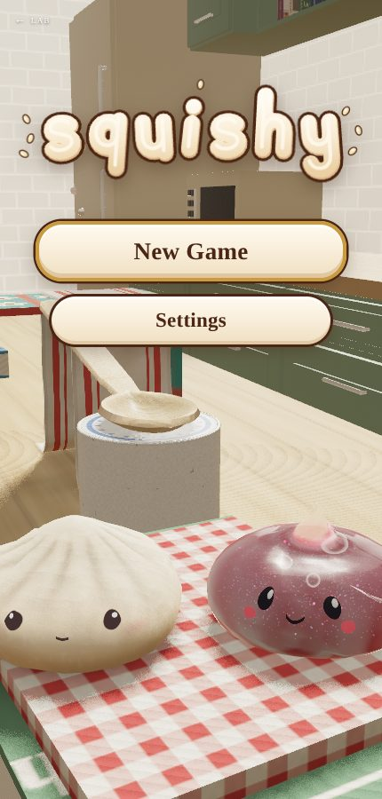
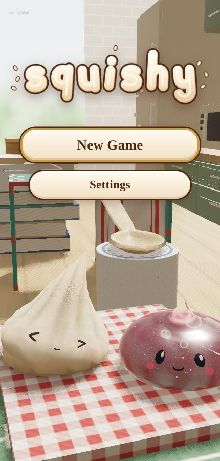

## A flick

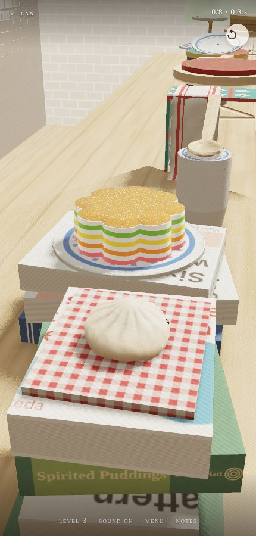
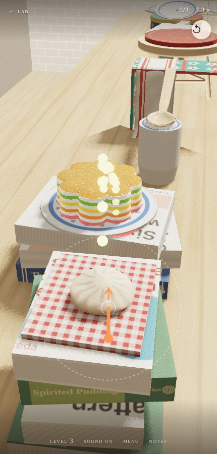
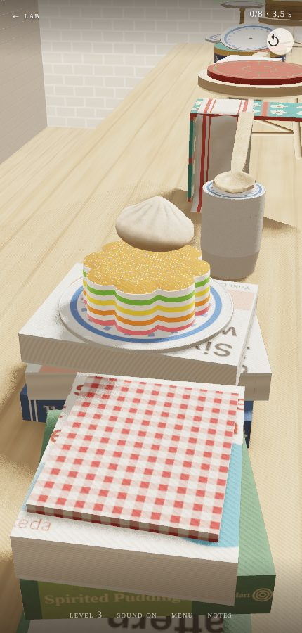
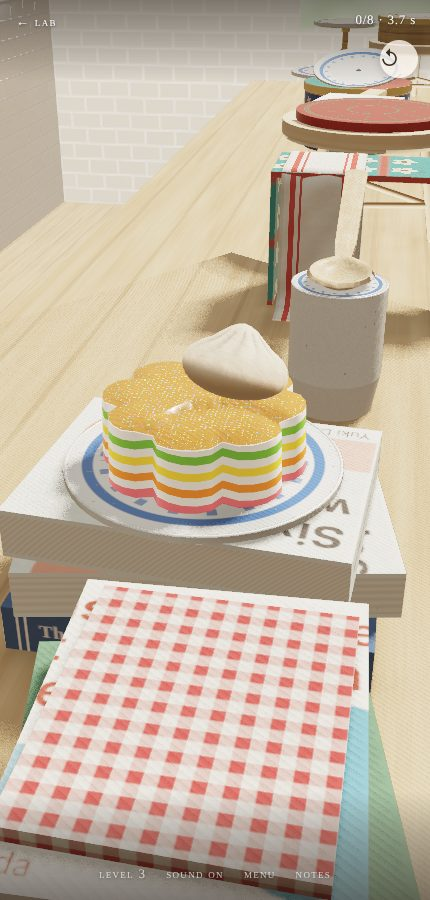

## The places

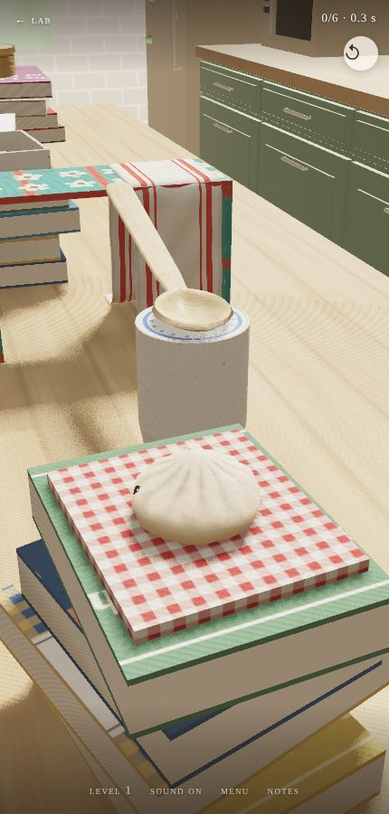
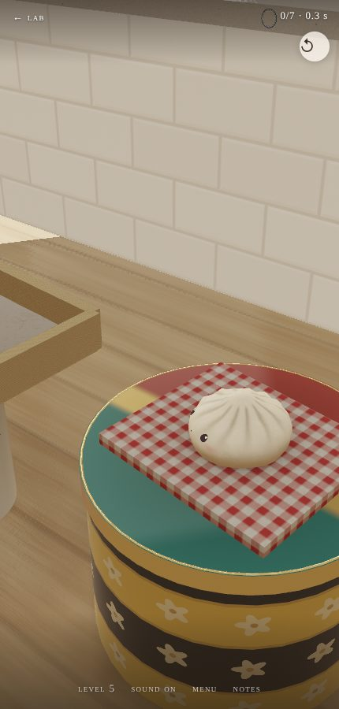
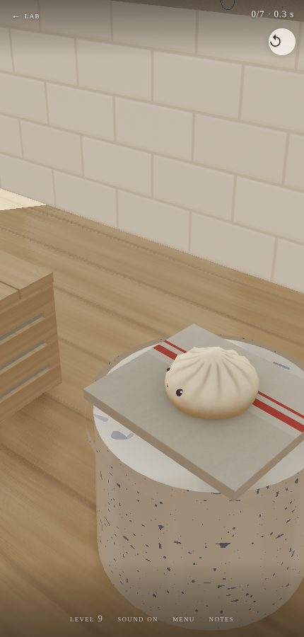
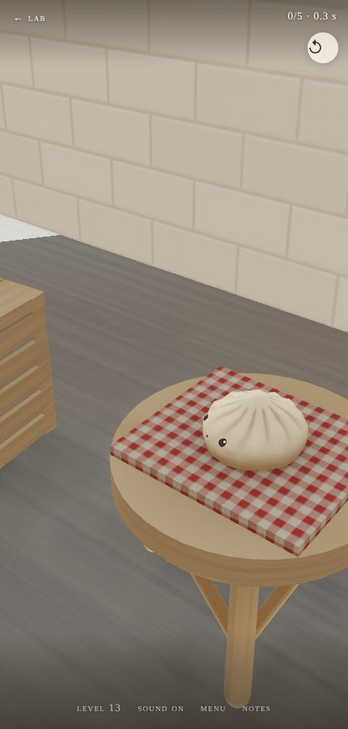
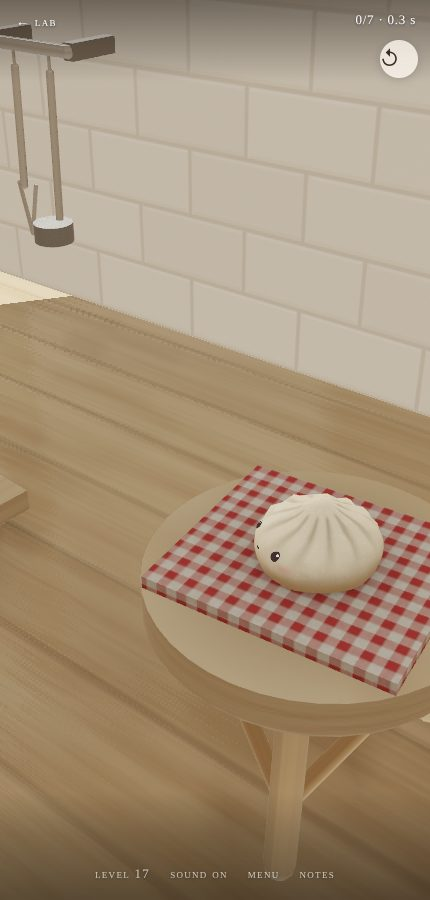

## Benches

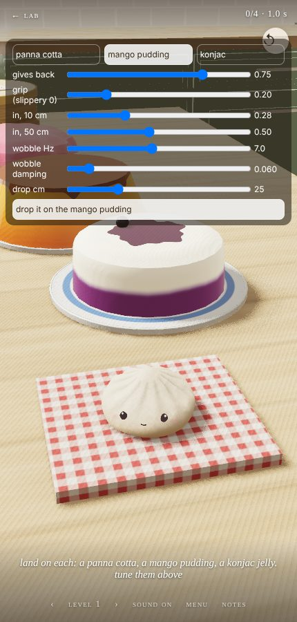
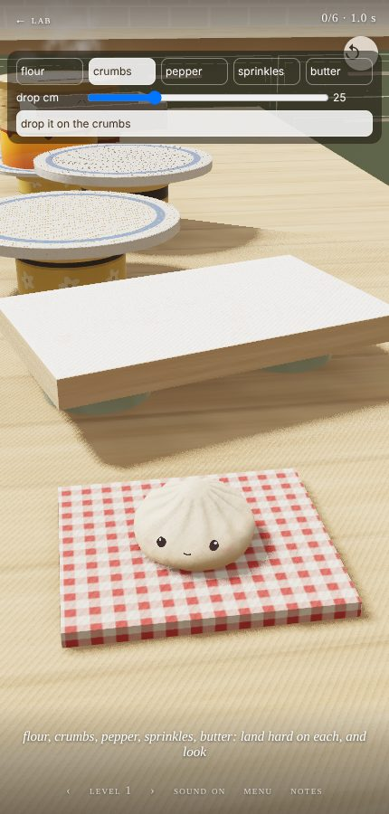
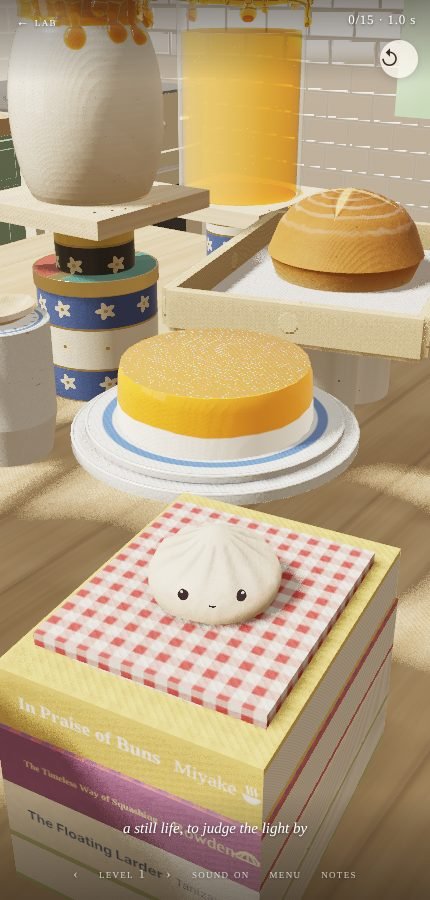
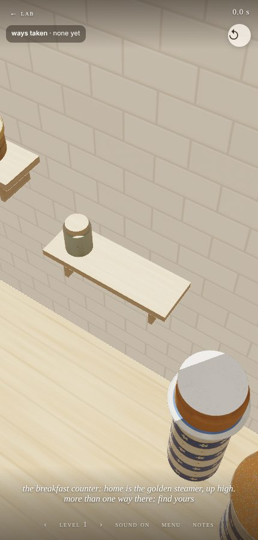
