# Switchback

A downhill motocross run down a mountain made as you ride it. The style target is a single flat-colour illustration (`switchback/target.jpg`): an orange-and-black rider on a pale cliff road, a charcoal rock wall, an orange fence along the drop, black pines, a deep ultramarine sky, blue snow-banded ranges, a white river far below, and speed drawn as orange, white and charcoal shards rather than blur.

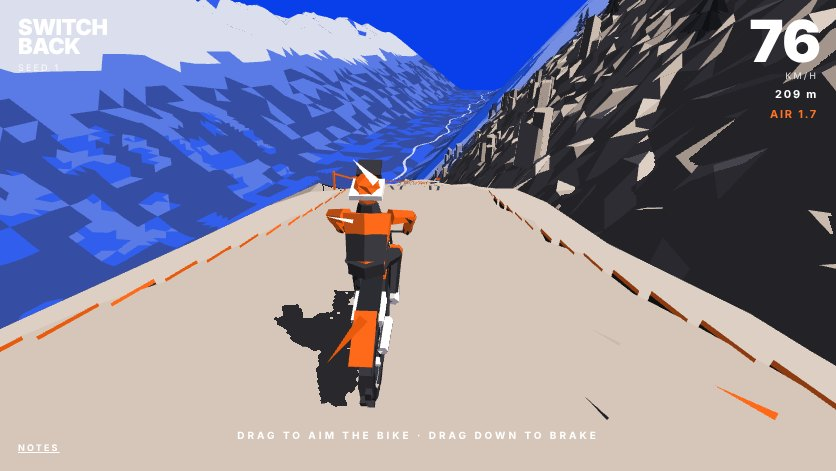

## The brief

A moving composition of cut colour: cobalt space, pale passages, charcoal weight and orange force. The mountain, the rider and the machine come out of overlapping silhouettes, deliberate openings and a few decisive internal marks; large areas stay flat and unbroken. Depth comes from perspective, occlusion, parallax, contact and a changing silhouette, not from shading every facet. What isn't drawn matters as much as what is:

- **An edge earns its place** by explaining a silhouette, an overlap, a fold that matters, a contact or a direction. A polygon boundary alone earns nothing.
- **Negative space is designed**: the opening under an elbow, through a wheel, between the hips and the seat.
- **Boundaries may disappear and return**: a black leg merges with the bike, then separates as the rider shifts; posture, contact and the riding decision stay readable.
- **It works between frames**: masses hold together as the rider turns, openings widen and close with load and lean, marks stay attached to what made them.
- **Rider and motorcycle are a changing partnership of masses.** Their axes separate under effort, open in flight and gather for landing. Hands and feet make the contact; elbows, knees and the spaces between show the forces.

## Riding

Drag left or right to steer: the drag's distance from where it began sets how hard you turn. Nothing steers for you: the bike goes where it points, and with no input it runs straight on, so every bend has to be ridden. Turn hard at speed and the rear steps out: the way you're travelling follows the way the bike points only as far as the tyres grip (less at speed, less braking), so the bike yaws past its line and slides, scrubbing pace and throwing roost, until it lines up again. Drag up and down to drive, as far as you drag, like the steering: up opens the throttle wider (a harder pull, toward ~185 km/h), down brakes; left alone, the engine and the hill keep you going as they always have. ← → or A D steer from a keyboard, ↑ ↓ or W S drive. **Jumps** come in four sizes, the orange chevrons painted on the ramp counting them: a **hop** (one chevron; under a second or so in the air), a **kicker** (two; about two seconds), a **big kicker** (three; nearly three) and a **booter** (four; three and a half and more: the big set piece, every kilometre or so, a little way past a checkpoint so a missed one doesn't cost much). Each is built to its flight: a ramp, a gap, and a landing shaped to the flight a rider at the usual pace makes, so whoever clears it comes down along it; the big ones have a straight run-in eased toward level and a steep ramp. Most are the mountain's own: the take-off a mound of snow and rock the ground rises into, the gap a **cleft** cracking the mountainside (for a hop or a kicker) or a **gorge** cut through it (for the big ones), its notch running up the wall as a gully and on down the drop as a channel, no flat floors: a cut falls steeply from its lips into a V, a stream's channel down its middle, its bed falling away down the mountain and rough with rock; a stream along a gorge's floor, and over some gorges' rims on the wall side a waterfall, thrown clear of the rock and falling in an arc to the floor, bands of it sliding down, spray where it lands; some kickers are still built, a ramp on black trestles, over a cleft like the rest. Too slow and you fall short into the gap; too fast (the throttle held wide open into a big one) and you overshoot the landing onto the flat: landed square, the bike takes it, slammed down and a third of your pace gone; crooked, it's a crash. Jumps launch you; whoops (a run of rollers) throw you at speed; any crest that falls away faster than you would drop puts you in the air. **The take-off decides the flight.** Nothing you do in the air steers: the rider's body keeps the bike on line (easing the flight back along the road and toward its middle, gently, at most about 0.6 rad/s), but where you go is where the lip sent you. On a ramp, down isn't the brake, it's the **pull**: how hard you're pulling as you leave the lip is how fast the bike rotates, nose up, and pulled hard enough (and with air enough: a whole turn wants about two and a half seconds, so a big kicker or a booter) it comes round into a **backflip**. Once it's committed you can only trim it: in the air the throttle spins it faster and the rear brake slows it, within a band around what the lip gave you, so a flip pulled too lightly can't be saved and one pulled too hard has to be held back. Off a flight that isn't a flip, up and down only tilt the nose (about 20° at most either way) and it settles back to the flight's line when you let go: nothing you press builds into a rotation, so a straight landing is always there. A light pull (as a brake into a ramp would be) counts for nothing; and a pull the flight can't bring round to a whole turn, even trimmed as hard as it can be, isn't committed at all (NO ROOM TO FLIP): the lip flies the flight forward to see. Up and down are measured from where your drag stood when you left the ground, so a pull held through the lip doesn't count twice. **Tricks are drawn.** Steering does nothing in the air. Instead, put a finger down while you're up (a fresh touch, or a second finger if you're still holding the first) and draw: a straight line is one of the body's tricks by its direction, **→ NO HANDER** (arms out wide), **← NO FOOTER** (legs kicked out behind), **↑ SUPERMAN** (both legs stretched straight back, the body flat over the bike), **↓ CAN-CAN** (the left leg swung over the seat to join the right), and on the diagonals **↗ HEEL CLICKER** (both feet up over the bars in front, heels together), **↖ NAC NAC** (the right leg swung back over the rear fender), **↘ SEAT GRAB** (a hand back on the seat, the legs kicked back) and **↙ ROCK SOLID** (hands and feet off at once, the body floated above the bike: the slowest in and out, and worth the most); the straight ways take a little more of the circle than the diagonals, so a line drawn a little off across still reads as across; a **loop** is the **WHIP**, the bike swung out beneath you, clockwise to the right, anticlockwise to the left. The line shows where your finger goes, turning orange once it's read. The trick is asked the moment the shape is clear and held for as long as your finger stays down: lift it and the rider gets back on (a quarter to two fifths of a second, the superman slowest), or draw another shape without lifting and the next trick is strung on from the first. Each is worth more the longer it's held all the way, and half as much again for each one strung on in the same flight. Still off the bike as you land is a crash, so the hold is the risk. But a trick the air left can't fit is never attempted: as you ask for it the sim flies the rest of the flight forward, and if there isn't time to get into it and back out, it's refused (NOT ENOUGH AIR) and costs nothing; ask for something else to try again. Keys: Z X C V the straight ways, R F T G the diagonals, Q E the whip, held. Over a crest, an air you didn't ask for, the rider's body lines the bike up with the road twice as firmly as off a jump, so a bend under a crest doesn't carry you off it. How the bike meets the ground matters (and a fall says why: SHORT, TOO HARD, NOSE UP, NOSE DOWN, STILL OFF THE BIKE, STILL WHIPPED): square to its slope, the landing's soft and keeps its pace, and it takes nearly twice the slam a crooked one does (a nose pushed down onto a falling slope carries you on a little faster); a little off and a wheel slams; well off (nose first, or looped over onto the back wheel) is a crash. A whole turn landed is a BACKFLIP or a FRONT FLIP (DOUBLE, or more), across the screen with a three-note chime. Bring it back straight before you land: still out a little and it comes down yawed and slides straight, scrubbing pace; still well out (past about 34°) and it's a crash. The wall on the left glances you off it and costs pace; the drop side, on the right, is forgiving: you can ride the shoulder past the fence and the slope beyond it (the bike rides the ground as it's drawn there, and slides down it where it's steep), and only going too far down it, landing too hard into it, or riding into a face (an outcrop, the side of a raised deck) ends it. A fall or a crash puts you back at the last **checkpoint**: the flags on the wall side, further apart the further down you are (about 300 m apart at the top, about a kilometre five kilometres on), each one counted as you pass it (CHECKPOINT n across the screen, and again when you're put back at it), and you start again just past it, going.

The rider is yours from the start; `auto` hands the steering to the sim's own rider, for a run like yours in the page's mode: scored, its tricks called, ended with its card, but never kept on your board (`auto=tricks` shows off; the lab's listing shows that, its score and calls over it). The eye rides over your right shoulder, the drop side, so the wall rises beyond the rider and the valley opens under you.

## The course (`course.ts`)

The line is laid a metre at a time from the seed, as an off-road route picks its way down rock rather than a road's arcs: straight legs broken by short, sharp kinks (seven to fourteen metres each, some hard; always turning back toward the fall line once the route has wandered, so it keeps going down the valley), a width that never settles (a new one every few metres, joined straight; now and then a pinch between rocks under 5 m, or a wide flat over 10), a fall that steepens and eases, and a rough surface that steps up and down over rock, a new height every few metres joined straight. On the legs, features: a jump every so often (a hop, a kicker or a big kicker; a booter a little way past some checkpoint flags), whoops between. The mountain stands on the left (a rock wall going up) and falls away on the right, as a cliff road does. Everything asks the course the same things: where the line is at distance `s`, the surface height at (s, u) with u across it, and whether there's surface at all (a gap has none).

## The rider (`sim.ts`)

Arcade physics in the world: the bike has a heading (where it points) and a travel (where it's going); steering turns the heading, quicker at low speed; the travel follows through the grip; where you are on the course (how far down, how far across) is read back from your position. The fall of the hill and the engine drive you, the air holds you back, the loose shoulder slows you. The lean is what the turn asks (pace times how fast the heading swings, against gravity). The engine pulls hard toward 165 km/h; a run averages well over 100. Off a ramp's lip you fly, exactly at its last metre and as steeply as that metre lifts you; off a crest too, where the ground a tenth of a second on falls away below the arc you'd fly by more than the suspension takes up (so the rough rattles you without throwing you every step). You fly a ballistic arc, the air holding you back with the square of your pace as it does on the ground; you land along whatever's under you, a hard landing squashing the suspension and costing pace; landing short into a gap or a landing's face, or falling far below the road, is a crash. Put back at a checkpoint, you start at about 85 km/h.

On a long flight the eye eases out to the drop side and holds the rider in the middle of the frame, so a flip or a whip reads as the whole figure turning; it comes back in as you come down.

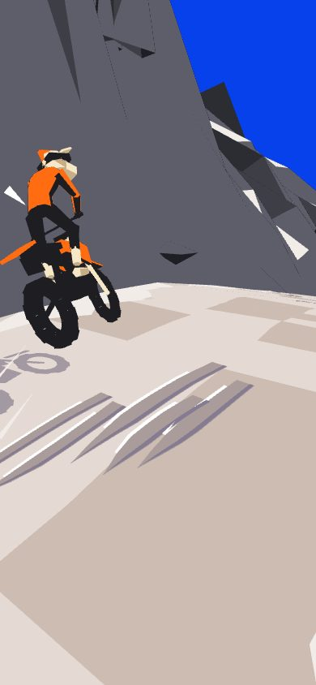
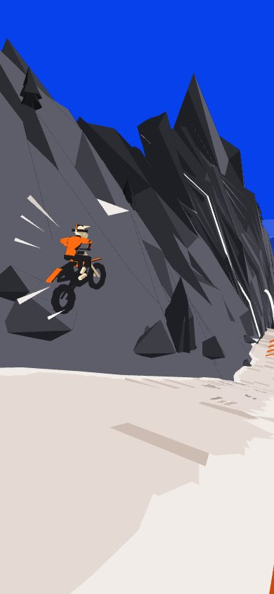

## The bike and rider

A motocross bike in its real proportions: a 1.48 m wheelbase, a 21-inch front wheel on a fork raked at 27°, knobbly tyres drawn as open rings with the rim inside, a swingarm and shock behind, tank and radiator shrouds, a long flat seat, the rear fender kicked up, the pipe and silencer.

- **On the ground:** each wheel stands on the surface under it (sampled ahead and behind), and the bike is pitched between them, so both tyres touch on slopes, crests and the rough.
- **Steering:** the whole front (the wheel, fork, fender, clamps, bars, grips and number plate) turns about the raked steering head. It turns the way you steer, less at speed, and toward where you're going in a slide (opposite lock).
- **Lean:** what the turn asks (the pace times how fast the way you're going is swinging, smoothed so a flick isn't a turn, against gravity). It comes in over about a third of a second and is never more than about 35°.
- **Suspension:** the frame sinks on its springs as you land and as the rough throws you up, and in the air it extends.

The rider isn't fixed to the bike; it works it:
- **The body rides on springs.** It sways against the bike's lean (the bike tips further than the body, which stays nearer upright over it), shifts to the outside of a slide, rocks back as the bike speeds up and forward as it brakes, bobs with the bike's lurches up and down. It lags, overshoots and settles.
- **States read as different shapes.** Riding, it stands on the pegs, the hips off the seat, the elbows open. Landing, the pelvis drops toward the seat (never into it), the chest goes down toward the bars and the elbows out and back: the figure shortens. In the air it stands tall at first, the hips well off the seat, and as it comes down it gathers, the hips settling and the weight going forward.
- **A chain, not a statue.** The pelvis, the chest and the head each turn their own amount: the chest is bent forward off the pelvis; in a whip the pelvis twists toward the swung bike, the chest less, the head a little the other way, toward where it'll land. The shoulders' line tips under the effort of the bars.
- **The head leads.** It's sprung on its own, quicker than the body: it looks into a turn and along a slide, nods down toward the ground as you come down to it, and is held nearer level than the bike.
- **Legs and arms are solved each frame** (two bones each) from the hips to the pegs and from the shoulders to the grips, which turn with the bars and swing with a whip. Their joints are pushed differently on each side, so the openings are made by what the body's doing: under the bars' effort or a whip one elbow goes up and out (a broad opening) as the other comes down and in (closing), and one knee grips the machine as the other comes away.

**Drawn as cut colour**: three masses, each one flat field with one dark cut where it turns from the light. Orange is the jersey (one shape, lofted through the pelvis, a narrow waist, the chest and broad, rounded shoulders; sleeves full at the shoulder, narrowing to the elbow) and the bodywork. One charcoal is the legs, the gloves and the whole machine (engine, frame, swingarm, pipe and silencer, side plates, tyres), with no marks inside it. Cream is kept for what touches or steers (the boots, the fork as one slash), the front plate and the helmet, its one dark cut the goggles and strap as a single band, with an orange stripe over the top; a dark neck parts it from the jersey. The wheels are thick knobbled rings, open through the middle. The rider is lit for the picture, not by the sun: from above, behind the eye and to its left, so what faces you is one field and only the side turned to the eye's right takes the cut.

`look=side|front|rear|quarter` holds the eye off the bike, for judging the model.

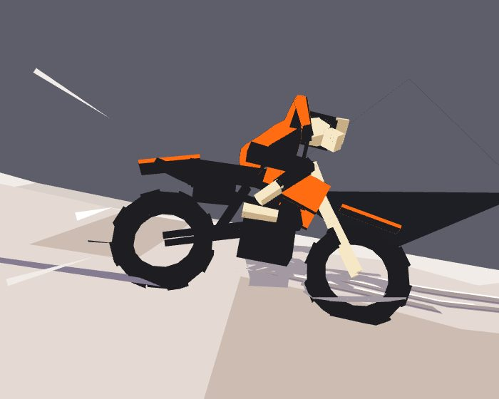
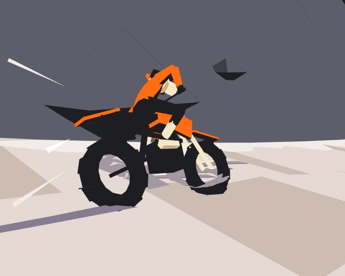

**Studies** (flags, for judging the figure):
- `rider=sil` draws the rider and bike as one solid charcoal, to judge the silhouette before the colour; `rider=facets` the old way, every face its own band (orange jersey with black panels, white boots, an orange helmet).
- `whip=<degrees>` holds the bike in a whip beneath the rider, for a pinned frame.
- `world=0` draws the rider alone on the sky, to judge its silhouette and openings.

## The drawing (`mesh.ts`, `render.ts`)

Every triangle has one material and one tone. The renderer takes each face's normal from the screen (so every face is flat), and its light, nudged by its tone, picks one of its material's four colours, all taken from the target: pale snow, packed track, charcoal rock, orange, black, white, the ranges' blues. So planes lit alike still break into different greys, as a painter sets them. Distance doesn't fade smoothly: it steps, four hard bands toward the valley's blues, each face keeping its band so the far slopes stay faceted. The rider's shadow is the bike itself flattened along the sun onto the ground. Each face's position is taken relative to the eye before its normal is found, so far down the mountain, where world coordinates run to thousands of metres, faces don't speckle between bands.

**The backdrop** is drawn round the eye, far enough off that it needn't move with you, in one family of blues: lighter and flatter the further off, never charcoal. It's a few deliberate set pieces rather than a field of random facets:
- **Two skylines**, the farthest (3.4 km) and a nearer one (2.5 km) in front of it. Each is one continuous ridge line: peaks of their own heights and widths, broad shoulders and sharp summits, some broken by a notch, overlapping so one hides the next, and saddles that never sink far.
- **Folds:** each skyline has one fold row partway down, pushed toward you under the summits and back in the saddles, so each face is one plane, lit or in shade.
- **Snow** comes down from the crest where it's above the snow line, further down the gullies than the spurs, so it reads as fields and runnels rather than caps.
- **Foothill ridges:** one or two in the middle distance (about 1.2–1.5 km), each a single long ridge rising from the valley floor and falling back to it, its face in a few big planes with one fold, and a band of forest along its foot, its top edge ragged as treetops.
- **The valley floor** is flat, in one blue, with the white river winding across it.

The world is built in 48-metre chunks: a cross-section every four metres, a few big planes from high up the wall to far down the drop, jittered hard in all three directions so its faces break into rock, its character drifting as you go down: the wall from a snowy bank to a sheer cliff, the drop from a shelf to straight down, now and then an outcrop of rock rising between the route and the valley; rock where it's steep and snow where it isn't; the track over it, its edges ragged; the fence (posts, an orange tape and a white one), checkpoint flags on the wall side, further apart the further down (their banners flying, built fresh each frame: waves run out along them, bigger toward the free end, which droops and swings; the facets catch the light and lose it as they turn), kickers on trestles, big jagged boulders bedded along both sides, crags (clusters of leaning rock towers) down the shelves and up the banks, a few pines.

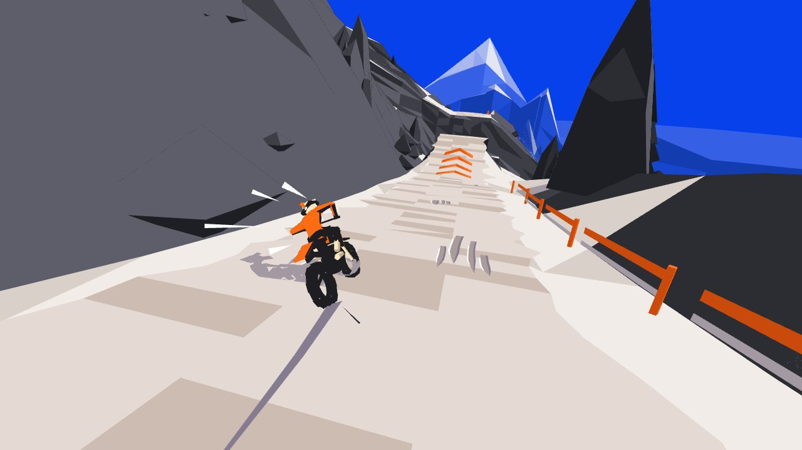

**Ruts** (`gouge.ts`) are carved, as a linocut would cut them: marks that say what the ground is rather than where to ride. Each is a gouge stroke, fine where it enters, swelling, lifted out square (or, now and then, tapering again); its floor a step darker than the road, a line of the deep shade's violet (a new ink, the road's) down the wall the sun can't reach, and a sliver of white over the lit lip, seen where the road round it is in shade. On smooth ground they come in combs of three to five parallel cuts going with the road, a print's way of laying down a field, cut by hand rather than stamped (staggered starts, so a comb's front edge slants, uneven gaps, each its own length, now and then one left out), one to each side now and then, with long rests of clean road between; through a bend more of them, longer, leaning out. Where the surface steps, short choppy cuts at odd angles just below the edge (a comb stops at an edge, it never runs over one). On whoops, hatching across the face of each hump, so the humps read as humps; where a landing takes the bike back, a cluster of short heavy cuts. They're anchored to the course, thin to nothing in the last metres before the eye, are cut broader further off so they keep their weight in the frame, and stop at about 60 m. **Your own track** is the freshest cut: laid behind the rear tyre as you ride, nearly unbroken, wider where the rear was sliding, broken where you were in the air, in the violet; the last 30 m of it kept, and a crash keeps it until you're put back at the flag.

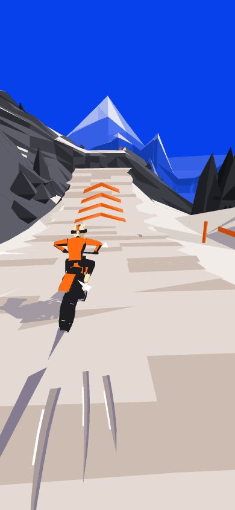
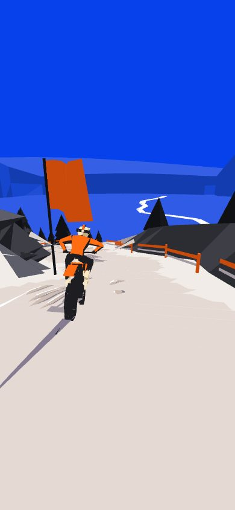
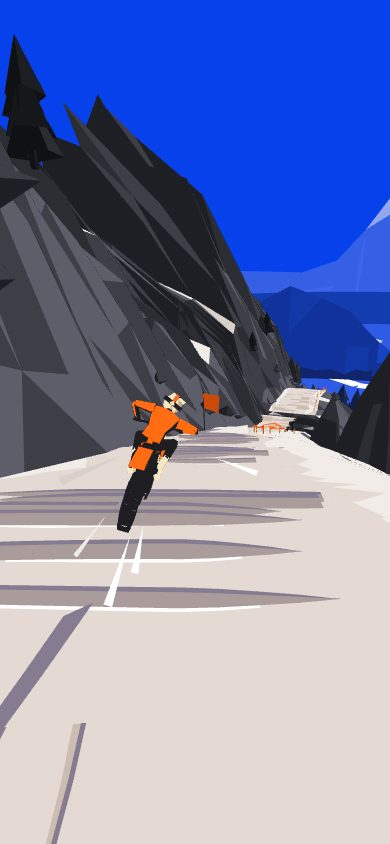

**The bolts** they replaced (`ruts.ts`, kept behind `ruts=bolts`) were drawn as bolts, not stripes: chains of straight strokes with breaks between them, each a thin dark wedge (the track's shade, nearly charcoal) that comes to a point at its uphill end, toward the eye, and is cut off blunt and slanted at its downhill end. A stroke kinks sideways where the surface bends (a rock step's edge, a roller's crest or trough) and every five metres or so between, so each lies on one plane of the road and takes that plane's light: the ruts are what describes the road's rise and fall. Two lines run down the road, swinging in toward the inside of a bend; where they come close they merge, and part again; now and then a third splits off one, runs its own way and rejoins it. They run on the road, the rollers and a landing deck, not on a ramp or over a gap. Near the eye they stream past as speed; further off fewer are drawn, and past about 60 m none, so the far road is one pale field. They're built each frame round the rider, not into the world.

With them, your own track is the same mark, fresh and a shade darker: strokes laid behind the rear tyre as you ride, a little kinked at each joint, wider where the rear was sliding, broken where you were in the air, the last 30 m of it kept. A crash keeps it until you're put back at the flag.

**Nothing fights in depth.** The ground under the road sinks away from it (0.15 m at its edges, 0.45 m under its middle), so the two never lie in one plane however the road's roughness and the 4 m between the ground's sections fall; what's laid on the ground (the road, its ruts and gouges, the rider's shadow) is drawn a hair toward the eye in depth; and the eye's near plane is 0.6 m (it was 0.3), which doubles the depth's precision everywhere. `node cells/lab/devtools/switchback-zfight.mjs [query …]` finds what's left (the eye held where it settles, `hold`): a held frame drawn with every face's depth, and nothing else, nudged a few steps every other frame (`zjit`); what changes between the frames is fighting.

## Speed, drawn

Motion is drawn as vector shapes on a canvas over the world, never as blurred pixels, and each colour has one job, so the layer reads like a gauge (and the sound says the same):

- **White and pale: the air.** Streaks hung in the air ahead (beside and above the way you're going, and some close about the rider) which the eye flies through, so they come in from the point you're riding at and whip past at the edges, each drawn from where it is back to where it was a moment ago against the eye: more and longer the faster you go, as the wind's roar rises with it; in the air they're all there is.
- **Orange: the engine pushing.** Streaks streaming back from behind the rider and out past the eye, only while you're actually speeding up (the throttle, or the hill pulling you on), more and longer the harder; at each change up the gearbox, as the engine's note drops, a burst of them and the white ones stretched for a moment. The rider's tail trails an orange wedge only under real push.
- **Charcoal: the ground taking it.** Low, fast fragments off the wheels as you brake or slide, as the gravel's crunch does; and the debris: faceted chunks of snow and rock thrown off the rear wheel, a burst on every landing, a spray on a crash, chips off the wall, each spun and smeared along its own motion.
- **Braking** draws it all in: the white shards shorten and slow, the wake shortens, the eye's field of view tightens a little (it widens a little under push). **A landing's** jolt does the same for a moment, with its thump, its burst and the eye's shake, all from the same impact.
- **Smears**: each fence post near you is dragged back as a wedge from where it is to where it was a moment ago, against the eye.
- **The air on the rider** peels off it: now and then the air leaving a point on the rider's outline as it's posed that frame, whatever it's doing (leaning, whipped, upside down in a flip). It's drawn in the world, not on the screen: from that point on the body it streams back past the rider and a little out round it, cut loose as it goes, so it's fine where it leaves the body and broadens toward the eye. They're born evenly along the outline (not most of them at the helmet, which stands out furthest), never where one's still going, and only where the air leaving there is seen to leave the figure, never crossing it; on the ground only sideways off its flanks, since from a chase eye the air rushing back past the top of the figure is drawn going up, which reads as hair on end, and past the bottom going down, as spray; in the air now and then up or down as it turns. A few at a time and each a while (about a third to a half of a second), more the faster you go, fewer braking. (`wake=fixed` the three streaks it had before, set at the helmet and the bar ends, which turned only with the bike's heading and from a chase eye fell back across the figure; `wake=0` none.)

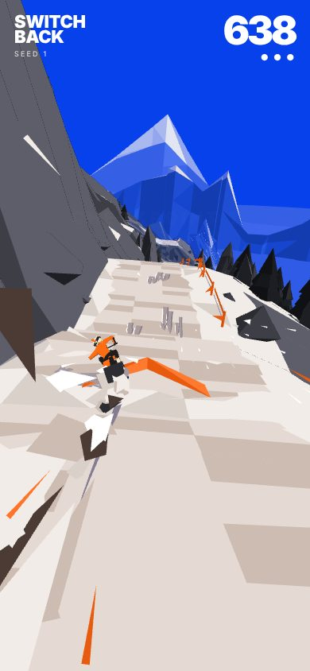
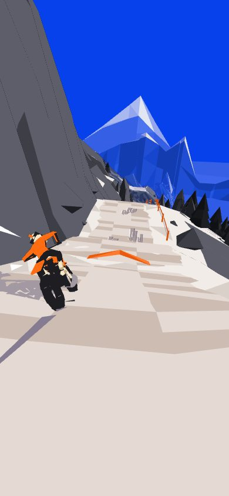

## Painted (`paint=1`, `paint.ts`)

An experiment in drawing the mountain as paint, after looking closely at a brush-shader snowboard prototype (Brush Rush) and its sibling (Paris Freestyle). Everything you see is a brush stroke on paper: the sky, the ranges, the mountain, the road, the fence, the pines, the flags, the rider and its shadow. Nothing is underpainted: the facets are still built, but only drawn into the depth, for what hides what.

- **Strokes with a reason to be where they are.** Planted on the ground's faces when a chunk is built, in two passes: the **masses** (big and broad) and the **detail** over them. They run the way the ground runs: along the road and the snow beside it, turning across the slope further off, down the face on rock, level on the far ranges. Fine by the road, broad away from it, so the picture simplifies where you're not looking. Things (the fence, the posts, the pines, the kickers, the rider, a flag) are painted in small strokes along each face's longest edge, on both sides; what moves is painted afresh each frame, each face's strokes seeded by the face, so they stay put on it.
- **Laid in the world, so they hold still** (after Brush Rush). A stroke lies on its face along its own way; across it, its width turns from lying on the face toward facing the eye as it gets further off, so it never thins to a sliver. Nothing about how it lies comes from the screen, so it can't swing as the eye moves (they were built on the screen at first, their direction from the way their face ran on the picture and their motion since the last frame, and they swung and jumped as you rode). Its depth is lifted toward the eye along the line to the eye (on the ground a little, more the further; on a thing by half its own size), so it clears its own face, and it's tested pixel by pixel against the facets' depth: hidden where something stands in front. The sky is painted only where nothing stands, the ranges only where nothing near stands (a stencil), so a gap shows paper, never the wrong thing behind. Strokes are blended (premultiplied) in a fixed order: they were drawn with alpha-to-coverage, whose dithered samples crawled wherever strokes overlapped.
- **The paint front.** The mountain is painted in ahead of you. Each stroke is laid, tail to head, as a front passes its station: the masses' front well ahead (420 m, out in the haze), the detail's close (110 m), so you see the snow's and the rock's detail brushed in over the masses as you come. Strokes just laid are a little lighter for a moment, wet. As the page opens the fronts set out from the rider and run on ahead; put back at a checkpoint, what's laid stays laid. `front=420,110` sets them.
- **Covered.** The masses overlap; strokes thinned out with distance grow to cover what the others left; near the eye they stay broad (as a painting's foreground), never wider than a part of the screen. A few percent of paper shows, mostly at silhouettes.
- **The facets' own colours.** Each stroke takes its face's band as the facets pick it (a little jittered), its bristles mixing toward the band next to it.
- **No strokes from behind.** A stroke on a face turned away from the eye isn't laid (it shrinks away as its face turns), as in Brush Rush, so a stroke lifted toward the eye never shows through an edge from the far side; the ground's outward side is up (it's a height field, cliffs included). Things thin enough to be seen from either side (the fence's tape, a flag) are painted on both.
- **Nothing pops.** A stroke whose turn to be thinned out with distance comes shrinks away rather than going at once. What's built afresh each frame keeps its strokes: the rider by its faces, the flags and the falls by where they are; the gouges aren't painted (they're cut to the eye, so their faces change as you ride), the road's own strokes running along it instead.
- **The speed in the marks.** At pace every stroke turns, on its own face, toward the way the eye is going and draws out by as far as the eye goes in a moment (the eye's smoothed motion in the world: one way for every stroke, so they hold steady rather than swing), so the ground and the rock fall into line with the motion and stream past (`stretch=0` none, `stretch=2` twice; not on what moves with you, nor on a held frame or a jump). Your track and the rider's shadow are laid flat, as the ground is (they'd been painted as standing things, their strokes turned up to the eye: grey marks shifting just ahead of the rider).
- **The speed layer too.** Its shards, the smears off the posts, the air off the rider and the debris are laid with the same stamps, tinted: a wedge becomes a long stroke tapering the same way, a chip a dab.

The marks come from an atlas of brush stamps made when the page loads: each a brush of bristles, every bristle with its own load of paint, touching down and lifting a little apart from the rest, running dry along the stroke, and piling paint where it lifts. They.re drawn instanced, blended (premultiplied) in a fixed order, far chunks first.

Cost: tens of thousands of strokes; a chunk's take about 7 ms to place as it's built; what moves (the rider, its shadow, the flags, the ruts) is re-painted on the CPU each frame. Untried on a phone.

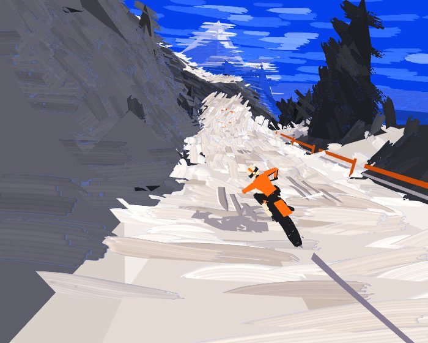
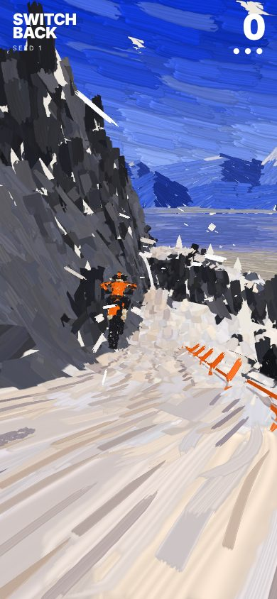

## Title, menu, modes, score (`score.ts`)

It opens on its title, the sim's own rider showing off on the mountain behind a veil of the sky's blue: flicking into kinks so the rear steps out, and at each ramp choosing what the flight will hold (on the run-in it flies the flight forward from the lip against the ground to see how long it'll be up and what it'll come down on, and picks what fits: a backflip, pulled up the ramp as hard as that flight needs and trimmed in the air; one of the body's tricks, or two strung together on a long flight, let go as soon as the air left is only enough to get back on; a whip; or nothing; it uses only the player's own inputs, so what it lands, you can). Pick a **mode** (THREE LIVES to begin with) and **RIDE** (which starts the sound too: browsers only start it from a tap), or look at the **LEADERBOARD**:

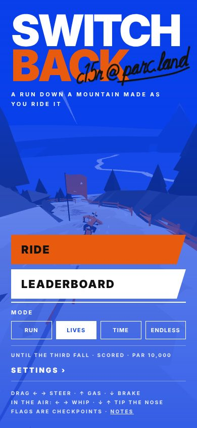

- **RUN**: 3 km down, scored.
- **THREE LIVES**: on until the third fall, scored.
- **TIME TRIAL**: the same 3 km against the clock; the time is the result.
- **ENDLESS**: on and on; **FINISH** it from the menu when you've had enough, and it's scored then.

Each mode keeps its best on each mountain (in this browser), shown under the mode; a run that beats it gets a gold card, A NEW BEST.

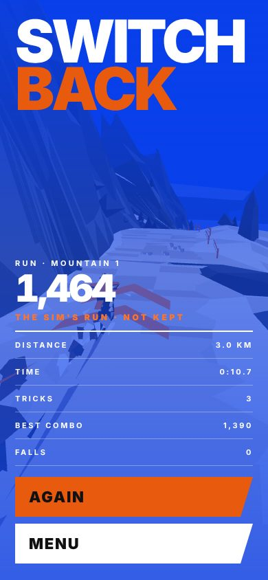

**Signed bests and the leaderboard** (`sign.ts`): a new best goes up on its mode's board, and the card asks **SIGN IT?** over a blank with a line and a cross, like an autograph book: no name typed in, just a gesture signed with a finger, a pen or the mouse. The pad keeps the strokes as they're made, with their timing (each point in thousandths of the pad's height, so the shape holds whatever box draws it, and hundredths of a second from the first touch), and puts them to the run on the board stroke by stroke. Leave it blank and the run stays unsigned; CLEAR to start over. The ink is a pen's: heavier where the hand went slowly, finer where it was quick.

**LEADERBOARD**, under RIDE on the title: a mode's top ten (each new best, on any mountain), with the place, the autograph, the score (a time trial's by the clock) and the mountain and day. Every board starts with a **PAR** run on it, signed by Claude: RUN 8,000, THREE LIVES 10,000, TIME TRIAL 1:45, ENDLESS 20,000. They're a tidy ride with a few tricks: the showing-off rider scores 12–18k over the 3 km in about 90 s, and around 40k in five minutes of ENDLESS, so PAR is well inside what can be done, for the humans. The mode's line on the title gives its PAR, and a run that beats it says PAR BEATEN on its card. Each signature is written out again as it was signed, one after another down the board, the one just signed in orange. It's kept in this browser: the lab has no shared store yet, so it's your own board of your own bests. Bests kept before there was a board start it, unsigned.

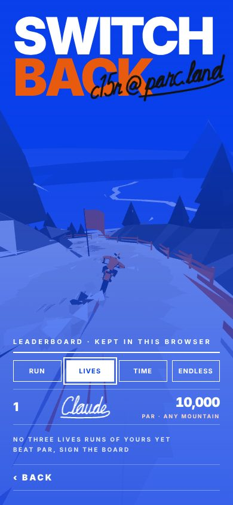

**Autographs by hand** (`hand.ts`): the built-in signatures aren't set in a font. They're written by a hand: each letter a few points the pen passes through, in a quick cursive; a word one stroke where its letters join (the pen lifted before a c, which joined into reads as an e, and for figures and marks); the dots and crossings after the word; the whole slanted, its baseline drifting, its letters varying a little; then timed as a hand moves, slow round the turns and quick down the straights. Out come the same strokes the pad keeps, so they ink and write themselves out just as a player's signature does. Two so far: **c15r @ parc.land**, written across the logo in marker each time the title comes up (a commission), and **Claude**, the e's tail carried round and back under the name, on the PAR runs.

**The score** takes the place of the speed (the speed layer shows that): big, top right (in a time trial, the clock), under it how the run's going (the kilometres of the three, the lives left, or how far), and the combo pending. Points come from riding well:

- **Pace**: a steady trickle while you're really moving (nothing below ~90 km/h).
- **Tricks**, into the combo: **AIR** on a real jump (by how long you were up), a **WHIP** (by how far out you threw it), a **BACKFLIP** (1,000), a **FRONT FLIP** (1,200; doubles more), a **CLEAN** landing square to the slope, a **SLIDE** held really sideways through a turn.
- **Checkpoints**: 250 each, more for reaching it under par.
- **Falls**: 200 off, and the combo pending lost.

**The combo**: each trick adds its points to a pool; each move after the first (a flight, a slide) lifts the multiplier half a step, to ×4. It banks (pool × multiplier into the score, with a little run of notes) once you've ridden a couple of seconds on the ground without another trick, or at a checkpoint; a fall before then wipes it. A clean 3 km run without tricks scores about 6,000; one showing off, flips, whips and the body's tricks strung together, half as much again and more (often three times).

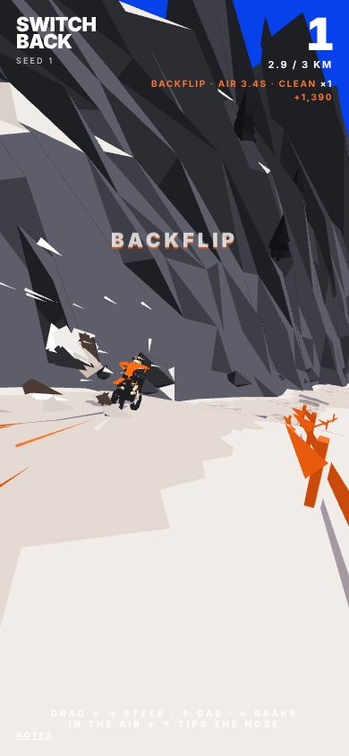

The menu (the two bars top left, or Esc) pauses a run: **CARRY ON**, **START AGAIN**, **FINISH** (endless), **QUIT** (back to the title). **SETTINGS ›** opens the settings, kept in this browser:

- **Sound**: on or off, and its volume.
- **Camera**: how far back the eye rides. MID is the usual chase. CLOSE is tight behind and low: the rider and bike fill the lower half of the screen. FAR is high and well back, an overview of the road ahead with the rider small in it. (`cam=close|mid|far` sets it for one page, for pinned frames.)
- **Mountain**: another seed.

## Sound (`audio.ts`)

All made in the page (WebAudio, no files):
- **The engine:** a two-stroke's buzz, three detuned oscillators driven through a soft clipper and a low-pass that opens as it revs. The revs come from the pace through six gears, so it climbs, drops a gear and climbs again. In the air the back wheel's free and it screams; braking, it falls to a burble.
- **The wind:** noise through a band-pass that rises with the pace, louder as the square of it.
- **The ground:** a gravel crunch under the tyres, more in a slide, none in the air.
- **One-shots:** a landing's thump, a crash, a glance off rock, a checkpoint's two-note chime.

## Flags

`paint=1` everything painted in brush strokes, laid by a paint front ahead of you (`stretch=0…2`: how far they stretch along their motion; `front=420,110`: how far ahead the masses and the detail are laid) · `seed=` the mountain · `mode=run|lives|time|endless` the mode for this page (THREE LIVES unless chosen) · `auto` the rider rides itself (`auto=tricks` showing off, as on the title), a run like yours in the page's mode: scored, its tricks called, its lives or kilometres shown, ended as the mode ends with its card, but never kept on your board (a touch takes over, and the run still isn't kept; AGAIN rides the sim's run again) · (any flag below skips the title) · `fx=0` no speed layer · `fog=0` no distance fade (both for judging a frame) · `rider=sil|facets`, `whip=`, `world=0` the rider studies (above) · `t=` start that many seconds down the run (ridden there by the auto rider) · `still` hold the frame · `preview` no HUD.

## Tests

`node cells/lab/devtools/switchback-run.mjs [seconds] [seeds…]` rides the auto rider down seeds 1–3 for three minutes with no page (few crashes, kickers cleared, pace held), and checks that hands off, nothing steers for you: the bike leaves the line at the first real bend; the air's tricks: a whip held a moment off a big ramp swings out and comes back and lands, a no hander held into the landing is a crash, held a while and let go in time it lands, and over the crests' little airs full steering does nothing and a superman asked is refused, never a crash; habits that mustn't crash a straight landing (the throttle held in the air, braking into a ramp, flat out all the way); the gestures: each line by its eight directions, each loop by its way round, a big slow loop not mistaken for lines, a line strung into a loop, a short scribble nothing; and the pull: pulling on every ramp with no trim crashes, and the throttle held open is faster than left alone. `node cells/lab/devtools/switchback-shot.mjs [query…]` renders pinned moments at a landscape and a phone size beside the target, in `devtools/out/switchback-board.png`. It also measures the jumps by size (airtime at the run's own pace, a hop about a second up to a booter over three) and rides the showing-off rider down three seeds (its flips, whips and slides, and what it lands). And it scores a 3 km run ridden plainly against one showing off (tricks are worth riding for), and checks a fall wipes the combo pending. Last, the board, in a stand-in for the browser's storage: each has its signed PAR (never kept with the player's runs), it starts from the bests kept before it, a new best goes up where it places and can be signed and unsigned, a lesser run is left off, time trials go by the clock, and ten are kept; and the hand's autographs come out whole (strokes in order, time going on, written in a few seconds).

**Pictures**: `node cells/lab/views.mjs switchback` makes the README's pictures from `client/switchback/views.mjs` (each `static/switchback/v-<name>.jpg`, the whole set in `static/switchback/views.md`): most held moments of the sim's run (`t=…&still&preview`), the run and its card caught as they happen.
