# switchback: every view

Made by `node cells/lab/views.mjs switchback` from `client/switchback/views.mjs`. The README is `../switchback.md`.

## Riding

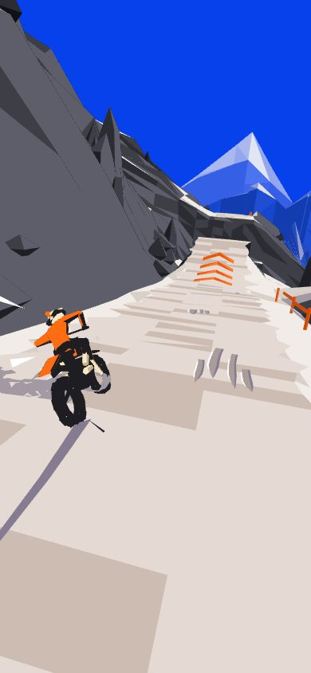
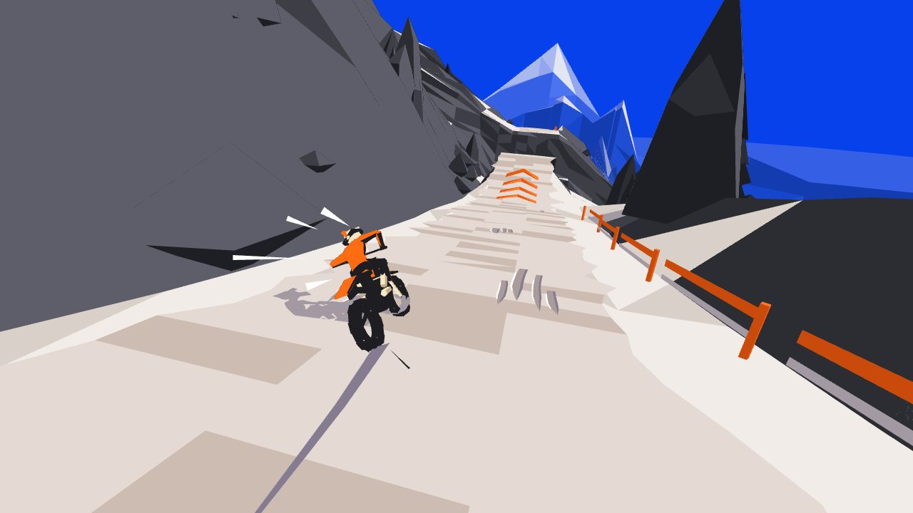

## A run

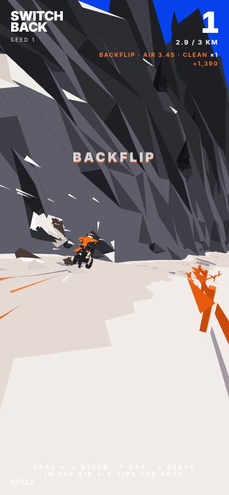
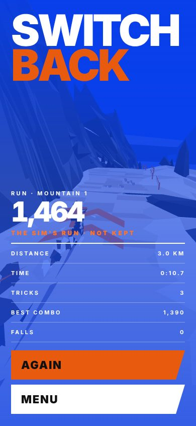
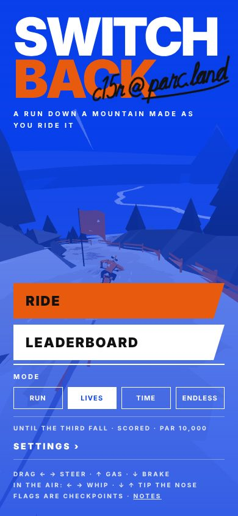
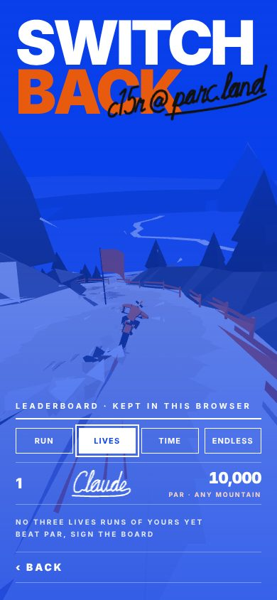

## The bike and rider

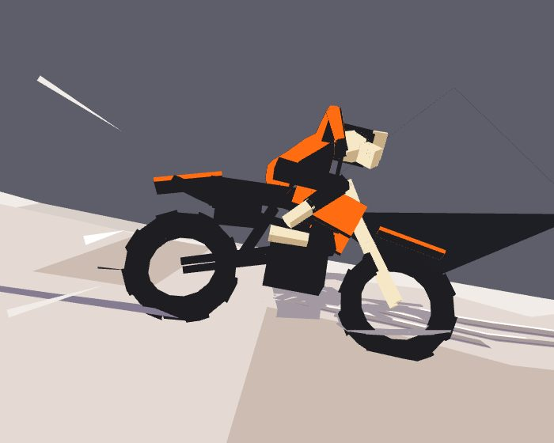
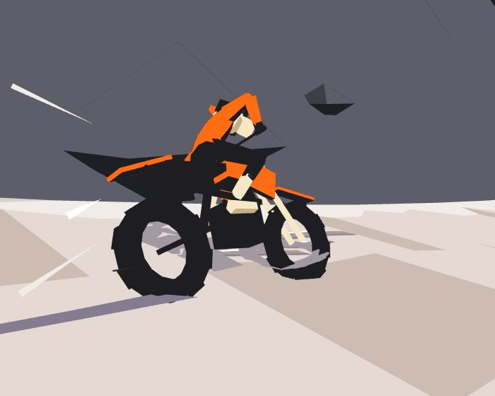
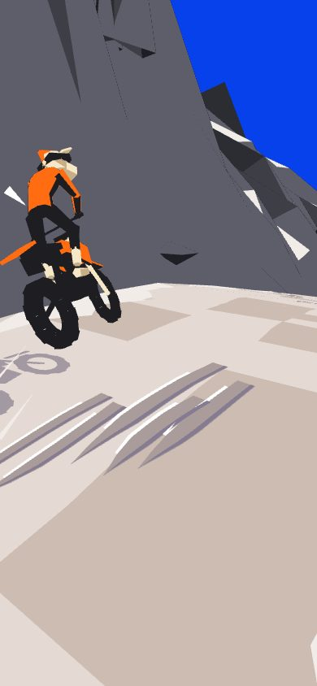
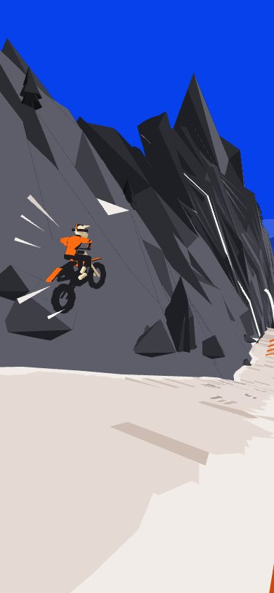

## The road

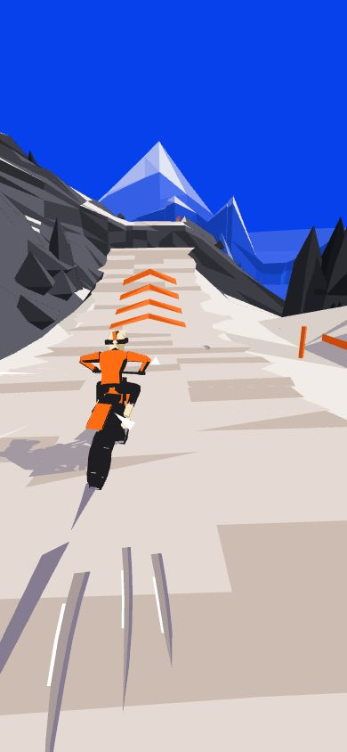
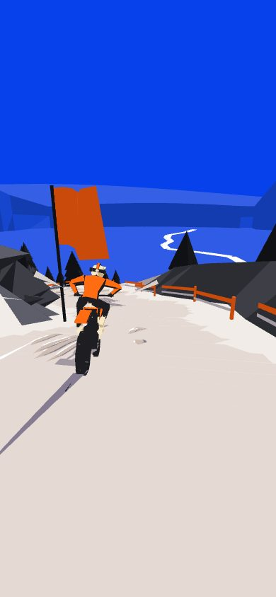
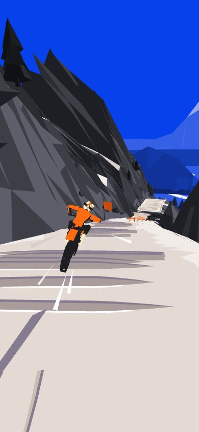

## Speed, drawn

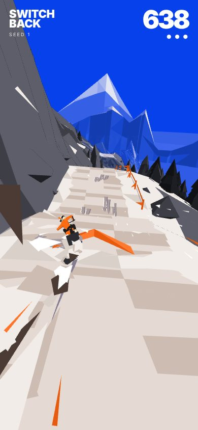
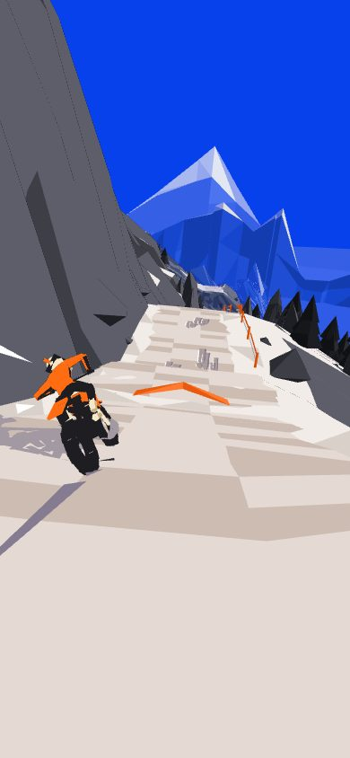
