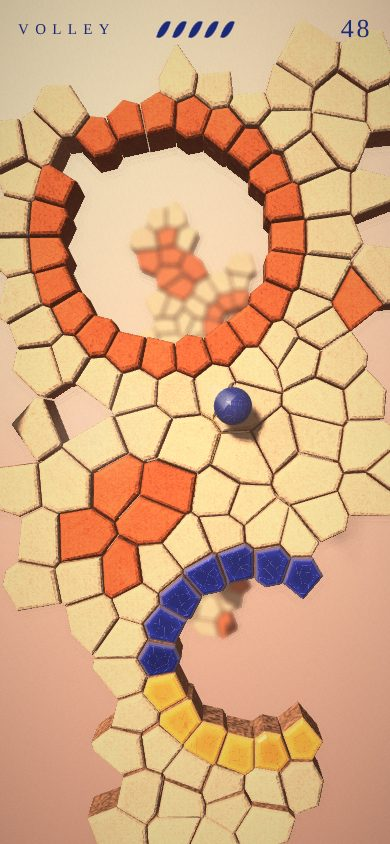
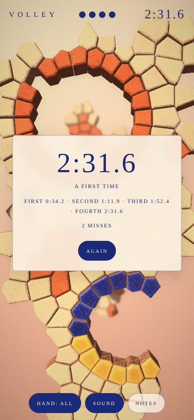
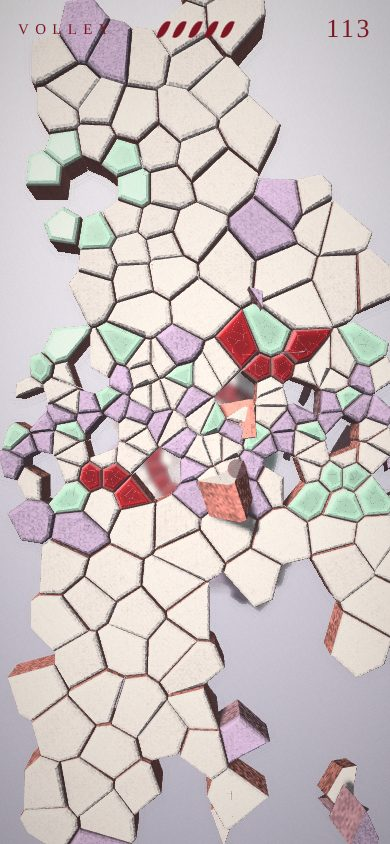
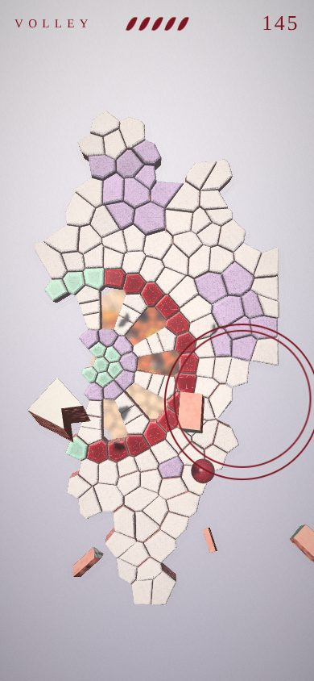

# Volley

> A ball thrown up into fired and glazed sheets and caught again. There is no paddle: the screen is a pane, and you return the ball with a hand on it.

You are lying on your back, throwing a bouncy ball up at what hangs above you: sheets of fired clay, tiled and glazed, one behind another, each with holes through it. The ball breaks the tile it strikes and falls back; wherever it comes back through the pane, a hand has to be there. Break most of a sheet and the rest of it gives way, and you rise to the next. Every six sheets is a **firing**, with its own clays, glazes and air; its first sheet, a great rosette, is its door.

Touch the pane to pick the ball up, and let go to throw it: a flick is a hard throw that way, a plain lift is a toss straight up. The ring that closes on the pane is where the ball is going to come through.

## The rules

Chosen before the first throw (and kept in the address as `rules=`):

- **Five lives** (`lives`): a ball let through is one of five gone; each firing reached gives one back. When they're gone, it's how far you got; and you can go **again from the last firing reached**, at its door, as Switchback puts a fall back at its last checkpoint (a run gone on from a firing isn't kept as a best).
- **Firings, against the clock** (`run`): four firings, no lives. A ball let through costs two seconds and is put back in your hand; the clock runs from the first throw to the last sheet of the fourth firing giving way. Each firing finished is a split, shown against your best as you pass it; the end is a card with the time, the splits and the misses. Bests are kept by seed and hand, in this browser.
- **Free** (`free`): nothing counted, nothing lost; a way to look.

## Sheets and tiles

A sheet is one fired thing, not a wall of parts. It is a Voronoi figure: a scatter of sites, each site's nearest ground a tile, so every tile is a flat-sided, convex piece that fits its neighbours, and the ball meets it as the solid it is. The figure is drawn by where the sites go:

- **Rings.** Sites set evenly round a circle make a ring of tiles, each a straight-sided segment of it.
- **A rosette**: a hub, a band of glaze round it, petals (a ring of sites on the petals' axes and one between, as many rows and petals as keep the tiles about square), a rim, and a collar of body to close it. Open, the petals are holes between spokes; closed, they're tiles with holes between.
- **A fan**: half a rosette, standing on a line; fans in a row are a frieze.
- **A ringed hole**: a ring of sites left out inside a ring of glazed tiles.
- **The body** round the motifs: a jittered grid of sites, broken into irregular tiles like any fired thing, with patches of the other clay.

Sites left out still divide the ground, so a hole's edge is as faceted as everything else. Past the sides of the way the sheet runs on as a frame the ball can't reach, its outer edge ragged.

What each tile is made of: the **body**, another **clay**, a **soft glaze** (glossy, breaks like the body), or a **hard glaze** (takes two blows, crazes at the first, and always turns the ball). Glaze goes in bands: round hubs, along rims, round holes; the hard one more often the further in.

- **Struck, a tile breaks**, and the ball comes off it and falls.
- **Struck hard and square, it bursts** and the ball goes on through, a fifth slower, and the tiles round the place go with it: the harder the throw, the bigger the hole, and one good throw can go through two sheets.
- **Three fifths of a sheet broken** (or sixteen tiles, if that's fewer) and the rest gives way, outward from where it was last struck.

## Firings

Three so far, in turn from the seed: **lapis** (cream body, terracotta, a soft ochre glaze, a hard lapis one, a warm peach air), **celadon** (porcelain and lilac, celadon, oxblood the hard glaze, a pale grey air) and **tenmoku** (bisque and terracotta, amber, the black hard glaze, a deep amber air). The ball is glazed in the firing's own, and the page's ink and the hand's ring take its colour. They came from four imagined pictures of the game, each answering `static/volley-brief.md` (which describes the game with no picture in it).

## The ball

- **It falls back.** Thrown up, it slows all the way; if it meets nothing it stops, hangs, and comes down again as fast as it left. Nothing else brings it back.
- **How hard is how high.** How fast your finger is going is how hard the ball goes, and so how far up it gets.
- **It comes down harder off a tile**: the nearer the sheet, the quicker and sharper the volley.
- **It can come down on top of the sheet it went through**, and break its way back.
- **It spins.** The sideways motion of your finger leaves the ball spinning that way, and the spin bends its flight for about a second, or until a bounce takes most of it off.
- **The four sides of the screen are sides**: it comes off them, keeping nine tenths.

## One hand

What a finger is to the ball is decided at the moment the ball lands on it, by two things: whether the finger is moving, and how long ago it touched down.

| as the ball lands, the finger is | it is | and the ball |
|---|---|---|
| still, and only just down (under a third of a second) | a **catch** | stops under the finger and stays there; thrown when you let go, the way and as hard as the finger is then moving |
| still, and long down | a **pad** | springs back by where on the pad it landed (off the middle, straight up; off the rim, sharply away), about as hard as it came |
| moving, and only just down | a **swipe** at it | leaves the way the finger was going, as hard as it was going; the most the ball can be turned |
| moving, and long down | a **bat being moved** | leaves partly the finger's way and partly by where it landed: turned less than half as much as by a swipe at it |

A finger left on the pane is a bat, and will keep the ball up on its own. Sliding it to get under the ball turns the return into a hit. Lifting off and coming down late is a catch, which is the one that needs timing, and buys you the time to look and throw.

The ring under your finger shows which of these it would be right now: round it, an arc of dashes grows (small at first, bigger as it goes) as the touch settles, from nothing (a catch) to all the way round (a bat); a moving finger's ring is dashed and wider (a hit). A mouse with no button down is a long-held finger; pressing is touching down.

**hand** (shown when the ball isn't in play) steps through the one hand and each of the three alone (`pad`, `swipe`, `catch`), for comparing; each keeps its own best.

## Reading it

- **Shadows.** One low, warm light from behind your shoulder, and it casts: each sheet's holes fall on the sheet behind, and so does the ball. The gap between the ball and its shadow is its height off that sheet.
- **Focus.** The nearest sheet still standing is sharp, and everything nearer; what's beyond it goes out of focus the further beyond it is, so the sheet you're working on stands out from the ones to come.
- **Haze.** Everything further is paler, into the sky's own colour, so sheets sort themselves by depth.
- **The ring on the pane**, for the last second and a third of the ball's fall. `guide=0` takes it away.
- **Sound.** Fired clay, placed left and right and quieter with distance: a crack for a break, a lower burst for a ball going through, a ring for glaze, a rumble when a sheet goes.
- **Never hidden.** Behind a sheet the ball is drawn faintly through it.

## How it is made

- `client/volley/sheet.ts` makes the sheets: the motifs as sites, the Voronoi figure of them, each tile's outline and what it's made of.
- `client/volley/sim.ts` is the game and nothing else: a falling, spinning sphere against convex prisms and four sides, in fixed steps of 1/240 s, everything random from the seed; the rules, the clock and the checkpoints. Hands are given to it as points on the pane with a velocity and an age. It also holds the stand-in player. Tested on its own in `devtools/volley.test.mjs`.
- `client/volley/draw.ts` draws it. Every solid is a flat-faced prism: a tile (its face tilted a little off the sheet's plane, so no two catch the light alike, its rim eased off in two flat chamfers), or a piece of one in the air (sharp: it's broken); even the ball is faceted. A sheet's mesh is made again when a tile of it changes. What a face is made of is worked out where it's drawn: the body rough and porous (its grains tilt the face every way a little, so it sparkles), a glaze pooled deep in the middle of a tile and thinning to the body over the eased rim, crazed, glossy; the bare clay on a broken edge. A shadow map from the one light; haze into a sky gradient; a shoulder on the brightness alone, so the hues hold. It's drawn antialiased to a texture, then through the lens: a 24-tap gather in a disc, each tap counted only if its own blur reaches that far, so what's sharp in front never smears onto what's blurred behind. No assets, no libraries.
- `client/volley/main.ts` is the fingers, the pieces in the air (a struck tile chips into a few, a burst one into many, a fallen sheet's mostly in chips), the ball's wake, the dust, the sound and the words.
- `static/volley-brief.md` describes the game with no picture in it, for anyone who wants to imagine it differently. This look began from four such imaginings.

## Flags

`seed` (a number, or a name like `moss-ford-7`), `rules` (`lives`, `run`, `free`), `hand` (`all`, or `pad`, `swipe`, `catch` alone), `auto` (the stand-in plays), `t` (run on this many seconds first, the stand-in playing), `still` (and hold there), `guide=0`, `mute`, `preview` (the index's card). `window.__volley.probe()` reports the game and the renderer.

## Before this

Five earlier versions are in the repository's history: a court seen from behind a dragged paddle; a tunnel of block slabs with three separate hands and an arcade ball; the same with a ball that fell down the screen; the same with the fall turned toward you and the hands made one; and the first sheets, plaster in irregular shards, without motifs, firings or rules.
