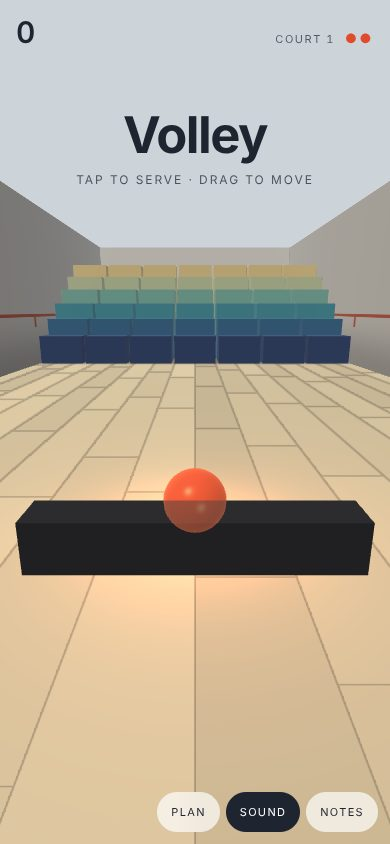
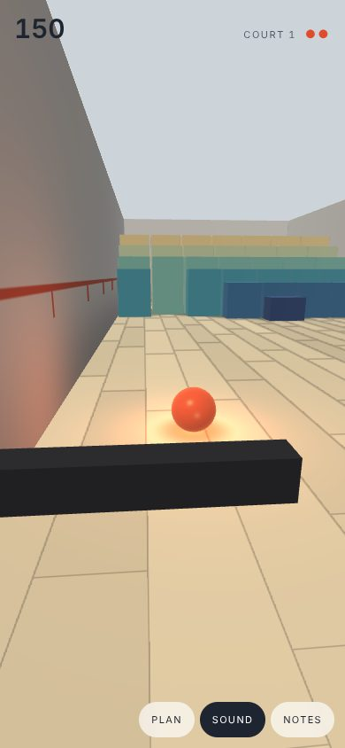
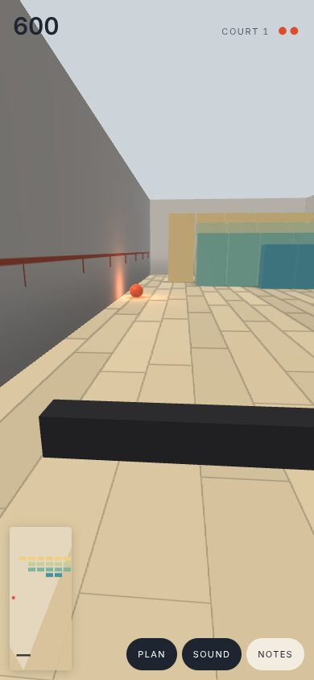
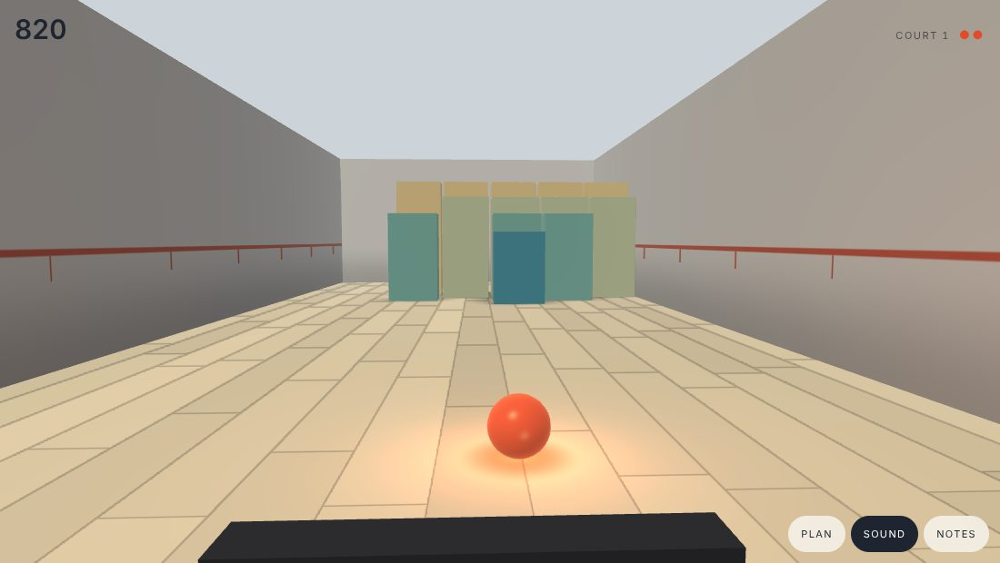
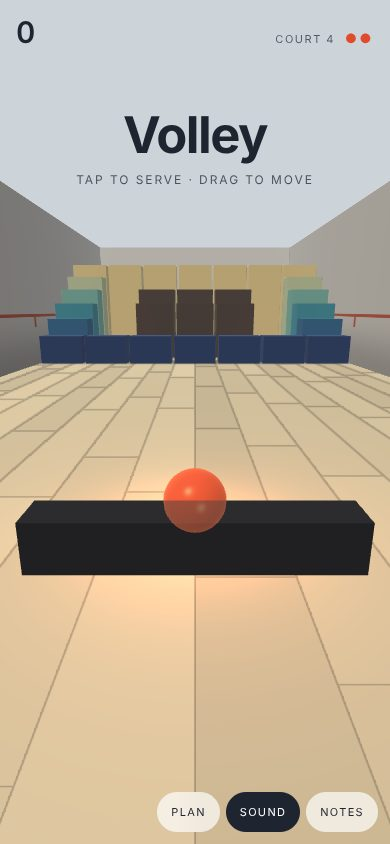

# Volley

> The brick-breaking game, seen from the paddle.

The game underneath is the plain one, unchanged: a ball, a paddle, rows of bricks, three walls, and the rule that where the ball meets the paddle sets the angle it leaves at. It is still played in a flat plan. The only thing moved is the eye. The plan is laid down as the floor of a court, and you look along it from where the paddle is: just behind and above it, going where it goes.

Drag anywhere to move (a drag across most of the screen is the whole court), tap to serve. On a keyboard: the arrows or A and D, and space. Three balls. **plan** puts the game as it is usually drawn in the corner; **sound** turns the sound off.

## What changes when the eye moves

From above, the game is about reading a line: you see the whole flight and put the paddle under its end. From the paddle, there is no line to read. Three things take its place.

**A ball that will hit you does not move across your view; it only grows.** This is the sailor's rule for a collision (constant bearing, decreasing range), and here it is the whole skill. Because the eye moves with the paddle, steering and looking are one act: move until the ball stops sliding sideways and it is yours.

**Depth has to be given.** A sphere on a plain floor could be anywhere along its line of sight. So the floor is boards running away from you, the walls carry a mark every two paces, the ball throws a shadow straight down and lights the boards and bricks near it. The light does most of the work: the patch on the floor is at the ball's true place, where the ball's own image is only at its bearing.

**You can't see everything.** The rows stand in rising tiers, so each shows over the one in front, but a ball that gets through to the lane behind them is hidden. It is drawn faintly through whatever covers it, and it is heard: every sound is placed left or right of you and quieter with distance, the rows ring higher the further back they are. The head turns part of the way toward the ball, never more than a glance, so a ball off a near side wall is not lost; if it is out of sight all the same, a mark at the screen's edge says which side.

The angle off the paddle is the one thing that is harder here than from above, and it is left so: you aim by where on the bat you take the ball, and from behind the bat that is a matter of a hand's width.

## The courts

The first is a full wall, six rows of seven. Then a colonnade (lanes straight through to the back), a chequer, and a keep: a ring round a dark core whose bricks take two. After those, each court is made from the seed, mirrored left to right, some bricks hard. The ball starts a little faster each court, quickens with every return and every brick, more for the far rows.

## How it is made

- `client/volley/sim.ts` is the game and nothing else: a circle against boxes in the plan, in fixed steps of 1/240 s, everything random from the seed. A seed and the same inputs are the same game. It also holds the stand-in player (it goes where the ball will cross the paddle's line, a little off-centre so its returns vary). Tested on its own in `devtools/volley.test.mjs`.
- `client/volley/draw.ts` draws it: every surface an axis-aligned box, instanced, one program; the ball a sphere. The dark round the feet of the bricks is a 9 by 8 texture of which bricks stand, sampled smooth. No assets, no libraries.
- `client/volley/main.ts` is the eye, the hand, the sound and the words.

## Flags

`seed` (a number, or a name like `moss-ford-7`), `level` (the court to start on), `auto` (the stand-in plays), `t` (run on this many seconds first, the stand-in playing), `still` (and hold there), `plan`, `mute`, `preview` (the index's card). `window.__volley.probe()` reports the game and the renderer.
